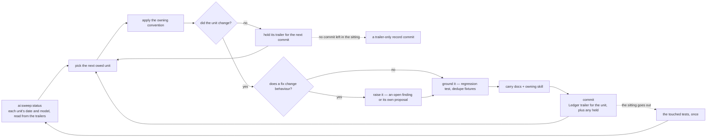

# One Pass

Read when running a sweep pass — picking a unit, committing it, carrying its trailer, and deciding when the checks run. The rules' one-liners are in `SKILL.md`; this page is the loop and every rule inside it.

- **Read the leaf, not the tree.** A pass loads `.agents/ledgers/README.md`, each question's own file (its folder's `README.md` where it keeps area notes, with that area's notes file), and the unit's bullet in `.agents/ledgers/areas/` (`references/ledger-files.md`).
- **Who decides the edit decides who runs the pass.** A sweep whose find recipe decides every edit runs one `haiku` agent per leaf, its prompt carrying the rule and asking back every site the recipe matched but left alone, and the main session reads the diffs; a sweep whose edits reading decides runs one `haiku` agent per unit, judging it for every question `pnpm ai:sweep:sample` lists beside it, once a pilot unit has set the carve-outs into the brief, with one verification per chunk rather than per agent. A judgement edge that two agents settle alone (whether a wrapper that only re-emits earns a component) is settled twice, differently, so the main session reconciles those from the reports after. Either way a leaf has **one writer**: no two agents touch the same file, so the questions judging one unit edit it one after the other. The main session reads each unit's diff and commits it before the next unit is judged.
- **Behaviour-preserving only.** A finding whose fix would change behaviour is raised, never folded in — the pass has to stay revertible as a unit. A unit that corrects toward the evidence (the reference or spec) is the one exception, and its commit body names the change.
- **One unit per commit**, so a pass that turns out wrong reverts cleanly, and the commit's trailer names the unit — `Ledger: <question> | <unit>`, the unit as its area bullet spells it, one trailer per question judged (`` Ledger: typescript | `apps/web/app/components/Styled` ``; the match ignores backticks and surrounding spaces, so either form dates the cell) — which is what dates the unit: no file holds the date, and `pnpm ai:sweep:status` reads it from the trailers whenever it is asked, reporting a trailer naming no unit, which `pnpm ai:land` refuses in any commit it is about to land. A rule change that invalidates coverage carries `Reopens:` instead (`references/standing-resume.md`, "A rule change reopens what its recipe finds"). **A unit the pass reads and leaves unchanged has no commit of its own**, so its trailer rides the sitting's next commit — the next unit's — and when the sitting has none left, a trailer-only record commit, `git commit --allow-empty`. Git keeps a commit that starts empty through `pull --rebase`, which is what `pnpm ai:land` runs, and trailers never conflict, so parallel agents each record their own.
- **Review and the finishing audit run per unit, before its commit.** The unit's diff is read against its rule and the `finishing` skill's audit is answered for that unit before it is committed, not once at the end of the sitting. A unit is committed and pushed as soon as it passes, so the work is saved as it goes; the touched tests stay at the end, as the bullet on the touched tests says.
- **Never sized to the review budget.** Each review run cuts its window at the file cap (the `review-queue` skill), so a session counts no files against it. A unit is split only when it is too large for one pass to read (`references/ledger-files.md`).
- **A trailer dates only what the pass read.** A sweep agent's report names its clean units and its raised units explicitly, and only those trailers are carried. A unit the agent never reached has no trailer, however undated its row is: dating it records a skim as coverage. A wrong date is cleared by a `Reopens:` trailer on a later commit, the one record there is.
- **Tests are part of the pass**, not a follow-up: anything the pass exposes gets the regression test it was missing, and repeated fixtures collapse (the `testing` skill, `references/test-helper-files.md`). A pass that only rewrote what typecheck already proves adds none — that is a result, not a gap.
- **The touched tests run once at the end of everything going out**, not per unit and not per file — several units swept in one sitting are one run, not one each (the `running-checks` skill, "One run, after all the edits going out", and the `package-scripts` skill, `references/check-suite.md`). Commits stay per unit regardless; commits are cheap and checks are not. **The end is the sitting going out — its last edit ready, not any one commit's push and never a unit finishing**: a unit is done when its commit lands, and a pass that runs the checks there has bought a green tree for a diff that is about to grow by everything the sitting has left.
- **Area boundaries, another session's files** — `references/windows-and-convergence.md`.
- **Skipped findings, with the reason, go in the commit message.** The ledger file lists units, not decisions — and never what a past pass changed, which git holds in full.
