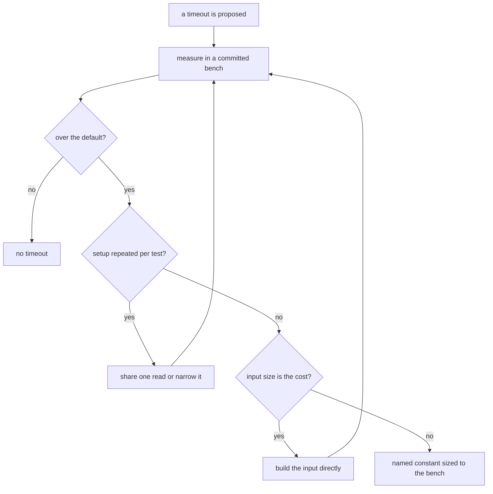

# Timeouts

A timeout is a claim: this test takes that long, and the default is too short for it. The claim is earned by a measurement, and the measurement is a committed benchmark, not a stopwatch. A timeout raised because a loaded CI shard was slow is not evidence; it hides the cost instead of measuring it.

## The ladder

1. **Measure the cost in a committed bench.** The speed gate is `.agents/skills/bench/references/speed-gate.md`: a timing belongs in a `*.bench.ts` whose `*.bench.md` is committed, and an ad-hoc stopwatch only locates where the time goes before the bench is written.
2. **Under the default, there is no timeout.** Vitest's default is five seconds. A slow run that passes is not a reason to add one.
3. **Over the default, find the setup that repeats.** A read of the whole tree done again per test, a `git ls-files` walk per check, a `pnpm pack` per package in sequence: the fix is one shared read per run, a read narrowed to the directory the check owns, or the packs run concurrently. Bench the setup again after it.
4. **Over the default, and the input is the cost.** A fixture that parses a long formula to build the tree it then tests spends its time in the parser, not the unit. Build the input directly where the test does not test the parser, and bench it again.
5. **Still over the default, after the setup and the input are right.** Promote it to a named constant in the owning suite's constants file, sized from the bench's magnitude with a margin, written as a Temporal duration. The shared tree-read constant is `TREE_READ_TIMEOUT_MS` in `scripts/src/workspace/constants.test.ts`; a suite-local one is a `const` in its `describe`.
6. **A timeout in a config file is repo-wide.** `apps/web/vitest.config.ts` and `packages/configuration/src/getVitestConfiguration.ts` set the defaults every suite inherits. A change there needs the measurement across the suites it would change, not one suite's.

The flow, as a diagram:

## What this round found, by magnitude

Repo prose records the size of a cost and what it changed, never the raw figures; those live in the reply and in the bench's own generated output.

- **The math compiler's long-list case.** The cost sat in parsing a formula of that length, which runs at a multiple of compile time. The tree is built directly, and no timeout was added. The committed compile bench carries the parse-to-compile ratio.
- **The tree-walking checks** (`citations`, `stackConfig`) each start with one listing of the working tree (`readSweepFilePaths`). Its committed bench shows a narrow pathspec costs about the same as the whole tree, so the scope of a check does not shorten it. Most of the listing is git's stat of every tracked file for the deleted check, which is inherent to reading the working tree. The checks stay on `TREE_READ_TIMEOUT_MS` until the listing is shared across a run rather than repeated per check.
- **`publishedFiles`** packed its packages one after another. Packing them concurrently moved the check from over the default to well under it, so its override was removed.
- **`staleNames`** keeps its long limit for the cold read before its cache exists; the warm read is well under the default.

## What the ladder does not cover yet

- The browser suites in `packages/genshin-world` (`Opening/Index.browser.test.ts`, `World/Screen/Index.browser.test.ts`) set their own `timeoutMs` for real UI waits. They have no bench yet.
- `packages/db-mock/src/createMockDb.test.ts` sets one minute on a single test. It has no bench yet.
- The repo-wide defaults in `apps/web/vitest.config.ts` and `getVitestConfiguration.ts` need a bench across the suites they govern before they change.
