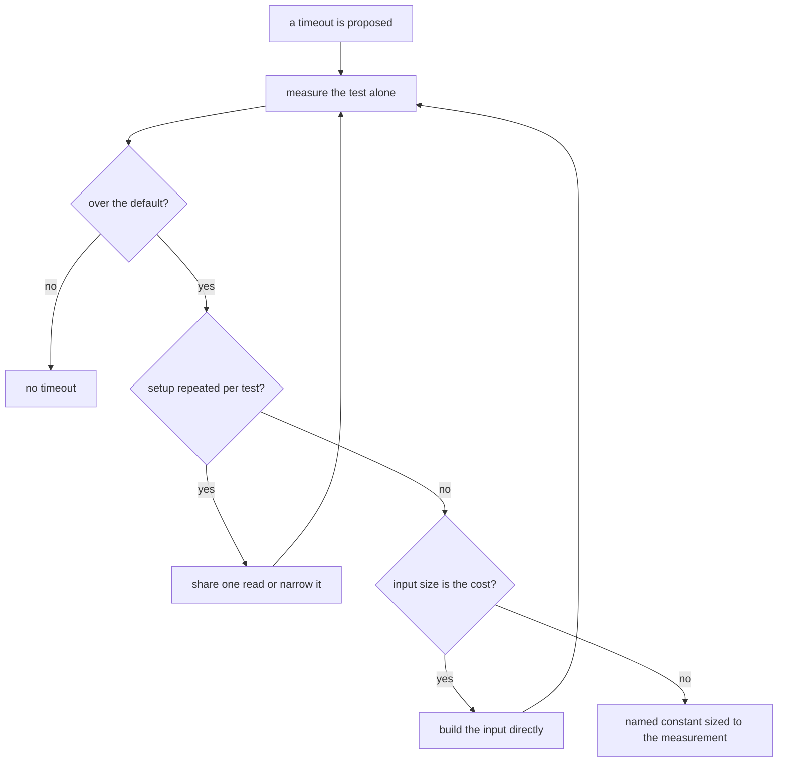

# Timeouts

A timeout is a claim: this test takes that long, and the default is too short for it. The claim is earned by a measurement, taken with nothing else running, and only after the setup and the input have been looked at. A timeout raised because a loaded CI shard was slow is not evidence; it hides the cost instead of measuring it.

## The ladder

1. **Measure the test alone, one file at a time.** `pnpm test <file> --run --fileParallelism=false`, with the JSON reporter for per-test durations (`references/running-the-suite.md`). A duration taken under the full parallel run is contention, not the test's cost.
2. **Under the default, there is no timeout.** Vitest's default is five seconds. A slow run that passes is not a reason to add one.
3. **Over the default, find the setup that repeats.** A read of the whole tree done again per test, a `git ls-files` walk per check, a `pnpm pack` per package in sequence: the fix is one shared read per run, or a read narrowed to the directory the check owns. Re-measure after it.
4. **Over the default, and the input is the cost.** A fixture that parses a long formula to build the tree it then tests spends its time in the parser, not the unit. Build the input directly where the test does not test the parser, and re-measure.
5. **Still over the default, after the setup and the input are right.** Promote it to a named constant in the owning suite's constants file, sized from the measurement with a margin, written as a Temporal duration and commented with the measured time. The shared tree-read constant is `TREE_READ_TIMEOUT_MS` in `scripts/src/workspace/constants.test.ts`; a suite-local one is a `const` in its `describe`.
6. **A timeout in a config file is repo-wide.** `apps/web/vitest.config.ts` and `packages/configuration/src/getVitestConfiguration.ts` set the defaults every suite inherits. A change there needs the measurement across the suites it would change, not one suite's.

The flow, as a diagram:

## What it looked like this round

Measured one file at a time on 2026-10-20, under the default of five seconds unless noted:

| Test                                                    | Measured             | Decision                                                                                                                   |
| ------------------------------------------------------- | -------------------- | -------------------------------------------------------------------------------------------------------------------------- |
| `compileMathExpression`, the 200,000-argument case      | about 1.7 s of tests | the fixture parsed a 1.4 MB formula four times (about 2 s each); the tree is built directly, and no timeout was added      |
| `citations`, every cited path exists                    | 7.3 s                | over the default; uses `TREE_READ_TIMEOUT_MS`; the per-token disk glob is the next setup to share                          |
| `publishedFiles`, pack no test                          | 9.8 s                | over the default; uses `TREE_READ_TIMEOUT_MS`; one `pnpm pack` per package runs in sequence, the next thing to parallelise |
| `stackConfig`, no stack file carries an encrypted value | 5.8 s                | over the default; uses `TREE_READ_TIMEOUT_MS`; two `git ls-files` walks, the next setup to share                           |
| `staleNames`, every cited code name resolves            | 22 s warm            | keeps its two-minute `STORE_READ_TIMEOUT_MS`, which covers the cold read before its `node_modules/.cache` exists           |

The five tree-walking tests that had no override and failed under the parallel run at five seconds are the ones the table's first three rows cover.

## What the ladder does not cover yet

- The browser suites in `packages/genshin-world` (`Opening/Index.browser.test.ts`, `World/Screen/Index.browser.test.ts`) set their own `timeoutMs` for real UI waits. They were not measured this round.
- `packages/db-mock/src/createMockDb.test.ts` sets one minute on a single test. It was not measured this round.
- The repo-wide defaults in `apps/web/vitest.config.ts` (thirty seconds for a test, five minutes for a hook) and in `getVitestConfiguration.ts` (one minute for a hook) need the same measurement before they change.
