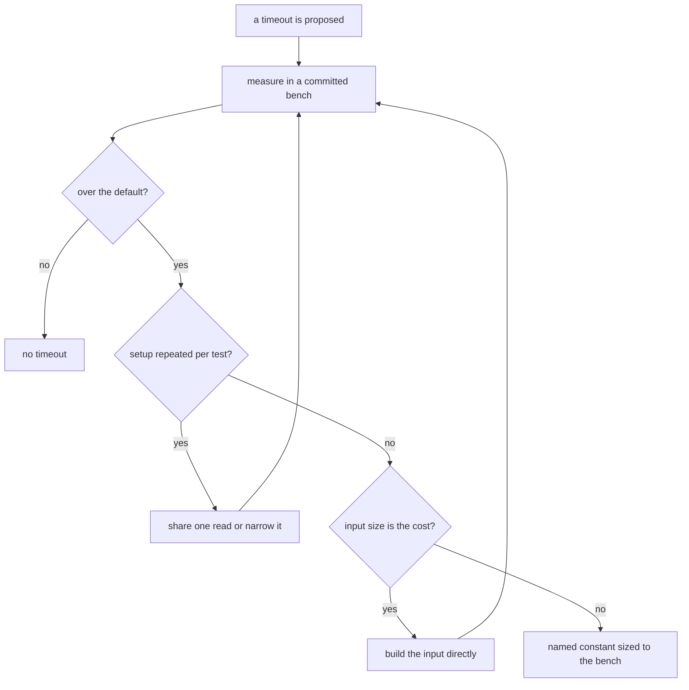

# Timeouts

Read when a test, suite or config sets a timeout, or a test fails with `Test timed out`. A timeout is a claim: this test takes that long, and the default is too short for it. The claim is earned by a measurement, and the measurement is a committed benchmark, not a stopwatch. A timeout raised because a loaded CI shard was slow is not evidence; it hides the cost instead of measuring it.

## The ladder

1. **Measure the cost in a committed bench.** The speed gate is the `bench` skill, `references/speed-gate.md`: a timing belongs in a `*.bench.ts` whose `*.bench.md` is committed, and an ad-hoc stopwatch only locates where the time goes before the bench is written.
2. **Under the default, there is no timeout.** The default is the one the suite's config sets: Vitest's five seconds in `scripts`, and the `testTimeout` `apps/web/vitest.config.ts` sets for the app. A slow run that passes is not a reason to add one.
3. **Over the default, find the setup that repeats.** A read of the whole tree done again per test, a `git ls-files` walk per check, a `pnpm pack` per package in sequence: the fix is one shared read per run, a read narrowed to the directory the check owns, or the packs run concurrently. Bench the setup again after it.
4. **Over the default, and the input is the cost.** A fixture that parses a long formula to build the tree it then tests spends its time in the parser, not the unit. Build the input directly where the test does not test the parser, and bench it again.
5. **Still over the default, after the setup and the input are right.** Promote it to a named constant in the owning suite's constants file, sized from the bench's magnitude with a margin, written as a Temporal duration. The shared tree-read constant is `TREE_READ_TIMEOUT_MS` in `scripts/src/workspace/constants.test.ts`; a suite-local one is a `const` in its `describe`.
6. **A timeout in a config file is repo-wide.** `apps/web/vitest.config.ts` and `packages/configuration/src/services/getVitestConfiguration.ts` set the timeouts every suite under them inherits. A change there needs the measurement across the suites it would change, not one suite's.

The flow, as a diagram:

Which suites carry an override, and the measurement each one rests on, is read off the tree with `git grep -n timeout` over the test files and the configs step 6 names.
