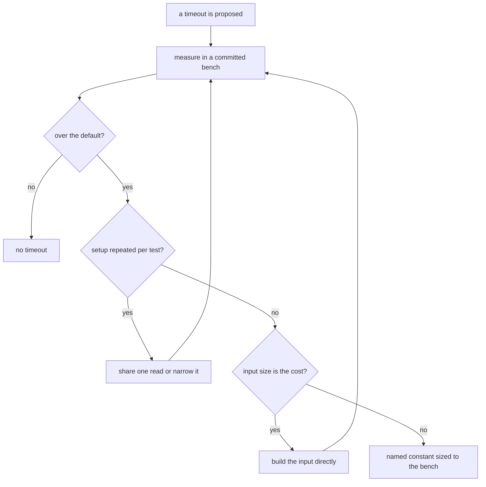

# Timeouts

Read when a test, suite or config sets a timeout, or a test fails with `Test timed out`. A timeout is a claim: this test takes that long, and the default is too short for it. The claim is earned by a measurement, and the measurement is a committed benchmark, not a stopwatch. A timeout raised because a loaded CI shard was slow is not evidence; it hides the cost instead of measuring it.

## The ladder

1. **Measure the cost in a committed bench.** The speed gate is `.agents/skills/bench/references/speed-gate.md`: a timing belongs in a `*.bench.ts` whose `*.bench.md` is committed, and an ad-hoc stopwatch only locates where the time goes before the bench is written.
2. **Under the default, there is no timeout.** Vitest's default is five seconds. A slow run that passes is not a reason to add one.
3. **Over the default, find the setup that repeats.** A read of the whole tree done again per test, a `git ls-files` walk per check, a `pnpm pack` per package in sequence: the fix is one shared read per run, a read narrowed to the directory the check owns, or the packs run concurrently. Bench the setup again after it.
4. **Over the default, and the input is the cost.** A fixture that parses a long formula to build the tree it then tests spends its time in the parser, not the unit. Build the input directly where the test does not test the parser, and bench it again.
5. **Still over the default, after the setup and the input are right.** Promote it to a named constant in the owning suite's constants file, sized from the bench's magnitude with a margin, written as a Temporal duration. The shared tree-read constant is `TREE_READ_TIMEOUT_MS` in `scripts/src/workspace/constants.test.ts`; a suite-local one is a `const` in its `describe`.
6. **A timeout in a config file is repo-wide.** `apps/web/vitest.config.ts` and `packages/configuration/src/getVitestConfiguration.ts` set the defaults every suite inherits. A change there needs the measurement across the suites it would change, not one suite's.

The flow, as a diagram:

## Where the overrides stand

Repo prose records the size of a cost and what it changed, never the raw figures; those live in the reply, the commit body, and the benches' own generated output.

- **Removed, measured under the default.** The math compiler's long-list case builds its tree directly, since the cost sat in the parser. `publishedFiles` runs its packs concurrently. The nine tree-walking checks that list the working tree once each, the git-fixture suites and the db-mock migration snapshot all run under the default when measured one file at a time, and `ledgerScopes` still passes the parallel workspace run at the default.
- **Kept on the shared tree-read constant.** Fifteen tree-walking checks take longer than the default in the parallel `scripts/src/workspace` run (`todos`, `restatedPointers`, `gcsimLinks`, `duplicateProse`, `sharedExportConsumers`, `lineEndings`, `controlCharacters`, `openspecLinks`, `openspecIndexes`, `citations`, `duplicateCode`, `toolchainVersionRestatements`, `constantScope`, `openspecValidate`, `runOnBullets`). The slowest is the one that sets the constant's margin. Their cost is the check's own reading of many files, not the listing, so a shared listing would not retire them.
- **Kept on a suite-local limit.** `nuxtModuleNativeLoad` spawns a node process per module entry, so it is not a tree read and takes its own `LOAD_TIMEOUT_MS` in its `describe`, sized with margin over one contended run rather than a committed bench.
- **Kept on the stale-names limit.** `staleNames` reads the installed packages' declarations cold before their cache exists, which is the read the limit covers. The source-name read is cached by file, and its committed bench records the warm read at a few seconds and the cold one at about twice that.
- **Kept on the type-measurement limit.** `typeBenchResults` measures the compiler over the repo. Its limit is oversized against its measured magnitude, and it stays until a bench across runs sizes it.

## What is not measured yet

- The browser suites in `packages/genshin-world` (`Opening/Index.browser.test.ts`, `World/Screen/Index.browser.test.ts`) set their own `timeoutMs` for real UI waits. They run in a browser that does not run locally, so they have no bench yet.
- The repo-wide defaults in `apps/web/vitest.config.ts` and `getVitestConfiguration.ts` need a bench across the suites they govern before they change.
