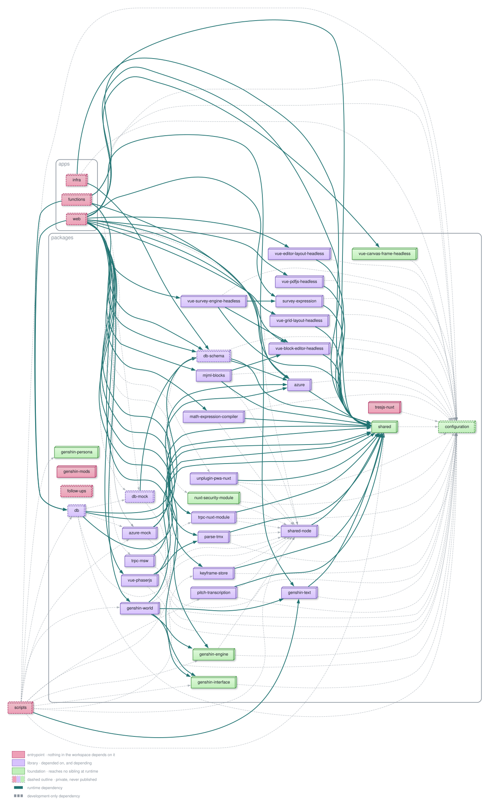

<p align="center">
  <a href="https://esposter.com" target="_blank" rel="noopener noreferrer">
    
  </a>
</p>

<h1 align="center">Esposter</h1>

<p align="center"><em>/ɛsˈpɒstər/ — "ess-POS-ter", the last two syllables as in "imposter"</em></p>

<p align="center"><strong>A nice and casual place for posting random things.</strong></p>

<div align="center">

[![Build Status][badge-ci]][url-ci]
[![Duplicate Code][badge-duplicates]][url-ci]
[![Repository Score][badge-score]][url-score]
[![OpenSSF Scorecard][badge-openssf]][url-openssf]
[![skills.sh installs][badge-skills]][url-skills]
[![Apache-2.0 licensed][badge-license]][url-license]

</div>

> **Experimental.** Every published package in this repository is experimental. Its exports, build entries and files may change or be removed in any release, including a minor release. See [Stability](openspec/specs/architecture/monorepo-tooling/design.md#stability-every-published-package-is-experimental).

## Table of Contents

- 🧱 [The Stack](#the-stack)
- 🏠 [Local Development](#local-development)
- 🧭 [Architecture](#architecture)
- 📦 [Packages](#packages)
- 🔌 [Claude Code Plugins](#claude-code-plugins)
- 🤝 [Community](#community)
- ⚖️ [License](#license)

---

## <a name="the-stack">🧱 The Stack</a>

### Toolchain

<table>
  <thead>
    <tr>
      <th width="2000" colspan="2">
      </th>
    </tr>
  </thead>
  <tbody>
    <tr>
      <td width="80" align="center" valign="top">
        <br />
        <a href="https://viteplus.dev/guide/">
          
        </a>
      </td>
      <td valign="top">
        <h3><a href="https://viteplus.dev/guide/">Vite+</a></h3>
        <p>
          The unified toolchain for the web: Vite, Vitest, oxlint, oxfmt and the <code>vp</code> command in one install.
        </p>
      </td>
    </tr>
  </tbody>
</table>

### Frontend

<table>
  <thead>
    <tr>
      <th width="2000" colspan="2">
      </th>
    </tr>
  </thead>
  <tbody>
    <tr>
      <td width="80" align="center" valign="top">
        <br />
        <a href="https://nuxt.com">
          
        </a>
      </td>
      <td valign="top">
        <h3><a href="https://nuxt.com/docs">Nuxt</a></h3>
        <p>
          The Intuitive Web Framework, based on Vue, with Pinia for state.
        </p>
      </td>
    </tr>
    <tr>
      <td width="80" align="center" valign="top">
        <br />
        <a href="https://vuejs.org">
          
        </a>
      </td>
      <td valign="top">
        <h3><a href="https://vuejs.org/guide/introduction.html">Vue</a></h3>
        <p>
          🖖 Vue.js is a progressive, incrementally-adoptable JavaScript framework for building UI on the web.
        </p>
      </td>
    </tr>
    <tr>
      <td width="80" align="center" valign="top">
        <br />
        <a href="https://0.vuetifyjs.com">
          
        </a>
      </td>
      <td valign="top">
        <h3><a href="https://0.vuetifyjs.com/">Vuetify 0</a></h3>
        <p>
          🐉 Headless building blocks for Vue, under the app's own UI library.
        </p>
      </td>
    </tr>
  </tbody>
</table>

### Backend

<table>
  <thead>
    <tr>
      <th width="2000" colspan="2">
      </th>
    </tr>
  </thead>
  <tbody>
    <tr>
      <td width="80" align="center" valign="top">
        <br />
        <a href="https://orm.drizzle.team">
          
        </a>
      </td>
      <td valign="top">
        <h3><a href="https://orm.drizzle.team/docs/overview">Drizzle ORM</a></h3>
        <p>
          TypeScript ORM that feels like writing SQL.
        </p>
      </td>
    </tr>
    <tr>
      <td width="80" align="center" valign="top">
        <br />
        <a href="https://www.postgresql.org">
          
        </a>
      </td>
      <td valign="top">
        <h3><a href="https://www.postgresql.org/docs/current/">PostgreSQL</a></h3>
        <p>
          PostgreSQL is a powerful, open source object-relational database system with over 35 years of active development that has earned it a strong reputation for reliability, feature robustness, and performance.
        </p>
      </td>
    </tr>
    <tr>
      <td width="80" align="center" valign="top">
        <br />
        <a href="https://trpc.io">
          
        </a>
      </td>
      <td valign="top">
        <h3><a href="https://trpc.io/docs">tRPC</a></h3>
        <p>
          🧙‍♀️ Move Fast and Break Nothing. End-to-end typesafe APIs made easy.
        </p>
      </td>
    </tr>
    <tr>
      <td width="80" align="center" valign="top">
        <br />
        <a href="https://zod.dev">
          
        </a>
      </td>
      <td valign="top">
        <h3><a href="https://zod.dev/">Zod</a></h3>
        <p>
          TypeScript-first schema validation with static type inference.
        </p>
      </td>
    </tr>
  </tbody>
</table>

### Infrastructure

<table>
  <thead>
    <tr>
      <th width="2000" colspan="2">
      </th>
    </tr>
  </thead>
  <tbody>
    <tr>
      <td width="80" align="center" valign="top">
        <br />
        <a href="https://www.pulumi.com">
          
        </a>
      </td>
      <td valign="top">
        <h3><a href="https://www.pulumi.com/docs/">Pulumi</a></h3>
        <p>
          Infrastructure as Code in any programming language.
        </p>
      </td>
    </tr>
  </tbody>
</table>

### Hosting & Domain Providers

<table>
  <thead>
    <tr>
      <th width="2000" colspan="2">
      </th>
    </tr>
  </thead>
  <tbody>
    <tr>
      <td width="80" align="center" valign="top">
        <br />
        <a href="https://www.namecheap.com">
          
        </a>
      </td>
      <td valign="top">
        <h3><a href="https://www.namecheap.com/support/knowledgebase/">Namecheap</a></h3>
        <p>
          ICANN-accredited domain name registrar providing domain name registration and web hosting.
        </p>
      </td>
    </tr>
    <tr>
      <td width="80" align="center" valign="top">
        <br />
        <a href="https://railway.app">
          
        </a>
      </td>
      <td valign="top">
        <h3><a href="https://docs.railway.com/">Railway</a></h3>
        <p>
          Infrastructure, Instantly.
        </p>
      </td>
    </tr>
  </tbody>
</table>

## <a name="local-development">🏠 Local Development</a>

Run these in order from the repository root. Each step that can fail ends in a check; do not continue past a failed one. An agent reads `AGENTS.md` next and starts every session with `pnpm ai:resume`.

1. **Symlinks.** The repository tracks symlinks. On Windows, turn on Developer Mode first. Then run one of these commands:

```bash
# Global setting, for all repositories
git config --global core.symlinks true

# Local setting, for this repository only
git config core.symlinks true
```

Check: the tracked symlinks open as links and not as text files. If they open as text, `git reset --hard` rewrites them. It discards uncommitted work, so push or commit first.

2. **Toolchain.** Install the global [Vite+](https://viteplus.dev/guide/) CLI, then the node and pnpm versions the repository pins:

```bash
vp env install
```

Check: `node -v` equals `.node-version`, and `pnpm -v` equals `packageManager` in `package.json`.

3. **Dependencies.**

```bash
pnpm i
```

Check: `pnpm i` exits with code 0.

4. **PostgreSQL.** Install [PostgreSQL + PgAdmin](https://www.postgresql.org/download). On macOS, run `brew install postgresql@18`. Run `brew install --cask pgadmin4` for PgAdmin. Then run `brew services start postgresql@18`. It keeps the server running across logins and reboots. Its binaries are in `/opt/homebrew/opt/postgresql@18/bin`. That folder is not on `PATH` until you add it. Check: the server answers on `localhost:5432`. The `esposter` database holds no data worth keeping, and `pnpm dev` runs its migrations.

5. **Environment.** Create `apps/web/.env` from `apps/web/.env.example`.

Check: the file `apps/web/.env` exists.

6. **Machine check.** The command prints a table of the tools and logins that this machine still lacks. Each row gives its install or login command. It prints the full table on every run. Run what the table lists, and rerun until the command exits with code 0:

```bash
pnpm ai:setup
```

Check: `pnpm ai:setup` exits with code 0.

7. **Run the app.** Build the workspace packages, then start the dev server on <http://localhost:3000>:

```bash
vp run build:packages
cd apps/web
pnpm dev
```

Check: <http://localhost:3000> answers.

### Production

```bash
pnpm build
pnpm -C apps/web preview
```

Deployment targets are in the [Nuxt deployment documentation](https://nuxt.com/docs/getting-started/deployment).

## <a name="architecture">🧭 Architecture</a>

Esposter is a pnpm workspaces monorepo. See [monorepo tooling](https://github.com/Esposter/Esposter/blob/main/openspec/specs/architecture/monorepo-tooling/design.md) for workspace script orchestration and publishing boundaries.
The Nuxt application uses the packages directly, through `workspace:*`.

For how AI sessions land their commits, and how those commits are reviewed before they reach `main`, see [the review docs](https://github.com/Esposter/Esposter/blob/main/openspec/specs/infra/review/design.md).

### Workspace Graph

[](https://github.com/Esposter/Esposter/blob/main/dependency-graph.svg)

The hue and tint of each node show the role its edges give it. The darkest nodes are what the repository ships. The lightest nodes are what the rest of the repository stands on. The key is drawn into the image.
To regenerate the graph, run this command from the repository root:

```bash
pnpm graph:gen
```

## <a name="packages">📦 Packages</a>

> [!WARNING]
> The published packages are built for this repository first. Use them at your own risk: their APIs may change in any release, without a deprecation period, in pursuit of better performance and simpler code.

| Package                                                                                                                   | Description                                                                                                                                                                                                                                 | Published |
| ------------------------------------------------------------------------------------------------------------------------- | ------------------------------------------------------------------------------------------------------------------------------------------------------------------------------------------------------------------------------------------- | :-------: |
| [`apps/functions`](https://github.com/Esposter/Esposter/tree/main/apps/functions)                                         | Serverless Azure Functions backend — push notifications, webhooks, EventGrid                                                                                                                                                                |     —     |
| [`apps/infra`](https://github.com/Esposter/Esposter/tree/main/apps/infra)                                                 | Pulumi infrastructure code and migration tools for Azure resources                                                                                                                                                                          |     —     |
| [`apps/web`](https://github.com/Esposter/Esposter/tree/main/apps/web)                                                     | Main Nuxt web application — frontend, server routes, tRPC API                                                                                                                                                                               |     —     |
| [`packages/agent-console-server`](https://github.com/Esposter/Esposter/tree/main/packages/agent-console-server)           | Agent console host — Claude Code sessions over a token-gated loopback WebSocket                                                                                                                                                             |     ✓     |
| [`packages/azure`](https://github.com/Esposter/Esposter/tree/main/packages/azure)                                         | Azure wire conventions — OData filter clauses, entity key casing, service limits                                                                                                                                                            |     ✓     |
| [`packages/azure-mock`](https://github.com/Esposter/Esposter/tree/main/packages/azure-mock)                               | Mock Azure service classes for local dev and testing                                                                                                                                                                                        |     ✓     |
| [`packages/configuration`](https://github.com/Esposter/Esposter/tree/main/packages/configuration)                         | Shared ESLint, TSConfig, and tsdown build configurations                                                                                                                                                                                    |     —     |
| [`packages/db`](https://github.com/Esposter/Esposter/tree/main/packages/db)                                               | Database connection utilities for Drizzle ORM, Azure Table, Blob, and WebPubSub                                                                                                                                                             |     —     |
| [`packages/db-mock`](https://github.com/Esposter/Esposter/tree/main/packages/db-mock)                                     | In-memory PGlite database factory for unit and integration tests                                                                                                                                                                            |     —     |
| [`packages/db-schema`](https://github.com/Esposter/Esposter/tree/main/packages/db-schema)                                 | Drizzle ORM schemas and migrations (PostgreSQL source of truth)                                                                                                                                                                             |     —     |
| [`packages/follow-ups`](https://github.com/Esposter/Esposter/tree/main/packages/follow-ups)                               | Claude Code plugin — a session's unfinished follow-ups written into a TodoList and drained until none is left                                                                                                                               |     —     |
| [`packages/genshin-engine`](https://github.com/Esposter/Esposter/tree/main/packages/genshin-engine)                       | Anime-style open-world engine for three.js WebGPU — toon materials, outlines, post-processing, world kits and music                                                                                                                         |     ✓     |
| [`packages/genshin-interface`](https://github.com/Esposter/Esposter/tree/main/packages/genshin-interface)                 | Genshin's 2D interface — the screen root, its units and pointer, and the pieces the game's screens share                                                                                                                                    |     ✓     |
| [`packages/genshin-mods`](https://github.com/Esposter/Esposter/tree/main/packages/genshin-mods)                           | Claude Code plugin — eight mods, five under one band and three guards: next steps, cache and usage with a one-click handoff, recording mode, a goal meter, a collision guard, a delegation guard, a disk-scan guard and a whole-index guard |     ✓     |
| [`packages/genshin-persona`](https://github.com/Esposter/Esposter/tree/main/packages/genshin-persona)                     | Claude Code plugin — a Genshin character picked by birthday, replies spoken in its own cloned voice                                                                                                                                         |     ✓     |
| [`packages/genshin-text`](https://github.com/Esposter/Esposter/tree/main/packages/genshin-text)                           | The game's own text in its fifteen languages — the language registry, a locale matcher, and the game's strings by text id                                                                                                                   |     ✓     |
| [`packages/genshin-world`](https://github.com/Esposter/Esposter/tree/main/packages/genshin-world)                         | Genshin's world on the engine — the region catalogue, each region's data, the TresJS components and the interface screens                                                                                                                   |     ✓     |
| [`packages/headless-block-editor`](https://github.com/Esposter/Esposter/tree/main/packages/headless-block-editor)         | A headless block editor: a typed node tree over a registry, the commands that edit it as JSON Patch operations, navigation and undo history, with no framework or DOM.                                                                      |     ✓     |
| [`packages/keyframe-store`](https://github.com/Esposter/Esposter/tree/main/packages/keyframe-store)                       | Content-addressed version store — zstd keyframes and deltas over any backend                                                                                                                                                                |     ✓     |
| [`packages/math-expression-compiler`](https://github.com/Esposter/Esposter/tree/main/packages/math-expression-compiler)   | Math expressions compiled once into a function of plain numbers — mathjs's numeric language, checked against its recorded answers with every deliberate difference listed                                                                   |     ✓     |
| [`packages/mjml-blocks`](https://github.com/Esposter/Esposter/tree/main/packages/mjml-blocks)                             | MJML's components as block types on the headless block editor — each component's attributes, defaults and nesting rules, a render to MJML's JSON form and source, and a read back from MJML, with no framework, DOM or MJML runtime.        |     ✓     |
| [`packages/nuxt-security-module`](https://github.com/Esposter/Esposter/tree/main/packages/nuxt-security-module)           | Nuxt security module for Nitro 3 and h3 2 — security headers, a nonce Content Security Policy, subresource integrity, CORS, basic auth, a rate limiter and a request size limit                                                             |     ✓     |
| [`packages/parse-tmx`](https://github.com/Esposter/Esposter/tree/main/packages/parse-tmx)                                 | Parser for Tiled Map Editor `.tmx` files                                                                                                                                                                                                    |     ✓     |
| [`packages/pitch-transcription`](https://github.com/Esposter/Esposter/tree/main/packages/pitch-transcription)             | The notes in a recording — Basic Pitch on ONNX Runtime, its readings turned into notes, bends and MIDI                                                                                                                                      |     ✓     |
| [`packages/shared`](https://github.com/Esposter/Esposter/tree/main/packages/shared)                                       | Shared TypeScript types, utilities, and error classes                                                                                                                                                                                       |     ✓     |
| [`packages/shared-node`](https://github.com/Esposter/Esposter/tree/main/packages/shared-node)                             | Node-only shared tooling — the machine-wide download cache, hidden-window child processes and benchmark reporting for vitest bench runs                                                                                                     |     ✓     |
| [`packages/survey-engine`](https://github.com/Esposter/Esposter/tree/main/packages/survey-engine)                         | The survey as a typed document on the headless block editor — its question kinds, the checks on a save and a runner of plain functions, with no framework or DOM                                                                            |     —     |
| [`packages/survey-logic`](https://github.com/Esposter/Esposter/tree/main/packages/survey-logic)                           | The survey's expression language — conditions, calculated values and validators over a survey's answers, checked against SurveyJS's recorded answers with every deliberate difference listed                                                |     —     |
| [`packages/tresjs-nuxt`](https://github.com/Esposter/Esposter/tree/main/packages/tresjs-nuxt)                             | TresJS for Nuxt — a Nuxt module that auto-imports the TresJS core API, registers TresCanvas for client and server, and registers every installed @tresjs package's components and composables, with no devtools UI of its own.              |     ✓     |
| [`packages/trpc-msw`](https://github.com/Esposter/Esposter/tree/main/packages/trpc-msw)                                   | tRPC for Mock Service Worker — every transport answered by tRPC's own handlers                                                                                                                                                              |     ✓     |
| [`packages/trpc-nuxt-module`](https://github.com/Esposter/Esposter/tree/main/packages/trpc-nuxt-module)                   | tRPC for Nuxt — a module registering the router's HTTP and WebSocket handlers, with composables over `useAsyncData`                                                                                                                         |     ✓     |
| [`packages/unplugin-pwa-nuxt`](https://github.com/Esposter/Esposter/tree/main/packages/unplugin-pwa-nuxt)                 | Nuxt PWA module on unplugin-pwa — a service worker built by the app, its manifest and its client plugin, for Nuxt 5 and Nitro 3 only                                                                                                        |     ✓     |
| [`packages/vue-canvas-frame-headless`](https://github.com/Esposter/Esposter/tree/main/packages/vue-canvas-frame-headless) | A headless canvas frame: an isolated document at a width, scaled down to fit a narrower pane, with its styles adopted into it, and no styling of its own.                                                                                   |     ✓     |
| [`packages/vue-grid-layout-headless`](https://github.com/Esposter/Esposter/tree/main/packages/vue-grid-layout-headless)   | A headless grid: the placement of items on a grid of cells, and the pointer gestures that move and resize them, with no styling.                                                                                                            |     ✓     |
| [`packages/vue-pdfjs-headless`](https://github.com/Esposter/Esposter/tree/main/packages/vue-pdfjs-headless)               | Headless Vue composables over pdfjs-dist: a document's loading, a page's drawing and the viewer's state, with no styling and no renderer of its own.                                                                                        |     ✓     |
| [`packages/vue-phaserjs`](https://github.com/Esposter/Esposter/tree/main/packages/vue-phaserjs)                           | Phaser game engine integration for Vue                                                                                                                                                                                                      |     ✓     |
| [`scripts`](https://github.com/Esposter/Esposter/tree/main/scripts)                                                       | The repository's own tooling — workspace graph, dependency report, sweep scans                                                                                                                                                              |     —     |

## <a name="claude-code-plugins">🔌 Claude Code Plugins</a>

This repository is also a Claude Code plugin marketplace named `esposter`. It is declared in [`.claude-plugin/marketplace.json`](https://github.com/Esposter/Esposter/blob/main/.claude-plugin/marketplace.json). To add the marketplace, use the repository's GitHub name. To install a plugin, use its name and the marketplace name:

```bash
claude plugin marketplace add Esposter/Esposter
claude plugin install genshin-persona@esposter
claude plugin install genshin-mods@esposter
```

| Plugin                                                                                       | What it does                                                                                                                                                                                                                                                                                                                                                                                                                                                                                                                                                                                                                |
| :------------------------------------------------------------------------------------------- | :-------------------------------------------------------------------------------------------------------------------------------------------------------------------------------------------------------------------------------------------------------------------------------------------------------------------------------------------------------------------------------------------------------------------------------------------------------------------------------------------------------------------------------------------------------------------------------------------------------------------------- |
| [`genshin-mods`](https://github.com/Esposter/Esposter/tree/main/packages/genshin-mods)       | Eight mods. Five sit under one band above the prompt. Waypoints gives the next steps, one press each. Resin gives cache, context, limits and cost, with warm, compact and a one-click handoff. Veil is the recording mode. Commission gives a goal's task list and clock. Ward asks a question before editing a file another session just changed. The other three are guards. A delegation guard nudges a run of lookups toward a haiku agent. A disk-scan guard refuses a Bash scan from a root or home folder. A whole-index guard refuses a git command over the whole index while another session shares the checkout. |
| [`genshin-persona`](https://github.com/Esposter/Esposter/tree/main/packages/genshin-persona) | The plugin speaks as the Genshin Impact character whose birthday is nearest to today. Each answer opens with a spoken line. The rest of each answer is plain prose. The plugin reads each reply aloud in the character's own cloned voice.                                                                                                                                                                                                                                                                                                                                                                                  |

A plugin here is an ordinary workspace package. It is formatted, linted, tested and dependency-bumped with every other package. A merge to `main` releases it. An installed copy follows the marketplace on the next plugin update. For how plugins are built, and what they deliberately do not do, see the [Claude interface](https://github.com/Esposter/Esposter/tree/main/openspec/specs/infra/claude-interface) page.

## <a name="community">🤝 Community</a>

We welcome contributions from everyone and are committed to maintaining a friendly, safe, and welcoming community. Start with the [Contributing guide](CONTRIBUTING.md), which also lists the recommended editor extensions. Please see our [Code of Conduct](CODE_OF_CONDUCT.md) and [Security Policy](SECURITY.md) for more information.

## <a name="license">⚖️ License</a>

This project is licensed under the [Apache-2.0 license](https://github.com/Esposter/Esposter/blob/main/LICENSE).

[badge-ci]: https://github.com/Esposter/Esposter/actions/workflows/CI.yaml/badge.svg?event=push&branch=main
[url-ci]: https://github.com/Esposter/Esposter/actions/workflows/CI.yaml?query=event%3Apush+branch%3Amain
[badge-duplicates]: https://img.shields.io/badge/duplicate%20code-0%20clones-brightgreen
[badge-score]: https://img.shields.io/badge/score-95%2F100-brightgreen
[url-score]: https://github.com/Esposter/Esposter/blob/main/SCORE.md
[badge-openssf]: https://api.scorecard.dev/projects/github.com/Esposter/Esposter/badge
[url-openssf]: https://scorecard.dev/viewer/?uri=github.com/Esposter/Esposter
[badge-skills]: https://skills.sh/b/Esposter/Esposter
[url-skills]: https://skills.sh/Esposter/Esposter
[badge-license]: https://img.shields.io/github/license/Esposter/Esposter.svg?color=blue
[url-license]: https://github.com/Esposter/Esposter/blob/main/LICENSE
