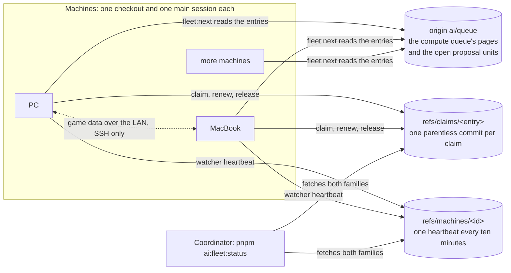

# Fleet

Machines pull work; nothing pushes it to them. Each machine keeps a profile saying what it is and which areas it is lent, each unit of work names the capabilities it needs, and a claim is a git ref on origin saying which machine works a unit. The coordinator writes the entries and settles the calls it is asked for. It never assigns work by message, never reads a report from each machine, and never names a machine in a rule, so adding a machine costs the coordinator nothing. The procedure an agent follows (commands, lanes, worktrees, the game-data copy) is the throughput skill's `references/fleet.md`; this page is the design those rules serve.

## How the pieces fit

Git is the only coordination. A claim is created by pushing a parentless commit to a ref that does not yet exist, so origin refuses every second create and exactly one machine wins. A renewal and a stale takeover are pushes with an explicit lease, so a machine never overwrites a commit it has not read. The queue branch `ai/queue` is never touched by a claim, so claiming starts no CI run.

## Machines

A machine's profile is `~/.esposter/machine.json`, written by `pnpm ai:fleet:profile`:

- `id`, the name the machine's claims and heartbeat carry. A new profile takes the hostname.
- `areas`, the areas the user lent the machine for. A new profile is lent every area. An area a machine was not lent is never worked, however idle it is.
- `capabilities`, read off the machine each run: its operating system, `game-install` when the game's asset blocks are present, `game-exports` when the parity exports exist, and `media-engine` where FFmpeg lists Direct3D acceleration. `parity-page` is not detected, so the user sets it, and a capability the user set is kept.

The profile's `id` and `areas` are never overwritten once the user has set them.

## Entries

An entry is one unit of work a machine may take, from two sources, both read off `ai/queue` as origin holds it, fetched fresh. The checkout's own copy is never read: one behind origin still lists an item another machine finished and deleted, and would offer it again.

- **The compute queue.** Each open item under the **Queue** heading of a page in `apps/web/content/docs/genshin/compute/` has an id in braces and its needs after `needs`. Its written paths are its touch set. An item under **Waiting** is not offered.
- **The open proposal units** under `apps/web/content/docs/proposals/<area>/`, the units `pnpm ai:proposals:report` reads. A unit's touch set is its Key files table plus the `touches` globs its frontmatter names, and a unit with a `waiting` blocker is not offered.

An entry is taken when the machine has its needs, its area is lent, it is not waiting, no live claim holds it, and its touch set overlaps no live claim's. Two entries whose paths do not overlap run in parallel on different machines; two that do wait for each other. Nothing takeable means the machine stays idle.

## Claims

- **A claim is a ref.** A claim pushes a parentless commit of the empty tree to `refs/claims/<id>`, its message naming the machine, the worker, the entry, when it was claimed and renewed, and the load at that moment. The push that wins creates the ref; a push that is refused because the ref exists names the holder.
- **Holders are machine and worker pairs.** A machine runs several workers, and a claim held by one of them reads as held to the others on the same machine.
- **A holder renews every ten minutes**, with a new commit leased from the claim the remote holds at that moment. A renewal stops when the ref is gone, or when another holder has it.
- **A network that drops never ends a hold.** Every call to origin's fleet refs, a push, a fetch or an `ls-remote`, is killed past `FLEET_REF_TIMEOUT_MILLISECONDS`, a bound well above a healthy call and well inside the renewal interval, because a network that stalls mid-call (a laptop put to sleep, Wi-Fi dropped) otherwise leaves git waiting on its transport for hours. A renewal that fails or is killed is logged and tried again at the next interval. A failed push is judged by where the remote holds the ref afterwards: at the new commit it landed, and still at the leased one nothing refused it, so a renewal that only timed out is retried rather than read as the claim moving.
- **Silence past thirty minutes frees a claim.** An unrenewed claim is replaced under the same explicit lease, so two machines reclaiming it cannot both land.
- **A miss stays.** A miss is written into the claim and never goes stale, so the entry waits for the coordinator's call and its paths stay held.
- **A finished entry releases its claim.** The landing commit removes the entry from its page, and the claim's ref is then deleted, which ends the hold.

## Load is read, not reported

A machine's watcher pushes `refs/machines/<id>` every ten minutes: a parentless commit carrying the machine's latest sample of CPU, GPU, free memory and platform, and the last commit the machine landed on `ai/queue`, as its sha and author date, read from git rather than kept in a file. A push that fails, or stalls past the same bound, is one logged line, and the watcher keeps sampling and pushes again at the next interval. The coordinator's status command fetches every claim and heartbeat and prints each machine's last sample, what it last landed and each claim's holder and age. It reads a fixed number of refs regardless of how many machines there are, which is what keeps its cost flat as the fleet grows.

An agent lands its commits on `ai/queue` with its own loop, the explicit action [no polling](/docs/architecture/no-polling) names as the trigger. The landed commit shows in its machine's heartbeat, so one machine sees another's progress from the heartbeat, with no message.

## Game data is never shared through a service

No export or recording is ever committed, published or sent to a hosted service. A machine's first route to the game data is the game itself, downloaded from HoYoverse's official CDN and extracted locally, so it needs no other machine. A copy between machines on the local network is the faster route, and it runs only over SSH, authenticated and encrypted. A machine off the network gets its game exports the same way, from the CDN, so until it holds them it takes only the entries that need no game data. The copy's procedure and the folders it moves are the throughput skill's `references/fleet.md`.

## Key files

| File                                                  | Role                                                                                                     |
| :---------------------------------------------------- | :------------------------------------------------------------------------------------------------------- |
| `scripts/src/fleet/profile/index.ts`                  | Writes the machine's profile from what it detects, keeping the id and areas the user set                 |
| `scripts/src/fleet/claim/index.ts`                    | Claims an entry as a ref on origin, exit 0 when won and exit 1 naming the holder                         |
| `scripts/src/fleet/hold/index.ts`                     | Claims an entry, then renews the claim every ten minutes until it is released                            |
| `scripts/src/fleet/release/index.ts`                  | Deletes an entry's claim, or with a miss keeps it as the holder's final word                             |
| `scripts/src/fleet/next/index.ts`                     | Claims the first entry this worker may take and prints its id and worker                                 |
| `scripts/src/fleet/status/index.ts`                   | Fetches every claim and heartbeat and prints the machines and the claims                                 |
| `scripts/src/fleet/data/index.ts`                     | The `ai:fleet:data` command: manifest, files, pull and push over ssh                                     |
| `scripts/src/services/fleet/selectTakeableEntries.ts` | Selects the entries a machine may take from its profile and the live claims                              |
| `scripts/src/services/fleet/claimFleetEntry.ts`       | Wins a claim with a plain push, adopts its own, or takes over a stale one with an explicit lease         |
| `scripts/src/services/fleet/pushFleetRef.ts`          | Points a fleet ref at a commit under a lease, and reads a failed push by where the remote holds the ref  |
| `scripts/src/services/fleet/runFleetRefGit.ts`        | Runs a git call to origin's fleet refs under the fleet's bound, so a stalled network fails it            |
| `scripts/src/services/fleet/parseComputeQueue.ts`     | Reads one compute page's open items, with their ids, needs and written paths, under its queue heading    |
| `scripts/src/services/fleet/readComputeQueue.ts`      | Reads every compute page, and throws on an id two pages share                                            |
| `scripts/src/services/fleet/readQueueFiles.ts`        | Reads a folder's files off origin's `ai/queue` in one `git cat-file --batch`, never off the checkout     |
| `scripts/src/services/machine/readLastPush.ts`        | Reads the last commit this machine's git identity landed on origin/ai/queue, which its heartbeat carries |
| `scripts/src/services/machine/watchMachine.ts`        | Samples the machine each minute and pushes its heartbeat every ten minutes                               |
| `apps/web/content/docs/genshin/compute/`              | The compute queue's pages, whose items the fleet takes                                                   |
