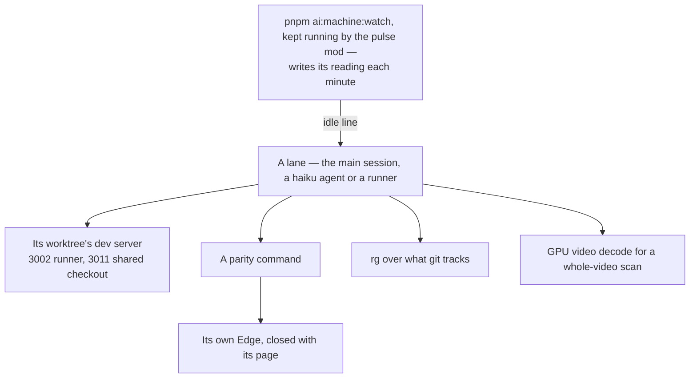

# Machine efficiency

The work on a machine is many agents and a few long runners sharing one machine's cores, GPU and memory: the PC (Windows 10, many cores, about 32 GB) or the M1 MacBook Air (four performance and four efficiency cores, 16 GB, fanless). The rules an agent follows are in the `throughput` skill (`.agents/skills/throughput/references/machine-efficiency.md`); this page covers what each one buys and why it is shaped the way it is.

## How the work runs

A **lane** is one thing doing work on the machine: the main session, a `haiku` agent in a wave, or a compute-queue runner. Every lane gets the same few shared resources, and four rules keep them from stacking up:

- **Each worktree serves its own parity page.** A runner's worktree starts its dev server on port 3002, and the shared checkout's page is served once on 3011 for the main session. A server holds its memory flat across page loads, so one per lane costs little.
- **Each command launches its own browser.** A parity command opens an Edge for its own life and closes it with its page, so no browser outlives the command that started it and none grows across pages.
- **The session bounds the heavy runs it starts.** A typecheck, a test run or a world render runs as its plain command. A multi-task run takes vp's `--concurrency-limit`, which defaults to four. A whole-workspace typecheck once held 10.7 and 12.6 GB and took free memory to 0.5 GB, so a one-off run that needs a heap cap sets `NODE_OPTIONS` itself. A package build is a `vp run` task that lasts seconds and replays from its cache, so it waits behind no other run.
- **A worktree commit borrows the main checkout's tools.** The pre-commit formatter runs from the main checkout's install, so a fresh worktree needs no install of its own for its commit, and the hook runs no check.
- **The machine watcher holds the rest.** The machine watcher (`pnpm ai:machine:watch`), which the [pulse mod](/docs/infra/claude-interface/genshin-mods/pulse) keeps running, takes the machine's claim, a `watcher.lock` file holding its process id, before its first sample, so a second watcher started beside it exits; the claim is removed on exit and taken over only once its process is gone. It prints an idle line when the machine has room, and nothing acts on that line by itself: a session asks `ai:fleet:next` for work when it has room for an entry, which may find none. It also pushes the machine's heartbeat, a `refs/machines/<id>` commit every ten minutes carrying its CPU, GPU and free memory, which `pnpm ai:fleet:status` reads for the whole fleet ([Fleet](/docs/architecture/fleet)); a failed push, a stalled one killed at the fleet's bound included, prints one line and the watcher carries on.

## What each mechanism buys

Each row is the magnitude the mechanism is kept for. The readings behind a row live with the artifact that holds them, not here.

| Mechanism                                                        | Magnitude                                                                                                                                       |
| :--------------------------------------------------------------- | :---------------------------------------------------------------------------------------------------------------------------------------------- |
| One dev server per lane                                          | Flat memory across page loads, so one per lane costs a fixed sliver of RAM, not a sliver per page                                               |
| Each command's own Edge                                          | Its memory is released when its page closes, so a shared browser's growth across pages never builds up                                          |
| One-off checks, not a standing watcher                           | A check costs a small fraction of the memory-time an always-on watcher holds, so the watcher pays only for a very high check rate               |
| The parity directory under `~/Esposter.noindex` (macOS)          | Spotlight stops indexing the extraction, which adds over a million files per run; `~/Esposter` is a symlink to it, so every path still resolves |
| `rg` over `grep -r` from the repository root                     | Two orders of magnitude faster, and it skips what git does not track                                                                            |
| GPU video decode for a whole-video scan                          | Several times faster than a CPU decode at full size, since the scan needs a low-resolution luma plane                                           |
| GPU vocoder for the persona's spoken lines (DirectML on Windows) | Most of the CPU time of a line is moved off the CPU; the language model stays on WebGPU, since DirectML rejects a slice in it                   |
| Surface statistics on the parity page's GPU                      | Several times less wall time and far less Node CPU than the CPU pass, with every printed figure matching it                                     |
| Colour pass's label similarity on the same GPU                   | A smaller share of the Surface pass's wall time and about half its Node CPU, with every printed figure unchanged                                |
| Spectrogram once per signal in `scoreShapedMusic`                | About a third of the STFTs per call, with every hashed output unchanged                                                                         |
| Twiddle table in `transformFourier`                              | Under half the time per transform, with every output bit-identical                                                                              |
| `notes` on one parity page, the game read once                   | One browser launch in place of one per segment, and each segment's game read and spectrogram once, with the written output identical            |

The one-off mechanisms that were tried and removed are not kept here: a mechanism that was measured and dropped has no rule left to state. The GPU rows measure the scan's time alone; a peak memory figure for the decodes is not recorded.

## Key files

| File                                                                          | Role                                                                                                                                                 |
| :---------------------------------------------------------------------------- | :--------------------------------------------------------------------------------------------------------------------------------------------------- |
| `.agents/skills/throughput/references/machine-efficiency.md`                  | The rules an agent follows: one check per package, search and long-run placement                                                                     |
| `scripts/src/machine/watch/index.ts`                                          | Watches the CPU, GPU and free memory, writes its reading to the state file, prints the idle and tight lines, sweeps orphans and pushes the heartbeat |
| `scripts/src/services/genshinParity/shared/openParityPage.ts`                 | Launches the page's own Edge with the flags an unlimited frame rate needs, and closes it with the page                                               |
| `scripts/src/services/genshinParity/shared/constants.ts`                      | The page's port, `GENSHIN_PARITY_PORT`, 3011 for the shared checkout and 3002 for a runner                                                           |
| `packages/genshin-world/parity/vite.config.ts`                                | The parity page's dev server, which each worktree serves on its own port                                                                             |
| `packages/genshin-world/parity/surfaceStatistics/computeSurfaceStatistics.ts` | The surface statistics reduced on the parity page's WebGPU device: the blurs as compute passes, only partial sums read back                          |
| `packages/genshin-world/parity/surfaceStatistics/computeLabelSimilarity.ts`   | The colour pass's label similarity on the same device, each scale's term map read back                                                               |
