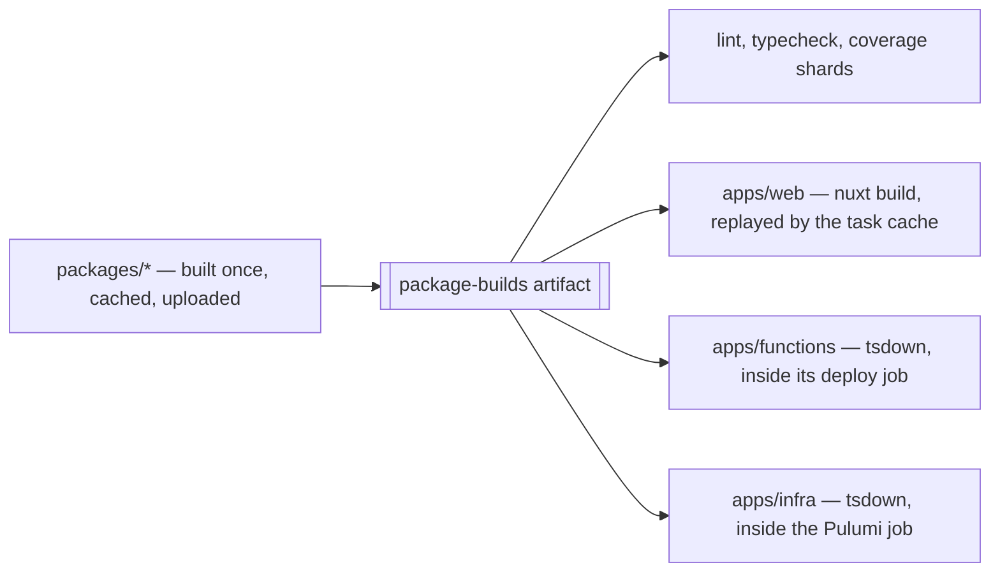
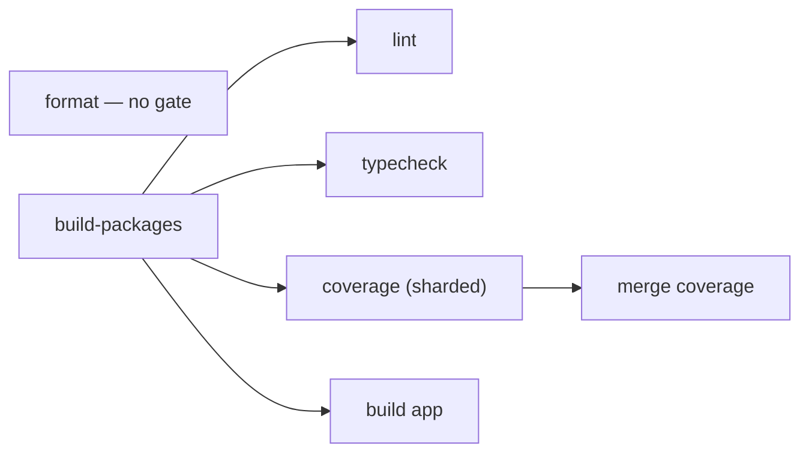

# Monorepo Tooling

How workspace package scripts, dependency installs, publishing, and CI runners are organized.

## Workspace layout

The workspace has two product roots, and the split is a single question: **does anything import it?**

- **`apps/*`** — what the repo runs. `apps/web` (Nuxt + Nitro), `apps/functions` (Azure Functions), `apps/infra` (the Pulumi program). Nothing imports one, so an app's `dist` is deploy payload rather than a dependency, and an app is never a version anyone resolves.
- **`packages/*`** — what the repo imports. Every library, published or private, is here and only here.

That is a boundary the toolchain can address, which is the point of it: **every selector names the set it wants rather than the members it does not.** `--filter "./packages/*"`, the positional `packages` for a lint pass, `--project "packages/*"` for a Vitest run. A library added later is inside all of them and an app added later is outside all of them, with nothing edited either way — where a `!@esposter/web` exclusion had to learn each new name, in configs where getting it wrong is silent.

Two mechanics make those selectors work. Vitest names a project after its nearest manifest unless the config sets `test.name`, which would make the names package identities (`@esposter/db`, `azure-mock`) that no pattern over the tree can select — so the shared factory names each project after its own workspace-relative directory (`getVitestProjectName`), and the app's `defineVitestProject` config spreads the factory's test options, the name among them. `--project` patterns are wildcards over that name and their `*` compiles to `.*`, so a pattern crosses a `/` like any other character. And a **single** project needs no filter at all: `pnpm -C apps/web build` names the directory, leaving `--filter` for what only it can say — a set (`./packages/*`) or a dependency closure (`@esposter/web^...`, which is how `pnpm build` reaches the app's libraries without naming one).



The artifact carries libraries only, and that follows from the same boundary: nothing imports an app's `dist`, so shipping it through the artifact would hand unread deploy payload to lint, typecheck, the app build and every coverage shard. Each app builds in the workflow that ships it instead, inside the install it already performs — which also means a deploy never reads its payload out of a cache entry recorded for someone else's purpose. That sequence — install the app's closure, build the libraries it links against, then build the app — is the `build-app` action, which the Pulumi preview and the Functions deploy call with the app's name. The cost is one line long: a deploy pays its own library and tsdown builds rather than inheriting them from a hit. Deploys are the rare path and those builds are seconds.

Nothing _imports_ an app's `dist`, but two suites read one: the Functions package counts the `app.*` registrations in its bundle — the only check that catches a bundler tree-shaking every trigger away — and `apps/functions` and `apps/infra` both snapshot their bundle's size. So the coverage job is a third workflow that ships an app's build, and it builds those two the same way a deploy does, from the source the shard checked out. That is stricter than carrying them in the artifact could be: the artifact is built from `packages/` alone, so a bundle in it would go stale the moment an app's own source changed, and the count would then be asserted against the wrong build. Each shard repeating a tsdown build measured in seconds is the price, and the web app is not among them — nothing reads its output.

## Package management

Esposter uses **pnpm workspaces** as the package manager and workspace script runner. Workspace packages are declared in `pnpm-workspace.yaml`, and package versions are centralized in the root catalog.

Use the root `package.json` scripts as the canonical entry points for cross-package work. Package-local scripts should stay small and predictable (`build`, `lint`, `lint:fix`, `typecheck`, `test`) so root recursive commands can compose them. Coverage is not a package-local script — it is owned entirely by the root `vitest` `projects` run.

The root scripts run their tools directly, on every platform.

## TypeScript compiler

Every package's `typecheck` is plain `tsc` — `vue-tsc` where the package holds `.vue` files — and the `typescript` package itself is a pnpm `overrides` alias onto [`typescript-native-bridge`](https://github.com/johnsoncodehk/typescript-native-bridge), a fork that keeps the classic TypeScript API surface while running the Go compiler in-process behind it. The override is the whole switch: `vue-tsc`, `@vue/language-core` and the editor's `tsserver` all consume that classic API, so one entry accelerates every one of them without any of them having to move to the TypeScript 7 API they cannot yet read. That is why there is no separate native-compiler dependency and no `tsgo` invocation left in any script. A run announces itself with `▎ TNB ACTIVE` on stderr — the line's absence means stock TypeScript loaded instead, and the override is not taking effect.

The trade is memory for wall-clock: the Go state shares the Node process, so peak RSS is several times a stock run's while the JS heap stays lower, and the app's `vue-tsc` pass loses roughly a third of its wall-clock. Diagnostics are the Go compiler's, not stock TypeScript's, so an error's wording may differ from what the same code reports under the `typescript` version the catalog names.

`oxlint-tsgolint` is unaffected either way — it ships its own Go binaries as optional dependencies and never loads the `typescript` package, so the type-aware lint pass neither gains nor loses from the override.

## Recursive script orchestration

Use pnpm recursive commands instead of Lerna Lite for running scripts across packages.

Common patterns:

```bash
pnpm -r build
pnpm -r --parallel lint
pnpm -r --parallel typecheck
pnpm -r --filter "./packages/*" build
pnpm --filter "@esposter/web..." build
pnpm -C apps/web build
```

Guidelines:

- Tests are the exception: `test`/`coverage` run through one root `vitest.config.ts` `projects` config (a single `vitest run`), not a recursive fan-out, so the whole suite shares one run, one coverage report, and one `--shard` axis.
- A recursive script is invoked bare (`pnpm -r --parallel lint`), never through `run`, which `packageScripts.test.ts` enforces. `typecheck` is a `vp run` task with no root script of the same name, so knip reads its bare argument as a binary; it sits in knip's `ignoreBinaries` instead.
- Use `--parallel` for independent checks such as linting and typechecking. Never for `build` — `--parallel` is what discards the topological order, and a package would build against a sibling's `dist` that is mid-write or absent.
- Output interleaving is settled by environment, not by the scripts. `pnpm -r` runs the graph's independent packages concurrently regardless of `--parallel`, so a failure's stack arrives spliced with another package's output; `aggregate-output` buffers each package into a contiguous block instead. A watched terminal wants the live interleaved default, a log read after the fact wants the blocks, and both run the identical script — so `PNPM_CONFIG_AGGREGATE_OUTPUT` is set by environment and no script carries the flag. It is set once, by `setup-project-dependencies` into `GITHUB_ENV`, rather than by a workflow-level `env` block per workflow: every job that runs pnpm sets its toolchain up through that action, where a workflow `env` reached only the two workflows that remembered it and left the fan-outs inside `build-app` and the review workflow interleaved. pnpm reads its settings from `PNPM_CONFIG_<SETTING>`; the npm-style `npm_config_*` spelling is not read. `--stream` is not the counterpart to it and never needs passing: it has been the default since pnpm 12, and `--stream`, `--no-stream` and no flag at all produce identical output.
- Use filters instead of Lerna scopes/ignores, and only where a filter says something a path cannot: a set, or a dependency closure. One project is `pnpm -C <directory> <script>`.
- `build:packages` — a task of the root `vite.config.ts`, run as `vp run build:packages` — and the app build are different sets rather than a sequence: the libraries are what CI caches and hands to the checks. `pnpm build` derives its one selector instead of naming anything — `--filter "@esposter/web..."`, the app and everything it imports, topologically, so the app builds last and the script knows no library by name. There is no `build:<app>` script: one app is `pnpm -C apps/<app> build` at the call site, and a root script that only delegates there is a second definition of the same line, one per app, that says nothing the flag does not. The `build:app` task in the root `vite.config.ts` is not that: it says what a call site cannot, the files the app build rewrites and the outputs a replay need not restore.
- The bare `build` meaning the app rather than the workspace is a deviation held on purpose. Railway runs `pnpm build` as its default build command, so that name is a deploy entrypoint: widening it to everything would have every deploy build the two bundles it does not ship, and the deploy has no way to ask for a narrower one. Every other stage is named, which is what a job reaches for.
- Use `--if-present` only for scripts that are optional across packages.
- A job runs the root script, not the binary the script wraps: `pnpm coverage --shard=1/4`, never `pnpm exec vitest run --coverage --shard=1/4`. The script is where the invocation is defined and reviewed, so a workflow spelling it out again is a second definition that drifts silently — and `pnpm exec` is the form that lets it. Reach for `pnpm exec <binary>` only where no script owns the invocation at all.
- Pass tool flags as **direct args**, never behind a `pnpm <script> --` separator — the trap, and why a flag pnpm itself owns is still forwarded, is `.agents/skills/package-scripts/references/pnpm-traps.md`. Do **not** use the separator form: pnpm forwards the literal `--` into the script's arguments, so the underlying tool treats the trailing flags as post-`--` positionals and silently ignores them (this dropped `--shard`/`--reporter` in CI).

## Lerna Lite

Lerna Lite is retained for versioning and publishing only:

```bash
pnpm release           # the gates, then lerna version --yes, then lerna publish from-package --yes
```

`lerna.json` repeats the workspace globs (`apps/*`, `packages/*`, `scripts`) that `pnpm-workspace.yaml` already declares, because lerna-lite reads neither that file nor a `workspaces` field pnpm does not use: with no `packages` key it falls back to its own default, `packages/*`. That default is silent — the release runs green and publishes the libraries while every member outside `packages/` stays pinned at the version it held the day it moved there, which is what a member moved out of `packages/` would do without this key. The repeat is enforced rather than trusted (`scripts/src/workspace/lernaPackages.test.ts`). **Versioning is wider than publishing on purpose**: every member is versioned and gets a CHANGELOG, and `@lerna-lite/publish` then filters the private ones, so the apps ride the same version as the libraries without ever reaching npm. The release's own gates stay `packages/*`-scoped (`build:packages`, `lint:packages`, `typecheck:packages`, `test:packages`) — nothing in `apps/` is published, and CI already gates all three on every push.

**A manifest's `files` is the whole tarball, and it comes in two shapes.** A built package lists `dist` and only what a runtime reads beside it — a `bin`, a schema, a model and its notice. A Claude Code plugin ships its source, since the engine loads it as it sits, so it lists its own directories and then excludes two things: `!**/*.test.ts`, scoped to no directory because a pattern scoped to `src` misses the next test written under `scripts`, and `!.claude-plugin/types`, the engine's declarations written beside a mod each time it loads one. lerna publishes through `npm-packlist`, which already skips that folder by its `.gitignore`; `pnpm pack` does not, and the exclusion keeps the two packers agreeing. Nothing reads `files` until a release, so `scripts/src/workspace/publishedFiles.test.ts` packs every published package with `pnpm pack --dry-run` and fails on any test, type test, benchmark or fixture in the list.

Do not use Lerna Lite for recursive script execution or watch orchestration. If a root script is not publishing, prefer pnpm workspace commands. This means `@lerna-lite/cli` and `@lerna-lite/publish` remain in dev dependencies, while `@lerna-lite/run` and `@lerna-lite/watch` are unnecessary.

`pnpm release` is the chain in front of it, and **every step is a check rather than a fix**: `format:check`, `build:packages`, `lint:packages`, `typecheck:packages`, `test:packages`, then the version and the publish. The version comes after every gate, so a failed gate bumps and tags nothing. `format:check` reads only source, so it runs before the build; everything after it reads what the build writes, because the barrels and `dist` are both generated and gitignored — from a clean checkout lint and typecheck resolve no `packages/*/src/index.ts` and the size snapshots measure no bundle. The fix variants led this chain once, which made a release rewrite the tree it was about to publish — whatever they changed shipped under the new version and got tagged without anyone reading it. A release is the one moment a dirty tree has to fail loudly rather than be tidied away. The suite is in the chain for the same reason the checks are: CI runs it on every push, but nothing tied a green suite to the tree lerna actually publishes, and a publish is the only step here that a later commit cannot walk back.

**The release is nightly, runs in CI, and ships `main`.** `.github/workflows/Release.yaml` runs at a fixed UTC minute each night and skips a night with no commit on `main` since the last tag, so only what a review has passed is published. One `release` job runs `pnpm release` on `main`, checked out with `REVIEW_COLLECTOR_TOKEN`: the Admin role that `main`'s ruleset lets update it and the review's fast-forward pushes with, persisted so lerna's own push authenticates with it. `lerna version --yes` bumps the versions, commits them, tags the commit, and pushes the branch and the tag. A rejected push fails the job before anything is published, and the next night versions from the tip then. Nothing is rebased or retried by the workflow. The version commit leaves `main` ahead of `ai/queue`, and that push starts `MergeMain.yaml`, which dispatches a review run whose diverged-main step merges `main` into `ai/queue` ([review](/docs/infra/review)) — the version commit reaches the queue with no session pulling it, and nothing is dispatched by hand.

**Rejected: releasing from `ai/queue`.** The first CI release versioned and published the queue's tip, which ships commits no review has read yet; the queue is where unreviewed work waits, and `main` is the reviewed prefix of it.

The same job then runs `lerna publish from-package --yes`, which publishes every version not yet on npm, the version it just tagged included. It publishes through npm's trusted publishing: lerna-lite exchanges the job's GitHub OIDC token for each package (`id-token: write`, with no long-lived npm token stored anywhere), and provenance is attached for a public package. The GitHub release is a draft from the moment the tag exists, and it goes public only after npm succeeds, so a public release never names a version that did not publish. [Release flow](/docs/architecture/release-flow) draws the job graph and its gates. The one manual step is a brand-new package's first publish, which trusted publishing cannot make, since the registration needs the package to exist on npm: publish it once by hand, then run `npm trust github <package> --file Release.yaml --repo Esposter/Esposter`.

**Rejected: publishing from a developer's machine.** The earlier design had `pnpm release` run locally, with lerna versioning, tagging and pushing from that machine. It is overturned, because releases are nightly now and no person runs them. A release run by hand is one more path that can drift from the tree CI tested, and the attestation that the tarball is the one CI built, which the local design could not offer, comes with the CI publish.

## Dependency installs

Use plain `pnpm i` from the repo root when package manifests change.

Do not set `CI=true` locally to bypass pnpm prompts, and do not use `pnpm install --config.confirmModulesPurge=false` or other store override workarounds. Those approaches can create a local `.pnpm-store/` in the repository.

When only dependency versions change, follow the dependency update process and refresh the lockfile with:

```bash
pnpm refresh:lockfile
```

An install that dies in the app's `postinstall` (`nuxt prepare`) on `Cannot find module '@nuxt/devtools-kit'` is local `node_modules` drift, not a bad lockfile. `@tresjs/nuxt` imports that package without declaring it, so it resolves only through pnpm's hoisted `node_modules/.pnpm/node_modules`; once those links go missing, every `pnpm <script>` fails too, because pnpm's deps-status check re-runs the install before running any script. `pnpm i` reports `Already up to date` and changes nothing — `pnpm i --force` relinks. A forced reinstall also clears `packages/*/dist`, so run `vp run build:packages` before the next typecheck, or the app reports missing exports from the workspace packages (`@esposter/db`, `@esposter/configuration`) that are really just unbuilt. The same ordering binds the app's own configuration: `nuxt prepare` loads `nuxt.config.ts` and everything under `apps/web/configuration` on install, before any `dist` exists, so none of it imports a workspace package at the top level — `hooks.ts` imports `@esposter/shared` inside the dev-only branch that needs it.

The node version is pinned once, in `.node-version`: `pnpm/setup` installs it on a runner, the global `vp` resolves it locally, and Renovate's built-in `nodenv` manager bumps it. The root manifest carries no `engines.node` or `devEngines.runtime` beside it, since a second copy is a second number to drift. A package that ships its own node floor, the persona plugin whose copy travels to a stranger's machine, states it as `>=` this pin, and `pnpm update:node [version]` moves that floor together with `.node-version`. Two writers move the pin, each together with the `@types/node` catalog entry: Renovate's `node` group in one branch, and `pnpm update:node [version]`, which also installs the version and removes the unused ones through `vp env` in one call (then refresh the lockfile) — so it is also what a machine runs after pulling a merged bump. Nothing else writes it.

## CI job shape

The reusable `build-packages` workflow gates every package-consuming check, and 🏎️ Bench calls the same definition (`uses: ./.github/workflows/build-packages.yaml`) — one build and one cache, so a workflow reaching a build already recorded replays it. Both workflows trigger on the same push, so the job's `concurrency` group is keyed on the commit: the second copy waits for the first and replays what it saved, rather than both missing together and each building once. It never cancels the waiting job — that job still owes its caller the artifact — and takes `queue: max` so a third invocation of the same commit, a re-run of either caller while the other waits, is queued rather than replacing the pending one. A reusable workflow shares its caller's run, so the `package-builds` artifact reaches that caller's other jobs; the task cache behind it is saved to `actions/cache` and shared repo-wide, which is what carries a build across workflows. Three composite actions split the setup work: `setup-project-dependencies` exports the aggregate-output setting above and runs a single `pnpm/setup` step that lays down pnpm (the `packageManager` version) and the `.node-version` node, and restores the pnpm store cache. It still pulls pnpm from registry.npmjs.org, deliberately — the registry package is the GitHub release asset byte for byte, and npm signs a checksum over it that the action verifies against a pinned key, which the GitHub-served digest cannot do. Setup runs no npm CLI: it is one signed binary fetched over a retrying HTTP client rather than a dependency resolution, so registry latency reaches it far less, though a registry outage still would. `install-projects` is the one install invocation (served by that store cache — the app's `postinstall: nuxt prepare` generates the Linux `.nuxt` in place), and `setup-packages` runs it and then downloads the compiled `package-builds` artifact. Its `filter` input is how a job installs only the projects it reads: the app build passes `@esposter/web...` and so never fetches the Pulumi SDKs, the library build `./packages/*`, the review workflow `./{packages/*,scripts}`, so no app's `postinstall` runs on the review's path, while the repo-wide checks leave it at its default, `*` — every project, the set a bare `pnpm i` lays down — because the `lint` and `typecheck` tasks run every project's own script. The action adds the root project (`{.}`) to whatever selector arrives, because the toolchain is declared there — `vite-plus`, `vitest`, `oxlint`, `oxfmt`, `tsx` and the `typescript` alias are root devDependencies, so a narrowed install without it lays down none of their bins and the job's first tool fails on a missing binary rather than on anything the filter was about. The root alone, not its closure: the workspace projects it depends on are the ones every selector already names. A repo-wide `includeWorkspaceRoot: true` would say that once and is refused: it also pushes the root into every recursive `run`, and the root's own `lint:fix` ends in `pnpm -r --parallel lint:fix`, which would then include the root and recurse.

`.github/workflows/` is flat because GitHub reads it that way: only files directly inside it are scanned, subdirectories are not, and a reusable workflow has to sit there too to be `uses:`-able. So a workflow file cannot be filed beside the thing it serves, and the directory grows as a list rather than a tree. What can be nested is `.github/actions/`, which is the lever that keeps the list short — a group of steps two workflows share becomes a composite action there rather than a third workflow.



`format` is the one check with no `needs`. oxfmt is a standalone binary over source files — no barrels and no package `dist` — so gating it on the package build only made the workflow's quickest check wait out its slowest job. It installs with `--filter "{.}" --ignore-scripts` for the same reason it skips `setup-packages`: it wants the lockfile-pinned binary, not the built artifact and not the app's `nuxt prepare`.

Tests run through a single root `vitest.config.ts` whose `projects` are the globs `pnpm-workspace.yaml` declares — `apps/*`, `packages/*` and `scripts` — each member configuring its own project, the app as a Nuxt project via `defineVitestProject`. Nothing in the root config knows what any member contains, `scripts` included: it is a member like the rest, and the tooling it holds (the dependency graph, the outdated-dependency report, the oxlint plugins, the sweep scans) is named by its own config rather than by a hand-scoped entry here. So `coverage`/`test` are `vitest run` at the root, not a `pnpm -r` fan-out, and a coverage shard can land a tooling test as readily as a package one. The agent tree under `.agents/` holds no executable, so a check **about** it lives in `scripts` like any other.

`coverage` runs as a matrix over `.github/workflows/CI.yaml`'s `matrix.shard`: `pnpm coverage --reporter=default --reporter=blob --shard=i/n` splits _all_ test files across runners (each shard runs a distinct slice and writes the collision-safe `.vitest/blob/blob-i-n.json`, which carries that shard's coverage data — the directory `--merge-reports` reads by default, so neither side names it). The default reporter is paired with the blob one on purpose: blob alone writes the file and prints only where it went, so a shard that exits non-zero says nothing about which test failed. A dependent `merge coverage` job downloads every blob and runs `pnpm coverage --merge-reports` to recombine them into one unified coverage report — this re-emits the report only, it does not re-run tests. Both are the root `coverage` script with trailing flags rather than a `pnpm exec vitest` of their own, so `--coverage` is stated once; what is banned is the `pnpm coverage -- …` separator form, which drops the flags after it.

Sharding distributes the coverage work rather than reducing it, and it is kept for faster test-failure feedback and because the root-level run covers every suite, which a per-package coverage fan-out does not. There are no coverage thresholds, so a partial per-shard report cannot false-fail. Matrix shards are isolated runners with no shared filesystem, so each repeats its own setup; the package _build_ is not among it, being downloaded as an artifact. Each restores genshin-world's game data mirror from the cache, keyed on the lock, and saves none: `build-packages`, which every shard waits on, fills the mirror with everything the lock names and saves it under that key whenever no cache holds it, where a shard's save would key the subset it read as the whole ([hosted game data](/docs/genshin/hosted-game-data)).

Shard count is a boundary rather than a preference: it is chosen so the `coverage` → `merge coverage` chain lands inside the app build, and halving it roughly doubles each slice, which puts the chain past that build and makes coverage the job everything else waits on. The shard count is the `coverage` job's matrix in `.github/workflows/CI.yaml`. What a shard repeats is its setup — about a quarter of its runtime, most of it provisioning the toolchain rather than installing, since the pnpm store cache absorbs the install and the single `build-packages` job already paid for the artifact. Bench is unsharded — it is a smoke test that every `*.bench.ts` still executes rather than a walltime measurement, so splitting it only multiplies setup. Changing the coverage count means changing the `CoverageShardCount` constant `queueStatusChecks` reads in the same commit: each shard publishes its own `Coverage (n)` required check, and a stale count either requires a context that never reports (blocking every PR) or silently stops requiring a live one.

### What a CI proposal has to beat

**Correctness first, then total consumption.** A check exists to be believed, so a proposal that cannot be shown to fail on a broken tree is refused whatever it saves — the failure worth fearing is a job reporting green over work it did not do. What clears that bar is judged on the **total** a run burns rather than on the moment its slowest job ends, so a saving inside another job's shadow is still a saving. What that counts against is **repeated** work — rebuilding what a cache holds, installing what a job never reads. Distributing distinct slices across runners is not exempt from that: the slices themselves are never repeated, but each isolated runner repeats its own setup, so a fan-out pays the shard count in setup for the failure it returns sooner. That is a trade to argue rather than assume — the coverage matrix above is where it was argued. Wall-clock returns only as a constraint, that no job be shortened into becoming the one every other job waits on, which is what sizes the coverage matrix above.

**A check is widened only for a decision that reads it.** Before a trigger grows a path, a gate job or a second content hash for a case it misses, name what waits on the check's verdict — a merge, a deploy, an `up`. The Pulumi preview on a pull request is the standing example of a check nothing waits on: `pulumi up` runs locally with its own preview in front of it (the `pulumi-infra` skill, `references/operations.md`), so the comment is a courtesy on the pull requests that carry infra source, and a provider bump that automerges from its branch never had a pull request for it to comment on. Its `paths:` therefore stay the infra tree and the workflow's own files; a gap in a courtesy costs nothing, and the gate that is load-bearing is the one to check the case against (the `fallacies` skill).

Nor is per-job setup where the time is: a checkout, a toolchain and an install land well inside a minute against an app build measured in several, and the pnpm store cache absorbs the install itself. **Caching `.nuxt` to skip `nuxt prepare` is a non-starter** on top of that — its output derives from app source, so any honest key hashes `apps/web` and misses on precisely the commits that change it, which is most of them. It would be a cache that hits only when it was not needed. Two larger versions of the same idea are refused for their own reasons: [Nuxt build cache](/docs/architecture/rejected/nuxt-build-cache) and [TypeScript build info cache](/docs/architecture/rejected/typescript-build-info-cache).

What is left is the app build, and it is the whole answer: it is several times the next-longest job and every other job finishes in its shadow. So both builds run under one cache — [Vite+](/docs/architecture/vite-plus)'s `vp run`, each build a task of the root `vite.config.ts` (`build:packages`, `build:app`), reached through the `run-cached-task` composite action. Lint, typecheck and format ride the same action as the `lint`, `typecheck` and `format:check` tasks: cheaper than the app build, but read-only, so a run that re-checks an unchanged tree — the rerun of a cancelled or flaky run, a branch pushed again without a change — costs a restore instead of a pass.

The rules a task follows — what it traces, which rewritten files it subtracts and why that list fails safe, and the probes every cached task passes — are the [Vite+](/docs/architecture/vite-plus) standard's; this section is how CI carries it.

**Where the cache lives.** In `node_modules/.vite/task-cache`, carried across runs by `actions/cache` — restored after the install under a key prefix per task, and saved only when the task executed rather than replayed. A prefix restore is safe here: an entry another commit saved replays only if every input it traced matches this checkout, so the worst a foreign entry costs is a miss. `vp` deletes a replaced entry's output archive, so the directory holds one entry per task. The package build's previous `dist` and generated barrels travel with it, for the directory-listing reason the standard gives. A hit therefore needs the install: the traced inputs include the dependencies a build read under `node_modules`, and they must be there to compare. That is a setup's worth of seconds per job, against builds that replay far more often.

**The app build replays on the packages' bytes.** It reads the libraries' built `dist` from the `package-builds` artifact, never their source, so a package change that rebuilds to the same bytes — a comment, a type-only edit — replays the app build too, which a key over package source could not do. Its task keeps no outputs: nothing reads the app's `.output`, so a replay restores nothing, and the replay itself is the verdict that this tree already built green.

The `build-packages` job builds the packages once and uploads `packages/*/dist` plus the generated `packages/*/src/**/index.ts` barrels as a single `package-builds` artifact (both share the `packages/` common ancestor, so consumers download into `packages`; neither path is a dotfile, so no `include-hidden-files`). It installs through `install-projects` with `./packages/*` — plus the root alone for the toolchain, as above — because the apps' dependency trees are install work this job never reads, and the downstream `setup-packages` composite installs dependencies and downloads the artifact — no build, no per-job cache. The review workflow replays the same task, reading the entries CI saves and saving none of its own. Pulumi and the Functions deploy do not: their install is the app's closure, which cannot replay the full library set, so they build the few libraries they link against — a deploy is rare enough that this is the cheaper trade. Both Functions stacks deploy from the one `deploy-function-app.yaml`, triggered by a push to `ai/queue` or `main`, and the branch is the only thing that picks the two resource names — so nothing is left to drift between the stacks.

**What a build produced is decided by the disk.** `verify-package-builds` runs after the build, replayed or not, asserting that every library with a `tsdown.config.ts` has a non-empty `dist` — the set discovered rather than listed, so a package added later is covered with nothing edited. A replay that restored too little fails there by name rather than downstream as a missing module.

The cache is one task per package, with `build:packages` ordering them as a set. Each package's build is a task of the root `vite.config.ts`, generated from its manifest's `build` script and ordered after the builds of the workspace packages it depends on, which is the per-package keying Turborepo and Nx derive from the workspace graph. An edit therefore rebuilds that package and the ones downstream while the rest replay. The traced key is still the one answer to whether a build is stale: a content-hash key beside the task cache would be a second, and where two answers differ, the one saying fresh is the one that ships a stale build.

The generated barrels travel in the artifact alongside `dist` because `build:packages` generates them from a `build:prepare` hook and they are not committed — TypeDoc and the package lint/typecheck steps fail without them even when `dist` is present. Every generated source index file is kept, not just the root `src/index.ts`, since some generators create nested barrels — and so is genshin-world's `src/generated/characterKitMap`, the kit map its `build:prepare` hook writes before the barrels, which its sources import and its barrel lists.

### The jscpd gate

The `jscpd` job in `CI.yaml` is the duplicate-code finder's gate: it scans the finder's scopes with the finder's globs and minimums, so a clone the gate fails on is one the sweep reports. Both copies of those settings live in code and are held equal by the `duplicate code` test in `scripts/src/workspace/duplicateCode.test.ts`: `.jscpd.json` must equal the finder's constants, and the workflow's `path:` must name its scopes. Changing a threshold means changing the constant, which regenerates nothing by hand.

## CI security

Set `persist-credentials: false` on every `actions/checkout` step.

Declare job permissions explicitly and narrowly:

- Read-only jobs: `contents: read`. Downloading an artifact produced by the **same** run needs nothing further — `actions: read` is for reading another run's artifacts or logs.
- OIDC deployment jobs: `id-token: write`, `contents: read` — and on **both ends** when the job is a call into a
  reusable workflow. A called workflow's token can only be as permissive as its caller's, and `id-token: write`
  is never a repository default, so declaring it only on the called workflow leaves `azure/login` with no token
  to exchange. Secrets do not cross that boundary either: a call that needs them is `secrets: inherit`, and the
  called workflow reads `secrets.*` directly. Naming them would narrow nothing — `CI.yaml` runs on every branch
  with the whole repository set — and on a call pinned to another ref it is a contract a release lag breaks; the
  [review](/docs/infra/review) workflow gives the case in full.
- Release jobs: `contents: write`.
- PR-commenting previews: minimum scopes for OIDC, repo reads, and PR comments.

## Workflow lint

`vp run lint:workflows` runs actionlint over `.github/workflows` as a leaf of the root `lint` task, so the Lint check of every push reads each workflow GitHub would run. A workflow GitHub cannot parse fails its run at startup with no job at all, so the push that carried the break is where it turns red.

- **The maintained fork, from npm.** Upstream actionlint stopped releasing before GitHub's `concurrency.queue` key, in use here, so its verdict on this tree is red over valid files. The fork that carries it publishes to npm as `@kjanat/actionlint`, its binary one optional dependency per platform with provenance, so it is a catalog entry the lockfile pins and Renovate bumps like every other linter, the same build in CI as on a laptop, with no download step or action of its own.
- **Its own checks only.** ShellCheck and pyflakes are off on the command line: actionlint runs each only when the host has it on `PATH`, so a script a runner image's ShellCheck rejects would pass on a laptop without one, and one check would give two verdicts.
- **Cached with the rest of `lint`.** An edit to a workflow must miss under `vp run`, which the [Vite+](/docs/architecture/vite-plus) standard's probes require of every native tool a task reads; knip in the same task reads the workflows as well.

## Local verification

Locally a change runs only the tests of what it touched. The pre-commit hook only formats what is staged and re-stages it (`.githooks/pre-commit`), and runs no check: the typecheck, lint, format check and whole suite are CI's on every push. The post-commit hook resets the index entry a commit by pathspec leaves behind (`.githooks/post-commit`): such a commit runs the pre-commit hook against a temporary index, so the formatting reaches the commit while the shared index keeps each file's unformatted copy.

The dev server pre-bundles the imports the world and the login find only as they mount, listed in `optimizeDeps.include` in `apps/web/configuration/vite.ts`. An import the app does not depend on is named through its importing package (`@esposter/shared > neverthrow`), since a bare name does not resolve from the app's root and Nuxt warns. An import left out is found mid-session, the optimiser re-runs, and the chunks already loaded answer 504 until a reload.

Vitest runs on Windows because `apps/web/configuration/modules.ts` gives Nuxt a minimal module allowlist under `process.env.VITEST` (no UnoCSS/PWA/security/SEO); loading the full list there crashes the config load on the PWA module's virtual import. If a new test needs an excluded module, add it to the Vitest branch there.

## Windows long paths

Agent worktrees live under `.agents/worktrees/<name>`, inside the repo and gitignored. Windows caps paths at 260 characters unless long paths are enabled, and a worktree's `node_modules` paths exceed that, so enable them once. From an elevated PowerShell run `Set-ItemProperty -Path 'HKLM:\SYSTEM\CurrentControlSet\Control\FileSystem' -Name LongPathsEnabled -Value 1`, then restart the terminal.

## Dependency updates

Renovate writes every version the repo declares — the catalog and `overrides:` in `pnpm-workspace.yaml`, both node pins, `packageManager`, every action under `.github/` and every `FROM` — and lands each one on `ai/queue` beside the sessions' commits, where the review reads it like any other. pnpm ships new workspace settings in minors that only its release notes announce, so a pnpm bump is read against those notes before it is taken. What a person writes is policy, and it lives in one place: a `packageRules` entry in `renovate.json` whose `description` is the reason, for every dependency that is held below a version, disabled, grouped or read before merging. `pnpm outdated:dependencies` reads the same rules, so a bump by hand and the bot agree on what is held — a cap expressed only as a catalog range, or only as a note in a skill, is one the bot cannot read and will propose past. The rules themselves, what each manager reaches and the local dry run that shows it are the `dependency-updates` skill's.

## GitHub Action versions

Pin actions to full commit SHAs with a trailing version comment:

```yaml
uses: actions/checkout@3d3c42e5aac5ba805825da76410c181273ba90b1 # v7.0.1
```

To resolve the SHA for a pin, look up the latest stable `vX.Y.Z` tag via:

```bash
git ls-remote --tags --sort='v:refname' https://github.com/<owner>/<repo>.git 'v*'
```

Ignore broad aliases (`v6`) and pre-release tags. For annotated tags `git ls-remote` prints both `refs/tags/<version>` and `refs/tags/<version>^{}` — pin the `^{}` (dereferenced) SHA.

Use normal zipped artifacts unless there is a measured need for direct artifact uploads. If artifact uploads use `archive: false`, use `actions/download-artifact` v8 or newer so direct/non-zipped artifacts are handled correctly.

### Allowed actions

The repository allows only the actions listed in `apps/infra/src/github/actionsPermissions.ts`: GitHub-owned actions, plus the `patternsAlloweds` pinned there. Any other third-party action is refused by GitHub, and a workflow that uses one fails at startup with no job run, so the whole workflow goes red with no log to read. A change that adds a third-party action adds its `owner/repo@*` to that list in the same commit, and the infra change is applied with `pnpm infra:up` after a clean preview.

## Sources

- [rhysd (the author) inactive. Any active forks?](https://github.com/rhysd/actionlint/issues/719), actionlint — upstream's last release and last commit both in the spring, and the fork named there as the one moving forward.
- [Actionlint does not know about `queue:` key for concurrency](https://github.com/rhysd/actionlint/issues/657), actionlint — still open upstream.
