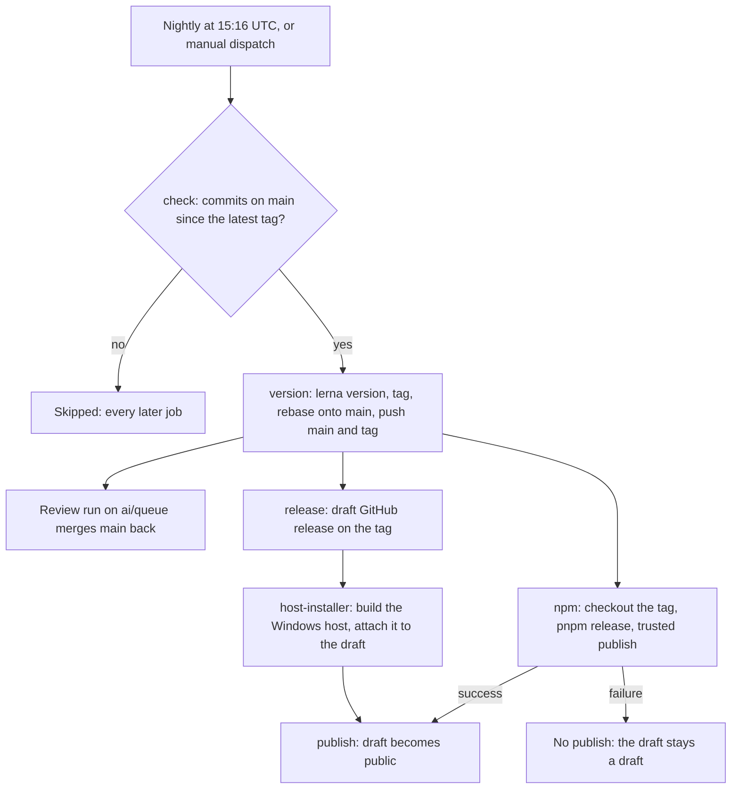

# Release flow

`.github/workflows/Release.yaml` is the only path that tags a release, publishes packages to npm and creates a GitHub release. It runs nightly and ships `main`, so only what a review has passed reaches npm. The versioning mechanics and the `pnpm release` gates are owned by [monorepo tooling](/docs/architecture/monorepo-tooling); this page is the job graph.

Each job is a gate on the one before it, with two exceptions: the GitHub release is created as soon as the tag exists, and the release is made public only after npm has published.

## Jobs

- **`check`** reads the latest tag and counts the commits on `main` since it. A count of zero skips the run, and every job depends on `check`, so a quiet night does nothing.
- **`version`** runs `pnpm release:version` on `main` as `REVIEW_COLLECTOR_TOKEN`, the identity `main`'s ruleset lets update it. It moves the tag with the version commit as that commit lands on `main`, retrying a rejected push up to five times, then starts a review run on `ai/queue` so the version commit reaches the queue. [Monorepo tooling](/docs/architecture/monorepo-tooling) owns the reasons.
- **`npm`** checks out the tag, installs the packages and the `scripts` project, and runs `pnpm release`. The install selects `./{packages/*,scripts}` because the root oxlint config loads plugins from `scripts`. Publishing uses npm trusted publishing (`id-token: write`, no token).
- **`release`** runs no checkout. It creates a draft release on the tag with `gh release create --draft --verify-tag`, and a re-run accepts an existing draft or an already-published release. It does not wait for npm.
- **`host-installer`** runs on a Windows runner. It checks out the tag, builds the agent console host as a single executable, and attaches it to the draft with `--clobber`, so a re-run replaces the asset. It is skipped once the release is already public.
- **`publish`** makes the draft public with `gh release edit --draft=false`. It needs `npm` to have succeeded and the host to be attached, so a public release always names a version that reached npm.

## Gates

| Gate                              | Where                  | Effect                                                             |
| --------------------------------- | ---------------------- | ------------------------------------------------------------------ |
| Commits since the latest tag      | `check`                | A quiet night skips every job                                      |
| One release at a time             | workflow `concurrency` | A run waits behind an earlier one on the same tag, never racing it |
| npm success before the public tag | `publish`              | The release goes public only for a version that published          |
| Already-public release            | `release`, `publish`   | A re-run takes no further asset and does not publish twice         |

## Notes

- The first publish of a new package is manual, because trusted publishing needs the package to exist on npm first. [Monorepo tooling](/docs/architecture/monorepo-tooling) gives the command.

- A failed npm publish is not retried by a quiet night, because `check` skips it. The tag and the draft stay, and the recovery is manual: check out the tag, run `pnpm release` (it publishes only the versions npm lacks), then `gh release edit <tag> --draft=false`. Publishing after the tag is safe for the same reason: the retry publishes only what npm lacks.

## Key files

| File                               | Role                                                      |
| ---------------------------------- | --------------------------------------------------------- |
| `.github/workflows/Release.yaml`   | the release jobs, their gates and their order             |
| `.github/actions/install-projects` | the install step every publish and check job shares       |
| `lerna.json`                       | the workspace globs lerna versions and publishes          |
| `package.json`                     | `release` and `release:version`, the scripts the jobs run |
