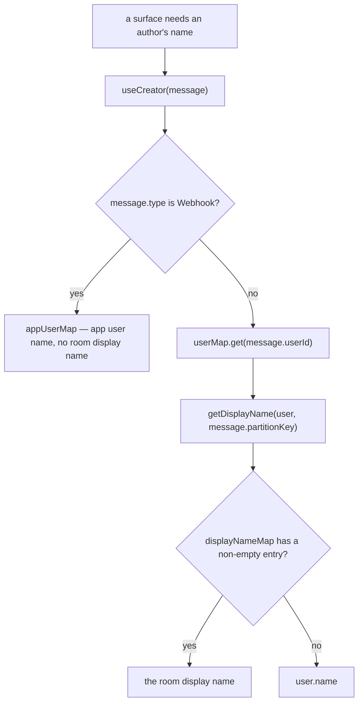

# Per-Room Display Names

Members can set a per-room display name that overrides their global username within that room.

## The resolution rule

Every member name is resolved through the one function the `esbabbler` skill names (`getDisplayName`), **never `user.name` or `member.name` read directly in a room context.**

```text
WRONG   — {{ member.name }}                     (ignores the room display name)
CORRECT — {{ getDisplayName(member, roomId) }}  (room display name, falls back to account name)
```

The one name a template may render directly is `creator.name` from `useCreator`, because that composable has already resolved it — see below.

Room display names are stored as `usersToRooms.displayName`, a `text().notNull().default("")` column — empty string means "no room-specific name", never null. Empty string is falsy, so fallback uses `||`, never `??`:

```ts
// WRONG — empty string passes through, user sees blank name
getDisplayNameMap(roomId)?.get(user.id) ?? user.name;

// CORRECT
getDisplayNameMap(roomId)?.get(user.id) || user.name;
```

Applied in: mention labels (`useMessageHtml`), the member list sidebar (`Member/List`), the profile card that pops out of it (`ProfileCard/Index`), the room settings Members panel (`Settings/Type/Member/ListItem`), the push notification title (queried server-side before the EventGrid publish), a room call's tiles, strip and action menu (resolved once in the two call composables every call surface reads — a standalone call has no room, so it keeps the account's name), the typing broadcast (resolved server-side), an unnamed room's "<creator>'s Room", the member editor's heading, the invite list's creator, and — through `useCreator` — every message in the timeline.

**`useCreator` resolves the display name itself**, so every surface that renders a message author — avatar initials, the batch header, reply titles, forward and pin lines, the delete and pin confirmations — gets it from one place rather than each remembering to call `getDisplayName`. It reads the room from the message's own `partitionKey`, so a message rendered outside the current room — a search hit, a thread preview — resolves against the room it was written in rather than the room on screen. A webhook message is the one exception: its author is an app user, which is not a member of the room and therefore has no room display name to overlay.

The resolution is a single ordered chain, and every surface enters it at the same point:



## Data model

One column: `usersToRooms.displayName` — `text`, NOT NULL DEFAULT `""`, max 32 chars.

## Client state — `useUserToRoomStore`

Two internal maps, both keyed by `roomId`, deliberately split for privacy:

- **`myUserToRoom`** — `Map<roomId, UserToRoomInMessage | undefined>` — the **current user's own** full row for that room (notificationType, lastReadAt, isHidden…), reached per room through `getMyUserToRoom` / `setMyUserToRoom`; populated by `readMyUsersToRooms` and the `onUpdateUserToRoom` subscription. There is no per-user inner map here — nobody else's row is ever held. What the store **exports** under that name is `useDataMap`'s current-key ref, not the map — one row, the room in view's — so it is named for the row rather than for the map behind it.
- **`displayNameMap`** — `Map<roomId, Map<userId, string>>` — **all members'** names as the room shows them (including self); filled from each row's server-resolved `displayName` as `readMembers` pages it in, and kept current by the same subscription. The `|| name` fallback in `getDisplayName` covers a cleared display name.

## Procedures

Member display names are returned by `readMembers` on each row as `displayName`. The procedure that reads the membership table keeps each member's private fields (notificationType, lastReadAt, lastMessageAt, isHidden) to themselves:

| Procedure            | Input           | Returns                      | Who               |
| :------------------- | :-------------- | :--------------------------- | :---------------- |
| `readMyUsersToRooms` | `{ roomIds[] }` | Full `UserToRoomInMessage[]` | Current user only |

`readMyUsersToRooms` is called from `useReadRooms` to pre-load the current user's private settings (unread state, notification type) for all rooms at startup.

The quick switcher needs to search and page direct messages by the same name it renders. `readRooms` can include DMs for that surface and returns the resolved value as `displayName`: participant display names (falling back to each account's `name`) are sorted by display name and user id, then joined in that order. `readDirectMessageParticipants` returns those participants with the same `displayName` values and order, so the client joins the server-resolved values instead of resolving them again. The UI still labels the per-room setting **Nickname**; persisted fields and code use `displayName` consistently.

## Setting your nickname

Room settings → **My Profile** tab (visible to all members, no permission required). The field is labeled **Nickname** in the UI; it edits `displayName`, and an empty value falls back to the account name. Saves via `updateUserToRoom({ roomId, displayName })`; the update propagates via the `onUpdateUserToRoom` subscription into both maps.

## Key files

| File                                                                | Role                                                   |
| :------------------------------------------------------------------ | :----------------------------------------------------- |
| `apps/web/app/store/message/room/userToRoom.ts`                     | `useUserToRoomStore`, `getDisplayName`                 |
| `apps/web/app/composables/message/room/useCreator.ts`               | message author, display name already applied           |
| `apps/web/app/composables/message/useMessageHtml.ts`                | mention label resolution                               |
| `apps/web/app/components/Message/Model/Room/Settings/Type/Profile/` | My Profile tab + display name field (labeled Nickname) |

## Notes

Setting other members' display names via the `ManageDisplayNames` permission bit is not wired to a UI yet — the bit exists in `RoomPermission` (see [RBAC](/docs/esbabbler/rbac)) but only self-service editing is built.
