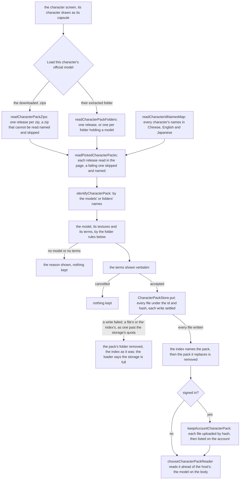
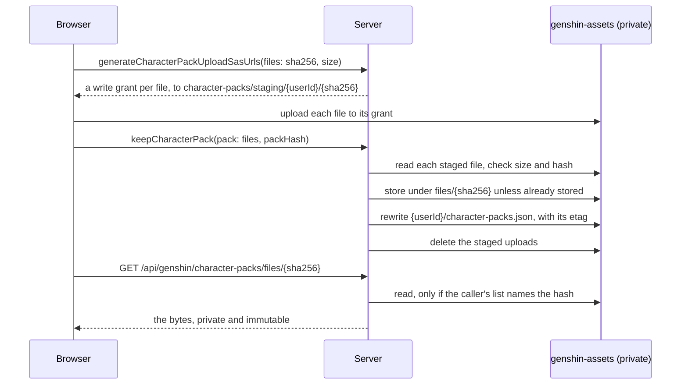

# A player's own pack

A player loads the official release they downloaded on the character screen, for the character it shows. The release is read in the page and kept in the browser's own storage, so a returning player loads it once. A signed-in player's copy is also kept with their account, so every device they sign in on draws the model without a second import. That copy is readable by its owner alone, as [the account copy](#kept-with-the-account) below sets out. The only other requests the load makes are for the game data's character names, fetched by key ([hosted game data](/docs/genshin/hosted-game-data)).

The layout the release is read into is the one [the characters index](/docs/genshin/characters) sets out. The folder rules below are the same ones [the development server](/docs/genshin/characters/development-packs) applies to a folder on its disk.

## Picking and reading the release

- **The loader.** `CharacterPackLoader` fills the character screen's slot. Where the character it shows is drawn as its capsule, it offers to load the character's official model, from the downloaded zips or their extracted folder. Where the browser keeps a pack for the character, it offers to remove it. Where the character is drawn from a pack, the browser's or the development server's, it offers the terms bundled with the model, which `CharacterTerms` reads through the character's `CharacterPackReader` and shows verbatim, or says could not be loaded.
- **A zip is read in the page.** `readCharacterPackZip` lists a zip's entries with fflate without inflating any, and inflates only the files a read asks for. fflate reads a name the archive leaves unflagged as UTF-8 as Latin-1, a letter a byte, so `decodeCharacterPackEntryNames` reads those names back to their bytes and decodes them together, by the rule the terms are decoded by: strictly as UTF-8, else Shift-JIS where they read as Japanese, else GBK. The releases mix names flagged as UTF-8 with Shift-JIS ones, as Ningguang's and Klee's do, or GBK ones, as Zhongli's and Tartaglia's do. Ningguang's, Klee's and Chongyun's archivers also wrote the 0x5C trail byte of "表" in "表情" as a slash, so where the names read in no encoding they are read again with the slash after each Shift-JIS lead byte restored to a backslash. The resource forks macOS's archiver adds under `__MACOSX` are passed over.
- **Many releases in one pick.** The loader takes every zip picked at once, or a folder holding several releases, each folder holding a model being one. Every release is read into its pack, and the ones that fail are named and skipped, so one that matches no character, lacks its model, or is not a zip at all never stops the rest. The terms of all the packs read are shown in one dialog, which keeps them together on acceptance, one at a time, since each keep rewrites the index the next one reads.
- **A RAR is read from its extracted folder.** Lumine's release of 2020 ships as RAR5, which nothing in the page decodes, so the player extracts it and picks the folder, which the browser hands over with each file's path from it.
- **Whose release it is.** `identifyCharacterPack` matches the models' own names, else the folders' names, to every character's names in the languages the releases use, as `chooseCharacterPackModel` matches a model's name. A release matching another character is kept for that character, which the terms' dialog says. One matching none, as the Traveler's "女主角" and folder "荧" match no name of hers, or several, is kept for the character it was picked for.
- **The terms before anything is kept.** The terms are shown verbatim with the model's name, and the release is kept only once the player accepts them. Cancelling keeps nothing.

### Reading a release's folder

An official release is extracted as it shipped: its folder names its files in Chinese or Japanese, nests the model a folder or two down, and spells a texture's case as it likes. Three rules turn it into the pack layout. Each lives in the world package and runs wherever a folder is read.

- **The model.** `chooseCharacterPackModel` takes the folder's one `.pmx`, in any case. Of several, as Zhongli's release ships his skill effects beside him, it takes the one whose own name, read from its header, is one of the character's names in Chinese, English or Japanese. `readCharacterNames` reads those names from the [hosted game data](/docs/genshin/hosted-game-data), and only for such a folder. The releases spell a name in a case and spacing of their own, so a name is matched without either. A folder with no model, or with several and none named as its character, is refused, naming each.
- **The textures.** `resolveCharacterPackTextures` matches each path the model names to a file below the model's own folder, case-insensitively and in either Unicode form, as MMD reads a path. A path climbing out of that folder matches nothing. `readPickedCharacterPack` keeps the textures the release holds and leaves out the rest, so Tartaglia's release, which names a `tex/面.png` it does not ship while shipping `tex/面1.png`, keeps its model, and the material that draws with the missing one is drawn untextured. The model is drawn with that texture missing and logged once, rather than refused.
- **The terms.** `chooseCharacterTermsFile` takes the text file named as terms are, `利用規約`, then `readme`, `使用说明`, `规约`, `规则` and `terms`, the one nearest the root where several share a name. `decodeCharacterTerms` decodes it strictly, from UTF-16 by its byte-order mark, or as UTF-8, Shift-JIS or GBK, so a byte no character maps refuses the encoding rather than being replaced. A folder with no terms is refused.

## Kept in the browser's storage

`openCharacterPackStore` opens the private file system where the page can write a file there, else IndexedDB, else the page's own memory, logging a storage the browser has but refuses, as a private window may.

A pack's files lie under its character's id and its hash, a SHA-256 of its files and their paths. `index.json` beside them lists which characters have one. A pack is written whole before the index names it:

- every file's write settles first;
- where any write failed, as one past the storage's quota does, or the index's write did, the pack's folder is removed and the index is left as it was, and the loader says the browser's storage is full and the model was not kept;
- a pack the character already keeps under the same hash is not written again, so a failure never removes files the index names;
- the index is read again once the files are written, so a pack kept meanwhile stays named;
- the pack it replaces is removed after the index names the new one. A removal forgets the pack in the index before its files go, so the index never names a pack with files missing.

An index that cannot be read or no longer parses is logged and rebuilt from the packs' folders, each named by a character's id and, within it, by a pack's hash. Where a character has several, the first found is kept, as a page closed between keeping a pack and removing the one it replaces leaves. The store is handed to the world before its index is read, so the packs kept from then on are drawn whatever the index held.

## Kept with the account

A signed-in player's accepted pack is also kept with their account, in the `genshin-assets` container, which is private and never changes its access level. The upload runs in three steps, all through the caller's own session:

1. **Hash and grant.** Each file is hashed in the browser (SHA-256). `genshin.generateCharacterPackUploadSasUrls` grants a write URL per file to a staging name under the caller's id and the hash, each held against the caller's storage quota for the file's declared size, as a resource's staged save is. A grant over the quota is refused. A grant is always issued, even for bytes the account already keeps, so the server only ever refers to bytes the caller has just uploaded.
2. **Upload.** The browser writes each file to its grant.
3. **Keep.** `genshin.keepCharacterPack` checks each staged file's length against its declared size before reading it, so a file of the wrong size is never downloaded, then reads it back conditioned on the etag that check read, so a file replaced since is refused rather than read, and checks its hash against what the caller claimed, and stores it once under its hash. A file already stored is not written again, so one stored copy serves every account that keeps the same bytes. Only then is the account's list rewritten, with the character's pack replaced. The staged uploads are deleted through the storage ledger's own deletion, which gives back their holds, whether the keep lands or is refused. The list is written with its etag, so two devices keeping at once cannot drop each other's packs.

`genshin.removeCharacterPack` drops the character's entry from the list. The stored files stay, since another account may keep the same bytes; nothing collects them yet.

Reading is limited to the owner. `genshin.readCharacterPacks` returns the caller's own list, and `/api/genshin/character-packs/files/{sha256}` answers with a file's bytes only when the caller's own list names that hash. Any other hash gets 404, and no session gets 401. The response is `private`, so no shared cache holds it.

On load, the browser's kept copy draws first, when its hash matches. Otherwise the account's copy is read and cached in the browser store the first time the field's character needs it, so a later load on that device does not fetch it again. The host's copy and the capsule follow.

The limits are the `MAX_CHARACTER_PACK_*` and `MAX_ACCOUNT_CHARACTER_PACKS_SIZE` constants in `apps/web/server/services/genshin/accountCharacterPack/constants.ts`, each sized for a release's model and textures with room to spare.

## Decisions

- **The loader is our own interface, laid over the character screen.** The game has no such control, so no reference measures it, and it stays out of what the parity loop scores. The character screen's fixture fills no slot, so its approved images and scores remain the game's. The loader is drawn in the screen's own colours and units.
- **A zip's unflagged names are decoded together.** A name on its own can read as Japanese in an archive whose names are Chinese, "唷" in GBK reading as "爍" in Shift-JIS. The releases write one archive's unflagged names in one encoding, so the archive's names together decide it. A release flags the rest as UTF-8, which fflate decodes.
- **The private file system first.** It keeps a pack's files as files, read back without a structured clone. IndexedDB stands in where the page cannot write a file there, and the page's memory where a browser keeps neither, so a pack loaded in a private window still draws until the page closes.
- **A lost index is rebuilt rather than read as empty.** An empty index would leave the kept packs' files where nothing names them, drawn by no character and removed by nothing, so the next pack kept would orphan them for good. The folders already say which packs the browser holds.
- **A drawn model's terms open from the loader.** The terms run to paragraphs, so laying them over the character screen would hide it. The loader offers them in the panel the terms are accepted in, which reads them only when opened.
- **A RAR is extracted by the player.** Decoding RAR5 in the page would add a decoder for one release, so its folder is picked instead.
- **A signed-in player's copy is theirs alone, which is why it is not redistribution.** The official terms forbid giving a pack to others, and the app never hosts one publicly. A player's own copy is kept under their account, readable only by a request made with their session and only for hashes their own list names. Bytes are stored once per hash across accounts, but no account can name or read another account's file without holding the bytes itself, which the upload proves. The app never hands out a link anyone else could use.
- **A grant is held against the quota, and a shared file is bounded per account.** A staged upload is a write target nothing else accounts for, so it is reserved like a resource's staged save and a player cannot mint grants past their quota. A stored file under `files/{sha256}` is not charged to any one account's ledger, since one copy serves every account that keeps its bytes. `MAX_ACCOUNT_CHARACTER_PACKS_SIZE` bounds what each account can name, a file counted once for each pack that lists it.
- **A kept pack is stored under its hash, a host's pack at its character's id.** A pack loaded again lands beside the one it replaces, so the index names whole packs only. A host's files are the developer's folder, read as they stand on each request.

## Key files

| File                                                                                                 | Role                                                                                                                               |
| :--------------------------------------------------------------------------------------------------- | :--------------------------------------------------------------------------------------------------------------------------------- |
| `packages/genshin-world/src/services/character/openCharacterPackStore.ts`                            | The kept packs' store over the private file system, else IndexedDB, else the page's memory                                         |
| `packages/genshin-world/src/services/character/createCharacterPackStore.ts`                          | Each kept pack's files under its id and hash, and the index of them                                                                |
| `packages/genshin-world/src/services/character/createOpfsCharacterPackStorage.ts`                    | The kept files in the browser's private file system                                                                                |
| `packages/genshin-world/src/services/character/createIndexedDbCharacterPackStorage.ts`               | The kept files in IndexedDB                                                                                                        |
| `packages/genshin-world/src/services/character/createMemoryCharacterPackStorage.ts`                  | The kept files in the page's memory                                                                                                |
| `packages/genshin-world/src/services/character/getCharacterPackStorageNames.ts`                      | The names directly below a path among the paths a storage keys its files by                                                        |
| `packages/genshin-world/src/services/character/listStoredCharacterPacks.ts`                          | The packs a storage holds by its folders alone, which a lost index is rebuilt from                                                 |
| `packages/genshin-world/src/services/character/readCharacterPackZip.ts`                              | A release's zip read in the page, its entries inflated only when asked for                                                         |
| `packages/genshin-world/src/services/character/readCharacterPackZips.ts`                             | The zips picked read each as a release, one that cannot be read named and skipped                                                  |
| `packages/genshin-world/src/services/character/decodeCharacterPackEntryNames.ts`                     | A zip's entry names decoded as the release wrote them                                                                              |
| `packages/genshin-world/src/services/character/readCharacterPackFolders.ts`                          | An extracted folder read as one release, or one per folder of a folder of releases                                                 |
| `packages/genshin-world/src/services/character/readPickedCharacterPacks.ts`                          | Every release picked read into its pack, a failing one named and skipped                                                           |
| `packages/genshin-world/src/services/character/readPickedCharacterPack.ts`                           | A picked release read into the pack layout, hashed, with its terms as text                                                         |
| `packages/genshin-world/src/services/character/identifyCharacterPack.ts`                             | The character a release is of, by its models' and folders' names                                                                   |
| `packages/genshin-world/src/services/character/readCharacterIdNamesMap.ts`                           | Every character's names in the languages the releases use                                                                          |
| `packages/genshin-world/src/services/character/getCharacterNameKey.ts`                               | A name as it is matched, in one form and case and with no spaces                                                                   |
| `packages/genshin-world/src/services/character/chooseCharacterPackModel.ts`                          | A folder's one model, or of several the one named as its character                                                                 |
| `packages/genshin-world/src/services/character/readCharacterNames.ts`                                | A character's names in the languages the releases name their models in                                                             |
| `packages/genshin-world/src/services/character/resolveCharacterPackTextures.ts`                      | Each texture matched to its file case-insensitively, kept at the model's spelling                                                  |
| `packages/genshin-world/src/services/character/chooseCharacterTermsFile.ts`                          | The terms file a folder holds                                                                                                      |
| `packages/genshin-world/src/services/character/decodeCharacterTerms.ts`                              | The terms decoded strictly, from UTF-16, UTF-8, Shift-JIS or GBK                                                                   |
| `packages/genshin-world/src/components/Character/PackLoader/Index.vue`                               | Loads a character's release on the character screen, its terms accepted first, removes a kept one, and shows a drawn model's terms |
| `packages/genshin-world/src/components/Character/Terms/Index.vue`                                    | Shows the terms verbatim, or that they could not be loaded                                                                         |
| `apps/web/server/services/genshin/accountCharacterPack/keepAccountCharacterPack.ts`                  | Reads each staged file, stores it under its hash, then names the pack in the account's list                                        |
| `apps/web/server/services/genshin/accountCharacterPack/generateAccountCharacterPackUploadSasUrls.ts` | A write grant per file to the caller's staging name                                                                                |
| `apps/web/server/services/genshin/accountCharacterPack/readAccountCharacterPackFile.ts`              | A file's bytes, only where the caller's own list names its hash                                                                    |
| `apps/web/server/services/genshin/accountCharacterPack/readAccountCharacterPackManifest.ts`          | The account's list of kept packs, read with its etag                                                                               |
| `apps/web/server/trpc/routers/genshin.ts`                                                            | The account's character pack procedures: grant, keep, list and remove                                                              |
| `apps/web/server/api/genshin/character-packs/files/[sha256].get.ts`                                  | Serves the signed-in player's own kept file by its hash                                                                            |
| `apps/web/app/composables/genshin/useAccountCharacterPacks.ts`                                       | The account's list while signed in, and keeping and removing a pack on it                                                          |
