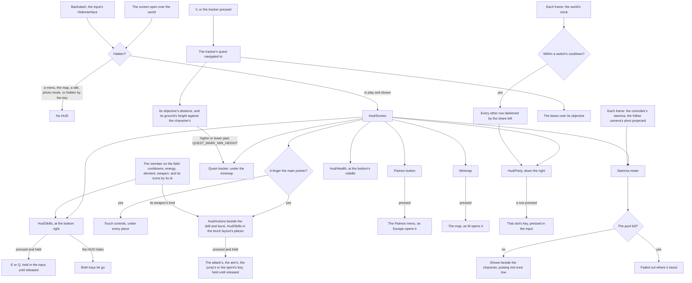

# HUD

While a player is in the world, the game keeps a heads-up display over it. The world's HUD is `Hud/Screen`, drawn in the interface library's `GameScreen` over the world's canvas, so its pieces are sized in the game's own units and hold on any window shape ([interface library](/docs/genshin/interface-library)).

## Decisions

- **The HUD's rects are the game's own tree.** The HUD's page is the `InLevelMainPage` GameObject in `00/04803507.blk`, found through its party button's Animator `TeamBtn_MP`, which no other block holds. Its tree holds the minimap, Paimon's button, the stamina meter, the party and the skill buttons, and `fitHud` publishes its rects as the `hud/interfaceRects` record as the login's are fitted ([interface layout](/docs/genshin/interface-layout)).
- **The screen reads its rects from the hosted game data.** The world reads the published `hud/interfaceRects` record as it opens (`readHudInterfaceRects`) and hands it to `Hud/Screen` as its `interfaceRects` prop, as the HUD's fixture reads it through the mirror. The record holds every piece of the fitted tree, and its schema keeps only the eight the screen places a piece by, each named by `HudInterfaceRectName` with its path in the tree as its value. A refit reaches the screen once its record is published.
- **The stamina meter stands on the screen, not in its rect.** Its rect in the tree, `SPBar`, is anchored at the screen's middle, while every recording shows the meter beside the character wherever the character stands, so the meter places itself on the whole screen by the pivot the world projects.
- **The touch layout is the host's to choose.** Whether the device's main pointer is a finger (`(pointer: coarse)`) is read by the world's session and handed to `Hud/Screen` as `isTouch`, so the screen holds no media query of its own and its fixture draws the touch layout its mobile recording shows.
- **Each glyph is the game's icon, traced.** A button's glyph is drawn as filled paths on a 128 unit square, never an image: the attack's from the wiki's render of each kind of weapon's normal attack icon, the jump's and the sprint's from their talent icons, and the skill's and the burst's from each character's own talent icons, each read as every pixel's share of white over the icon's graded disc and traced at the splits between its tones, each drawn at its tone's share of white. A character's two talent icons are hosted game data, one entry a character of the `skillGlyphs` index, which `genshin:assets skill-glyphs` traces from the wiki for every playable character (`traceTalentIcon`), splitting each icon at the gaps its own histogram of whites shows (`getToneSplits`): a pale tone under the white where it holds a peak of its own, the white alone where it does not. The world reads a character's with its kit as it joins the party (`readCharacterKit`), and the screen takes the deployed team's by character id, so a button stays bare until its character's kit arrives. The aim's has no render, so it is drawn from its measure on the recording, a ring, four arrowheads and a dot ([interface library](/docs/genshin/interface-library)).
- **The burst's fill takes its element's tones.** `ElementBurstColorsMap` fills a charged burst in the element's colour, as the PC recording's charged discs do, rather than in gold. The gold first decided for it was read as #dcb670 at 24% energy, but no pixel of `hud-world-pickup`'s burst disc reads gold: its fill is #309d6b over grass and #47bcea over water (70 and 80 seconds of `world-pickup.mkv`), and the recording's PC part fills a charged disc in Cryo's and Geo's colours. The element's tones moved `hud-world-pickup`'s score by a fraction of a point, as its snapshot row records; a game fill of gold after all would move it back.
- **The PC keys' burst fills from its foot while uncharged, in the element's tone.** The uncharged disc is the touch layout's dark disc, filled as the element's bright tone rises; a PC frame with an uncharged burst would show whether the game fills it that way.
- **The stamina pulse starts under an eighth.** The climbing clip behind `hud-stamina-climb` shows the track pulsing red with a glow from the moment the pool runs out at 33 seconds, but no frame under an eighth before it. It starts where the flash it replaced did; a clip pulsing with stamina left would confirm it, one pulsing only from empty would move it to empty.

## How it works

- **Only what the world backs.** A piece appears with the feature it shows, never as an inert copy, since a button that does nothing tells the player the world has something it lacks. The Paimon button opens the Paimon menu ([screens](/docs/genshin/screens)), and the [minimap](/docs/genshin/minimap) opens the [map](/docs/genshin/map). The game's other pieces (the Events and Battle Pass shortcuts, the shortcuts' badges, the latency and the chat) wait on the features behind them.
- **The top right's shortcuts.** `Hud/Shortcuts` draws the Wish, Adventurer Handbook, Inventory and Character shortcuts in the game's order against the right of the game's panel for them, `GrpTopPanel`, one every 76 canvas units, each the Paimon menu's traced icon for its screen at 0.78 of its size, its paler tones with it, since they are the same art. A press taps the key that opens its screen (`HUD_SHORTCUTS`), so it opens as F3, F1, B and C do, and each is named by the screen's title in the game's words. The game's Events and Battle Pass stand before them, and join once their screens are more than a placeholder.
- **Props for the pieces the world fills.** The quest tracker under the minimap, the deployed team's portraits down the right, the member on the field's health and the skill and burst buttons are plain props of `Hud/Screen`, the world screen handing each its state (the field member's figures as one `HudMember`), so the whole HUD is a fixture the parity page renders with its pieces in place. The stamina meter places itself, since it follows the character across the screen.
- **The deployed team's portraits.** `Hud/Party` draws the deployed team down the right, a row a member in slot order: the member's name from the roster's name text, the Traveler's being the name the player chose when the save holds one ([save data](/docs/genshin/save-data)), right-aligned over a thin HP bar, before a round portrait stand-in and, in the keys' layout, its slot's key on the cap the skill and burst wear (`Hud/KeyCap`), which the touch layout leaves off as the mobile client does, with the member on the field's whole row. The rows stand in the game's `TeamBtnContainer`, centred about a fixed point whatever the party's size: for the keys 71.25 canvas units above its middle on an 80 unit pitch, and on touch at its middle on a 76 unit pitch. For the keys the member on the field's name and portrait stand forward on a band, with a pointer after the name and no bar, its health being the HUD's own, and a member who is down is greyed. For `PARTY_SWITCH_COOLDOWN_SECONDS` after a switch every other row is darkened by the share of the cooldown left, read off the world's clock, which the frame carries as `seconds`. A press on a row taps that slot's key (`tapActionKey` over `PARTY_MEMBER_INPUT_ACTIONS`), so a pointer switches as the number keys do. The names are blank until the world's names load in the reader's language.
- **The member on the field's health.** `Hud/Health` shows the game's level (`LevelFormat`) before a bar filling the HUD's rect for it, `HPBarContainer`, filled by HP over Max HP, and the two as whole numbers on its middle, "13056 / 17065" as the game writes them, HP rounded up and Max HP rounded. The Max HP is the one the character's attributes give, and the bar carries `role="meter"` named by the game's word for HP.
- **The skill and burst buttons.** `Hud/Skills` shows the member on the field's skill and burst at the bottom right, for the keys at the places, sizes and tones the PC client shows, the skill's disc darkening what lies under it and the burst's ringed in its element's bright tone once charged, each with its key's cap below it, and, on a touch screen, at the touch layout's places beside its action buttons, each a dark disc as theirs are. Each carries the character's skill or burst icon where it is traced, the burst's white at 0.14 until charged as `hud-world-pickup` shows it. A cooldown darkens its button by the share left of the kit's own, all of it while more is left, as a stance's end sets, and counts its seconds down to a tenth, a skill with charges only while none of them stands (`getSkillReadySeconds`), and the burst fills from its foot with its energy over its cost in its element's bright tone, laid at a third over the disc, and once full and off cooldown is filled whole in its element's charged tone, haloed in the bright one (`ElementBurstColorsMap`). The cooldowns and energy are the member's own in the party, and the costs and cooldowns are the kit's ([combat](/docs/genshin/combat)). Pressing one holds `E` or `Q` in the world's input until released, as the touch controls hold theirs, so a held skill holds as the key does, and the buttons let go of both as the HUD hides. A press captures its pointer, so a release outside the button still lets go as the capture ends (`pressCapturedPointer`), and a focused button holds its key on Enter or Space until the key is released or the button loses focus, stopped before the world's own keys hear them. Each is named by the game's words for the skill and the burst.
- **The touch layout's action buttons.** On a touch screen `Hud/Actions` draws the game's attack, jump and sprint buttons in the HUD's rect for its action buttons, `GrpActionBtn`, and an aim button when the member on the field wields a bow. Each is a dark disc carrying its glyph, the attack's the normal attack icon of the field member's kind of weapon (`WeaponTypeGlyphLayersMap`), and each holds its action's own key in the world's input while pressed (`getActionKeyCode`), so the jump is Space and the free camera's rise as well. The buttons hold and let go as the skill and burst buttons do, by pointer or by Enter and Space, and let go of their keys as the HUD hides. Each is named by the game's words for its action.
- **The stamina meter follows the character.** The world screen reads the party's stamina off the character on the field, which hands its controller's pool up, and while the pool is spent or refilling it projects the follow camera's pivot over the character onto the screen each frame. Both go into one reactive frame object, `HudFrame`, which the meter reads, so the frame re-renders the meter alone. The meter is an arc round the pivot, to the character's right as the wiki has the game draw it: a yellow fill over a dark red track, filled from its foot, the track cut at each 100 of the pool. Once the pool falls under an eighth the fill turns red and the track pulses red with a glow toward the character every two thirds of a second, as `hud-stamina-climb`'s climbing clip shows from the pool running out. It fades in over 100 ms and, once the pool is full, out over 200 ms, held where it last stood. It carries `role="meter"` with the pool's value and the game's word for stamina.
- **The quest tracker shows the quest V navigates to.** Under the minimap it shows the navigated quest's title over its step's line and how far its counted objective has come, as the quest screen counts it (`getQuestCounter`). With no quest navigated it shows the first quest in progress, the one V would navigate to. V, in play, or a press on the tracker navigates to the tracker's quest, and the world raises the [quests](/docs/genshin/quests)' beam over its step's first objective. While no quest is loaded both stay empty.
- **The tracker's line names how far off and how high the navigated objective stands.** Under the title it shows the objective's distance across the ground in the quest screen's words for it, "1540m", and, where the objective's ground stands at least `QUEST_MARK_MIN_HEIGHT` above or below the character's, the game's own word for it (`QUEST_MARK_UP`, `QUEST_MARK_DOWN`) after a white arrowhead pointing up or down, as the recording's "Higher 1540m" reads. The world screen reads both off the world's one ground as the character moves (`QuestMark`): the objective's point is the one the beam rises over, and its height is the ground's under it against the ground's under the character, so a region's published ground puts the objective as high as it stands. No quest navigated to, or an objective no region in reach places, shows no line.
- **A piece presses what its key does.** A HUD piece the player presses holds its action's own key in the world's input, as the touch controls do (`getActionKeyCode`), so a press passes the same checks as the key: the tracker presses V.
- **It hides as the game's does.** The backslash, bound to the input's `HideInterface` action as the game's Hide UI key is ([controls](/docs/genshin/controls)), hides and shows it. Every menu, the map and a talk hide it too, as does photo mode, through the screen's own behaviour ([screens](/docs/genshin/screens)).
- **The world stays reachable through it.** The HUD's root lets every pointer through to the world, and only its pieces take one, so a click on the world between them still locks the pointer and turns the camera. A mouse press on a piece stops at the HUD's root, so the world's input never reads it as an attack.
- **The Paimon button is the emblem bare.** As the game draws it, Paimon's emblem stands over the world with no disc, in its five tones traced a layer each off `hud-world-keys` (`PAIMON_EMBLEM_LAYERS`), spanning the width of the game's rect for the button with its cape hanging below. It shows the emblem alone, so it carries Paimon's name in the game's words for a screen reader.

## Key files

| File                                                                       | Role                                                                            |
| :------------------------------------------------------------------------- | :------------------------------------------------------------------------------ |
| `packages/genshin-world/src/components/Hud/Screen/Index.vue`               | The HUD: its pieces, their places and the slots others fill                     |
| `packages/genshin-world/src/services/hud/readHudInterfaceRects.ts`         | The HUD's rects, read from the hosted game data as the world opens              |
| `packages/genshin-world/src/models/hud/HudInterfaceRectName.ts`            | The pieces of the tree the screen places by, each by its path                   |
| `packages/genshin-world/src/models/hud/HudInterfaceRects.ts`               | The record's schema, keeping only those pieces' rects                           |
| `scripts/src/services/genshinAssets/fit/fitHud.ts`                         | Fits the HUD's interface rects from its exported tree                           |
| `scripts/src/services/genshinAssets/shared/DerivedAssetComponentMap.ts`    | Names the HUD's page: its anchor `TeamBtn_MP` and root `InLevelMainPage`        |
| `packages/genshin-world/src/components/Hud/PaimonButton/Index.vue`         | The corner button that opens the Paimon menu                                    |
| `packages/genshin-world/src/components/Hud/Minimap/Index.vue`              | The corner map                                                                  |
| `packages/genshin-world/src/components/Hud/Quest/Index.vue`                | The quest tracker under the minimap                                             |
| `packages/genshin-world/src/components/Hud/Shortcuts/Index.vue`            | The shortcuts in the top right                                                  |
| `packages/genshin-world/src/components/Hud/Stamina/Index.vue`              | The stamina meter beside the character                                          |
| `packages/genshin-world/src/components/Hud/Party/Index.vue`                | The deployed team's portraits down the right                                    |
| `packages/genshin-world/src/components/Hud/KeyCap/Index.vue`               | A key's cap by the piece its key presses, for the keys' layout                  |
| `packages/genshin-world/src/components/Hud/Health/Index.vue`               | The member on the field's level and HP at the bottom's middle                   |
| `packages/genshin-world/src/components/Hud/Skills/Index.vue`               | The skill and burst buttons at the bottom right                                 |
| `packages/genshin-world/src/components/Hud/Actions/Index.vue`              | The touch layout's attack, aim, jump and sprint buttons                         |
| `packages/genshin-world/src/services/hud/WeaponTypeGlyphLayersMap.ts`      | The attack button's glyph for each kind of weapon                               |
| `packages/genshin-world/src/services/hud/InputActionGlyphLayersMap.ts`     | The aim's, the jump's and the sprint's glyphs                                   |
| `packages/genshin-world/src/services/hud/pressCapturedPointer.ts`          | A button's press, its pointer captured until the release                        |
| `packages/genshin-world/src/services/hud/ElementBurstColorsMap.ts`         | The burst's fill and charged disc tones for each element                        |
| `packages/genshin-world/src/generated/skillGlyphs/SkillGlyphsLoaderMap.ts` | Each character's skill and burst icons, read from the hosted index with its kit |
| `scripts/src/services/genshinAssets/skillGlyphs/buildSkillGlyphs.ts`       | Traces every playable character's talent icons from the wiki                    |
| `packages/genshin-world/src/components/Hud/Glyph/Index.vue`                | A button's glyph drawn from its layers                                          |
| `packages/genshin-world/src/models/hud/GlyphLayer.ts`                      | One tone of a glyph: its path and its share of white                            |
| `packages/genshin-world/src/components/Hud/Screen/Index.fixture.ts`        | The HUD's parity fixture: the frame's party, member and tracked quest           |
| `packages/genshin-world/src/models/hud/HudMember.ts`                       | The field member's figures the health and skill buttons read                    |
| `packages/genshin-world/src/components/Hud/Stick/Index.vue`                | The touch layout's stick at the bottom left                                     |
| `packages/genshin-world/src/components/Hud/Touch/Index.vue`                | The touch layout's look drag under the pieces                                   |
| `packages/genshin-world/src/models/hud/HudFrame.ts`                        | What the HUD reads off the world each frame                                     |
| `packages/genshin-world/src/services/quest/getQuestCounter.ts`             | A step's counted objective, as the tracker and the quest screen show it         |
| `packages/genshin-world/src/models/quest/QuestMark.ts`                     | How far off and how high the navigated objective stands, for the tracker        |
| `packages/genshin-world/src/services/shared/getActionKeyCode.ts`           | The key a pressed piece holds in the world's input                              |
| `packages/genshin-world/src/services/shared/tapActionKey.ts`               | A press that acts once, as a tap of its action's key                            |
| `packages/genshin-world/src/components/World/Session/Index.vue`            | Mounts the HUD, fills its slots with each piece's state, navigates on V         |
| `packages/genshin-world/src/components/World/Windrise/Index.vue`           | Raises the beam over the navigated objective in the world's group               |
| `packages/genshin-world/src/services/screen/ScreenBehaviourMap.ts`         | Which screens hide the HUD                                                      |

## Notes

- **Its places and looks are provisional where nothing has measured them.** Each piece sits in its fitted rect of the HUD's own RectTransform tree, as the login's interface does ([interface layout](/docs/genshin/interface-layout)), except the quest tracker, which has no rect in it yet and stays at its provisional place, and the stamina meter, which places itself. The touch layout's buttons, the health bar, the tracker's line and the meter's arc, colours and low share are measured off their recordings, the touch layout's at the mobile client's larger scale ([interface library](/docs/genshin/interface-library)); every other place, size and colour is a provisional value marked in its file, as are the height the tracker names an objective higher or lower from, the meter's place about the pivot, the share its pulse starts under and its glow's spread, the party's band and pointer on the member on the field, the keys' burst while uncharged, which no PC frame shows, and the burst's tones for every element but Anemo's fill and the Cryo and Geo charged discs, which `world-pickup.mkv` measures. The Paimon button's mark is traced from the game's frame, its place and fill to be measured against it ([roadmap](/docs/genshin/roadmap)).
- **Its parity is scored over the recordings it is drawn over.** `hud-world-pickup` is the English mobile client at 70 seconds of a public recording played on a phone, cropped to the game's screen (its letterbox bars are black) and scored over the part clear of its subtitles, so the fixture draws the touch layout. `hud-world-keys` is the same recording's PC part at 20 seconds, Chongyun on the field with his burst charged, scored over the keys' skill and burst with their caps. `hud-stamina-climb` is the English PC client's meter part drained on a public climb, scored over the meter alone with the frame's pivot set to the centre its arc was fitted to. The recording's own HUD sits under ours, so the composite scores a placement and a look but cannot see a piece the HUD drops; `world-hud-hidden.mkv` on the References sought list gives the bare scene.
- **The PC client centres its rows above the container's middle.** Its rows of one, two and four members share one middle on five recordings from 2025, 71.25 canvas units above `TeamBtnContainer`'s, where the mobile client's centre on it; the tree read is the mobile client's, so the PC client's own tree likely places the container higher. The 1.0 PC recording's one row stands centred, an older layout.
- **The mobile client's right inset is wider than its left.** The party's bar ends 155 canvas units from a 16:9 screen's right edge and 69 to 82 units further in on wider phones, more than the canvas inset the left corner's buttons fit, as a notch's safe area would; the touch layout keeps the one inset, so on a wide phone its party stands up to 23 units nearer the edge than the game's.
- **What the composite shows is not yet the game's.** The minimap's drawing stands on the map's plain ground where the game paints its terrain. The fixture's field member is Venti, whose figures and bow the frame shows, while its party's rows are the three the recording lists, the Traveler's named Tabibito, the name the recording's player chose.
- **The meter is cut into sections of 100, and the world's pool is one.** The meter takes the pool as `maxStamina` and draws a cut at each 100 short of it (`STAMINA_METER_SECTION`), but nothing raises the pool past `STAMINA_MAX` yet, so only `hud-stamina-climb`, drawn with its clip's pool of about 214, shows any. That clip shows the cuts at 0.464 and 0.936 of the arc, each a white line about 1.5 wide at a quarter across the drained track, and the fill unbroken across the first while it stands above it, so the cuts are drawn under the fill.

## Sources

- [Paimon Menu](https://genshin-impact.fandom.com/wiki/Paimon_Menu), Genshin Impact Wiki: the Paimon button in the top left corner opening the menu, as Escape does.
- [Map](https://genshin-impact.fandom.com/wiki/Map), Genshin Impact Wiki: the top-left minimap, which opens the map.
- [Controls](https://genshin-impact.fandom.com/wiki/Controls), Genshin Impact Wiki: Hide UI on the backslash, and Quest Navigation on V.
- [Stamina](https://genshin-impact.fandom.com/wiki/Stamina), Genshin Impact Wiki: the meter to the right of the character while stamina drains or refills, hidden when full, cut into sections of 100.
- [Quest](https://genshin-impact.fandom.com/wiki/Quest), Genshin Impact Wiki: navigating a quest marks its objective with a beam from 50 metres off.
- [Party](https://genshin-impact.fandom.com/wiki/Party), Genshin Impact Wiki: the one second cooldown between switches.
- [Traveler](https://genshin-impact.fandom.com/wiki/Traveler), Genshin Impact Wiki: the player choosing the name the Traveler is referred to by.
- [Talent Jump](https://genshin-impact.fandom.com/wiki/File:Talent_Jump.png), [Talent Normal Sprint](https://genshin-impact.fandom.com/wiki/File:Talent_Normal_Sprint.png) and the five weapons' normal attack icons, such as [Bow Unaligned](https://genshin-impact.fandom.com/wiki/File:Bow_Unaligned.png), and every playable character's skill and burst talent icons, such as Venti's [Talent Skyward Sonnet](https://genshin-impact.fandom.com/wiki/File:Talent_Skyward_Sonnet.png) and [Talent Wind's Grand Ode](https://genshin-impact.fandom.com/wiki/File:Talent_Wind%27s_Grand_Ode.png), Genshin Impact Wiki: the glyphs the buttons are traced from.
- [Elemental Skill](https://genshin-impact.fandom.com/wiki/Elemental_Skill), Genshin Impact Wiki: the skill's cooldown, during which it cannot be used.
- [Elemental Burst](https://genshin-impact.fandom.com/wiki/Elemental_Burst), Genshin Impact Wiki: the burst's icon at the bottom right showing its cooldown's time and filling with the character's energy, glowing once ready.
