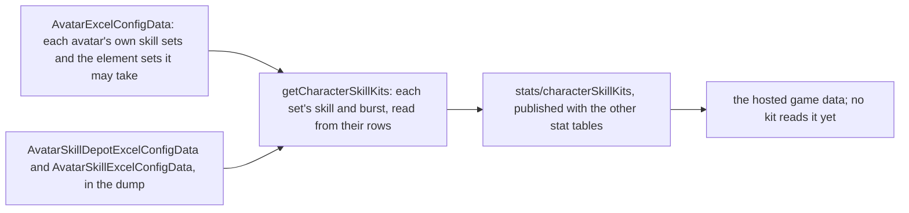
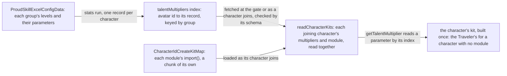
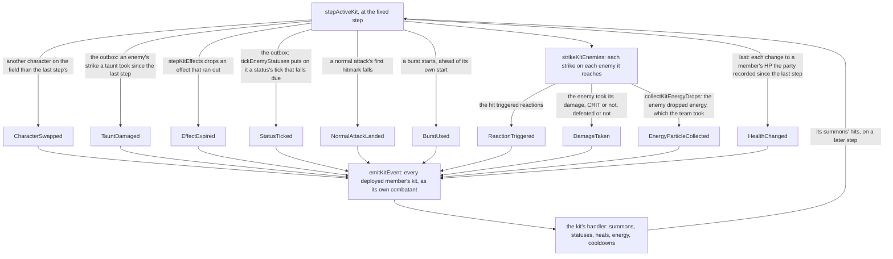

# Character kits

A character's combat kit is its skills, cooldowns, costs and talent multipliers, and the game keeps those in its tables by the character's skill sets. Every playable character's kit is written on the framework below: the skill sets and talent multipliers read from the tables, the targeting that turns an action to its enemy, and the shared effects and kit events every kit uses. The table at the end links one page per character, and it is the record of which kits are built. The kits' hits are [combat](/docs/genshin/combat)'s, and the kit's action state machine is documented there too. The attributes a kit is priced from are on [character attributes](/docs/genshin/character-attributes), and the character's movement on the field is on [character controller](/docs/genshin/character-controller).

## Skill sets

A character has one skill set in its own form, and a set for each element form its element may take, the one a statue's element picks. A set holds a skill, the character's elemental skill, and a burst, its energy skill, each read from the skill table by its id. The skill has a cooldown and its charges, the burst a cooldown, an energy cost and the element it deals, the element its energy is named as.

- **A set with neither a skill nor a burst is left out.** A character none of whose sets has either is left out too. One of the Traveler's element sets, 705, holds neither in this dump, so the dump gives the Traveler no form for it.
- **A burst's element is the one its energy names, when it names one of the seven.** A burst that costs no element has none. Which set a Traveler's kit reads is for the element a statue gives, which is not built yet.
- **The table is published by** `pnpm -C scripts genshin:assets stats`, the same run as the characters, weapons and artifacts. Each character is checked against the world's schema as it is built.

## Talent multipliers

The stats run publishes each playable character's combat talent multipliers as its own entry of the `talentMultipliers` index, by its avatar id, keyed by the talent's proud skill group. A level keeps its parameters (`paramList`) up to the last one that is not zero, so a read past that point is zero. The labels, the text id naming each parameter (`paramDescList`), go apart into the character's entry of the `talentLabels` index, which the combat table never carries.

Each character's multipliers are an entry of the hosted `talentMultipliers` index, under its avatar id ([hosted game data](/docs/genshin/hosted-game-data)). `TalentMultiplierLoaderMap` is keyed by avatar id, and each entry reads that character's record from the world's game data base and checks it against its schema. `readTalentMultipliers` merges the records it is given by group, and `getTalentMultiplier` reads a parameter from the table by its index. `readCharacterKits` builds each character's kit once, from its multipliers and its own module, both read together as the character joins; a character with no module fights with the Traveler's kit, built from the Traveler's multipliers. The world's gate reads the starting team's kits before the world opens, so its first frame has each member's combatant, and the world reads a character's as the team changes to take it in, reading a failed read again `DATA_FETCH_RETRY_MS` later, since a team that stays as it is starts no other. The world's entry carries neither: the multipliers' loader map replaced one static import that was 1.4 MB of it, and the kit map loads each module through its own `import()`, which the build splits into a chunk, while the barrel leaves the modules out. A member whose kit is still in flight has no combatant yet, which is a loading state rather than an error: it gains no energy, and on the field its kit's step waits, starting no attack, skill or burst and holding the team's effects, while the body moves on.

## Targeting

An action turns the body to the enemy it targets as it starts. That is the living enemy inside the action's targeting area scoring highest, where an enemy's score is 0.7 times its nearness to the body within the area's radius, plus 0.3 times its nearness to straight ahead, the angle from the body's facing over a half-turn. An enemy more than 2 metres above or below the body scores a fifth of that. Enemies outside the area, and the dead, are not targeted. The view, current-target and priority coefficients are not built.

## Shared effects

Each effect is on the party, in the list a `KitEffectState` holds, so a switch leaves it running, and a drown or a jump clears it. Each one is ticked each step.

- **Damage** is a hit: its talent multiplier, its gauge of an element, the element it names when it is not its character's own, the DMG Bonus it carries of its own, if any, added to its striker's as it is priced, and the additive base damage it reads from its striker, if any, added to its base damage. A hit with no internal cooldown applies its whole gauge, and one under a cooldown shares it through it.
- **Infusion** makes the character's normal attacks, charged attack and plunges deal its element at the gauge the hit gives it, 1U for a strike and 0U for a collision. One that converts the attacks gives each hit its converted poise and reach where it has them, and one with a DMG Bonus adds it to each hit it infuses, as Bane of All Evil's does to Xiao's Normal, Charged and Plunging Attacks alone. It is refreshed by a second one of its kind on the same character, not stacked.
- **Buff** adds a stat bonus to the character's pricing for its seconds: a flat ATK adds to its attack and any other bonus to its attribute total. It is refreshed by one of its attribute from the same source on the same character, not stacked: a source names the effect that gives it, so two effects on one attribute run side by side, as Sprawling Greenery's two Elemental Mastery buffs do.
- **Heal and drain** are `changeKitMemberHealth`, the one way a kit changes a member's current HP, its own or another's, by an amount of HP: a heal is raised by its source's Healing Bonus and the member's Incoming Healing Bonus as the buffs on them stand, and a drain is taken as it is, as gcsim's `Heal` and `Drain` price them. Under it, the party's `healPartyMember` and `damagePartyMember` change a share of a standing member's Max HP, a heal never above all of it and a drain never below none, and a downed member stays down, as only a revive brings one back. Each records its change in the party's `healthChanges`, which [party](/docs/genshin/party) describes and `HealthChanged` sends to the kits.
- **Energy** is the party's `gainPartyEnergy`, which an enemy's drop calls through `collectKitEnergyDrops`.
- **Field** is a circle placed where its character casts, for its seconds, with a tick on a schedule. Each tick runs while the body stands inside it, reading the character on the field and the team, and a tick's own buffs and infusions start at their full seconds. A field that ticks once and no more is a one-tick field, and one that ticks once after a delay, wherever the body stands, is how a kit sets something going a few frames on (`createDelayedKitField`).
- **Summon** is an entity cast where its character stands, which lands its own hits on the seconds their hitmarks fall at, for its seconds. It is priced by the combatant that cast it, as it stood then, and its hits land from its own body, not the character's. A summon may travel: its body moves forward at its speed from its start on its clock, and its hits are reached from where it is then. A summon may follow the body on the field instead: its body stands where that body stands on each step, whoever is on the field, and its hits are reached from there. A summon whose seconds end on its last hitmark lives `SUMMON_LINGER_SECONDS` past it, so the step that lands its last hit still has it on the field however its clock and its seconds left round. Its hits are dealt as the kind of attack its kit names as it casts it (`KitSummon.attackTag`), gcsim's attack tag for them, and as none where its kit names none. An action's hits whose hitmarks fall past its end are a summon too, cast as the action runs its course (`queueKitHits`), so each lands at its hitmark through a later action or a swap, dealt as the action's kind of attack and infused as it lands, by [combat's timing rule](/docs/genshin/combat): an action's `seconds` is its gcsim cancel, never stretched to its last hit.
- **A coordinated summon** is set going by the character on the field, whoever that is: as that character starts a normal attack, `coordinateKitSummons` runs each summon's `onNormalAttackStart` with the world's context, whose body and combatant are that character's, called by the character component beside the action's own start. Any other action sets none going, and the summon's hook decides what it casts.
- **A shield** is set on the team by the character that casts it, for the seconds left of it, and is recast over the one that character already holds. It takes the damage the character on the field takes, whichever character cast it: an enemy's strike is taken by every live shield at once, each absorbing the full damage through the combat's `absorbShieldDamage` at the struck character's shield strength, and the character loses the least any of them passes on. The wiki gives the rule in its own words: "when the active character takes damage, damage is dealt to shield health first", and "When a character has more than one shield, the damage dealt by an enemy will affect every active shield simultaneously" ([Shield](https://genshin-impact.fandom.com/wiki/Shield)). A shield is dropped once its health is spent. A shield with an explosion goes off as it ends, whether its seconds run out, its health is spent or it is recast over.
- **A taunt** is an entity placed where its character cast it, with health, which draws the enemies' strikes while it stands. A taunt that carries an explosion explodes once, from its body and priced by the combatant that cast it, when its seconds run out or its health is gone, and one that carries none, as Ushi does, ends dealing nothing. An enemy within its aggro range strikes it instead of the character, and each strike is taken from its health by `damageKitTaunt`, which puts the damage on the context's outbox for the kits to hear as `TauntDamaged`.
- **A bubble** is held on one enemy by a hit that casts it, for its seconds. A hit with poise damage bursts it, as its seconds running out do: the Omen goes on the enemy from the burst, and the explosion lands on that enemy alone, from where it stands, priced by the combatant that cast it. A hit that casts a bubble holds the enemy in one, and never restarts the one it holds, since each cast's bubble bursts on its own.
- **A status on a character** is a mark it carries for its seconds, by an id (`KitStatus`), as gcsim's character statuses are: a passive's or a constellation's own cooldown, such as Thundering Retribution's half second on the character on the field, or a mark a kit reads later, such as Havoc: Annihilation's on Tartaglia's stance. A second one of its id on the same character restarts it. `findKitStatus` reads it, `checkHasKitStatus` whether it is there, and `checkIsKitStatusActive` whether it has not run out, as one that runs out on a step stays among the effects until that step drops it.
- **A stance** plays its own normal attacks, charged attack and its stamina, skill and burst in place of its character's kit while it lasts (`KitStance`), and counts the seconds it has held, which its end reads. `enterKitStance` builds its combatant once as it starts, the character's combatant with the stance's actions in place in its kit, and the step of the character on the field plays the combatant of the stance it holds (`findKitStance`), its attributes as they stood as the stance started, so a stance's attacks are that character's normal and charged attacks wherever a kit's actions are read: their hits' kinds, an infusion, a coordinated summon.
- **A stance's hits deal the kind of attack of the group they play in**, set as its kit is built, unless a hit names its own: Nilou's sword dance plays as her normal attacks but names Elemental Skill DMG, and Ayato's Shunsuiken slashes are Normal Attack DMG.
- **A field may lower cooldowns.** A skill or a burst cast while the body stands inside a field with a `cooldownMultiplier` has its cooldown multiplied by it, each such field multiplying in turn, as Atmospheric Revolution's frost field does (`getKitFieldCooldownMultiplier`).
- **An infusion may quicken the normal attacks.** An infusion with a `normalAttackSpeedBonus` plays each normal attack of its character that much faster, its seconds and its hitmarks alike, as Steady Breathing's does.
- **A strike may carry a DMG Bonus against some enemies.** A kit's `getStrikeDamageBonus` reads each of its own strikes and the enemy it lands on, and adds what it returns to the hit's DMG Bonus as it is priced, as Frozen to the Bone's 15% against an enemy with Cryo on it and Rally of Four Blades' 15% against an enemy with less of its HP left do.
- **A Moonsign character's kit holds its Moonsign Benediction** (`moonsignBenediction`): the Lunar reactions it turns the party's reactions into and the Base DMG Bonus it gives them from its holder's stats, which the deployed team's Moonsign reads as each strike lands. A `lunarHit` on a hit makes it a direct Lunar hit, which [combat](/docs/genshin/combat#lunar-reactions) prices from the stat its `getScalingStat` reads, ATK if none, as Hymn of Eternal Rest's Lunar-Bloom is. The party's Verdant Dew is the Lunar-Bloom's resource, which a kit spends with `spendVerdantDew`.
- **A status on an enemy may strike on its own schedule.** A status with a `tickIntervalSeconds` counts down to its next tick, and each tick that falls due while it lasts is put on the outbox (`tickEnemyStatuses`), which the step sends to the kits at once, as Hydrospout's on Riptide is. A refresh restarts its seconds and keeps the schedule it holds. A status may also cut the ATK the enemy strikes with by its `attackReduction`, as Divine Suppression's Talisman does, and a status's own interval is a status of its own, as Riptide Flash's 0.7 seconds on each enemy are.

## Kit events

A passive or a constellation that answers something happening in combat is a kit's `onKitEvent`, one handler on each kit over one channel. The step of the character on the field sends each event to the kit of every member of the deployed team whose combatant is built, on the field or off it (`emitKitEvent`), and each kit reads it as its own character, whose ascension and constellation count gate what it does. A handler writes through the team's effects, the party and the enemy's statuses, and a strike it sets off is a summon cast at the enemy or the body, landing a frame or more on, as gcsim queues them.

- **CharacterSwapped** carries the character that left the field and the one now on it, read off the character the team's effects last stepped with (`KitEffectState.fieldCharacterId`). Chongyun's field infuses the one coming on, Tartaglia's Melee Stance ends as he leaves, and Fischl's burst spawns its Oz at once.
- **TauntDamaged** carries a taunt on the team and the damage an enemy's strike dealt it. `damageKitTaunt` puts each strike on the outbox (`KitContext.outbox`) as it lands, between steps, and the step sends the outbox in the order the strikes landed and empties it, ahead of its effects running down, so a strike that spends the taunt's health is heard before the taunt ends. Ushi's stack as it takes damage answers it.
- **EffectExpired** carries an effect the step dropped, its seconds run out or ended by its kit. Rimechaser Blade strikes as Chongyun's field ends, and Tartaglia's stance sets his skill's cooldown as it ends.
- **NormalAttackLanded** carries a normal attack of the character on the field as its first hitmark falls, whether or not it struck anything. Evernight Raven's Oz attacks along with it, Gaze of the Deep fires with Fischl's own, and Ice Unleashed's blades follow Chongyun's fourth strike.
- **ReactionTriggered** carries an enemy, the reactions a hit triggered on it and the combatant that dealt the hit. Thundering Retribution answers an Electro-related one the character on the field triggers while Oz stands.
- **DamageTaken** carries an enemy, the hit as it struck, its kind of attack when it is one of its kit's own actions (`KitHit.attackTag`), the combatant that dealt it, whether it was a CRIT hit and whether it defeated the enemy. The Talisman's heal, A Glimpse into Arcanum, Ascetics of Frost, Frozen Skies, and Riptide's application and every strike it sets off answer it.
- **StatusTicked** carries an enemy and the status on it whose tick fell due. Hydrospout answers Riptide's.
- **BurstUsed** carries the member that used its Elemental Burst and the burst's energy cost, sent as the burst starts and ahead of the burst's own start, as gcsim announces a burst before it plays. Resolve's stacks from another member's burst answer it.
- **EnergyParticleCollected** carries the particles or orbs an enemy dropped: how many, which of the two, their element, none for a clear one, and the member on the field, who collects them. It is sent once the team has taken their energy, every standing member by the game's rule, the one on the field in full and the others a share by the party's size, as gcsim distributes a particle before announcing it. Every drop is collected where it falls, a strike's, a reaction's reach or an elemental tick's alike (`collectKitEnergyDrops`). Wishes Unnumbered's Resolve answers it.
- **HealthChanged** carries a recorded change to a member's HP, as the party's `healthChanges` hold it, with no character for an enemy's strike or a drown. `healPartyMember` and `damagePartyMember` record every change wherever it is made, so a strike between steps is heard as well as a kit's own, and the step sends the changes last and empties them: a change a handler makes as it hears one is sent on the next step. Let the People Rejoice's Fanfare and Endless Waltz answer it.

## How a kit is read

Every kit page is written on the same reading, so a page names only what departs from it.

- **Values.** A kit's multipliers are read from its character's proud skill groups in the [hosted game data](/docs/genshin/hosted-game-data): the first group holds the strikes, the charged attack, its stamina and the plunges, the second the skill's and the third the burst's. Cooldowns and the burst's energy cost come from those groups or the skill kit record, at talent level 1. A page lists its groups and how many decimal places its multipliers match gcsim's to.
- **Sources.** A page's Sources cites the character's gcsim directory (MIT, at main) and the files it reads, with what the kit takes from each: hitmarks, cancels, reaches and areas, and the values gcsim states. A gcsim file or function is named in prose or linked to its raw file, never as a code name, since this tree holds no gcsim.
- **A borrowed plunge.** gcsim has no plunge file for most kits. Their plunges are priced at the shared collision, low and high reaches, land as their action starts over 0.4 seconds, and deal 100 poise for the low plunge, 150 for the high and 25 for the collision. A kit that takes other timings or no poise says so on its page, and a recording of the character's plunges would settle each one.
- **A borrowed charged attack.** A charged attack gcsim does not implement takes another kit's measured frames and reach, or the table's shape for a spin, with the multiplier and stamina read from the first group, until a recording settles it.

## Framework decisions

- **A kit is data plus one module.** Each character's kit is one module under `services/kit/characters/`, keyed by its declared id into the generated kit map, which loads it as its character joins, and every kit has the same shape: a normal attack's string of hits, a charged attack, a plunge, an Elemental Skill, an Elemental Burst and its passives. What a character alone does is a small module over the shared effects (a hit, a field, a summon, a buff, an infusion, a heal and a shield), written from the talent's description and the wiki's notes; a character with no module fights with the Traveler's kit.
- **A catalyst's and a bow's attacks.** A catalyst's every attack deals its element, a bow's only its charged shot, and every other weapon physical damage unless an infusion changes it. A bow's `R` aims instead of targeting, as the controls bind it.
- **A kit's action carries its start.** A kit action may name an `onStart` that adds its effects, given the world's one context (`KitContext`), whose body and combatant are the character's, and the enemy it turned to, so a module writes what its burst or skill sets going without the framework knowing which. A burst may name a variant the same way a skill hold does, played instead while its check holds on the step it starts.
- **A character's ascension phase is on its combatant.** A passive reads `combatant.ascension` against the phase its table names, so the Diluc A4 gate is `ascension >= 4`.
- **A character's constellations are on its combatant as a count.** A character's `constellationCount` is on her `Character` record, and the world copies it onto the combatant beside its ascension phase. No save holds the roster yet, so a reload starts without the characters a player held, as the [save data proposal](/docs/proposals/genshin/save-data) records. A constellation reads `combatant.constellationCount` against the level it needs, so Breastplate's C1 gate is `constellationCount >= 1` and its C4 gate `constellationCount >= 4`, each read as the effect is cast. Bennett's C1 and C6 read it alike, on `constellationCount >= 1` and `constellationCount >= 6`.
- **A gcsim call says what it puts on the character.** "ApplySelfInfusion" puts an elemental aura on the character, not a weapon infusion; only "AddWeaponInfuse" is one, and the kit's `infusion` effect is that. A branch on `c.Base.Cons >= N` is constellation N, so the kit gates it on `constellationCount >= N`. The Bennett fix is the evidence: its field infused the character at every constellation, having read the self infusion as a weapon infusion, with the Cons 6 branch left ungated.
- **Boxes are circles.** An area holds a fan or a circle, so a box is priced as the circle to its farthest corner, provisional until areas hold boxes.
- **A kit's provisional values share five causes.** A plunge gcsim has no file for lands as its action starts and ends 0.4 seconds on, and a claymore's charged attack gcsim gives no frames for strikes at half a second and a second and ends at 1.2. A poise gcsim gives none reads 0. A hold's threshold with no table or wiki figure is half a second, Bennett's first Charge Level's 0.5. A reach on a target is the circle round the body until areas hold targets, and a box round the body the circle to its far corner until areas hold boxes. `genshin:assets kits` names each as a `KitProvisionalCause` and applies it by rule, so a kit's own page and overlay name only the value that differs from these five.
- **A hit's gauge, tag, group and particles come from the wiki.** The client holds them only in its scrambled ability configs, so each module writes them beside its character, each value citing its wiki page. Poise is gcsim v2.47.2's where gcsim gives it, and a hit with no source value stays provisional.
- **A collision infused at 0U still deals the element.** A hit's element no longer needs a gauge, so the collision's Pyro damage lands with no aura, as the wiki's table gives it.
- **A charged attack after a strike skips its windup.** gcsim skips 14 frames of the charge's windup after a normal attack, so the hit lands at 56 frames here, and at 70 from rest, which the kit does not start.
- **A skill with holds starts on its release.** A kit's `elementalSkillHolds` are ordered by their minimum seconds, and a release plays the highest level its held seconds reach, else the press, on that level's cooldown. The press therefore starts when the key is let go, as the game's Charge Levels do, rather than on the press.
- **A cooldown multiplier is read as a skill's cooldown starts.** `getSkillCooldownMultiplier` takes the world's context, the body, the combatant and the team's effects among it, and each skill's cooldown is multiplied by it when the skill starts. Bennett's A1 cuts every Passion Overload by 20%, and A4 halves it while Bennett stands in a field he cast, which a field's `characterId` names. The deployed team's Impetuous Winds multiplies a skill's cooldown by a further 0.95 after the kit's own, in `startNextKitAction`, so the two compose.
- **A charged attack's stamina multiplier is read as it starts.** `getChargedAttackStaminaMultiplier` takes the world's context, and a charged attack's stamina is multiplied by it both where the pool is checked and where it is spent, in `startNextKitAction`, so a multiplier of none starts the attack on an empty pool. A charged attack that costs none spends nothing, so it does not hold the pool's refill back. Ningguang's Backup Plan gives none while she holds a Star Jade, from Ascension 1, and Impetuous Winds' cut applies after the kit's, as it does to every spend.
- **An enemy's strike takes the team's shields through the combat shield, all at once.** `absorbKitShield` gives the strike's damage to every live shield, each priced by `absorbShieldDamage` with the struck character's shield strength, the rule the combat page gives, so the Geo shield's 150% and the shield strength are the combat's. The character takes the least overflow among them as damage to HP, so a shield that holds the whole strike leaves none. The kit keeps no second absorption arithmetic.
- **An enemy strikes the nearest live taunt within its aggro range.** `selectEnemyTaunt` picks, for each enemy on each step, the nearest taunt within `ENEMY_AGGRO_RANGE` of the enemy, and a taunt with no seconds or no health left is not picked. The taunt takes the damage the strike would deal the active character, as the kit gives a taunt no defence of its own.
- **An enemy's statuses add to the damage of each hit on it.** An enemy carries statuses for their seconds, stepped with the enemy. A hit's `enemyStatus` gives it to each enemy it strikes before the hit's damage is taken, restarting a status of its id, each status's `damageTakenBonus` adds to the damage bonus the hit reads, its `resistanceReduction` lowers the enemy's resistance to each element it names, as Enduring Rock's Geo RES does, and its `physicalResistanceReduction` lowers the Physical RES a physical hit reads, as the Jade Shield's does.
- **The team's effects are the world screen's.** The world's context holds one `KitEffectState`, the character on the field steps it, and the enemies and their strikes read its list. A write reassigns the list rather than changing it, as the stepping and the adding do, and the character emits `clearKitEffects` on a drown, a jump and its unmount, which the screen answers by emptying the list, so a shield or taunt does not outlive a drown, a jump or the character's unmount. A switch clears nothing, so a shield another character cast stands while someone else is on the field.
- **A skill's charges are the seconds until every one is back.** A kit's `elementalSkillCharges` gives its skill more than one, and the party member's one skill cooldown counts the seconds until all of them are back: each use adds its cooldown, and the skill starts while no more than the other charges' cooldowns are left, which `getSkillReadySeconds` reads for the step and the HUD alike. That is the game's recharge, a charge at a time, each on the skill's cooldown, as gcsim's charges run, and a skill of one charge waits out the whole cooldown as before. A use adds its cooldown at the kit's multiplier and Impetuous Winds', and the charges' threshold takes Impetuous Winds' alone, which is exact while no kit with charges has a multiplier of its own, as none does. The HUD counts down only while no charge stands, and the count of charges the game draws on the button is not built. Klee's and Xiao's skills hold 2, their skill sets' count, written beside each kit as a kit reads no skill set.
- **One event channel, not a hook per event.** A kit has one `onKitEvent`, sent every event of combat while its character is deployed, as gcsim subscribes each character to the core's events, and a handler that answers only some ignores the rest. A new passive or constellation is a branch of its kit's handler, never a new hook on the framework.
- **An action's start is given the enemy it turned to.** `onStart` reads the target the step's targeting picked, so a hit gcsim centres on the primary target lands there from a summon, as Flash of Havoc does.
- **Every call a kit answers is given the world's one context.** `KitContext` is the world's combat state, built once by `useWorldCombat` and written in place by each step: the party, every built combatant of the deployed team by id, the enemies and their tables, the team's effects, the seeded random source, the outbox, the body and combatant of the character on the field, and the step's own lists of the effects that ran out on it and the strikes it lands, which it empties by their length, so a step where nothing lands allocates nothing. An action's start, a variant's check, a summon's coordination, a field's tick, a hit's strike, a sprint, the cooldown and stamina multipliers and an event are all given it, so no call builds a context of its own, and a test builds it with `createKitTestContext`. A hit's strike is given the strike as well, whose body and combatant are the ones that dealt it, and an event the kit's own combatant, which a passive reads as its own character. What only the step of the character on the field reads, the controller it acts from, the camera's aim and the ores its hits strike, is apart from it (`ActiveKitControls`).
- **A kit draws from the world's one seeded random source.** The context carries it (`KitContext.random`), so a kit's step, an action's start, a field's tick and a hit's strike draw from the same source the kit events, a hit's CRIT and a shard's bearing read, and the world plays the same under the same seed. The Ajaw's laser intervals are drawn as Kinich's burst starts. A summon's hits read no random source.
- **A strike an event sets off is a summon.** Thundering Retribution, the Talisman's and Riptide's strikes and the coordinated attacks are summons cast where the enemy or the body stands, landing a frame or more on as gcsim queues them, priced by the combatant that casts them; Fischl's are priced by Oz, which holds her as she cast it.
- **A hit's kind of attack is set on it as its kit is built, and a summon's is read off the summon.** `tagKitHits` gives each hit of a kit's actions its action's kind as `readCharacterKits` builds the kit, and each hit of a stance's as `enterKitStance` builds the stance's kit, so a hit keeps its kind through a stance that starts or ends while its action plays, and an infusion's copy keeps it too. Beside it, the hit is given the kind of the action it sits in (`KitHit.actionAttackTag`), which an infusion and an ore read rather than the kind it is dealt as: an infusion takes the hits of a normal attack, the charged attack and the plunges, and an ore takes a normal or charged attack's as melee, so a stance's normal attack whose stance ends mid-swing is still a normal attack to both, as gcsim infuses an attack by its own tag as it lands (`internal/template/character/character.go`). A summon's hits carry the kind its kit names as it casts it, gcsim's tag for them: Aurous Blaze's explosion is Elemental Burst DMG, and Thundering Retribution, the hit an Electro reaction sets off, Elemental Skill DMG. An action's own hits queued past its end carry their action's. A summon whose kit names no kind deals none, as gcsim's "AttackTagNone" hits do, though gcsim tags some that still name none here, Gaze of the Deep's and Riptide Flash's among them, Normal Attack DMG. A reaction's own damage is no kit's hit, so it sends no `DamageTaken`, and gcsim's reaction tags are none of the five kinds a kit reads.
- **A normal attack lands as its first hitmark falls.** `NormalAttackLanded` is sent once for each normal attack, whether or not it strikes, as the wiki gives Evernight Raven "every execution of a Normal Attack regardless if it hits", where gcsim fires it as the attack starts and every second it holds.
- **An interval on an enemy is a status of its own.** Riptide Flash's 0.7 seconds, Riptide Slash's 1.5 and the Talisman heal's second each go on the enemy as a status of their own id, as gcsim keeps them, and a passive's own interval goes on its character as a `KitStatus`.
- **A skill's sweep reads full while more is left than the kit's own cooldown**, as a stance's end sets on Tartaglia's 1-second press cooldown.
- **A Swirl's member is matched by its element from the deployed combatants.** The world's context carries every built combatant of the deployed team by id (`KitContext.characterIdCombatantMap`), so a passive reads each member's element as the Swirl's element is read.
- **A field's Geo count reads the deployed team's combatants.** A field's tick is given the world's context, whose combatants by id Crunch counts its Geo members from, as gcsim counts the party when it loads.
- **An absorb check takes one element from all the enemies it reaches, in gcsim's priority.** `findAbsorbedElement` walks Pyro, Hydro, Electro and Cryo in turn and takes the first any reached enemy holds, whichever enemy holds it, as gcsim's absorb check walks its priority ahead of its enemies. An element is held as gcsim reads an aura: Pyro under a Burning aura too, and Cryo under Freeze. Sucrose's field, Kazuha's Autumn Whirlwind and Heizou's Windmuster Iris each read it, Heizou's on the one enemy its aura check strikes.

## Not built in the framework

Each page names only what it alone lacks. These are the gaps every page shares, so each is stated once here.

- **The Nightsoul Blessing is not built.** A press that starts it, the points it spends and the strikes it replaces wait on a counter of Nightsoul points that a Blessing spends and that ends it at zero; the Blessing itself is a stance, whose hits each name gcsim's attack tag as any stance's can. Each Natlan page names what its own Blessing would change.
- **Constellations 3 and 5 raise talent levels no kit reads.** Each raises the skill and the burst by three levels, and a kit reads each group at its start level, so `getConstellationTalentAdditions` is unread.
- **Particles are not built.** A skill's or burst's particles wait on a hit that gives particles, which nothing yet does, so an enemy's HP drop is the only energy a strike gives.
- **The Hexerei team bonus is not built.** Every Hexerei kit and its constellations waits on it. gcsim turns them on by default, and the kits here follow the standard kit.
- **A kit moves no enemy.** Pulls, knockbacks and holds that move or fix an enemy in place are not built.
- **A hit is priced from its striker alone.** A kit reads no other member's buff into a hit, so a Quill or a banner that adds to another member's hits is not built.
- **A character holds no aura.** Only an enemy holds elemental state in this package, so an aura on a party member is not built.
- **A heal written before `changeKitMemberHealth` reads no Healing Bonus.** The kits that call `healPartyMember` with a share of their own, and `healKitParty` and `healKitStriker`, heal as their talent gives it, without the healer's Healing Bonus or the member's Incoming Healing Bonus, until each moves onto the hook.

## Key files

| File                                                                                  | Role                                                                                                                                                                                                                              |
| :------------------------------------------------------------------------------------ | :-------------------------------------------------------------------------------------------------------------------------------------------------------------------------------------------------------------------------------- |
| `packages/genshin-world/src/models/character/SkillDepot.ts`                           | A skill set: its skill's cooldown and charges, its burst's cooldown, cost and element                                                                                                                                             |
| `packages/genshin-world/src/models/character/CharacterSkillKit.ts`                    | A playable character's skill sets by its id                                                                                                                                                                                       |
| `scripts/src/services/genshinAssets/stats/getCharacterSkillKits.ts`                   | Every playable character's skill sets, from the dump's tables                                                                                                                                                                     |
| `scripts/src/services/genshinAssets/stats/toSkillDepot.ts`                            | One skill set, from its depot row and the skill rows                                                                                                                                                                              |
| `scripts/src/services/genshinAssets/stats/toTalentTables.ts`                          | Each character's talent groups: their levels, parameters and labels, apart                                                                                                                                                        |
| `scripts/src/services/genshinAssets/stats/writeTalentTables.ts`                       | Each character's entries of the two talent indexes, and the loader map whose entries read the hosted index                                                                                                                        |
| `scripts/src/services/genshinAssets/commands/statsCommand.ts`                         | Publishes the skill sets as `stats/characterSkillKits` with the other stat tables                                                                                                                                                 |
| `packages/genshin-world/src/generated/talentMultipliers/TalentMultiplierLoaderMap.ts` | The loader map reading each character's multipliers from the hosted index as the character joins                                                                                                                                  |
| `packages/genshin-world/src/services/kit/readTalentMultipliers.ts`                    | The given characters' multipliers, checked and merged by proud skill group                                                                                                                                                        |
| `packages/genshin-world/src/services/kit/readCharacterKits.ts`                        | The joining characters' kits, each built once from its own module and its multipliers, both read on demand, and the Traveler's for a character with no module                                                                     |
| `packages/genshin-world/src/composables/useWorldCombat.ts`                            | The deployed team's kits: the gate's for the starting team, and a character's read as the team takes it in                                                                                                                        |
| `packages/genshin-world/src/services/kit/createCombatant.ts`                          | A character's combatant once its kit is built: its attributes, and its element and weapon type off the roster                                                                                                                     |
| `packages/genshin-world/src/services/kit/stepActiveKit.ts`                            | The kit on the field at the world's step, playing nothing while its combatant is not built, its stance's actions while one holds, and the step's events sent to the team's kits                                                   |
| `packages/genshin-world/src/services/kit/replayScriptedMinute.test.ts`                | One scripted minute of the world's fixed step for a team, in combat or idle, which the replay guard and the bench both drive                                                                                                      |
| `packages/genshin-world/src/services/kit/stepActiveKit.replay.test.ts`                | Each kit alone and the proof party through the minute, one test a team, each strike log's count and multipliers by attack tag snapshotted as they stand, bugs included: a kit's beside its module, the party's beside the test    |
| `packages/genshin-world/src/services/kit/stepActiveKit.bench.ts`                      | The proof party's minute timed idle and in combat, the kit framework's before against its after                                                                                                                                   |
| `packages/genshin-world/src/services/kit/getTalentMultiplier.ts`                      | A talent's parameter at a level, by its index                                                                                                                                                                                     |
| `packages/genshin-world/src/services/kit/selectAttackTarget.ts`                       | The targeting score an action turns the body to                                                                                                                                                                                   |
| `packages/genshin-world/src/models/kit/Combatant.ts`                                  | A character as its hits are priced, its element and the kind of weapon it wields among what it carries                                                                                                                            |
| `packages/genshin-world/src/models/kit/KitSkillHold.ts`                               | A skill's hold level: its action, cooldown and the seconds held to reach it                                                                                                                                                       |
| `packages/genshin-world/src/models/kit/KitContext.ts`                                 | The world's combat state every call a kit answers is given, built once and written in place by each step, with the step's own lists                                                                                               |
| `packages/genshin-world/src/models/enemy/EnemyStatus.ts`                              | An enemy's status: its id, the seconds left of it, the DMG taken it adds to each hit, the RES and ATK it takes off, and its own tick                                                                                              |
| `packages/genshin-world/src/services/enemy/addEnemyStatus.ts`                         | Gives an enemy a status, restarting the one it already holds of its id and keeping its tick's schedule                                                                                                                            |
| `packages/genshin-world/src/services/kit/effects/stepKitField.ts`                     | A field's schedule, run on each step, ticking while the body stands in it, and a following field's centre moved to the body                                                                                                       |
| `packages/genshin-world/src/services/kit/effects/stepKitTaunt.ts`                     | A taunt's end, exploding if it carries an explosion, once its seconds or its health run out                                                                                                                                       |
| `packages/genshin-world/src/services/kit/effects/damageKitTaunt.ts`                   | An enemy's strike taken from a taunt's health, and put on the outbox for the kits to hear as `TauntDamaged`                                                                                                                       |
| `packages/genshin-world/src/services/kit/sendKitOutbox.ts`                            | Sends the outbox's events in the order they were raised and empties it in place                                                                                                                                                   |
| `packages/genshin-world/src/services/kit/selectEnemyTaunt.ts`                         | The taunt an enemy's aggro picks, as the [enemies](/docs/genshin/enemies) page sets out                                                                                                                                           |
| `packages/genshin-world/src/services/kit/readKitStackedHit.ts`                        | A stacked hit's multiplier and poise by the stacks on an enemy, which the hit consumes                                                                                                                                            |
| `packages/genshin-world/src/models/kit/KitStackedHit.ts`                              | A hit whose multiplier and poise are set by the stacks of a status on the enemy it strikes                                                                                                                                        |
| `packages/genshin-world/src/services/kit/getSkillReadySeconds.ts`                     | The seconds before a skill can be used again, read off the seconds until every charge of it is back                                                                                                                               |
| `packages/genshin-world/src/services/kit/createTargetedHitArea.ts`                    | A hit gcsim centres on the target, priced round the body at the targeting's radius plus its own                                                                                                                                   |
| `packages/genshin-world/src/services/kit/createMaxHealthScaledBonus.ts`               | A hit's flat base damage as a share of its striker's Max HP, as gcsim's flat damage hits are                                                                                                                                      |
| `packages/genshin-world/src/services/kit/effects/absorbKitShield.ts`                  | Every live shield on the team takes an enemy's strike through the combat's absorption                                                                                                                                             |
| `packages/genshin-world/src/services/kit/effects/stepKitSummon.ts`                    | A summon's clock, moving a following or travelling summon and putting each hit its clock has reached in the step's strikes                                                                                                        |
| `packages/genshin-world/src/services/kit/effects/coordinateKitSummons.ts`             | Sets each coordinated summon going as the character on the field starts a normal attack                                                                                                                                           |
| `packages/genshin-world/src/models/kit/KitSkillChain.ts`                              | A skill's follow-up presses and the window each press leaves open                                                                                                                                                                 |
| `packages/genshin-world/src/generated/characterKitMap/CharacterIdCreateKitMap.ts`     | The kit map of `import()` calls, generated at build from every module in `services/kit/characters/` keyed by its declared id, each module a chunk the barrel leaves out                                                           |
| `packages/genshin-world/scripts/kit/generateCharacterKitMap.ts`                       | Writes the kit map from the build hook, which then writes the barrel without the kit modules                                                                                                                                      |
| `packages/genshin-world/src/services/kit/effects/healKitStriker.ts`                   | Heals the character that struck an enemy by a hit's share of its ATK, per enemy struck                                                                                                                                            |
| `packages/genshin-world/src/models/kit/KitEffectState.ts`                             | The team's effects, held on one owner so each write reassigns the list                                                                                                                                                            |
| `packages/genshin-world/src/services/kit/effects/addKitEffect.ts`                     | Adds an effect, refreshing one of its kind on the same character from the same source, of the same id, or the same stance                                                                                                         |
| `packages/genshin-world/src/services/kit/effects/createKitSummon.ts`                  | Builds a summon cast where its body stands, landing its hits from there, for its seconds or a tenth past its last hit                                                                                                             |
| `packages/genshin-world/src/services/kit/effects/stepKitEffects.ts`                   | Runs the effects' seconds down, a stance's held seconds up and the fields' ticks, puts the summons', taunts', bubbles' and shields' strikes in the step's strikes, and drops in place those that run out into the expired effects |
| `packages/genshin-world/src/services/kit/effects/getKitInfusion.ts`                   | The infusion on a character's normal attacks, charged attack and plunges, if one is on it                                                                                                                                         |
| `packages/genshin-world/src/models/kit/KitBubble.ts`                                  | A bubble holding an enemy: its seconds, its explosion and its Omen, until it bursts                                                                                                                                               |
| `packages/genshin-world/src/services/kit/effects/strikeKitBubble.ts`                  | A hit's bubble: a poise hit bursts the enemy's, and a casting hit holds the enemy in one                                                                                                                                          |
| `packages/genshin-world/src/services/kit/effects/stepKitBubble.ts`                    | A bubble's clock: its burst, and the explosion on its enemy alone                                                                                                                                                                 |
| `packages/genshin-world/src/services/kit/effects/stepKitShield.ts`                    | A shield's explosion, from the body on the field, once its seconds run out or its health is spent                                                                                                                                 |
| `packages/genshin-world/src/services/kit/effects/healKitParty.ts`                     | Rolls a hit's party heal under a shield or unshielded, healing each member by a flat HP and ATK, DEF and Max HP shares                                                                                                            |
| `packages/genshin-world/src/models/kit/KitPartyHeal.ts`                               | A hit's party heal: its chance, ATK, DEF and Max HP shares, flat HP and whether it needs a shield                                                                                                                                 |
| `packages/genshin-world/src/services/kit/effects/infuseKitHit.ts`                     | Infuses a landed hit, or a summon's strike's, that sits in a normal attack, the charged attack or a plunge                                                                                                                        |
| `packages/genshin-world/src/services/kit/effects/getBuffedCombatant.ts`               | The combatant with its buffs added to the pricing                                                                                                                                                                                 |
| `packages/genshin-world/src/services/kit/constants.ts`                                | The targeting weights, the kit's shared timing constants, the radius of a field with no edge and the weapons a melee infusion converts                                                                                            |
| `packages/genshin-world/src/services/kit/findAbsorbedElement.ts`                      | The element an absorb check takes from the enemies it reaches, in gcsim's priority                                                                                                                                                |
| `packages/genshin-world/src/models/kit/KitEvent.ts`                                   | The events of combat a kit answers, one per `KitEventKind`                                                                                                                                                                        |
| `packages/genshin-world/src/models/kit/ActiveKitControls.ts`                          | What the step of the character on the field reads beyond the context: its controller, the camera's aim, its landed hits and the ores                                                                                              |
| `packages/genshin-world/src/services/kit/emitKitEvent.ts`                             | Sends an event to the kit of each deployed member whose combatant is built                                                                                                                                                        |
| `packages/genshin-world/src/services/kit/collectKitEnergyDrops.ts`                    | An enemy's energy drops, taken by the team and sent to its kits as collected by the member on the field                                                                                                                           |
| `packages/genshin-world/src/services/kit/strikeKitEnemies.ts`                         | A step's strikes on the enemies they reach, priced, the reactions and damage they cause sent as events, and the strikes kept in place to those that struck                                                                        |
| `packages/genshin-world/src/services/kit/tickEnemyStatuses.ts`                        | The ticks of the enemies' statuses that strike on their own schedule, put on the outbox                                                                                                                                           |
| `packages/genshin-world/src/services/kit/tagKitHits.ts`                               | Each hit of a kit's actions given its action's kind of attack, as the kit or a stance's kit is built                                                                                                                              |
| `packages/genshin-world/src/models/kit/KitStatus.ts`                                  | A status on a character: a cooldown of its own or a mark its kit reads                                                                                                                                                            |
| `packages/genshin-world/src/models/kit/KitStance.ts`                                  | A stance's combatant, built once with its actions in place of its character's, and the seconds it has held                                                                                                                        |
| `packages/genshin-world/src/services/kit/effects/enterKitStance.ts`                   | A stance entered on a combatant, its combatant built as it starts                                                                                                                                                                 |
| `packages/genshin-world/src/services/kit/effects/findKitStance.ts`                    | The stance a character holds, whose combatant the step plays                                                                                                                                                                      |
| `packages/genshin-world/src/services/kit/effects/checkHasKitStatus.ts`                | Whether a character carries a status of an id                                                                                                                                                                                     |
| `packages/genshin-world/src/services/kit/effects/findKitStatus.ts`                    | A character's status of an id among the team's effects                                                                                                                                                                            |
| `packages/genshin-world/src/services/kit/effects/checkIsKitStatusActive.ts`           | Whether a character's status of an id has not run out                                                                                                                                                                             |
| `packages/genshin-world/src/services/kit/effects/createDelayedKitField.ts`            | A field that ticks once after a delay, as a kit sets something going a few frames on                                                                                                                                              |
| `packages/genshin-world/src/services/kit/effects/getKitFieldCooldownMultiplier.ts`    | The cooldown factor of the fields a skill or burst is cast inside                                                                                                                                                                 |
| `packages/genshin-world/src/services/party/gainPartyMemberEnergy.ts`                  | A flat amount of energy a passive or constellation gives one member, up to its burst's cost                                                                                                                                       |
| `packages/genshin-world/src/services/party/healPartyMember.ts`                        | Heals a standing member up to all its HP, recording the change with its overflow and its healer                                                                                                                                   |
| `packages/genshin-world/src/services/party/damagePartyMember.ts`                      | Takes a share of a standing member's HP, recording the change, and downs it at none                                                                                                                                               |
| `packages/genshin-world/src/services/kit/effects/changeKitMemberHealth.ts`            | The one way a kit heals or drains a member by an amount of HP, a heal raised by the Healing and Incoming Healing Bonuses                                                                                                          |
| `packages/genshin-world/src/models/party/PartyHealthChange.ts`                        | HP changes as they took effect, queued on the party and carried by `HealthChanged`                                                                                                                                                |

## Sources

- [AnimeGameData](https://github.com/DimbreathBot/AnimeGameData), the community's per-patch dump: the avatar, skill depot and skill tables the table is read from, and the proud skill table the multipliers are read from.
- [Shield](https://genshin-impact.fandom.com/wiki/Shield), Genshin Impact Wiki: the active character's damage is taken by its shields first, every active shield takes an enemy's strike at once, and absorption is scaled by the active character's Shield Strength.

## Characters

| Page                                                | Covers                                                                            |
| :-------------------------------------------------- | :-------------------------------------------------------------------------------- |
| [Aino](/docs/genshin/kits/aino)                     | Three strikes, a provisional charged attack, Musecatcher and Cool Your Jets Ducky |
| [Albedo](/docs/genshin/kits/albedo)                 | Solar Isotoma, Transient Blossoms and the Fatal Blossoms                          |
| [Alhaitham](/docs/genshin/kits/alhaitham)           | Universality's tap and hold, Particular Field and Projection Attacks              |
| [Aloy](/docs/genshin/kits/aloy)                     | Freeze Bomb and Rushing Ice                                                       |
| [Amber](/docs/genshin/kits/amber)                   | Explosive Puppet's Baron Bunny and Fiery Rain                                     |
| [Arlecchino](/docs/genshin/kits/arlecchino)         | Invitation to a Beheading and All Is Ash's Spike and Cleave                       |
| [Baizhu](/docs/genshin/kits/baizhu)                 | Universal Diagnosis and Holistic Revivification's seamless shield                 |
| [Barbara](/docs/genshin/kits/barbara)               | Let the Show Begin♪ droplets, Melody Loop and Shining Miracle♪                    |
| [Beidou](/docs/genshin/kits/beidou)                 | Tidecaller's shield and the Thunderbeast's Targe                                  |
| [Bennett](/docs/genshin/kits/bennett)               | Passion Overload's Charge Levels and Fantastic Voyage's field                     |
| [Candace](/docs/genshin/kits/candace)               | Heron's Sanctum's shields and Wagtail's Tide's Prayer                             |
| [Charlotte](/docs/genshin/kits/charlotte)           | Framing's press, its Snappy Silhouette marks, Still Photo and Kamera              |
| [Chasca](/docs/genshin/kits/chasca)                 | Four strikes, the charged Aimed Shot and Galesplitting's first hit                |
| [Chevreuse](/docs/genshin/kits/chevreuse)           | Rapid Interdiction Fire's hold and Ring of Bursting Grenades                      |
| [Chiori](/docs/genshin/kits/chiori)                 | Fluttering Hasode's Tamoto doll and Hiyoku: Twin Blades                           |
| [Chongyun](/docs/genshin/kits/chongyun)             | Layered Frost's field and Rimechaser Blade                                        |
| [Citlali](/docs/genshin/kits/citlali)               | Three strikes, the charged attack and Ice Storm                                   |
| [Clorinde](/docs/genshin/kits/clorinde)             | Five strikes, the charged attack and Last Lightfall                               |
| [Collei](/docs/genshin/kits/collei)                 | Floral Brush and Trump-Card Kitty's explosion and leap                            |
| [Columbina](/docs/genshin/kits/columbina)           | Three strikes, the charged attack, and the skill's press and DoT field            |
| [Cyno](/docs/genshin/kits/cyno)                     | Chasmic Soulfarer and Pactsworn Pathclearer's Mortuary Rite                       |
| [Dahlia](/docs/genshin/kits/dahlia)                 | Four strikes, charged attack, Immersive Ordinance, Radiant Psalter                |
| [Dehya](/docs/genshin/kits/dehya)                   | Molten Inferno and Incineration Drive                                             |
| [Diluc](/docs/genshin/kits/diluc)                   | Searing Onslaught and Dawn                                                        |
| [Diona](/docs/genshin/kits/diona)                   | Icy Paws and Signature Mix's field                                                |
| [Dori](/docs/genshin/kits/dori)                     | Alcazarzaray's Exactitude's Connector field and Troubleshooter Shot               |
| [Durin](/docs/genshin/kits/durin)                   | Tap E's window, Confirmation of Purity and Denial of Darkness, and both Dragons   |
| [Emilie](/docs/genshin/kits/emilie)                 | Four strikes, Lumidouce Case's summon hit and Spiritbreath Thorn                  |
| [Escoffier](/docs/genshin/kits/escoffier)           | Three strikes, Low-Temperature Cooking and Scoring Cuts                           |
| [Eula](/docs/genshin/kits/eula)                     | Grimheart stacks, Icewhirls and Glacial Illumination                              |
| [Faruzan](/docs/genshin/kits/faruzan)               | Wind Realm of Nasamjnin and the Dazzling Polyhedron                               |
| [Fischl](/docs/genshin/kits/fischl)                 | Oz, Midnight Phantasmagoria and Thundering Retribution                            |
| [Flins](/docs/genshin/kits/flins)                   | Manifest Flame's press and Cometh the Night's initial and final hits              |
| [Freminet](/docs/genshin/kits/freminet)             | Pressurized Floe's Upward Thrust and Shadowhunter's Ambush                        |
| [Furina](/docs/genshin/kits/furina)                 | Salon Solitaire's members and Singer, Fanfare and the Arkhe hits                  |
| [Gaming](/docs/genshin/kits/gaming)                 | Stellar Rend, Bestial Ascent and Suanni's Gilded Dance                            |
| [Ganyu](/docs/genshin/kits/ganyu)                   | Frostflake Arrow, Ice Lotus and Celestial Shower                                  |
| [Gorou](/docs/genshin/kits/gorou)                   | General's War Banner and Crystal Collapse                                         |
| [Heizou](/docs/genshin/kits/heizou)                 | Heartstopper Strike, Vacuum Slugger and Windmuster Iris                           |
| [Hu Tao](/docs/genshin/kits/hu-tao)                 | Her string, charged attack and Guide to Afterlife's Paramita stance               |
| [Iansan](/docs/genshin/kits/iansan)                 | Three strikes, the charged attack and Thunderbolt Rush                            |
| [Ifa](/docs/genshin/kits/ifa)                       | Three strikes, the charged attack and her plunges                                 |
| [Ineffa](/docs/genshin/kits/ineffa)                 | Four strikes, charged attack, Cleaning Mode, Cyclonic Exterminator                |
| [Itto](/docs/genshin/kits/itto)                     | Masatsu Zetsugi, Ushi and the Arataki Kesagiri                                    |
| [Jahoda](/docs/genshin/kits/jahoda)                 | Three strikes, the charged shot and Savvy Strategy's pursuit                      |
| [Jean](/docs/genshin/kits/jean)                     | Gale Blade and Dandelion Breeze's field                                           |
| [Kaeya](/docs/genshin/kits/kaeya)                   | Frostgnaw and Glacial Waltz's icicles                                             |
| [Kamisato Ayaka](/docs/genshin/kits/kamisato-ayaka) | Soumetsu's storms and Senho's infusion                                            |
| [Kamisato Ayato](/docs/genshin/kits/kamisato-ayato) | Kyouka's Soukai Kanka stance and Suiyuu's field                                   |
| [Kaveh](/docs/genshin/kits/kaveh)                   | Artistic Ingenuity and Painted Dome                                               |
| [Kazuha](/docs/genshin/kits/kazuha)                 | Chihayaburu and Kazuha Slash's Autumn Whirlwind                                   |
| [Keqing](/docs/genshin/kits/keqing)                 | Stellar Restoration and Starward Sword                                            |
| [Kinich](/docs/genshin/kits/kinich)                 | Three strikes, charged attack and the burst's first hit                           |
| [Kirara](/docs/genshin/kits/kirara)                 | Tail-Flicking Flying Kick's shield and Secret Art: Surprise Dispatch              |
| [Klee](/docs/genshin/kits/klee)                     | Jumpy Dumpty, Sparks 'n' Splash and Sparkly Explosion                             |
| [Kokomi](/docs/genshin/kits/kokomi)                 | Bake-Kurage and Nereid's Ascension                                                |
| [Kujou Sara](/docs/genshin/kits/kujou-sara)         | The Cover and its Ambush                                                          |
| [Kuki](/docs/genshin/kits/kuki)                     | Grass Ring of Sanctification                                                      |
| [Lan Yan](/docs/genshin/kits/lan-yan)               | Four strikes, the charged attack and Lustrous Moonrise                            |
| [Lauma](/docs/genshin/kits/lauma)                   | Three strikes, the charged attack and Hymn of Hunting                             |
| [Layla](/docs/genshin/kits/layla)                   | Nights of Formal Focus and Starlight Slug                                         |
| [Lisa](/docs/genshin/kits/lisa)                     | Violet Arc and Lightning Rose                                                     |
| [Lynette](/docs/genshin/kits/lynette)               | Enigmatic Feint and the Bogglecat Box of Magic Trick                              |
| [Lyney](/docs/genshin/kits/lyney)                   | Bewildering Lights and the Prop Arrow's Grin-Malkin Hat                           |
| [Mavuika](/docs/genshin/kits/mavuika)               | Four strikes, the charged attack and her plunges                                  |
| [Mika](/docs/genshin/kits/mika)                     | Starfrost Swirl and Skyfeather Song                                               |
| [Mona](/docs/genshin/kits/mona)                     | Mirror Reflection of Doom and Stellaris Phantasm                                  |
| [Mualani](/docs/genshin/kits/mualani)               | Three strikes, the charged attack and Boomsharka-laka                             |
| [Nahida](/docs/genshin/kits/nahida)                 | All Schemes to Know's press and full hold                                         |
| [Navia](/docs/genshin/kits/navia)                   | Rosula Shardshot and As the Sunlit Sky's Singing Salute                           |
| [Neuvillette](/docs/genshin/kits/neuvillette)       | Hydro strikes, his skill and his burst                                            |
| [Nilou](/docs/genshin/kits/nilou)                   | Dance of Haftkarsvar's Pirouette and Dance of Abzendegi                           |
| [Ningguang](/docs/genshin/kits/ningguang)           | Star Jades, Jade Screen and Starshatter                                           |
| [Noelle](/docs/genshin/kits/noelle)                 | Breastplate and Sweeping Time                                                     |
| [Ororon](/docs/genshin/kits/ororon)                 | Three strikes, Aimed Shot, Spirit Orb and Dark Voices' Echo                       |
| [Qiqi](/docs/genshin/kits/qiqi)                     | Herald of Frost and Fortune-Preserving Talisman                                   |
| [Raiden Shogun](/docs/genshin/kits/raiden-shogun)   | The Eye and Musou Isshin                                                          |
| [Razor](/docs/genshin/kits/razor)                   | Electro Sigils, the Wolf Within and Lightning Fang                                |
| [Rosaria](/docs/genshin/kits/rosaria)               | Ravaging Confession and Rites of Termination                                      |
| [Sayu](/docs/genshin/kits/sayu)                     | Fuufuu Windwheel and Muji-Muji Daruma                                             |
| [Sethos](/docs/genshin/kits/sethos)                 | Fully-charged Aimed Shot and Ancient Rite: Thunderous Roar of Sand                |
| [Shenhe](/docs/genshin/kits/shenhe)                 | Spring Spirit Summoning and Divine Maiden's Deliverance                           |
| [Sigewinne](/docs/genshin/kits/sigewinne)           | Bolstering Bubblebalm's bubbles and Super Saturated Syringing                     |
| [Skirk](/docs/genshin/kits/skirk)                   | Seven-Phase Flash, its strikes and charged attack, and her plunges                |
| [Sucrose](/docs/genshin/kits/sucrose)               | Astable Anemohypostasis Creation-6308 and Forbidden Creation                      |
| [Tartaglia](/docs/genshin/kits/tartaglia)           | The Ranged and Melee Stances and Riptide                                          |
| [Thoma](/docs/genshin/kits/thoma)                   | Blazing Blessing and Crimson Ooyoroi's Fiery Collapse                             |
| [Tighnari](/docs/genshin/kits/tighnari)             | Vijnana-Phala Mine and Tanglevine Shaft with its secondary                        |
| [Traveler](/docs/genshin/kits/traveler)             | The Anemo form's attacks, Palm Vortex and Gust Surge                              |
| [Varesa](/docs/genshin/kits/varesa)                 | Three strikes, Rush's press and Flying Kick, outside her blessing                 |
| [Venti](/docs/genshin/kits/venti)                   | Skyward Sonnet, Wind Domain and Stormeye                                          |
| [Wanderer](/docs/genshin/kits/wanderer)             | Hanega: Song of the Wind and Kyougen: Five Ceremonial Plays                       |
| [Wriothesley](/docs/genshin/kits/wriothesley)       | Darkgold Wolfbite and Icefang Rush                                                |
| [Xiangling](/docs/genshin/kits/xiangling)           | Guoba, Pyronado and Oil Meets Fire                                                |
| [Xianyun](/docs/genshin/kits/xianyun)               | Stars Gather at Dusk, with four strikes and Skyladder's first press               |
| [Xiao](/docs/genshin/kits/xiao)                     | Lemniscatic Wind Cycling and Bane of All Evil                                     |
| [Xilonen](/docs/genshin/kits/xilonen)               | Three strikes, the charged attack and Yohual's Scratch                            |
| [Xingqiu](/docs/genshin/kits/xingqiu)               | Fatal Rainscreen and Raincutter                                                   |
| [Xinyan](/docs/genshin/kits/xinyan)                 | Sweeping Fervor and Riff Revolution                                               |
| [Yae Miko](/docs/genshin/kits/yae-miko)             | Sesshou Sakura totems and Great Secret Art: Tenko Kenshin                         |
| [Yanfei](/docs/genshin/kits/yanfei)                 | Scarlet Seals, Signed Edict and Done Deal                                         |
| [Yaoyao](/docs/genshin/kits/yaoyao)                 | Yuegui radishes and Moonjade Descent                                              |
| [Yelan](/docs/genshin/kits/yelan)                   | Lingering Lifeline and Depth-Clarion Dice                                         |
| [Yoimiya](/docs/genshin/kits/yoimiya)               | Niwabi Fire-Dance's Blazing Arrows and Aurous Blaze                               |
| [Yumemizuki Mizuki](/docs/genshin/kits/mizuki)      | Three strikes, the charged attack and Aisa Utamakura Pilgrimage                   |
| [Yun Jin](/docs/genshin/kits/yun-jin)               | Opening Flourish and Cliffbreaker's Banner                                        |
| [Zhongli](/docs/genshin/kits/zhongli)               | Stone Steles, Jade Shield and Planet Befall                                       |

- [Fearnaught](https://genshin-impact.fandom.com/wiki/Fearnaught), [I Got Your Back](https://genshin-impact.fandom.com/wiki/I_Got_Your_Back) and [To Be Cleaned](https://genshin-impact.fandom.com/wiki/To_Be_Cleaned), Genshin Impact Wiki: Bennett's A4, and Noelle's C1 and C4, as the kit gates them.
