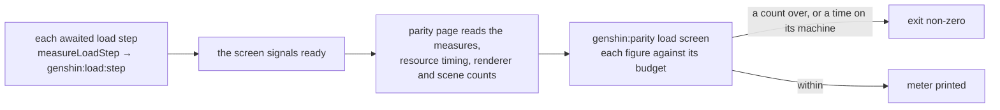

# Load budget

Each screen of the game is held to a budget for what it loads before it shows. The steps the loading awaits are measured by the browser under `genshin:load:<step>`, so DevTools' Performance panel draws them on its Timings track, and `pnpm -C scripts genshin:parity load <screen>` reads the same entries on the parity page and prints each figure against its budget. The steps this page times are the first frame's needs; the trims that bring them down are the [proposal](/docs/proposals/genshin/load-budget).

## What is measured

- **Load steps.** `measureLoadStep(name, promise)` times an awaited step from its call to its settling, as the measure `genshin:load:<name>`. The promise's result or rejection passes through unchanged, and a rejected step is measured too, with `detail: { isFailed: true }`. The start is a timestamp rather than a mark, since two steps of one name can run at once (each region's read is one `regions` step).
- **Time to ready.** The milliseconds from navigation start to the moment the parity page signals the screen ready, read right after that signal.
- **Requests.** Every request the page made, from resource timing, with its transferred bytes. The game data among them is the requests under the hosted game data's base, and their bytes are the game data bytes the budget holds.
- **Renderer and objects.** The renderer's geometries, textures and programs, and the visible objects by kind, read once at ready the way the scene bench counts them. A screen with no scene at ready draws none, so its counts are zero.

## Running it

```bash
pnpm -C scripts genshin:parity load WorldScreen        # 1920 by 1080, the default
pnpm -C scripts genshin:parity load LoginScreen 1280 720
```

The screen is a fixture on the parity page, opened cold in a fresh browser, so its cache is empty. The command prints one meter row per figure: the value, its budget, the share used as a bar, and OVER when past it, then the measures slowest first, then the requests and the objects by kind. It exits non-zero when a figure checked here is over its budget. Time is checked only on the machine the budget names (`os.hostname()`); on any other machine the time is printed beside its row and does not fail.

## Reading the Timings track

Open the parity page (or the app) in DevTools' Performance panel, record the load, and the `genshin:load:*` measures appear on the Timings track as bars named by their step. A step's bar starts at its call and ends when its promise settles, so a long bar with nothing under it is a step waiting on a fetch or a compile, and a bar that starts late is a step that waited on an earlier one.

## Budgets

The budgets are written in `scripts/src/services/genshinParity/load/ScreenLoadBudgetMap.ts`, each at the figure measured on this machine plus a tenth, rounded up. Lowering a budget is part of the commit that lowers the load; raising one needs its own reason.

| Screen        | Ready (ms) | Requests | Game data (KB) | Objects | Geometries | Textures | Programs |
| :------------ | ---------: | -------: | -------------: | ------: | ---------: | -------: | -------: |
| `GameOpening` |      2 163 |    1 878 |        2 499.2 |       0 |          0 |        0 |        0 |
| `LoginScreen` |      7 124 |    1 902 |        2 499.2 |      57 |         28 |       36 |       33 |
| `WorldScreen` |     25 543 |    2 819 |        4 340.2 |     343 |        303 |       43 |      130 |

The time column is checked on the budget's machine only. A screen's own load steps are named in its `measures` section when it has any: the world's are `world-gate` with each of its reads, `regions`, `terrain` from mount to ready, and `compile`; the login has none of its own, its reads belong to the opening, and the opening's are `opening`.

## How it works



## Decisions

- **The opening's ready is its mount.** `GameOpening`'s fixture names no ready event, so the page is ready as the opening mounts and its `opening` steps are read as they stand then. Its fixture also reads the title logo and the login records at module load, so the game data is fetched before the page is ready and its steps are short.
- **The parity page raises the resource timing buffer.** The browser keeps 250 resource timings by default, and a world's load makes more requests than that, so the buffer is raised before the first request in `openParityPage`; without it the request and game data counts stop at the buffer.
- **Ready waits on the finest terrain tiles only.** The terrain reports ready once every finest-level tile the view wants is held or given up, and the coarser rings keep streaming after ready without holding it. On `WorldScreen` it did not move the time: the median ready is 25.1 s against 24.5 s before, within the noise, and the terrain measure is unchanged, since the wait is the terrain workers starting, see the proposal. The budget stays where it is, since a tenth above the new median is above it, and a budget is never raised.
- **The time's machine is named by the budget.** The counts are the same on every machine and the milliseconds are not, so a budget names the machine it was measured on.

## Key files

| File                                                             | Role                                                              |
| :--------------------------------------------------------------- | :---------------------------------------------------------------- |
| `packages/genshin-world/src/services/loading/measureLoadStep.ts` | Times an awaited load step as `genshin:load:<name>`               |
| `packages/genshin-world/src/services/loading/constants.ts`       | `LOAD_STEP_MEASURE_PREFIX`, the one prefix the measures carry     |
| `packages/genshin-world/parity/benchLoad.ts`                     | The parity page's read at ready: measures, requests, scene counts |
| `scripts/src/services/genshinParity/load/ScreenLoadBudgetMap.ts` | Each screen's budget, by screen name                              |
| `scripts/src/services/genshinParity/commands/loadCommand.ts`     | The `load` command, beside `bench`                                |
| `scripts/src/services/genshinParity/shared/formatLoadMeter.ts`   | The meter's rows, the measures and the exit rule                  |
| `scripts/src/services/genshinParity/shared/openParityPage.ts`    | Opens the page cold and raises the resource timing buffer         |
