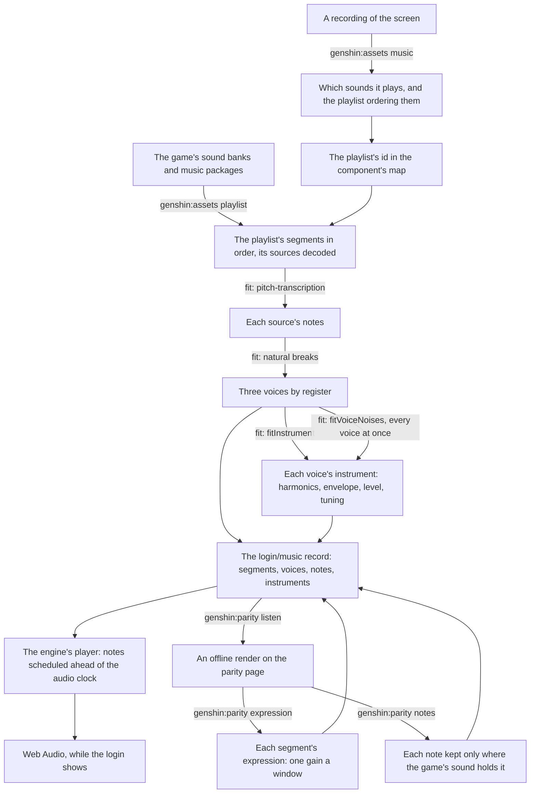

# Music

The login plays its music, and so does ours. The game's audio is a reference, read locally from the installed game and never shipped. What ships is ours: the playlist's structure, the notes, each voice's measured instrument, and a synthesizer that plays them, with recordings of real instruments layered over the voices where they bring a piece nearer the game ([sampled instruments](/docs/genshin/sampled-instruments)). The login is the first piece, and every other piece of the game's music goes through the same steps.

## How it works

## The playlist

- **The structure is exact.** The login's playlist is a continuous sequence that loops forever: a first piece of 104 seconds, a silent segment of about ten seconds, a second piece of 92.75 seconds (its source's last 2.25 seconds trimmed), and the rest again. Every length, trim and the order come from the sound banks (`genshin:assets playlist`), so the handoffs land where the game's do. A recording only found which playlist it is.
- **It plays as loud as the game's mix plays it.** A segment's volume is read from the banks, through its track, every node above it and every bus to the master, with each game parameter at its default (`readGameMixVolumes`). The first piece plays 5 decibels under its source and the second 16, so the second sounds about 11 decibels quieter than the first, as it does in a public recording of the login. The live player applies it on each segment's gain. The fits, the expression and every score work at the source's own level, so a render scored against the source leaves it out.
- **It starts as soon as the browser lets it.** `LoginMusic` renders nothing. It starts the player as the login screen mounts and stops it when the screen goes. The browser's autoplay policy decides whether a new audio context runs or starts suspended, so when it starts suspended the music waits for the first pointer press or key press anywhere on the window, usually the title's own click, and starts there from its beginning. The autoplay rule is MDN's, in [Sources](#sources).

## The fit

The fit turns each source into the record the player reads. Its parts are on their own pages:

- [Voices](/docs/genshin/music/voices) — the notes transcribed from the decoded sound, the notes the game's sound does not hold dropped, the registers, and each voice's measured instrument.
- [Synthesizer](/docs/genshin/music/synthesizer) — the engine's oscillator and noise per note, and the player that schedules them.
- [Expression](/docs/genshin/music/expression) — the swell each segment carries over its voices.
- [Scoring](/docs/genshin/music/scoring) — the listening score that judges a render against the game's sound, and what its numbers are worth.

The score's numbers are not kept on these pages: they are the committed snapshot `scripts/src/services/genshinParity/shared/ParityMusicScores.snapshot.md`, which the `listen` command rewrites.

## Recreating another piece

The order, and the rules each step keeps, are the `genshin-parity` skill's `references/music.md`:

1. Find the sound with `genshin:assets music <recording>` over a recording of the screen.
2. Name its playlist in the component's map (`musicPlaylistId`).
3. Export it with `genshin:assets playlist <component>`.
4. Fit it through the component's fit, after `fitLoginMusic`.
5. Fit its expression with `genshin:parity expression`.
6. Prune its notes with `genshin:parity notes`, then refit its expression.
7. Layer its recordings with `genshin:parity instruments`, then refit its expression with `genshin:parity expression`.
8. Play it from a component that renders nothing, after `Login/Music`, with an `isMotionOnly` fixture.
9. Score it with `listen`.
10. The user listens.

## Key files

| File                                                                   | Role                                                            |
| :--------------------------------------------------------------------- | :-------------------------------------------------------------- |
| `scripts/src/services/genshinAssets/music/extractComponentPlaylist.ts` | A component's playlist resolved from the banks, sources decoded |
| `scripts/src/services/genshinAssets/music/readGameMixVolumes.ts`       | Each segment's volume in the game's mix, from the banks         |
| `scripts/src/services/genshinAssets/fit/fitLoginMusic.ts`              | The login's notes, voices and instruments                       |
| `packages/genshin-world/src/components/Login/Music/Index.vue`          | Where the login's music plays                                   |

## Sources

- [bnnm/wwiser](https://github.com/bnnm/wwiser), the reference parser for Wwise's banks, read to confirm the track's clips and the playlist's items at the banks' version.
- [vgmstream](https://github.com/vgmstream/vgmstream), the decoder for Wwise's Vorbis, pinned in the scripts' cache.
- [Autoplay guide for media and Web Audio APIs](https://developer.mozilla.org/en-US/docs/Web/Media/Guides/Autoplay), MDN: when a browser starts an audio context suspended until the page's first click or key.
