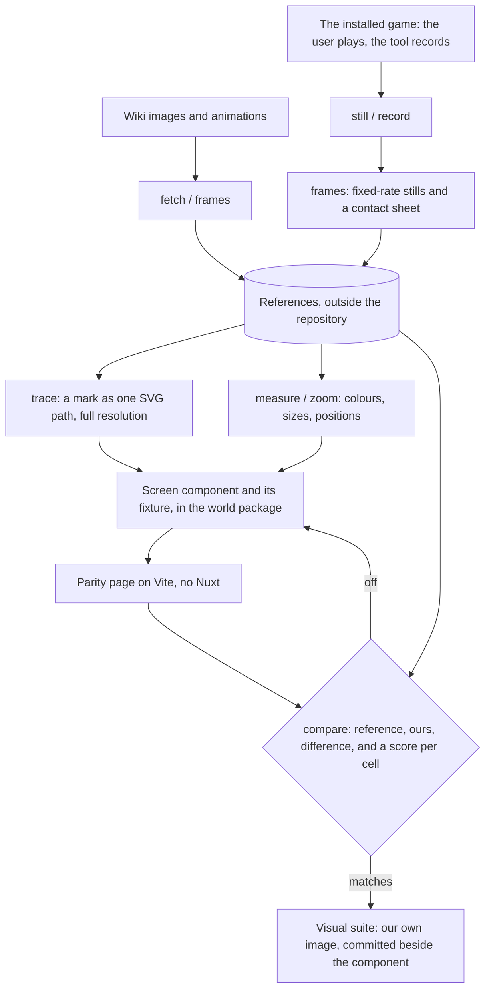

# Parity

The Genshin area recreates the game's own screens, so "does it look right" has an exact answer: the game. Parity is the loop that asks it. It is built for an agent, which reads images but drives no browser of its own: every step is one command that prints numbers and writes an image the agent reads. The user's eye stays the final check. The loop is fast enough that nobody has to wait on that check.

## How it works

## The pieces

- [References](/docs/genshin/parity/references): where a screen's images and recordings come from, and how the game is recorded.
- [Tracing](/docs/genshin/parity/tracing): a mark traced into the SVG path a component draws.
- [Screens](/docs/genshin/parity/screens): a component folder with its fixture, on the parity page and in the suite.
- [Witness](/docs/genshin/parity/witness): the game's exports drawn through our scene and priced against the reference.
- [Clean plate](/docs/genshin/parity/clean-plate): a reference behind an interface, compared over its scene.
- [Comparison](/docs/genshin/parity/compare): the scores, FLIP and the committed report.
- [Light](/docs/genshin/parity/light): the stone light solved from a reference.
- [Passes](/docs/genshin/parity/passes): a new screen derived in passes, each with its measure.
- [Motion](/docs/genshin/parity/motion): motion matched frame by frame.
- [Visual suite](/docs/genshin/parity/visual-suite): approved screens held by the browser suite.
- [Costs](/docs/genshin/parity/costs): the loop's cost, the benches and the GPU reduction.
- [Commands](/docs/genshin/parity/commands): every `genshin:parity` command.

## Shapes come from the game's assets

The interface is rebuilt from screenshots, which its overlay compare holds exactly; a scene's towers, doors and profiles come from the installed game's files. AnimeStudio exports them with the game closed into the references folder, outside the repository like every other reference, and a transform fits our own kits' parameters to them, so only numbers of ours ship ([derived assets](/docs/genshin/derived-assets)).
