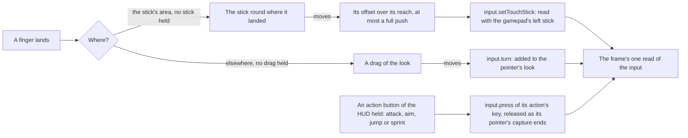

# Touch controls

A phone or a tablet has no keys or mouse to move and look with, so the game's mobile client draws its controls over the world. The world's touch controls are drawn the same way, as the bottom layer of the [HUD](/docs/genshin/hud), whenever the device's main pointer is a finger.

## How it works

- **One input for every device.** The touch controls write into the engine's `input` rather than moving the camera themselves: the stick's axes are added to the gamepad's left stick, a drag's turn to the pointer's look, and each of the HUD's action buttons holds its action's key code as a key would. So the character and its camera, and photo mode's camera, read one move and one look whatever drives them.
- **The stick stands in the game's own rects.** `Hud/Stick` is drawn in the HUD's tree under `MoveJoystick_H4`: its area is the bottom left, a third of the screen across and 340 canvas units up, with the 80 unit strip over it, and its group of back and head is the tree's `GrpJoyStick` and `ImgJoyStickHead`. At rest only the head shows, a faint ring where the mobile recording shows it, 215 units in and 173 up, where the tree's own rect stands 102 in and up, so the game places it as it runs.
- **A thumb in the area holds the stick; anywhere else drags the look.** A finger landing in the stick's area moves the stick round the point it landed on and keeps its moves wherever it goes until it lifts; its offset over the stick's reach is the move, the reach being as far as the head stays inside the back, and a finger pushed past it holds the head at its rim in its direction. A finger landing anywhere else that no piece takes drags the look by how far it moves (`Hud/Touch`). One finger holds each, and lifting it lets go, the stick back at rest.
- **The action buttons are the HUD's.** The attack, the jump, the sprint and, for a bow's wielder, the aim stand in the HUD's own rect for its action buttons beside the skill and burst, measured off the mobile client's recording ([HUD](/docs/genshin/hud)). The jump is the character's jump, as Space is, and the tuning panel's free camera's rise.
- **Only on a touch screen.** The controls are drawn when the device's main pointer is coarse (`(pointer: coarse)`), which the world's session reads and hands to the HUD, so a computer's clicks still reach the world to lock the pointer. Hiding the HUD hides them, and they let go of whatever they held.

## Key files

| File                                                          | Role                                                                |
| :------------------------------------------------------------ | :------------------------------------------------------------------ |
| `packages/genshin-world/src/components/Hud/Stick/Index.vue`   | The stick, in its area of the game's tree                           |
| `packages/genshin-world/src/components/Hud/Touch/Index.vue`   | The look's drag under every piece                                   |
| `packages/genshin-world/src/components/Hud/Actions/Index.vue` | The attack, aim, jump and sprint buttons                            |
| `packages/genshin-world/src/services/hud/constants.ts`        | The stick's place and head at rest, and the look's turn for a pixel |
| `packages/genshin-engine/src/input/createInput.ts`            | `press`, `release`, `setTouchStick` and `turn`, read with the rest  |

## Notes

- **The stick's sizes are the game's canvas units.** Its area, back and head scale with the screen as the game's do, so its reach is a share of the screen rather than a fixed distance on the glass. The back's look and the held head's are provisional, and so is the look's turn for a pixel of a drag, until a recording of a thumb on the stick and a drag is measured ([roadmap](/docs/genshin/roadmap)).
- **The tuning panel's free camera rises by touch but does not fall.** The game's touch layout has no button to descend, so the free camera flown by touch climbs on the jump button and has no way back down.

## Sources

- [Controls](https://genshin-impact.fandom.com/wiki/Controls), Genshin Impact Wiki: the mobile client's every action done by touching the screen, the camera turned by touching and dragging it, and the jump that moves upward where the free camera flies.
- [Game accessibility guidelines](https://gameaccessibilityguidelines.com/full-list/): support for several input devices.

## Reference

- `hud-world-pickup.png` — the mobile client's play screen from a public recording, the [HUD](/docs/genshin/hud)'s reference, which shows the stick at rest.
- `mobile-touch.png` — a recording of a thumb on the mobile client's stick and a drag of its look. On the wiki and YouTube, none found (searched 2026-10-11).
