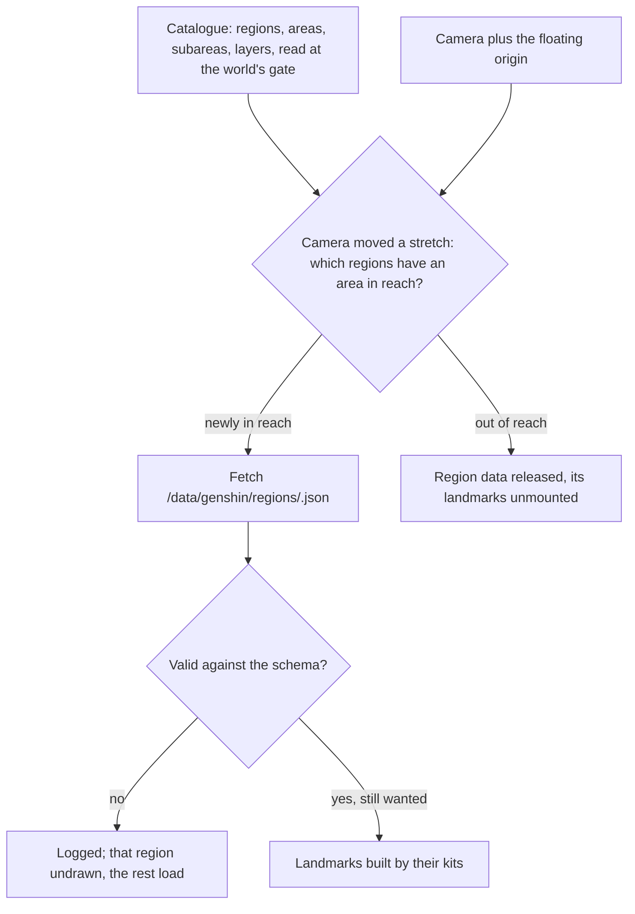

# World map

The world map is the one place a region is described. Every other page reads the world through it: the terrain will take its shapes from it, the weather each area's weather, the vegetation its biomes, and exploring its waypoints. It is organised as the game organises its own map, and world units are metres, y up, with x the game's own x and z the mirror of its z, which the game's map runs north and east.

## How it works

- **The catalogue follows the game's hierarchy.** It runs region, then area, then subarea, with the names the game and its wiki use, and an area's subregion where it has one, such as Liyue's Chenyu Vale or Sumeru's Dharma Forest. Windrise is a subarea of Galesong Hill in Mondstadt. The catalogue is the file people edit (`data/catalogue.json`), its outlines aside, published by `genshin:data authored` as the `catalogue/catalogue` record of the [hosted game data](/docs/genshin/hosted-game-data). The world's screen reads it before it opens, since every view needs it, parsed against its schema as it arrives (`readCatalogue`), and hands it to each view that reads it: the region data's reach, the weather, the map, the minimap and the jumps.
- **Layers for places on their own map.** The surface is one layer. Enkanomiya, the Chasm's underground mines and the Sea of Bygone Eras, which the game draws on maps of their own, are layers (`WorldLayer`) that will carry their own terrain, sky and water, entered at their gates.
- **An area's outline decides reach.** An area carries its outline in world metres, and an empty one counts as infinitely far, so a region with no outlined area never loads.
- **Each outline is drawn round the tiles its places stand on.** No asset the exports' index names holds an area's shape, only a few single places' weather and volume bounds, so `genshin:assets fit windrise --only catalogue` draws them (`fitAreaOutlines`) from the waypoints and statues the game's own area table files under each of its level-one areas, an area being the catalogue's of the same English name. Every terrain tile any of them stands on is cut into 64-metre cells, each the area of the point nearest it (`computeAreaCells`), so two areas sharing a tile split it and no place is two areas'. Each area's cells are traced round to within a cell, its largest piece kept, and the fit writes the outlines back into the catalogue and publishes it. An area the table files no point under keeps what the file gives it: Snezhnaya's, which the table does not hold yet, are empty but for Everfrozen Earth's provisional square round Snezhnograd ([region buildings](/docs/genshin/region-buildings)).
- **An area names its weather.** Each area lists the weathers it can have, its own first, as the wiki ties weather to areas; whichever area holds the camera sets the world's weather ([weather](/docs/genshin/weather)).
- **Regions load by reach and are released.** Once the camera has moved a stretch, `useRegionData` finds every region with an area within reach (`computeOutlineDistance`, zero inside an outline) and fetches the ones it does not hold as `/data/genshin/regions/<region>.json`, which the app's server serves from the world package's `src/data/regions` (`GENSHIN_REGION_DATA_BASE_URL`), with the region's ground and the palettes of its buildings' kits from the [hosted game data](/docs/genshin/hosted-game-data) (`readLoadedRegion`). It releases those that have left reach, all but a region's ground, which is kept once it arrives. A region is fetched rather than imported because the browser keeps an imported module for the life of the page, so an imported region could never be released. A region that leaves reach while it is still fetching is not kept.
- **Landmarks are kits with parameters.** A landmark records its kind, its area, where it stands on the ground, how far above or into the ground its base sits, and which way it faces. Its kind decides the kit that builds it and the options it carries (`landmarkSchema`, a union by kind). Windrise's great oak is a tree landmark with its tree options, its Statue of The Seven a statue landmark, and each region's capital a building landmark its region's kit builds ([region buildings](/docs/genshin/region-buildings)); where both stand and which way they face is written by `genshin:assets fit windrise` from the game's own placements ([derived assets](/docs/genshin/derived-assets)), and the rest of each is the region's own. `Landmarks` builds every landmark of every region in reach, so a region's landmarks appear as its data arrives and go when it is released.
- **A schema failure hides one region, not the world.** A region whose data fails validation, or whose fetch has not answered within `DATA_FETCH_TIMEOUT_MS`, is logged and left undrawn while the rest of the continent loads, so a stalled request never holds the world from being ready.

## Key files

| File                                                              | Role                                                             |
| :---------------------------------------------------------------- | :--------------------------------------------------------------- |
| `packages/genshin-world/src/data/catalogue.json`                  | Every region, area and subarea the game ships, and their layers  |
| `packages/genshin-world/src/services/world/readCatalogue.ts`      | The catalogue read from the hosted game data at the world's gate |
| `packages/genshin-world/src/models/world/Catalogue.ts`            | The catalogue's shape: regions, areas, subareas and outlines     |
| `packages/genshin-world/src/models/world/RegionData.ts`           | A region's authored data: its landmarks                          |
| `packages/genshin-world/src/models/world/Landmark.ts`             | A landmark, by kind, with the options its kit builds it from     |
| `packages/genshin-world/src/data/regions/mondstadt.json`          | Mondstadt's landmarks: Windrise's oak and statue                 |
| `packages/genshin-world/src/composables/useRegionData.ts`         | Regions fetched by reach, validated and released                 |
| `packages/genshin-engine/src/world/computeOutlineDistance.ts`     | How far a point is from an area's outline                        |
| `scripts/src/services/genshinAssets/fit/fitAreaOutlines.ts`       | Each area's outline drawn round the tiles its waypoints stand on |
| `scripts/src/services/genshinAssets/fit/computeAreaCells.ts`      | The tiles' cells split between the areas by the nearest point    |
| `packages/genshin-world/src/components/World/Landmarks/Index.vue` | Every landmark in reach, built by its kind's kit                 |

## Notes

- **Names are facts.** The catalogue's names come from the game's wiki, and no region's shape is taken from any map's imagery.
- **A tile no waypoint stands on is in no area.** A peak or a stretch of sea the waypoints leave out lies outside every outline, so its weather is clear and its region loads only once another outline is in reach.
- **Event areas are left out.** Places that existed only for an event, such as the Golden Apple Archipelago, are not part of the continent the catalogue describes.

## Sources

- [Area](https://genshin-impact.fandom.com/wiki/Area), Genshin Impact Wiki: the areas of each region and their subregions, and each area lit on the map by its Statue of The Seven.
- [Map](https://genshin-impact.fandom.com/wiki/Map), Genshin Impact Wiki: Enkanomiya and the Chasm's underground mines unlocked as maps of their own, which is where the layers come from.

## Reference

- `world-map.mkv` — the map opened on M over the character's own area, the zoom slider pressed in and out to its ends, a waypoint chosen on the map and Teleport pressed on the panel it opens, 30 seconds at most. Partly found 2026-10-11: https://www.youtube.com/watch?v=gN1IURjDuWo at 0–30 s (`captures/yt-gN1IURjDuWo-world-map.mp4`); still sought: a waypoint chosen on the map and Teleport pressed on the panel it opens; the zoom slider ends are only shown as the map zooms.
