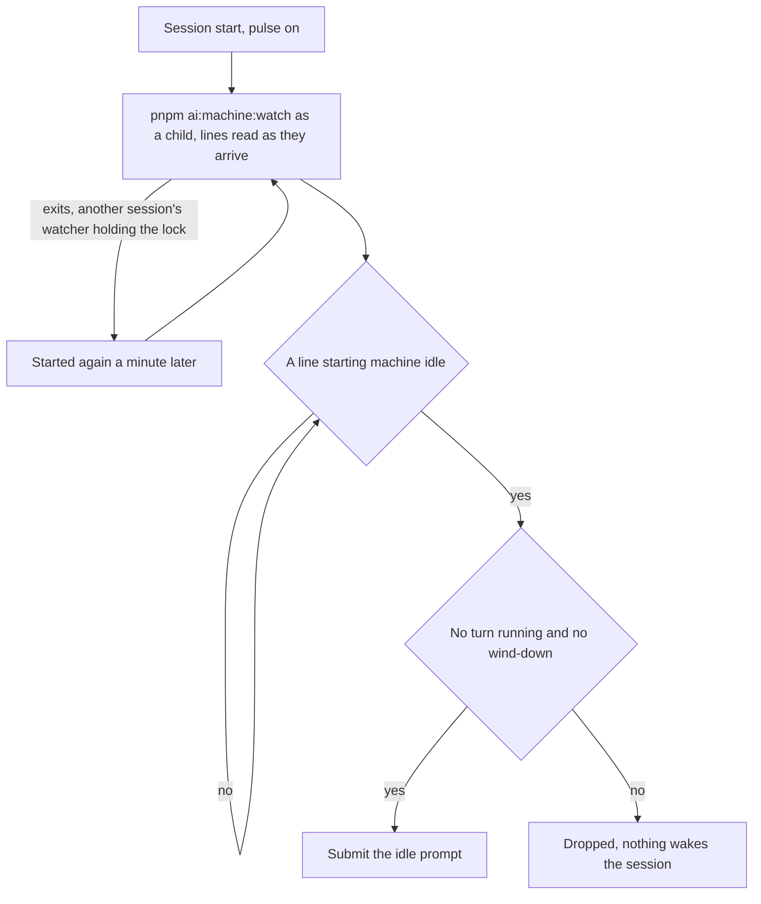

# Pulse

Part of [Genshin mods](/docs/infra/claude-interface/genshin-mods). The machine watcher, `pnpm ai:machine:watch`, reads the machine's CPU, GPU and free memory each minute, and the fleet's idle time is what it measures. A watcher run under Monitor ends at the Monitor's expiry, which comes within thirty minutes and with the session, so a machine could sit idle for a day with nothing to wake the session. The pulse runs the watcher as the session's own child and reads the lines it prints, so an idle machine wakes the session by the watcher's own event rather than by a clock asking the state file.

Pulse draws no row above the prompt. Its visible act is a prompt the session takes as a turn of its own.

## How it works

At session start, with pulse on, the plugin starts `pnpm ai:machine:watch` in the session's directory as a child process and reads its output as it arrives, a whole line at a time. Outside the repository the watcher's script is not there, so nothing starts. The watcher writes each reading to `~/.esposter/machine/state.json`, and it holds `~/.esposter/machine/watcher.lock` for its life, taken before its first sample: a watcher that finds the lock held by a live process exits, so two sessions starting together never sample the machine twice. A lock whose process is gone, written before the machine last booted, or left empty past the seconds' grace its writer has to write its process id in, is taken over: it is judged and replaced only by the one process holding its takeover file, with its holder and its time read through one open file, so two processes taking one over together never remove the lock the first has just taken, and a lock is only ever released by the process holding it. The watcher is the session's: it ends with the Claude Code process that started it. Each session starts its watcher again a minute after it exits, so while one session's watcher holds the lock the others' exit each minute, and once that session ends another open session takes the watching over within a minute; only the session whose watcher holds the lock is woken by its idle line.

The watcher prints one line when the machine goes idle, `machine idle: …`, and repeats that line every fifteen minutes (`REMINDER_MINUTES`) while the machine stays idle. Idle is a full three-minute window of CPU under 80% with free memory above its room share; the line also carries the GPU's figure, which the idle test does not weigh. Each idle line wakes the session, unless a turn is running or a usage reserve is winding down, in which case the line is dropped and nothing wakes the session for it. A maintenance tier still wakes, since its instruction keeps the cleanup on haiku.

The wake is a prompt, `IDLE_WAKE_PROMPT`, that tells the session to run `pnpm ai:fleet:fill`, then to launch one background haiku agent per brief it printed, with the brief as its prompt, and to report what started. A brief names the entry, its spec, the command that releases it and the standing rules. When the command prints `nothing ready`, the session reports that instead.

The session also runs `pnpm ai:fleet:fill` before anything else when an agent reports with the machine under its line, so a finished agent's slot is refilled at once (the `throughput` skill).

## How to use it

Pulse is on by default, and `/pulse off` stops it; `/pulse on` turns it back on, and the switch is kept as every mod's is, on the [Genshin mods](/docs/infra/claude-interface/genshin-mods) page. The switch is read at session start, so a change takes effect in the next session. With pulse off nothing starts the watcher, and `pnpm ai:resume` reports the watcher as not running until one is started by hand or a session with pulse on runs.

`pnpm ai:resume` has a `watcher` row for this: it is satisfied while the watcher's reading is fresh and its process is alive, and otherwise names `pnpm ai:machine:watch`, or starting a session with the plugin, as its action.

## Notes

- The idle line is the watcher's, decided by its own three-minute window of CPU and by its memory room. The watcher reads the GPU and the line carries its figure, but the idle test does not weigh it.
- A watcher stops with its session, so a machine with no session open reports no reading and its heartbeat pauses until one starts.
- The idle line repeats on the watcher's reminder while the machine stays idle, so an idle session is woken again at each reminder rather than on a timer of the pulse's own.

## Key files

| File                                                           | Role                                                                                                            |
| :------------------------------------------------------------- | :-------------------------------------------------------------------------------------------------------------- |
| `packages/genshin-mods/src/services/registerLifecycle.ts`      | Session start starts the watcher and reads its lines                                                            |
| `packages/genshin-mods/src/services/pulse/getPulseWake.ts`     | The wake decision, a pure function over one watcher line and the session                                        |
| `packages/genshin-mods/src/services/pulse/takeWatcherLines.ts` | Splits the watcher's chunks into whole lines, holding a partial one                                             |
| `packages/genshin-mods/src/services/constants.ts`              | The idle line's prefix, the watcher's script path and the wake prompt                                           |
| `scripts/src/services/machine/watchMachine.ts`                 | The watcher's loop, which refuses to start while another watcher holds the claim                                |
| `scripts/src/services/machine/claimMachineWatch.ts`            | The watcher's claim, `watcher.lock`, taken before its first sample and taken over only once its process is gone |
| `scripts/src/services/machine/writeMachineState.ts`            | The watcher's write of its reading, renamed over the file it replaces                                           |
| `scripts/src/services/resume/getWatcherItems.ts`               | The `watcher` row of `pnpm ai:resume`                                                                           |
