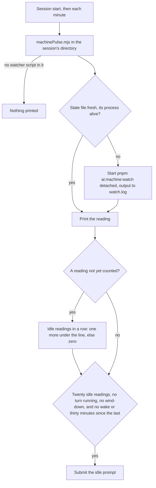

# Pulse

Part of [Genshin mods](/docs/infra/claude-interface/genshin-mods). The machine watcher, `pnpm ai:machine:watch`, reads the machine's CPU, GPU and free memory each minute, and the fleet's idle time is what it measures. A session that ran the watcher under Monitor lost it at the Monitor's expiry, which comes within thirty minutes and with the session, so a machine could sit idle for a day with nothing to wake the session that would have started its work. Pulse removes the arming: any session with the plugin keeps the watcher running, and wakes an idle session with the work the fleet has ready.

Pulse draws no row above the prompt. Its one visible act is a prompt the session takes as a turn of its own.

## How it works

Each minute, and once at session start, the plugin runs `scripts/machinePulse.mjs` with the session's directory. Outside the repository the script prints nothing, since the watcher's script is not there. Inside it, the script reads the watcher's latest reading from `~/.esposter/machine/state.json`, which the watcher writes each minute, and starts `pnpm ai:machine:watch` detached when that reading is missing, older than three minutes, or written by a process that has exited. The watcher's output is appended to `~/.esposter/machine/watch.log`. The script then prints the reading, and the plugin counts it.

A reading is idle when the CPU is under 80% and the GPU is under 80% or unread. Each new reading counts once, so the count is of readings, and a reading at or over the line starts the count again at zero. The session is woken when the count reaches twenty, no turn is running, and no usage reserve is winding down. A maintenance tier still wakes, since its instruction keeps the cleanup on haiku. The first wake of an idle episode is immediate once those hold, and while the machine stays idle the session is woken again at most every thirty minutes.

The wake is a prompt, `IDLE_WAKE_PROMPT`, that tells the session to run `pnpm ai:resume`, to take the next unit with `pnpm ai:fleet:next --kind unit`, and to start a runner for each compute-queue lane with items, every agent on haiku unless a call needs the main session.

## How to use it

Pulse is on by default, and `/pulse off` stops it; `/pulse on` turns it back on. The setting is kept in the plugin's store, so it holds for every later session. With pulse off nothing starts the watcher, and `pnpm ai:resume` reports the watcher as not running until one is started by hand or a session with pulse on runs.

`pnpm ai:resume` has a `watcher` row for this: it is satisfied while the watcher's reading is fresh and its process is alive, and otherwise names `pnpm ai:machine:watch`, or starting a session with the plugin, as its action.

## Notes

- The idle count is the pulse's own. The watcher's `minutesInState` classifies a machine as busy, idle or tight by its memory gate and its CPU average over three minutes, which is a different line from the 80% that wakes a session.
- A reading older than three minutes restarts the watcher even when its process is still alive, since a live watcher that writes nothing is one the pulse cannot otherwise see. A machine whose memory reader returns nothing every minute would therefore restart the watcher each minute, and `pnpm ai:resume` would show it.
- A run whose script exits non-zero is silent and the next tick tries again. A run that cannot start `node` at all rejects, and the timer slot leaves that rejection unhandled.

## Key files

| File                                                            | Role                                                                              |
| :-------------------------------------------------------------- | :-------------------------------------------------------------------------------- |
| `packages/genshin-mods/scripts/machinePulse.mjs`                | Reads the watcher's reading, starts the watcher when it is missing, stale or dead |
| `packages/genshin-mods/src/services/registerLifecycle.ts`       | The minute clock and session start that run the pulse, and the wake itself        |
| `packages/genshin-mods/src/services/pulse/getPulseWake.ts`      | The wake decision, a pure function over the reading and the session               |
| `packages/genshin-mods/src/services/pulse/getIdleMinutes.ts`    | The count of idle readings in a row                                               |
| `packages/genshin-mods/src/services/pulse/checkIsIdle.ts`       | Under the line on the CPU, and on the GPU or unread                               |
| `packages/genshin-mods/src/services/pulse/parseMachinePulse.ts` | The script's stdout as a reading, or nothing outside the repository               |
| `packages/genshin-mods/src/services/constants.ts`               | The line, the wait, the repeat interval and the wake prompt                       |
| `scripts/src/services/machine/writeMachineState.ts`             | The watcher's write of its reading, renamed over the file it replaces             |
| `scripts/src/services/resume/getWatcherItems.ts`                | The `watcher` row of `pnpm ai:resume`                                             |
