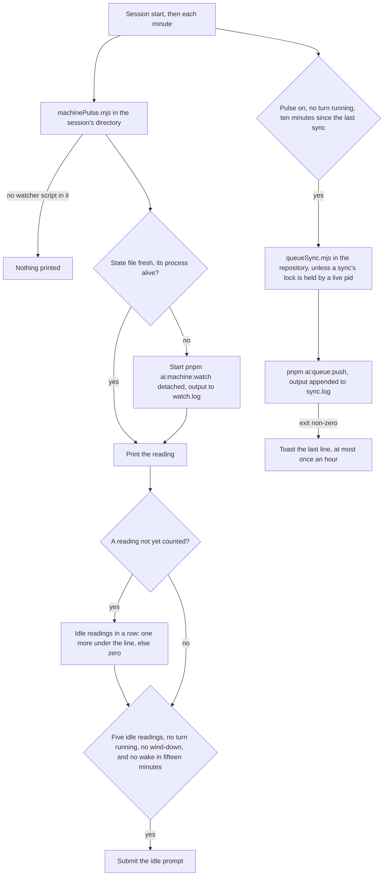

# Pulse

Part of [Genshin mods](/docs/infra/claude-interface/genshin-mods). The machine watcher, `pnpm ai:machine:watch`, reads the machine's CPU, GPU and free memory each minute, and the fleet's idle time is what it measures. A session that ran the watcher under Monitor lost it at the Monitor's expiry, which comes within thirty minutes and with the session, so a machine could sit idle for a day with nothing to wake the session that would have started its work. Pulse removes the arming: any session with the plugin keeps the watcher running, and wakes an idle session to fill the machine with the work the fleet has ready.

Pulse draws no row above the prompt. Its visible acts are a prompt the session takes as a turn of its own, and a toast when a queue push fails.

## How it works

Each minute, and once at session start, the plugin runs `packages/genshin-mods/scripts/machinePulse.mjs` with the session's directory. Outside the repository the script prints nothing, since the watcher's script is not there. Inside it, the script reads the watcher's latest reading from `~/.esposter/machine/state.json`, which the watcher writes each minute, and starts `pnpm ai:machine:watch` detached when that reading is missing, older than three minutes, or written by a process that has exited. The watcher's output is appended to `~/.esposter/machine/watch.log`. The script then prints the reading, and the plugin counts it.

A reading is idle when the CPU is under 80% and the GPU is under 80% or unread. Each new reading counts once, so the count is of readings, and a reading at or over the line starts the count again at zero. The session is woken when the count reaches five, no turn is running, and no usage reserve is winding down. A maintenance tier still wakes, since its instruction keeps the cleanup on haiku. The first wake of an idle episode is immediate once those hold, and while the machine stays idle the session is woken again at most every fifteen minutes.

The wake is a prompt, `IDLE_WAKE_PROMPT`, that tells the session to run `pnpm ai:fleet:fill`, then to launch one background haiku agent per brief it printed, with the brief as its prompt, and to report what started. A brief names the entry, its spec, the command that releases it and the standing rules. When the command prints `nothing ready`, the session reports that instead.

The session also runs `pnpm ai:fleet:fill` before anything else when an agent reports with the machine under its line, so a finished agent's slot is refilled at once (the `throughput` skill).

## Queue sync

On the same minute tick, every ten minutes and only outside a turn, the plugin runs `packages/genshin-mods/scripts/queueSync.mjs` with the session's directory. The script does nothing outside the repository, and nothing while a previous sync still runs: a lock file at `~/.esposter/queue/sync.lock` holds the pid of the sync that took it, and a sync is skipped while that pid is alive. Inside the repository, the script runs `pnpm ai:queue:push` in its root, spawned without a shell, and appends the output to `~/.esposter/queue/sync.log`.

A sync is silent when it succeeds. When it exits non-zero, one toast carries the last line of its output, and a further failure is not toasted until an hour has passed. The pulse switch covers the sync as it covers the watcher, so `/pulse off` stops both. The push records itself in `~/.esposter/queue/last-push.json`, which each machine's heartbeat carries, so the other machines see its progress in `pnpm ai:fleet:status` without any message.

## How to use it

Pulse is on by default, and `/pulse off` stops it; `/pulse on` turns it back on, and the switch is kept as every mod's is, on the [Genshin mods](/docs/infra/claude-interface/genshin-mods) page. With pulse off nothing starts the watcher, and `pnpm ai:resume` reports the watcher as not running until one is started by hand or a session with pulse on runs.

`pnpm ai:resume` has a `watcher` row for this: it is satisfied while the watcher's reading is fresh and its process is alive, and otherwise names `pnpm ai:machine:watch`, or starting a session with the plugin, as its action.

## Notes

- The idle count is the pulse's own. The watcher's `minutesInState` classifies a machine as busy, idle or tight by its memory gate and its CPU average over three minutes, which is a different line from the 80% that wakes a session.
- A watcher is started only when none is alive: no reading exists, or the process that wrote the last one has exited. A live watcher is never started twice. A reading older than three minutes from a live watcher, which a machine whose memory reader returns nothing would leave, is read as no reading, so the pulse wakes nothing on it, and `pnpm ai:resume` shows it.
- A run whose script exits non-zero is silent and the next tick tries again. A run that cannot start `node` at all rejects, and the timer slot leaves that rejection unhandled.

## Key files

| File                                                            | Role                                                                       |
| :-------------------------------------------------------------- | :------------------------------------------------------------------------- |
| `packages/genshin-mods/scripts/machinePulse.mjs`                | Reads the watcher's reading, starts the watcher when none is alive         |
| `packages/genshin-mods/src/services/registerLifecycle.ts`       | The minute clock and session start that run the pulse, and the wake itself |
| `packages/genshin-mods/scripts/queueSync.mjs`                   | Runs `pnpm ai:queue:push` in the repository, under the sync lock           |
| `packages/genshin-mods/src/services/pulse/getQueueSyncDue.ts`   | The sync decision, a pure function over the last sync, the clock and turns |
| `packages/genshin-mods/src/services/pulse/getPulseWake.ts`      | The wake decision, a pure function over the reading and the session        |
| `packages/genshin-mods/src/services/pulse/getIdleMinutes.ts`    | The count of idle readings in a row                                        |
| `packages/genshin-mods/src/services/pulse/checkIsIdle.ts`       | Under the line on the CPU, and on the GPU or unread                        |
| `packages/genshin-mods/src/services/pulse/parseMachinePulse.ts` | The script's stdout as a reading, or nothing outside the repository        |
| `packages/genshin-mods/src/services/constants.ts`               | The line, the wait, the repeat interval and the wake prompt                |
| `scripts/src/services/machine/writeMachineState.ts`             | The watcher's write of its reading, renamed over the file it replaces      |
| `scripts/src/services/queue/writeLastPush.ts`                   | The record of each push, which the heartbeat carries                       |
| `scripts/src/services/resume/getWatcherItems.ts`                | The `watcher` row of `pnpm ai:resume`                                      |
