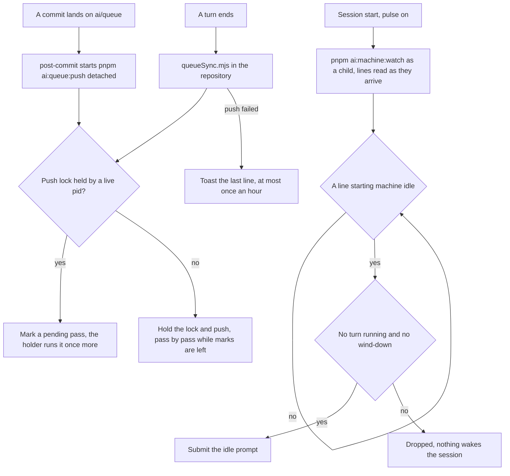

# Pulse

Part of [Genshin mods](/docs/infra/claude-interface/genshin-mods). The machine watcher, `pnpm ai:machine:watch`, reads the machine's CPU, GPU and free memory each minute, and the fleet's idle time is what it measures. A session that ran the watcher under Monitor lost it at the Monitor's expiry, which comes within thirty minutes and with the session, so a machine could sit idle for a day with nothing to wake the session. The pulse runs the watcher as the session's own child and reads the lines it prints, so an idle machine wakes the session by the watcher's own event rather than by a clock asking the state file.

Pulse draws no row above the prompt. Its visible acts are a prompt the session takes as a turn of its own, and a toast when a queue push fails.

## How it works

At session start, with pulse on, the plugin starts `pnpm ai:machine:watch` in the session's directory as a child process and reads its output as it arrives, a whole line at a time. Outside the repository the watcher's script is not there, so nothing starts. The watcher writes each reading to `~/.esposter/machine/state.json`, and it holds `~/.esposter/machine/watcher.lock` for its life, taken before its first sample: a watcher that finds the lock held by a live process exits, so two sessions starting together never sample the machine twice. A lock whose process is gone, or written before the machine last booted, is taken over. The watcher is the session's: it ends with the Claude Code process that started it.

The watcher prints one line when the machine goes idle, `machine idle: …`, and repeats that line on each reminder interval while the machine stays idle. Idle is a full three-minute window of CPU under 80% with free memory above its room share. Each idle line wakes the session, unless a turn is running or a usage reserve is winding down, in which case the line is dropped and nothing wakes the session for it. A maintenance tier still wakes, since its instruction keeps the cleanup on haiku.

The wake is a prompt, `IDLE_WAKE_PROMPT`, that tells the session to run `pnpm ai:fleet:fill`, then to launch one background haiku agent per brief it printed, with the brief as its prompt, and to report what started. A brief names the entry, its spec, the command that releases it and the standing rules. When the command prints `nothing ready`, the session reports that instead.

The session also runs `pnpm ai:fleet:fill` before anything else when an agent reports with the machine under its line, so a finished agent's slot is refilled at once (the `throughput` skill).

## Queue sync

Each turn's end runs `packages/genshin-mods/scripts/queueSync.mjs` with the session's directory, once the turn has returned, so the push never holds the turn. The script runs `pnpm ai:queue:push` in the repository, and does nothing outside it. The push itself holds the lock: a turn ending while a push runs only marks one more pass, so a sync never starts a second push beside a running one.

A sync is silent when it succeeds. When it exits non-zero, one toast carries the last line of its output, and a further failure is not toasted until an hour has passed. The pulse switch covers the sync as it covers the watcher, so `/pulse off` stops both. The push records itself in `~/.esposter/queue/last-push.json`, which each machine's heartbeat carries.

The push is triggered by a commit as well: the repository's `post-commit` hook starts `pnpm ai:queue:push` detached when a commit lands on `ai/queue`, its output appended to `~/.esposter/queue/sync.log`. The hook is the one trigger a session needs, and a turn's end is the second, so a session never pushes by hand except to retry.

## How to use it

Pulse is on by default, and `/pulse off` stops it; `/pulse on` turns it back on, and the switch is kept as every mod's is, on the [Genshin mods](/docs/infra/claude-interface/genshin-mods) page. The switch is read at session start, so a change takes effect in the next session. With pulse off nothing starts the watcher, and `pnpm ai:resume` reports the watcher as not running until one is started by hand or a session with pulse on runs.

`pnpm ai:resume` has a `watcher` row for this: it is satisfied while the watcher's reading is fresh and its process is alive, and otherwise names `pnpm ai:machine:watch`, or starting a session with the plugin, as its action.

## Notes

- The idle line is the watcher's, decided by its own window of CPU and by its memory room, and it does not read the GPU. The earlier pulse counted five idle readings of CPU and GPU together, so a session now wakes after about three minutes of idle, not five.
- A watcher stops with its session, so a machine with no session open reports no reading and its heartbeat pauses until one starts.
- The idle line repeats on the watcher's reminder interval while the machine stays idle, so an idle session is woken again at each reminder rather than on the pulse's own timer.

## Key files

| File                                                           | Role                                                                                  |
| :------------------------------------------------------------- | :------------------------------------------------------------------------------------ |
| `packages/genshin-mods/src/services/registerLifecycle.ts`      | Session start starts the watcher's lines, turn end runs the queue sync                |
| `packages/genshin-mods/src/services/pulse/getPulseWake.ts`     | The wake decision, a pure function over one watcher line and the session              |
| `packages/genshin-mods/src/services/pulse/takeWatcherLines.ts` | Splits the watcher's chunks into whole lines, holding a partial one                   |
| `packages/genshin-mods/src/services/constants.ts`              | The idle line's prefix, the watcher's script path and the wake prompt                 |
| `packages/genshin-mods/scripts/queueSync.mjs`                  | Runs `pnpm ai:queue:push` in the repository at a turn's end                           |
| `.githooks/post-commit`                                        | Starts `pnpm ai:queue:push` detached when a commit lands on `ai/queue`                |
| `scripts/src/queue/push/index.ts`                              | The one push entry the hook and the mod share, under its lock                         |
| `scripts/src/queue/push/runQueuePush.ts`                       | The lock and pending loop, one push at a time, a marked commit run once more          |
| `scripts/src/services/machine/watchMachine.ts`                 | The watcher's loop, which exits while another watcher holds its lock                  |
| `scripts/src/services/shared/acquireProcessLock.ts`            | The lock the watcher and the queue push each hold, taken over once its holder is gone |
| `scripts/src/services/machine/writeMachineState.ts`            | The watcher's write of its reading, renamed over the file it replaces                 |
| `scripts/src/services/queue/writeLastPush.ts`                  | The record of each push, which the heartbeat carries                                  |
| `scripts/src/services/resume/getWatcherItems.ts`               | The `watcher` row of `pnpm ai:resume`                                                 |
