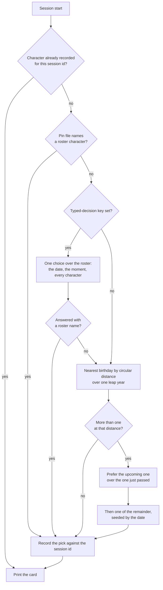

# Picking a character

The rule that decides which character a session is given, and the record that keeps it.

## How a session gets its character

By default the pick is **whoever's birthday is nearest to today**, so the character changes with the calendar rather than by a counter, and the card can say why — a bracketed note under the name, "[Birthday: 20 September, today]" or "[Birthday: 23 September, in 3 days]" — a line of context that is true today and false next week. Every session started on one day gets the same answer, because the pick is a function of the date alone.

With a [typed-decision](/docs/infra/typed-decisions) key in the plugin's options, the session's character is **picked by lore** instead: one choice question over the whole roster, each character an option described by **the habits their card was written with** — how they actually are to talk to — with the game's own line about them standing in only for a character nobody has carded yet. Alongside it is the state code knows for certain: every character's facts, including the affiliation, weapon and constellation the data always held and nothing used to read, with their birthday measured from today, and the person's moment — the date, the weekday, the hour, the time zone and the locale, which is all the machine knows without asking, and the characters the person met in the last week's sessions with the date each was met, read from the pick records. Those are state, not weights: if variety matters the tier weighs it in its own odds, and nothing in the code scales them. The description is deliberately absent from that state, because the habits say the same thing better and saying it twice was the largest thing the request carried for nothing. The character is **drawn from the answer's probabilities, not taken as its top choice**: one random draw weighted by exactly the odds the tier returned, with no weighting of our own, so lore leads without the same favourite meeting every session near a birthday. No confidence floor applies, because a floor guards an action and a pick is a preference. The tier is asked afresh at every session start rather than once a day: a round trip of about a second is cheap enough to spend each time, and a little variety between the day's sessions is what the lore pick is for. The call is one attempt with a short ceiling, and anything short of an answer — no key, a timeout, a name the roster does not hold — falls back to the birthday pick, never to the failure card.

The answer is a distribution over the whole roster, and the welcome shows it rather than keeping the one name: a bar chart of the drawn character and the nearest runners-up, one row each of a bar, the probability and the name, the bars scaled to the longest of them. It costs nothing — the probabilities arrive in the same answer as the choice — and it is the one place the person sees what the pick weighed, since a typed decision returns numbers and no rationale. When the tier did not answer, the welcome says so beside the birthday pick that stood in, with the reason: a hook's stderr reaches nobody, and a key that expired would otherwise fall back in silence at every start.

The edge cases, each decided and each covered by the pick's tests:

- **Several share the nearest birthday.** The upcoming one wins over the one just passed, because anticipation reads better than aftermath. Among what is left the choice is seeded by the date through a small string hash, so it feels random day to day and is identical for every session started that day.
- **The session crosses midnight.** Whatever the session is given — the pin's character or a pick — is recorded against the session id at startup and reused on every later start event that keeps the id — compact, resume — so a compaction after midnight never swaps the character mid-conversation, and a pin set after the session started leaves it alone. A clear is a new session id, so it is a new session to the hook and gets a fresh pick. Records older than a week are pruned whenever one is written.
- **Year wrap and leap day.** Every month and day is measured as a day of one leap year, so late December and early January are neighbours and a 29 February is a day like any other.
- **A character with no birthday** — Aether and Lumine — is never picked by distance, only pinned.
- **A pin names a character the roster does not hold.** The pin is ignored and the pick stands; the `today` command reports the stale pin.
- **The tier cannot be reached, or answers a name that is not in the roster.** The birthday pick stands in for that session with the reason in the welcome, and the next start asks again. The `today` command run from a shell asks the same way, so under the lore pick it shows one answer the next session may not repeat, and reports the same reason when the tier gave none; run inside a session it shows that session's own record.
- **The workspace is not installed** — a fresh clone before the first install — or **anything else fails.** A process-level handler registered before any work exits zero with nothing printed, the session starts with no character, and the output style answers plainly. A session start is never blocked by its own decoration.

The hook reads one package and one state directory under the user's Claude home: the pick records as tab-separated lines, a shape that cannot fail to parse, plus a pin file, a mute flag, a volume and the roster cached against the installed data package's version. Every write into that directory lands on a temp sibling and is renamed over its target, so a session killed part-way through leaves the previous file rather than half of this one. The cache is the file that needs it: the others are read a line and a field at a time and survive losing either, while half-written JSON would throw in every later session instead of being rebuilt. The one network call it may make is the lore pick's, and only with a key set.

**Why a hook picks and not the model.** A skill the model chooses from would spend a decision every session on a question with a fixed answer. That is the [typed decisions](/docs/infra/typed-decisions) rule applied to the terminal: a nearest-birthday lookup is the cheapest tier there is, code, and where a judgement is wanted it goes to the typed-decision tier at each start, never to the session's own model.

## Key files

| File                                                               | Role                                                                                                     |
| :----------------------------------------------------------------- | :------------------------------------------------------------------------------------------------------- |
| `packages/genshin-persona/scripts/pick.ts`                         | The session-start entrypoint: resolve the character, print the card, never fail                          |
| `packages/genshin-persona/src/services/getSessionNameplate.ts`     | The nameplate's resolution, never another session's record                                               |
| `packages/genshin-persona/src/services/pickCharacter.ts`           | The nearest-birthday pick and its two tie-breaks                                                         |
| `packages/genshin-persona/src/services/resolveSessionCharacter.ts` | The session's record, then the pin, then a fresh pick; whichever it is, the session records it           |
| `packages/genshin-persona/src/services/pickCurrentCharacter.ts`    | The lore pick with a key, asked afresh each start, else the birthday pick                                |
| `packages/genshin-persona/src/services/getLorePickRequest.ts`      | The one choice over the roster and the state it is asked over                                            |
| `packages/genshin-persona/src/services/drawLoreChoice.ts`          | The draw over the tier's odds, weighted by them alone                                                    |
| `packages/genshin-persona/src/services/formatLoreChart.ts`         | The tier's answer as a bar chart: the choice first, the runners-up by probability, three aligned columns |
