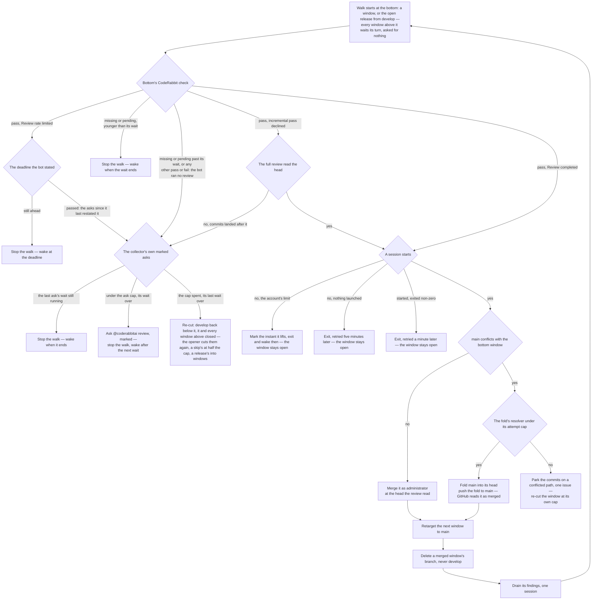

# Gate and merge

The walk that settles the open windows before any window opens, and the merge it makes once a review completes.

## The open windows: gate and merge, bottom up

**A window gets one review, and merges once it completes and a session could drain it.** Each window's pull request is based on the window below it, and only the bottom one is based on `main`, so the walk only ever merges the bottom one. A window's review starts when its pull request opens and reads the window's diff against its base, which is only what that window adds. Its branch is never pushed to again, so the review reads a head that does not move. Whatever the review finds is not fixed on that pull request: it merges once a session probe succeeds, and its findings are drained into the next window, whose review reads the fixes in full.

- **The status is the whole answer.** With one review per window, a completed check at the head is that review, and its flip to completed arrives as a status event of its own. A check the bot marked `Review skipped: incremental reviews are disabled` is the bot declining a second pass, not a verdict: it proceeds when the bot's latest review names the head, and is a skip like any other when commits landed after that review. Any other finished state — a `pass` whose description the gate does not name, or a `fail` — is the bot running no review: a skip for the plan's file limit or its usage credits, or a review that failed. Its sentence carries its own counts, so it is matched by elimination. Each window's check is read on its own, since each has its own head.
- **A rate limit asks again, and an ask it leaves unanswered is asked as a skip is.** `Review rate limited` means the bot ran nothing. The [runner's retrigger](/docs/infra/review-collector/runner) sleeps out the deadline the bot stated on the window next to merge, and once it has passed the window goes through the same marked asks, waits and re-cut as a skipped review (`settleReviewAsk`). The bot answers an ask by running the review or by restating the limit in its block, so only the asks posted since the block was last rewritten count: a restated limit is a fresh deadline and a fresh count, and only an ask nothing answers spends one. A window still unreviewed past the last ask's wait is re-cut under the cap it was cut under, not half of it, since the bot never read it and its size is not what held it. A block the bot never rewrote after an ask would hold the window with no wake and nothing more to post, so its ask is marked and counted like a skip's, and the collector finishes unattended at the plan's full rate without a push or a person.
- **A completed review waits its turn.** A window whose review completed above one still running is merged by a later run, once the window below it has merged. The walk takes the bottom window only, so a merge is never made over a window below it.
- **Only the window next to merge is asked for its review.** The bot serves whichever review reaches a free slot of its rolling allowance first, and a window above the bottom merges no sooner for a review it gets first, so an ask above the bottom is a slot the bottom's own review is refused — and a rate-limited bottom holds every window above it. So the walk settles a rate limit, a skip, a missing check or a pending one on the window next to merge alone, and a window above it is asked for nothing until every window below it has merged; its retarget to `main` then has the bot attempt its review again, and the walk asks it like any bottom window. The order is the asks' only: a window's opening is its own first ask, which the bot answers whatever stands below it, so the [opening](/docs/infra/review-collector/collection-cycle/opening)'s cap is what keeps that to the one window above the bottom.
- **Retarget, then delete.** Merging the bottom window is followed by retargeting the next one to `main`, and only then deleting the merged window's branch: deleting a branch that is a pull request's base closes that pull request. The merged window's findings are drained before the walk moves on, one drain session per merged window, in stack order. A drain past its attempts defers what it could not answer, a reply on each finding and one issue ([drain](/docs/infra/review-collector/drain)), so the walk always goes on. A retarget that fails is logged and its branch kept, and the drain still runs: the window above is then stranded on the merged head, and the next run retargets it to `main` and deletes that branch before it reads the stack.
- **A closed window pauses the collector.** A window closed without merging is a person's pause, and the run exits before it merges, drains or opens anything. A folded window is the exception: its head reaches `main` by a push and its branch is deleted straight after, and a deletion GitHub processes before the push closes the pull request instead of merging it. So a closed window whose head `main` carries is read as merged — never a pause, and drained as any merged window is. A window a re-cut closed is no pause either: its marker says a replacement is owed at once.
- **The merge names the head the review read.** `gh pr merge --match-head-commit` is the same compare-and-swap the push makes: a branch that moved since is refused rather than released unread.
- **A window `main` conflicts with is folded, never re-reviewed.** A repair or an express cut can land on `main` after the window went out, and a merge GitHub cannot create fails every run that tries it. So the window is tried against `main` in memory; a conflict folds `main` into the window's head through the same resolver the window's fold uses, and the fold is pushed to `main` itself — it descends from both, and GitHub closes a pull request whose head its base carries as merged. The fold adds nothing but `main`'s own content, so no review is owed for it. A window that still merges cleanly is left to GitHub. Past the resolver's attempts on that `main` head, the window's commits that touch a conflicted path — all of them when the conflict is one a merge inside the window wrote — are parked as the sync parks, and the window is re-cut at the cap it was cut under, so the next run opens one that merges. Its review completed before the re-cut, so its findings are carried to the drain of the window that replaces it (below).
- **The checks do not gate it.** The window's own checks run, and the merge does not wait for them: the review is the gate, and a red check is one more commit in the next window.

## The merged window: drain

## The merged window: drain

With the bottom window merged, its review's findings are drained by the [drain](/docs/infra/review-collector/drain) — one session per merged window, before the walk reaches the next. Replies come first: a commit `develop` already carries above `main` — a window a run pushed and died before opening — answers its findings, and the reply citing it is posted before any exit. The drain's fixes land on `ai/review-fixes`, and the port puts them at the head of the next window.

## Notes

- **Rejected: trusting an incremental review.** A push to an open window asked the bot for a review of just the new commits, and it declined one it could not recover — "the last reviewed checkpoint was preserved" — then flipped its check to completed with no range stated. The collector read that as a skipped head and released it on a verdict: a window merged with most of its commits read by no review at all. Everything that kept the incremental path honest — the frontier read off stated ranges, the skipped-review detection, the merge-risk gate, the verdict session and its typed decision — existed to second-guess a review that should never have been asked for. A window now gets exactly one review, of its whole diff against its base, and the fixes it asks for are the next window's to review in full.
- **Rejected: holding a window until its findings are fixed.** Fixing on the open pull request is what asks for an incremental review. The fixes lead the next window instead, so every line that reaches `main` has been read by one full review — a fix by the window after the one that found it.
- **Rejected: undoing a fold of `main` that put the range over the cap.** It left `develop` diverged until the merge, where a conflict was a person's, and it counted files the bot's cap does not.
- **Rejected: failing red on any state the gate does not name.** A finished check is a sentence the bot writes, and a skip's sentence carries its own counts, so a gate that names only the sentences it has met fails on the next one. That stalled the whole stack twice, about twelve hours each — no window merged and none opened — first on `Review skipped: incremental reviews are disabled`, then on reviews skipped for the plan's file limit, every run in between failing red on the same bottom window while nothing asked the bot again, until a person did. A state the gate does not name is the bot running no review, which an ask answers. A skip or a missing check is settled by the asks, a wait apart, and a window still skipped past them is re-cut smaller, so the review pipeline never stalls on a person.

## Key files

| File                                                                       | Role                                                                                                                                                                                              |
| :------------------------------------------------------------------------- | :------------------------------------------------------------------------------------------------------------------------------------------------------------------------------------------------ |
| `scripts/src/services/coderabbit/collect/walkWindowStack.ts`               | the walk — the bottom window merged, the next window's rate limit or skip settled and the windows above it left to their turn, a missing or pending check waited out, a skip past its asks re-cut |
| `scripts/src/services/coderabbit/collect/getGateDecision.ts`               | the gate — one window's check read as running, complete, rate limited, skipped or missing                                                                                                         |
| `scripts/src/services/coderabbit/collect/readCheckWaitEndsAtMs.ts`         | when the bottom window's missing or pending check is given up on and its review asked for                                                                                                         |
| `scripts/src/services/coderabbit/collect/readCheckStartedAt.ts`            | when the check took its state — for a pending one, when its review started                                                                                                                        |
| `scripts/src/services/coderabbit/collect/settleRateLimit.ts`               | a rate limit — the stated deadline slept out, then the asks since the bot last restated it settled as a skip's are                                                                                |
| `scripts/src/services/coderabbit/collect/getStrandedWindowPullRequests.ts` | the window whose retarget a merge did not land, found from the stack and its history                                                                                                              |
| `scripts/src/services/coderabbit/collect/retargetStrandedWindows.ts`       | the recovery that retargets it to `main` and deletes the merged head, before the stack is read                                                                                                    |
| `scripts/src/services/coderabbit/collect/markFoldedWindowsMerged.ts`       | a closed window whose head `main` carries, read as the merge its fold was                                                                                                                         |
