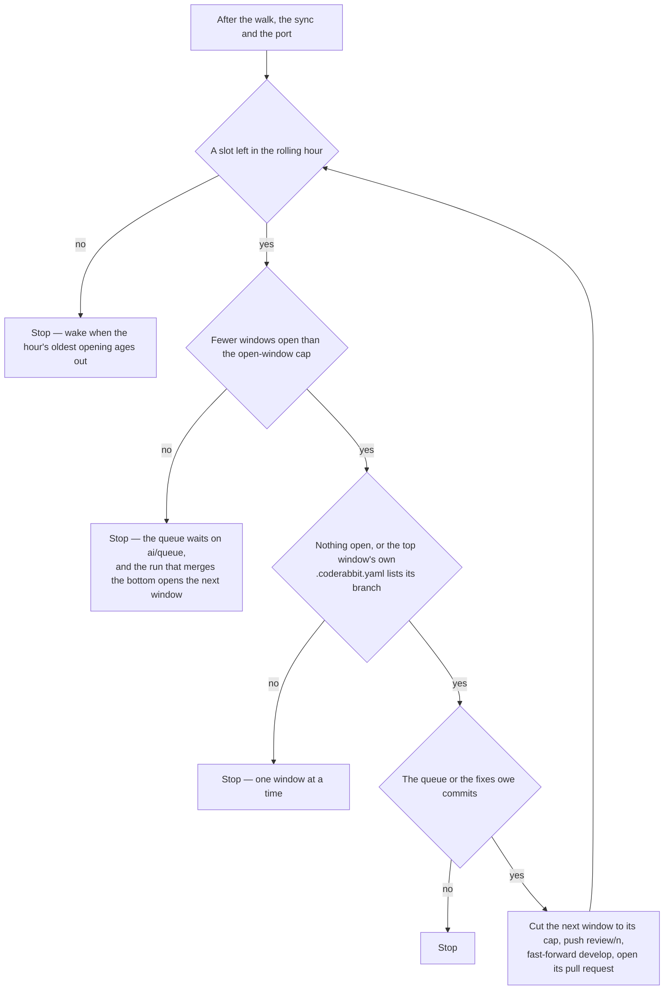

# Opening a window

After the walk, the sync and the port, a run opens windows from the top of the stack while the hourly ceiling, the open-window cap and the guard allow.

## Opening a window

After the walk, the sync and the port, a run asks the return stroke again — the walk may have merged the whole stack, or a re-cut closed it — then opens windows one at a time, cutting each from the top of the stack, and keeps opening while every one of these holds:

- fewer window pull requests were opened in the last hour, by their creation time, than the plan's hourly figure — merged and closed ones included;
- fewer windows are open than the open-window cap (`OPEN_WINDOW_CAP`);
- stacking is allowed: nothing is open, or the guard below holds;
- the queue or the fixes still owe commits.

The decision is a pure count, `getWindowOpenCount`, that returns how many more may open — the fewer of what the hour and the cap have left; the loop also stops when a cut comes out empty. The plan's figures and the open-window cap are read from the constants files (see [key files](#key-files)), never restated here. **The stack is held to the cap because only its bottom merges.** A window above the next one to merge waits out every merge and drain below it however soon its own review completes, and CodeRabbit's allowance is rolling and adaptive: its limit block states an allowance below the plan's figure once the windows spend it, so a review given to a window that cannot merge within the hour is a slot the bottom window's own review is refused, and a rate-limited bottom holds the whole stack. The cap is chosen from those costs — how long a review and a drain take, and the allowance the bot states — in the comment beside it: deep enough that the window above the bottom is reviewed while the bottom one drains, so a merge never waits on a review, and no deeper. A cycle that finds the stack full cuts nothing: the queue's commits wait on `ai/queue`, and the cycle that merges the bottom opens the next window over all of them, cut to the file cap as every window is. That cycle is the merge's own — the walk merges before the openings run — so a full stack needs no wake of its own. Each window is cut exactly as the port cuts it, measured against the window's cap — the plan's, or the smaller one a re-cut left on the newest window — and the cut is pushed to its own branch — `review/<n>`, the number one above the highest any window pull request has carried, open or closed — through the same compare-and-swap as every collector push. `develop` is then fast-forwarded to that head, so the next cut is built on it and carries the window below. The window's pull request is opened with its base at the top window's branch, or at `main` when none is open, and titled with its number. Its one review reads the window's own diff against that base.

**The ceiling turning over wakes the cycle.** It counts by creation time, so a slot comes back on the clock with no push or review to report it, and a queue that still owes commits would wait on a push that may never come. A run that ends with the hour's openings spent sets the [retrigger](/docs/infra/review-collector/runner) to the moment the oldest of them ages out of the hour, or to a sooner wait the walk stated.

**The guard.** CodeRabbit reviews a pull request by itself only when its base is `main` or a base the `.coderabbit.yaml` it reads lists under `reviews.auto_review.base_branches`. A window stacked on the window below it has that window's branch as its base, so the list has to name the window branches. `.coderabbit.yaml` carries that entry, with a comment saying why. The guard reads the copy of the file on the base a window is cut over (`git show origin/<base>:.coderabbit.yaml`): the top window's branch, or `main` when none is open. It is asked again before each cut, and a window stacks only when one of that copy's patterns matches the base's branch name. A window's copy comes from `develop`, which follows `main`, so until `main` carries the list the windows open one at a time, as they did before there was a stack.

## Push, reply, open

The window is pushed to its own branch at the cut, through `pushBranch`, the one compare-and-swap every collector push goes through. The `develop` fast-forward follows under the lease on the sha every count was measured from, so the remote refuses it if `origin/develop` left that sha: the run reports a moved outcome and the next one re-measures — fired by the push itself on `main` or `ai/queue`, and woken a minute later (`MOVED_BRANCH_RETRY_DELAY_SECONDS`) on `develop`, `ai/review-fixes` or a window's branch, whose pushes fire no run — while a push that failed for anything else fails the job as itself. No review can be running under the window's head — its branch is new — so no status is re-read first. After the pushes the reply step runs again and posts `Agreed, fixed in <sha>` on every thread of a merged window that a pushed commit's trailer names, and one verdict comment per `Drains:` review id. A thread whose newest word is already the collector's gets nothing more, so a finding two commits answer gets one reply, and only a bot comment after that reply earns another. The merged windows it replies on are the run's own drained ones and every pull request merged since the window below was opened, since a run that drained one and opened nothing leaves its fixes for a later run's cut.

The pull request is opened once its branch is on the remote. A run that pushed a window and died before opening it is finished by the next one, which finds `develop` ahead of the stack with nothing to add and opens the pull request that is owed. Nothing is deleted afterwards except a window's branch once its pull request has merged: `ai/review-fixes` stays, owing nothing, until the next drain re-creates it, and the queue's ported commits drop from the session's history at its next rebase.

## Key files

| File                                                                     | Role                                                                                                                        |
| :----------------------------------------------------------------------- | :-------------------------------------------------------------------------------------------------------------------------- |
| `scripts/src/services/coderabbit/collect/getOpeningWaitMs.ts`            | how long until the hourly ceiling gives a slot back — the oldest opening of the hour aging out                              |
| `scripts/src/services/coderabbit/collect/getWindowOpenCount.ts`          | how many more windows the rolling hour and the open-window cap let open, and none above an open one the guard refuses       |
| `scripts/src/services/coderabbit/collect/checkIsStackingAllowed.ts`      | the guard — whether the base's `.coderabbit.yaml` lists a pattern matching the base's branch: the top window's, or `main`'s |
| `scripts/src/services/coderabbit/collect/pushBranch.ts`                  | the compare-and-swap every window and `develop` push goes through                                                           |
| `scripts/src/services/coderabbit/collect/getMovedOutcome.ts`             | a push the lease refused — nothing written, and a minute's wake when no push to that branch fires a run                     |
| `scripts/src/services/coderabbit/collect/readMergedPullRequestsSince.ts` | the pull requests merged since the window below opened, whose answers the cut replies on                                    |
| `scripts/src/services/coderabbit/shared/constants.ts`                    | the file cap and the plan's hourly figure, both read off the plan                                                           |
| `scripts/src/services/coderabbit/collect/constants.ts`                   | the open-window cap, `OPEN_WINDOW_CAP`, with the costs it is chosen from                                                    |
| `.coderabbit.yaml`                                                       | the window branches listed as bases CodeRabbit reviews on creation, and the path filters a window's count leaves out        |
