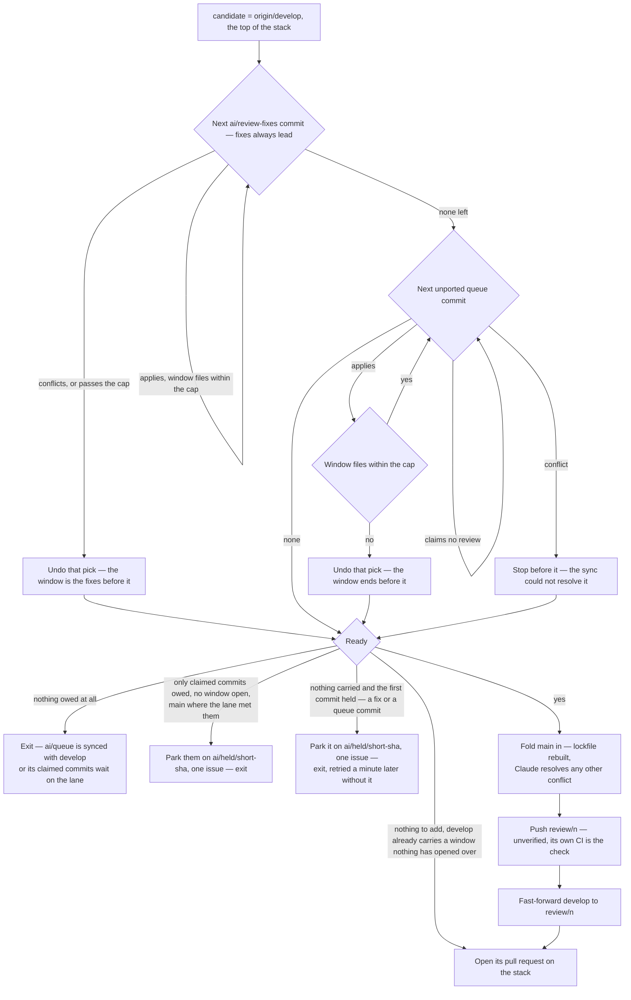

# Window port

The port builds the window as a local branch, one cherry-pick at a time, and measures after each from the tree that will be pushed.

The port builds the window as a local branch, one cherry-pick at a time, and measures after each from the tree that will be pushed.

- **Fixes lead, cut at the cap like the queue.** The fixes are picked first, one commit at a time, and measured after each by the same count as the queue against the cap the window is cut to, a re-cut's smaller one included — all but the first fix, which only the plan's cap holds back, so a fix a review could read is never parked: fixes that alone pass it go out over as many windows as it takes, each the fixes alone, and the queue waits behind the last of them. A cut falls only between commits, so a fix commit is never split from the finding it answers; a finding two commits answer is replied to on the first, and the second rides the next window. Each window carrying fixes replies on every review they were drained from — every pull request merged since the newest window opened before its oldest fix was written (`readFixedPullRequests`) — since the run's own look-back from the newest window stops at the first part's window. A fix no window can take — alone over the cap, or conflicting once a fix before it was parked — is held as a queue commit is, and parked when it leads the cut. Fixes alone over the cap never fail the run, since nothing a person must see is left behind: the collector cuts them over windows of their own, so no window, merge or drain waits on a person.
- **Only what the queue authored is owed.** A merge of `main` into `ai/queue` brings `main`'s commits and the merge itself, none of it the queue's. The porter takes the queue's commits that are neither on `develop` by patch id nor reachable from `main` nor named — under any identity they have carried, by a copy anywhere on either — and a cut whose ancestors hold anything the porter did not pick — a skipped merge, a commit claiming no review — is ported rather than fast-forwarded. A fast-forward moves `develop` to the queue's own sha, so everything behind that sha rides with it: a cut that carries more than was counted would put a claimed commit into the very review its claim exempts it from, over a cap measured without its files.
- **Queue order, never reordered, and a claimed commit only when something needs it.** A commit carrying `Express:` is the lane's and is skipped as if it were not there — what follows it ports — unless an owed commit only applies on top of the claimed commits skipped before it, and the window then carries those ahead of it; the first remaining commit that would overflow the cap or conflicts is where the window ends, and the count includes every fix. A first commit no window can take is the residual case — the sync reshapes or parks every commit its caps exhaust, so this is one that still overflows or conflicts after both — and it is parked as the sync parks, with the run waking a minute later to cut what follows it.
- **The window is counted the way the bot counts its pull request: the diff against the window's base, kept to the paths the base's `.coderabbit.yaml` `path_filters` include when they list any, less every path they exclude.** The bot reads its config from the base and states its count after those filters, so a filtered file — a snapshot, a generated folder, the lockfile — is room the window can still fill. The base is `main`'s tip for a window cut from the bottom, and the head of the window below for a stacked one, so each window is counted alone and the windows below it are not. A fold of `main` adds nothing to a window cut from `main`, since the diff counts only the window's own side of it; on a stacked window the files `main` brought count, because the diff against the window below holds them. So a stacked cut is measured again after its fold, and held over the cap until the stack below merges — the cap the port cut it under, which the port returns: the one it was given, or the plan's for a first fix alone past a re-cut's smaller one, since the port took that fix under the plan's. The fold is counted against the cap the port cut the window under, so a window the port took past a re-cut's smaller cap is measured against that same cap. A stacked window held over it waits for the stack below to merge, and the run wakes for that rather than ending idle with nothing to wake it. The count is the bot's own diff through the bot's own filters, so it cannot let a review overflow, and it is one counter (`readReviewedFilePaths`): the window, the reshaper's commit and each reshaped part are all measured by it. That the bot diffs against the base the window is cut from is an assumption about the bot, stated here because the code cannot verify it — a wrong guess surfaces as a review skipped for too many files, which the gate asks about up to its ask cap and then re-cuts at half the cap, never silently.
- **The fold always lands.** What reached `main` unread — an express cut, a dependency bump — is merged into the candidate so `develop` never diverges from `main` into the window's merge: the lockfile conflict is rebuilt from the installed tree (`git` skill), any other is the resolver's, counted on `main`'s head, and only past its attempts is the fold abandoned: the window goes out unfolded, and when it reaches the bottom, the fold at merge time — counted on the same `main` head and so already past its cap — parks the window's commits that touch a conflicted path and cuts the window again without them.
- **The window is pushed unverified.** Its own CI runs after the push, and a red there is one more commit in the next window.
- **Fast-forward when the shas allow it** — no fixes, the queue sitting on `origin/develop`, no skipped merge among the cut's ancestors, nothing folded — so the session's local branch already matches and no rebase is owed.

### Readiness

The window goes out when the port holds anything at all — a fix, a queue commit that fit, or what `develop` already carries above `main` — at whatever size it reached; with none of those, nothing is owed, or the first commit is parked and the run wakes a minute later to cut what follows it, or with no window open the claimed commits the express lane could not cut are parked ([express lane](/docs/infra/review-collector/express-lane)).

**There is no lower bound on a window.** The port takes every commit the queue owes and stops only at the cap or on a conflict, so a window that came out small is the whole of what was left — and waiting for it to grow waits on a push nothing has promised while the queue stays unsynced. Fixes alone are the same case, and go out the moment they are drained (why is on the overview page). The standing goal is `ai/queue` fully drained into `develop`; the cap is the only size the window is measured against, and it is measured on the tree that will be pushed.

A window a dying run left pushed is ready with nothing to add, and only its opening is owed. A parked commit is told in one issue per park, opened once and keyed on the first commit it parks, which names each commit's held branch and the steps that re-land it: pick each held branch with `--no-commit`; settle what the cause names, splitting it under the cap or resolving the conflict; commit each part under a message of its own; push the queue, and delete the held branch. The message is the step a re-land gets wrong. The one the pick prepares keeps the held commit's "(cherry picked from commit …)" lines, and `-x` adds another; each names a sha the held branch carries, and a commit naming one stays out of the owed set until that branch is deleted, so a re-land committed under it would port only once the branch was gone. The re-landed commit is new, so it is owed and ported like any other. The collector tries that re-land itself as `main` moves ([re-land](/docs/infra/review-collector/collection-cycle/re-land)), so the steps are for a re-land by hand.

## Notes

- **Rejected: verifying a window before the push** — build, typecheck and lint on the candidate, dropping the tail commit until green. A gate with no remedy: the window is a prefix of the queue, so a red commit inside it holds every window behind it while its repair sits commits later and past the cap, and each attempt spends runner-minutes finding that out. The queue's own CI already names the red commit to the session that can fix it in the next commit. The express lane's cut reaches `main` unread and is not verified either; the [repair](/docs/infra/review-collector/repair) answers whatever red it leaves there.

## Key files

| File                                                               | Role                                                                                                                            |
| :----------------------------------------------------------------- | :------------------------------------------------------------------------------------------------------------------------------ |
| `scripts/src/services/coderabbit/collect/foldCandidate.ts`         | the window's cut and its fold of `main`                                                                                         |
| `scripts/src/services/coderabbit/collect/portWindow.ts`            | the port — the cut's commits, fixes then queue, measured after each pick, and the cap the cut was held to                       |
| `scripts/src/services/coderabbit/collect/readFixedPullRequests.ts` | the reviews a window's fixes answer, however many windows the cap cut them over                                                 |
| `scripts/src/services/coderabbit/collect/readWindowFilePaths.ts`   | the count the bot makes of a window — the diff against its base less the base's path filters, on the tree that will be pushed   |
| `scripts/src/services/coderabbit/collect/readReviewedFilePaths.ts` | the one counter — any range's files through the base's path filters, for a window, a commit the reshaper measures and each part |
