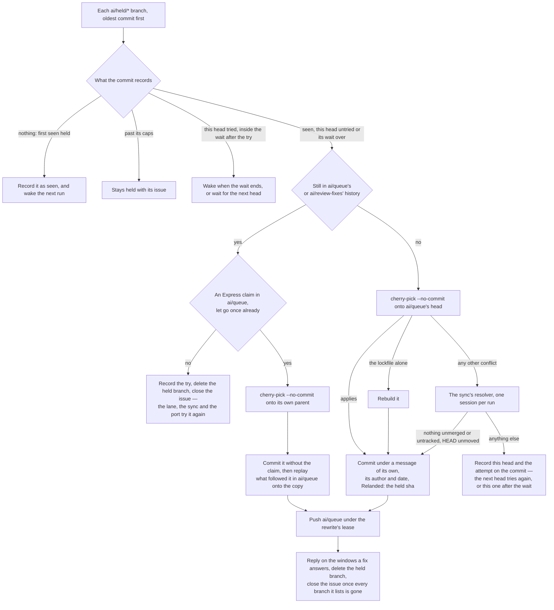

# Re-land

A parked commit comes back on its own once what held it changes, and the caps bound how many attempts it gets.

## Re-land

A parked commit comes back on its own. What held it — a conflict with the tree the queue was built on, a `main` its claim or its window would not apply to, a room too small beside the fixes — changes when `main` moves, and every window merge moves it, so after the openings each held commit is tried at every `main` head (`relandHeldCommits`), the head it was parked at included. The first run to find it held — the run that parked it, or one soon after — only records that it has and wakes the run after it a minute later (`ATTEMPT_RETRY_DELAY_SECONDS`), which tries the re-land at that same head: a pick at once would spend a second session in the run that just spent its attempts, and in a quiet queue `main` may not move again for hours. For the same reason a head already tried is tried again once the wait after its last try passes — the waits are `RELAND_RETRY_WAITS_MS`, lengthening with the count — and the run states that wake for the [retrigger](/docs/infra/review-collector/runner) to sleep out, so the attempts are spent with `main` still. Every head a re-land was tried at is recorded on the commit itself, and so is every try against the attempt cap; a run that stops on one resolver session wakes the next for the commits behind it.

A commit its own branch still carries is not picked: a claim the express lane parked, the port's leftover first commit and a fix `ai/review-fixes` holds all stay in the history of `ai/queue` or of the fixes until a rewrite drops them, and picked onto a queue that holds it, a commit comes back as the commit that was parked. It is let go instead — its try recorded first, then its held branch deleted and its issue closed — which returns it to the owed set, and the paths that parked it, the express lane, the sync and the port, try it again under their own caps on the run the step wakes a minute later. One they park again comes back here, and waits out its try as a failed pick does. An `Express:` claim `ai/queue` carries is let go once: parked again, it has failed the lane twice, so it takes the window route instead of spending the cap on the lane. Its copy without the claim is committed in the claim's own place — picked onto its parent, with what followed it replayed onto the copy, each commit onto the tree it was written against so none conflicts — and the queue is pushed under the rewrite's lease, for a window to carry the copy in queue order.

- **The resolver is the sync's.** A conflict goes to the session the replay's conflicts get, pointed at one pick rather than a sequence and told to stage its resolution and commit nothing; the tree it leaves is the proof, as the replay's is. A run spends one session on it at most, after the openings, so a backlog of held commits never holds a window.
- **The copy is a new commit with the held one's author and date.** Its message drops every "(cherry picked from commit …)" line, since one naming a sha the held branch carries keeps a commit owed nowhere, and its `Express:` claim, so a window carries it in queue order. The author and the date are what the queue push's replay matches a carried commit by. A pick the queue already carries whole commits nothing, and the branch and the issue close all the same.
- **A commit let go is counted before its branch goes.** A park that brings it back finds the try on the commit, so the commit waits out the try before it is let go again, and past the cap it stays held with its issue; were the branch deleted first, a refused post would return the commit with nothing spent on it. A deletion that fails changes nothing else: the commit stays held, its issue open, for the next run to meet.
- **A copy parked again is bounded.** It is a new commit, so its own counts start afresh; the `Relanded:` trailer each copy adds names the held commit it came from, and a commit carrying `SESSION_ATTEMPT_CAP` of them is not re-landed again. A failed re-land counts against the same cap on the held commit under the collector's basis, so a fix to the collector is a fresh turn. A commit over the plan's cap alone never comes back this way: only a reshaping carries it, and that is what failed.
- **A parked fix is replied for where its finding is.** A fix the sync parked from `ai/review-fixes` comes back as a queue commit, and the window it answered is often no longer the newest merged one, on which no opening replies. So its reply is posted as it re-lands, citing the copy, on each merged window whose findings it names, searched newest first.
- **A re-land is tried again at a quiet head.** The run after the one that first finds a commit held tries it at the head it was parked at, not only once `main` moves, since a quiet queue may leave `main` still for hours. Each failed try spends one of the attempts, and the attempts running out with `main` still ends the commit held with its issue.
- **A commit the queue still holds is let go for the paths that parked it.** In a quiet queue nothing rewrites the queue, so a claim parked with no window open, the port's leftover and a fix the fixes branch held are let go to try again. Only a commit past every resolver's caps stays held, for a session to land from its `ready-for-agent` issue.
- **An `Express:` claim is let go once.** A let-go spends one of the re-land's attempts on a lane that already refused the claim, so a second let-go would spend the cap before any rewrite drops it. After the one let-go the commit takes its place in the queue without the claim, for a window to carry.
- **The collector re-lands a parked commit itself.** The park's issue lists the steps for a re-land by hand, which the collector does not wait on.

## Key files

| File                                                              | Role                                                                                                                                                                                 |
| :---------------------------------------------------------------- | :----------------------------------------------------------------------------------------------------------------------------------------------------------------------------------- |
| `scripts/src/services/coderabbit/collect/parkCommits.ts`          | a commit no window can carry pushed to `ai/held/<short-sha>`, then the one issue saying how to re-land it                                                                            |
| `scripts/src/services/coderabbit/collect/readHeldShas.ts`         | every identity the held branches carry, taken out of what the queue owes                                                                                                             |
| `scripts/src/services/coderabbit/collect/relandHeldCommits.ts`    | each held commit tried on the run after its park, at every later `main` head and after the wait at an unmoved one — picked onto the queue, or let go while a branch still carries it |
| `scripts/src/services/coderabbit/collect/releaseHeldBranch.ts`    | a held branch deleted, and its issue closed once no branch it lists stands                                                                                                           |
| `scripts/src/services/coderabbit/collect/relandHeldCommit.ts`     | one re-land — the pick, its conflict the resolver's, committed under a message of its own, in a claim's own place when it is rerouted                                                |
| `scripts/src/services/coderabbit/collect/replyRelandedAnswers.ts` | a re-landed fix's replies, on the merged windows whose findings it answers                                                                                                           |
