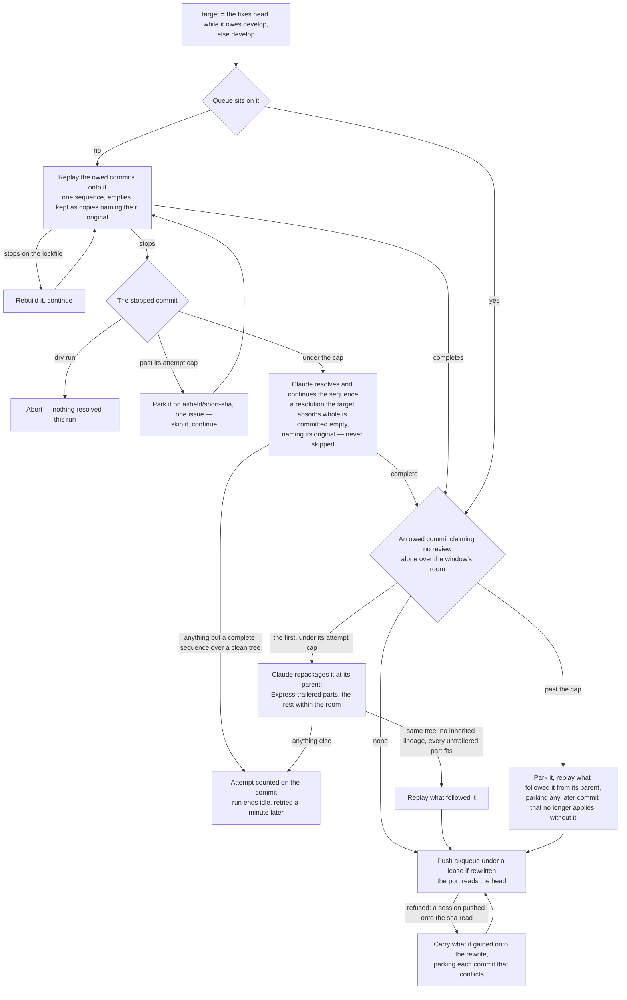

# Queue sync

The rewrite that runs before the port, so the next window is cut from a queue that sits on its tree and fits its room.

## Sync

The fixes branch is synced first. A drain builds on the `develop` it read, and `develop` can move before those fixes port — the return stroke, a window cut, a fold, a repair, a hand revert — so a fixes branch that no longer sits on `develop` has what it owes replayed onto it by the same sequence and the same resolver the queue gets, and is pushed back under a lease on the sha it read. A conflict nothing resolved this run — a dry run, or a resolver that could not start — ends the run idle. A fix whose conflict failed the resolver past the attempt cap is parked like any commit (below), so every fix behind it still lands, and the finding it answered reads as open again and is drained afresh. Left unsynced, a fix that no longer applies would fail every port with nothing to resolve it.

Before the port reads the queue, the collector rewrites it onto the tree the window is built on — `ai/review-fixes` while it owes `develop` commits, `develop` otherwise — reshapes the first owed commit adding more files than the window has room for, and pushes it back under a lease on the sha it read. The room is the cap less the files the window carries ahead of the queue — the fixes and any pending window `develop` holds, counted from the window's base as the port counts them — and a file of the commit's that the window already counts costs it nothing, since the port counts the resulting window's distinct files. The room does not measure a commit carrying `Express:` — that one is the lane's at any size, and reshaping it would pay a session per run to repackage what no window will ever carry. The commits the queue still owes are replayed in order as one `cherry-pick` sequence — `-x`, so every copy names the original it came from and a resolution that drifted its patch id still reads as carried, and `--empty=keep`, so a commit the tree already holds under another patch id lands as an empty copy naming it rather than falling away with nothing to say it did, and an empty copy a past resolution left rides through rather than stalling the sequence; a queue already sitting on that tree with nothing to reshape is left alone, which is every run but the one after a window.

- **Why the collector and not the session.** A queue left on an old base carries commits written against files a drain has since repaired, and every one is a conflict the porter would hold on, run after run, until a person notices a red run. Here the conflict is met once, where the fixes are, and the working session's `git pull --rebase` afterwards replays only what it committed since (`.agents/skills/review-queue/SKILL.md`).
- **The lockfile is never a conflict a session sees.** A replay of the queue stops on it once per commit that touched a manifest, and every one of those stops has the same answer the fold already gave: the lockfile is deleted and rebuilt from the manifests the replay settled, never merged (`git` skill). The sequence is run out over as many stops as land on that path alone, bounded by the replay’s own length, and only a stop on another path is worth a session — which finds the sequencer exactly where it expects it, mid-pick with that commit’s conflict open.
- **A conflict is the drain's session pointed at a conflict.** The same headless Claude, the same denials — no push, no branch switch, no GitHub — told which commit stopped the sequence and on which paths, that both sides survive, and that a commit whose whole change the target already carries is committed empty rather than skipped. What proves the resolution is a sequence run to its end over a clean tree that carries every commit the queue owed, never the session's word — the first two are what `git cherry-pick --abort` leaves as well, and the rewrite behind them would force-push every owed commit away, so the third is read off the replay itself — and so the resolver owes no finishing checks and repairs nothing beyond the conflict: a red elsewhere in the replay is a queue commit's, which the queue's own CI names to the session that owns it, and every minute the resolver spends past the conflict is one the working session can push into. **`--skip` is denied, and the empty commit is why.** A resolution the target absorbs whole leaves the same tree as an abandoned one, so no test over content can tell the sanctioned drop from the lost work; git's own prepared message names the original, and an empty copy carrying it is the one record that says which happened. The replay keeps the same record for itself: a commit whose change the target already carries under another patch id — a repaired copy the port skipped, or a fold's — still reads as owed by patch id, and dropping it as it applies would leave that check reading the resolver's finished sequence as one that lost it. The owed set ignores a commit that changes nothing, so the queue sheds either copy on the next rewrite rather than replaying it forever. A failure counts against the attempt cap under a marker in a comment on the conflicting commit itself rather than on the pull request, for the reason the runner's counts carry, and the marker names the collector's own source as the basis the attempt was made against, so a collector fixed since hands the commit a fresh turn with nobody resetting anything ([the runner's counts](/docs/infra/review-collector/runner)). Past the cap the commit is parked: pushed to its own held branch, `ai/held/<short-sha>`, before anything drops it, named in one issue saying how to re-land it, and skipped, so the sequence carries everything behind it. The held branch takes it out of the owed set, so no later replay, port or reshaping meets it again.
- **A commit alone over the window's room is repackaged, never held.** No window can carry it and no session is asked to commit differently — what a commit holds is the session's business, and what in it needs a reviewer's eye is a judgement. The same session, detached at the commit's parent, rewrites it as a sequence: the parts that need no review — a rename, a one-rule substitution a lint rule now enforces, generated output, a format pass — each a commit of any size carrying `Express: <why>`, which the express lane takes to `main`; the rest in commits within the room, ordered so every prefix is green. It repackages and never edits, and the collector proves that rather than trusting it: `git diff <original> HEAD` empty, no part keeping a `(cherry picked from commit …)` line, and every untrailered part within the room, or the attempt fails and is counted on the commit. Those lines name the copies the original was replayed from, and a part keeping them shares them with its siblings — so the express lane's copy of one part reads every part as ported, and the next sync drops the rest unreplayed. One commit per run, since the rewrite's push fires the next. Past the attempt cap the commit is parked whole on its held branch, what followed it is replayed from its parent without it, and a later commit that no longer applies without it is parked beside it in the same issue — a commit no window can carry is set aside with a record, and the queue moves on. **The room, not the cap, because the fixes lead every window.** A review almost always yields findings, so a commit that fits the cap alone but not beside the fixes is held behind every window, and each window ships the fixes alone; a reshaping the cap measured ended in a part of exactly the cap's size, and it sat at the queue's head while window after window carried a handful of fix files. Fixes that fill the cap alone leave no room to reshape into — the port cuts them over windows of their own, and the queue waits behind them. **Every count here is the bot's own**: the commit, the room and each part are measured through the base's `.coderabbit.yaml` path filters, by the same counter the port measures a window with (`readReviewedFilePaths`), so a commit too big only before its snapshots and generated folders are filtered out never costs a session.
- **Two writers of `ai/queue`, one compare-and-swap.** The lease is the rewrite's alone — it names the sha the run read, against a session that pushes plain and pulls when the rewrite refuses it ([two writers](/docs/infra/review-collector/two-writers)). A rewrite the session's push beat is not redone: that push fast-forwarded the sha the lease named by a commit or two, so the rewrite carries those onto itself and pushes again under the lease the push moved to, a few times over before giving up — redoing the run would hand the resolver the same conflict to lose to the next push, which under an active session never converges. **A carried commit that conflicts with the rewrite is parked, never the rewrite dropped.** The collector runs unattended and finishes on its own, and the rewrite under that commit can be minutes of replaying hundreds of commits and a resolver's work already done, so throwing it away for one commit hands the next run the same minutes to lose to the next push. The commit is parked as a commit past its attempts is — pushed to its held branch, named in one issue, and skipped, with any later carried commit that no longer applies without it — and the rest ride the push. It gets no resolver turn of its own: it was written against the queue the rewrite replaced, and every minute a resolver spends on it is one the next session push can beat again. Nor does the session that pushed it bring it back beside its held branch: its next push replays only what it committed after that push. A carry whose skips cannot run its sequence out is aborted and the rewrite left unpushed rather than pushed short of the commits after the stop, and a reshaping park that cannot replay what followed its commit puts the queue back and ends the run with the commit unparked: neither drops a commit no held branch holds. Only a queue whose history was rewritten under the run exits it idle, since that push fires a run of its own that replays onto what the queue then carries — porting off the stale head instead would hold on a conflict the next run resolves.

## Notes

- **Rejected: holding the queue on a commit alone over the room for a person to split.** Every slot until then went to the drain's fixes alone, and the red that told the person arrived only with the next window. Repackaging is the collector's, and the commit's author is asked for nothing.

## Key files

| File                                                          | Role                                                                                                                           |
| :------------------------------------------------------------ | :----------------------------------------------------------------------------------------------------------------------------- |
| `scripts/src/services/coderabbit/collect/syncQueue.ts`        | the queue's rewrite onto the tree the next window is built on, the first commit over the room reshaped                         |
| `scripts/src/services/coderabbit/collect/pushQueueRewrite.ts` | the rewrite's push under a lease that carries what a session pushed meanwhile, parking what conflicts                          |
| `scripts/src/services/coderabbit/collect/skipStops.ts`        | a replay's stops run out — the lockfile rebuilt, a commit past its attempts parked and skipped, the first other stop left open |
