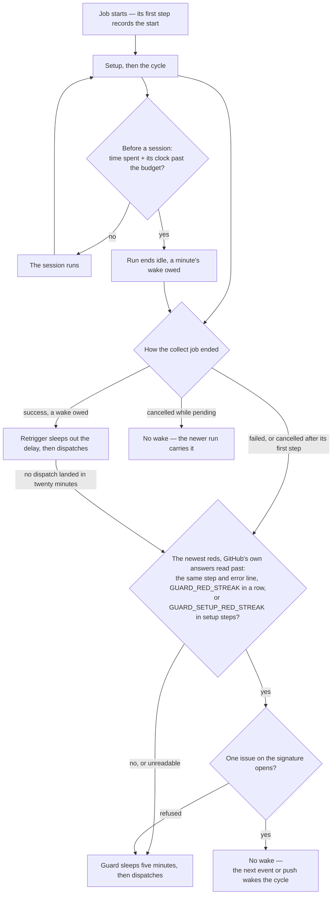

# Guard

A third job wakes a cycle that a failed or killed run left unfinished, unless the newest runs keep failing on the same red.

A run its job's `timeout-minutes` kills writes no retrigger, and so does a run that fails red: nothing then wakes the cycle but an unrelated event, which is hours away once the sessions stop pushing. One check inside the run keeps the timeout from being met, and one job after it wakes whatever ended that way anyway — unless the newest runs keep failing on the same red, which a wake only meets again.

**The guard wakes a run that failed or was killed anyway.** A third job, `guard`, runs when the collect job failed, or was cancelled after its first step, or when the retrigger's dispatch never landed: it sleeps five minutes and dispatches the cycle as the retrigger does. A red the platform caused has most likely cleared by then. The retrigger asks for its dispatch for twenty minutes past its sleep, under a timeout on that step rather than the job's: a step past its timeout fails, and that red is what the guard wakes on, while a job past its own reads as cancelled, the same as a retrigger a newer wake replaced, which nothing may wake. The guard asks for its own dispatch for the same twenty minutes, under the same timeout on its step; one that never lands leaves the cycle to the next event or push. **The dispatch asks for twenty minutes, then gives up.** A dispatch asked until the job's timeout would let an Actions outage that outlasted the sleep run the loop into that timeout, where a cancelled job wakes nothing and the cycle would stand still until an unrelated event. The collector runs unattended, calling on a person only for what [failure semantics](/docs/infra/review-collector/runner) names. A run cancelled while pending — superseded in the concurrency group by a newer fire — never ran a step, so it set no output and is not woken: the newer run carries it. The guard shares the retrigger's concurrency group, so one wake waits at a time: a streak of red runs never multiplies its wakes, and a newer run's deadline replaces a waiting guard as a newer guard replaces a waiting deadline.

**The guard stops on a red the newest runs keep failing on.** Before it wakes anything it reads the newest collector runs whose collect job can have ended (`pnpm ai:coderabbit:guard`): each status is its own list, filtered by the API before the bound counts (`readCollectorRuns`) — the runs still going, its own among them, then the green and the red — so the events the filter skipped and the fires superseded while pending, three in four runs and most of the rest, never take a place in it. A cancelled run is a superseded fire, save one whose waiting retrigger or guard a newer run replaced after its collect job ended, so the cancelled runs are read only across the streak's own span, before it holds, and a span holding more of them than one list reads holds nothing. A collect job that neither succeeded nor failed is read past, and so is a red any of whose failure annotations is GitHub's own answer — a server error or a rate limit, in `gh`'s, `git`'s or Octokit's wording (`GITHUB_OUTAGE_REGEX`) — since it clears by itself and a streak of them would hold the cycle on a red no fix answers. A red in a step that fetches the code or its toolchain — the checkout, pnpm and node, the install (`SETUP_STEP_NAMES`) — never fails on the collector's code, and GitHub or the network fails those steps for a while as readily as a dead token or a broken tree fails them for good, so the setup's reds keep a streak of their own, `GUARD_SETUP_RED_STREAK` of them in a row, longer than the other; a red past the setup ends it, and the other streak reads past the setup's reds. The guard keys each red on its failed step and the first error line its log wrote: the collector writes its own error line as an annotation on the job (`writeErrorAnnotation`), read in place of the runner's exit code, which is the same for every red and stands only for a step that died without a line of its own. When the last `GUARD_RED_STREAK` reds share that signature — or the last `GUARD_SETUP_RED_STREAK` of the setup's — no rerun will answer it, and each wake may pay a session to meet it again, so the guard opens one issue keyed on the signature (`openCollectorIssue`) and wakes nothing, a setup's issue naming where such a red comes from. The issue comes first and the hold is written only once it is open (`runGuard`): one GitHub refuses — the content-creation limit, a server error — fails the step with no output, which the workflow reads as a wake, since a hold no issue reports would leave the cycle asleep with nobody told. The next push to `ai/queue`, or any event the collector listens to, wakes the cycle as usual, and a run that succeeds ends the streak. A guard that cannot read the runs wakes the cycle as it did before it could tell, and so does a red that breaks the guard's own setup, which is the collect job's: it fails before the cycle could spend anything, so a wake costs only a runner. The setup's streak therefore holds only on a red the guard's own setup and read survive, such as a full-history checkout its shallow one never makes: the guard reads with the collector's token and installs as the collect job does, so a dead token, a lockfile the frozen install refuses or a broken composite action of the setup fails the guard too, and is woken every time at a runner's cost. **The newest runs are read per status, never as one list.** One list of them holds only a few collect jobs in live traffic, so no streak would ever be in reach and every red would be woken; the `completed` status cannot narrow it either, since GitHub counts a skipped run and a cancelled one as completed. A red no wake can answer goes to the tracker once rather than paying a session each time. **GitHub's own answers are read past, not counted as reds.** A rate limit that turns a run red clears by itself, as does a checkout git fails on GitHub's side, which leaves only its exit code, so neither counts towards a streak. **A setup red has a streak of its own**, `GUARD_SETUP_RED_STREAK` long rather than `GUARD_RED_STREAK`, since a checkout GitHub fails for a while clears before that longer streak holds, and nobody is woken every few minutes for a red that no wake answers.

## Notes

- **Cancelling a run by hand wakes it again.** The guard reads a cancelled run that started as a killed one, so a run cancelled from the Actions tab is dispatched again five minutes later. The off switch is `gh workflow disable ReviewCollector.yaml`, under which a waiting retrigger's dispatch is refused for its twenty minutes, and then the guard's for its own.

## Key files

| File                                                              | Role                                                                                                                  |
| :---------------------------------------------------------------- | :-------------------------------------------------------------------------------------------------------------------- |
| `scripts/src/coderabbit/guard/index.ts`                           | `pnpm ai:coderabbit:guard`, the guard's entry point                                                                   |
| `scripts/src/services/coderabbit/guard/runGuard.ts`               | the guard's one decision — a wake, or one issue on a repeated red and the hold written once it is open                |
| `scripts/src/services/coderabbit/guard/readHeldStreak.ts`         | the red the newest runs keep failing on, read over the runs whose collect job can have ended                          |
| `scripts/src/services/coderabbit/guard/readCollectorRuns.ts`      | the newest runs at one status, filtered by the API before the bound                                                   |
| `scripts/src/services/coderabbit/guard/readRedStreak.ts`          | the streak the given runs end on, newest first, past the jobs that ran nothing and GitHub's reds, the setup's its own |
| `scripts/src/services/coderabbit/guard/guardWorkflow.test.ts`     | the collect job's name, its setup steps' names and the guard's output, held to their constants                        |
| `scripts/src/services/coderabbit/collect/writeErrorAnnotation.ts` | the collector's error line, written where the guard reads it                                                          |
