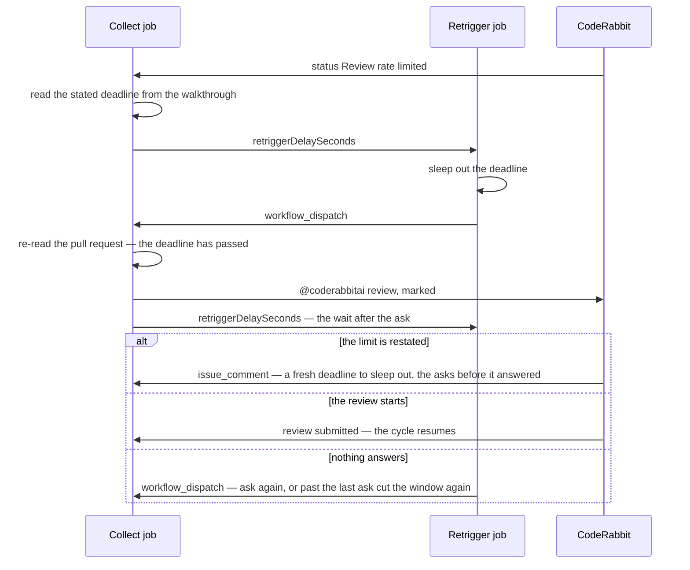

# Delayed retrigger

The workflow sleeps out a wait the cycle asked for, then dispatches the cycle again, since no event follows a deadline.

## The delayed retrigger

CodeRabbit skips a review when the account is over its hourly limit, sets `Review rate limited`, and says nothing when the limit turns over — but the walkthrough it rewrites when it skips states when the next review becomes available. The cycle reads that sentence, a second job sleeps it out and dispatches the cycle again, and that run — the deadline now passed — posts `@coderabbitai review` and exits: the bot's answer arrives as an `issue_comment`, which is a trigger, and an answer that never comes is the wait after the ask running out, after which the window is asked again as a skipped review is.

**The job that sleeps is not the one that asks.** A session push during the sleep may already have a review running once the limit lifts, and a retrigger posted blind would cancel it; so the sleeping job only wakes the cycle, and every decision is made in the script with fresh state. The deadline is **relative to the comment that carries it**, never to now — the block is not removed when the limit lifts, so an expired one must read as nothing left to wait for — and it is the deadline only, never the fact: whether a limit applies is the commit status's answer. A block stating no readable deadline is asked about rather than guessed at. One sleep is capped under the job's timeout; a longer deadline is slept in relays, each dispatched run reading what is left. With several windows open, only the one next to merge is settled on its deadline: the windows above it wait on the merges below, as [gate and merge](/docs/infra/review-collector/collection-cycle/gate-and-merge) gives, so their deadlines wake nothing.

**More holds lift at an instant the run can state, and are slept out the same way.** Claude Code's limit lifts at the reset its marker carries ([the drain](/docs/infra/review-collector/drain), "When it cannot"), and the sessions that push `ai/queue` draw on the same account, so they stop at the same limit and no push wakes the cycle until it lifts. The hourly opening ceiling counts windows by their pull request's creation time, so it gives a slot back when the oldest window opened in the last hour passes the hour, with nothing pushed or reviewed to report it; a run sets that wake whenever the hour's openings are spent, however many windows are open (`getOpeningWaitMs`). A skipped review's ask is followed by its wait (`REVIEW_ASK_WAITS_MS`), a bottom window with no check is waited on from its opening (`MISSING_CHECK_WAIT_MS`), and a bottom window whose check is pending is waited on from the status that set it (`PENDING_CHECK_WAIT_MS`); the bot states no deadline for any of them — a review it dropped sends no status at all — so each wait is the collector's own, set by every run that sees it, and the run that ends it posts the next ask or the re-cut ([the collection cycle](/docs/infra/review-collector/collection-cycle)); an ask a rate limit's window is owed once its deadline passes is followed by the same waits. Those waits are set by a run that walks the window, and the run that opens one walked the stack before its openings, so it sets the wake itself, for when the window's review is due (`OPENED_WINDOW_READ_DELAY_SECONDS`, a margin past the slowest review measured live): a window opened from an empty stack under the hourly ceiling has no ceiling wake either, and a bot that then posted nothing, with no session pushing, would leave it unread. A push the lease refused on `develop`, `ai/review-fixes` or a window's branch wakes the cycle a minute later (`MOVED_BRANCH_RETRY_DELAY_SECONDS`), since no push to those fires a run; an ask the re-read check withholds, five minutes later (`CHECK_REREAD_DELAY_SECONDS`); a commit a run first finds held, a minute later (`ATTEMPT_RETRY_DELAY_SECONDS`), so its re-land is tried at the `main` head it was parked at rather than only once `main` moves, which a quiet queue may not do for hours, and so is one let go for the paths that parked it to try again; a head a held commit's re-land already failed at, once the wait after that try passes (`RELAND_RETRY_WAITS_MS`), so its attempts are spent with `main` still; GitHub's own rate limit, at the instant GitHub states it lifts, or after a set wait where it states none ([failure semantics](#failure-semantics)); a red signature past its repairs, at the instant enough of its oldest attempts age out of `REPAIR_SIGNATURE_SPAN_MS` to bring it under the cap; and a red `main` held — for the queue's run over it, in a transit gap, or for a re-run of its failed jobs — once the newest queue run's own span from push to verdict has passed again, or the red run's own for a workflow the queue never runs ([the repair](/docs/infra/review-collector/repair)). Each instant gets the buffer a rate limit's deadline gets and the same relays past one sleep's cap (`getRetriggerDelaySeconds`), and a run that knows of several holds sleeps out the soonest, since the run it wakes states the rest again.

## Sources

- [Rate limits for the REST API](https://docs.github.com/en/rest/using-the-rest-api/rate-limits-for-the-rest-api), GitHub Docs — a primary or a secondary limit is a 403 or a 429; wait out `retry-after` seconds when it is present, else until `x-ratelimit-reset` (UTC epoch seconds) when `x-ratelimit-remaining` is 0, else at least a minute; and asking `rate_limit` does not count against the primary limit.

## Key files

| File                                                                     | Role                                                                                                                    |
| :----------------------------------------------------------------------- | :---------------------------------------------------------------------------------------------------------------------- |
| `scripts/src/services/coderabbit/collect/getRetriggerDelaySeconds.ts`    | the sleep an instant asks of the retrigger, capped under the job's timeout and relayed past it                          |
| `scripts/src/services/coderabbit/collect/readOutageRetryDelaySeconds.ts` | the wait after GitHub refused a run: five minutes, a minute for the content-creation limit, or as long as GitHub states |
