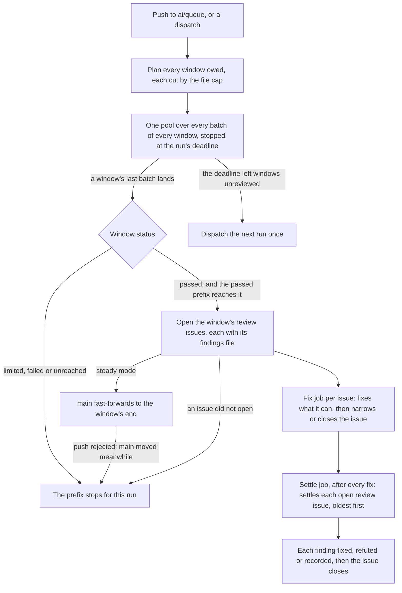

# Review

Working sessions push one permanent branch, `ai/queue`, which is the default branch, and nothing reaches `main` except through a review. The review is a GitHub workflow, `.github/workflows/Review.yaml`, that runs on every push to `ai/queue`. It reads the commits `main` does not yet have, cuts them into windows of a bounded size, reads every batch of every window at once with headless haiku sessions, and fast-forwards `main` through the windows that were read in full. Every finding it raises then ends in one of three terminal states, and the workflow carries each one there. Nothing waits on a person, and no step is timed: a run's spend is bounded by how many files it reads.

## The terminal-state rule

Every finding ends in exactly one of three states:

- **fixed:** a commit on `ai/queue` that resolves it;
- **refuted:** the code disproves it, with the reason written down;
- **recorded:** it needs a design decision or a feature, so it is written into the owning area's proposal or roadmap page, where the build loop takes it.

Until a finding reaches one of these, it lives in an open issue labelled `review` (`REVIEW_ISSUE_LABEL`). That issue is durable: it outlives the job that opened it, and a job that crashes leaves it whole for the settle job. Sessions and triage never take a `review` issue, since the review's settle job owns it until it closes.

## Why it replaced CodeRabbit

CodeRabbit's limits were time-based. The plan allowed a set number of reviews an hour, and a repository that sent more than that in a week was cut down to one an hour. Commits came in faster than that, and a backlog of many commits and thousands of files sat unreviewed.

The review collector existed to work around the bot. It cut windows to the bot's file cap and opened a stack of pull requests to `main`, with `develop` behind them. That machinery was most of the code paid for one job, getting a review. Without a bot, none of it is needed: there are no pull requests, so there is no `develop`, and nothing is rewritten. `main` is the reviewed prefix of `ai/queue`, and a review moves it forward.

## How a run goes

1. **Fetch.** The run reads `origin/main` and `origin/ai/queue`.
2. **Diverged main.** If `main` is not an ancestor of `ai/queue`, something else pushed `main`: the nightly release's version commit, which starts a run itself, or a push by hand. The run merges `origin/main` into `ai/queue`, pushes it, and ends, since that push starts the next run. A conflict fails the run, listing the conflicted paths.
3. **Commits owed.** The commits on `main..ai/queue`, first parents only, in order. None means the run ends.
4. **Windows.** Every owed commit is cut into consecutive windows. Each window is the longest run of commits whose changed files, taken together, stay within `REVIEW_WINDOW_FILE_CAP`, and holds at least one commit, even when that commit alone is over the cap. The run plans every window owed at its start.
5. **Batches.** Each window's changed files, after the excluded paths and binary files are dropped, are sorted by path so neighbours land together, then packed in order into batches under a file cap and a changed-line cap.
6. **Reviewers.** One pool holds every batch of every window and runs at most `REVIEW_RUNNER_SESSION_CAP` sessions at once. Each window has one detached worktree at its end, shared by its reviewers and removed after the pool. A reviewer is read-only and answers with a JSON object of findings. A batch that fails is retried once.
7. **Window status.** A window passes when every batch answered. It is limited when a batch hit the account's usage limit, failed when a batch still errored, and unreached when the deadline left a batch unstarted.
8. **The prefix advances as it grows.** Whenever a window settles, the run acts on each window that has just joined the passed prefix, in window order. The prefix is the windows before the first one that did not pass, so a window after a stopped one never reads its base as landed. The run first opens each newly passed window's review issues, so no finding is held only in the run's memory once `main` moves past it. A window whose issues did not open ends the prefix there for the rest of the run, and the next run reviews it again. In steady mode the run then fast-forwards `main` to the end of the windows whose issues opened, once per advance and never forced. A rejected push means `main` moved meanwhile: the run stops advancing for the rest of the run, the issues it opened stay open, and the next run, which reviews those windows again, may raise their findings again.
9. **Fix and settle.** Each issue's findings file goes to a fix job, and the settle job runs after every fix. Both are described below.

Because the prefix advances as the pool runs, a timeout or a crash loses only the windows still in flight. Everything already passed has its issues open and, in steady mode, is on `main`. A batch's error is printed to the job's log as well as its summary, since GitHub's API reads a job's log but not its summary.

### Review issues

Each newly passed window that has findings opens its review issues. A window's findings are split into chunks of at most `REVIEW_ISSUE_FINDING_CAP`, so each issue's body stays far under GitHub's body limit, and a window with more is split into parts. Each issue is titled with its range and its finding count, and its body holds one line saying the review owes these findings until the settle job closes it, the run's ID on a `Run:` line, the range, and each finding with its trigger.

The `Run:` line is what lets the settle job tell an issue a fixer may still be on from one nobody is working on. An issue with no `Run:` line, such as one a person opened, is never held back.

### The fix job

Each issue gets one fix job, in a matrix over the issue numbers the run opened, up to `REVIEW_FIX_MATRIX_CAP`. GitHub limits a matrix to that many jobs. Issues past the cap are not lost: they stay open, and the settle job takes them.

The fixer runs once over the issue's findings at the tip of `ai/queue`. Its commits land on `ai/queue` by pull and push, and a fix whose commit does not land is deferred again. A pull whose rebase stops on a conflict is aborted, so the checkout leaves the landing as it entered it: a rebase left in progress would refuse every later pull, the settle job's next settlers included. Then it updates its issue:

- when every finding is fixed or refuted, it comments each finding's outcome and reason, and closes the issue;
- otherwise it comments the fixed and refuted findings, and rewrites the body to the findings still open, each with a `Why deferred:` line holding the fixer's reason.

A fix job that crashes leaves its issue open and whole, which is correct: the settle job takes it. The fixer never opens an issue.

A fixer's or a settler's commit lands on `ai/queue` with nothing else to stop a red, so before committing each session runs its checks (`REVIEW_SESSION_CHECKS`): the workspace rules, which read every page, skill and test file, the docs suite, the tests of the files it touched, the typecheck and lint of each package it touched, oxlint over the files it touched, which CI's Lint runs beside each package's ESLint, the bundle size snapshot of each package whose source it changed and of the Functions app that bundles it, re-recorded after a fresh build since only one moves it, and every check the touched files' skills name, such as a reader run over all its real inputs, since a reader's own tests cover only the inputs someone wrote down. A fix they refuse is not made. The workspace rules and the docs suite also run before the first edit, and only a failure that run did not list is the session's: the tip is often red from other work, and fixers told only to keep a red suite green committed duplicated prose they could not tell apart from the red already there. Tests alone let a fixer strip return types that `isolatedDeclarations` needs, and a settler write roadmap items past the docs suite's length rule.

### The settle job

The settle job runs after the review and every fix job, whatever their outcome, so an open issue is never left without an owner. It lists every open `review` issue, oldest first, and settles them one at a time, since each settler lands its commits before the next starts.

An issue whose `Run:` line names another run is left alone while that run's review job, or the issue's own fix job, has not completed, since a fixer may still be on it. The jobs are read by their names in `Review.yaml`. Another run's settle job holds nothing, since settle jobs never overlap, and a run that cannot be read holds nothing, so a deleted run never strands its issues. Otherwise one settler session settles the whole issue on a clean checkout of the queue's latest tip, so nothing an earlier settler left uncommitted or unlanded carries in, and each of its findings must reach a terminal state:

- fixed, at its root, with the session's checks run;
- refuted, with the reason the code disproves it;
- recorded, in the owning area's proposal or roadmap page, where the build loop takes it.

A settler never defers and never opens an issue. Its answer is validated against a schema whose outcomes are only those three, and an answer that leaves a finding out fails the issue. When the settler's commits land, the issue is commented with each finding's outcome and closed. When they do not land, the issue stays open for the next run. When the settler fails, its error is commented on the issue, the issue stays open, and the job goes on to the next issue and ends red. A usage limit stops the loop, and every issue not yet settled stays open for the next push's run. No settler starts once `REVIEW_SETTLE_DEADLINE` has passed, which leaves one settler's wall clock below the job's timeout, and a loop the deadline stopped dispatches the next run, since no push may follow.

### The deadline and its one dispatch

The pool starts no new batch once `REVIEW_RUN_DEADLINE` has passed since the run began, and the batches already started finish. The review job's timeout is GitHub's hosted maximum, above that deadline. Windows the deadline left unreviewed are owed, and when the run stopped for nothing else (no limit, no failure), it dispatches `Review.yaml` on `ai/queue` once, with `gh workflow run` under the collector's token, so the workflow's own token stays read-only. A workflow group folds the dispatch into any run already waiting. A run stopped by a usage limit or a failure dispatches nothing, since the next push resumes it, and a rerun would meet the same limit or failure.

### Range mode

A dispatch may name a `from` and a `to` commit. Steps 3 to 8 then run over the commits between them. Range mode never moves `main`, so its issues are opened and settled the same way, and it names in its summary the `from` to resume with when it stops early.

### The usage limit

Every session draws on the same Claude account as a person's working session, so the account's limit can run out in the middle of a run. When a session reports it, that batch's window is limited: the windows after it do not pass, `main` moves only through the windows before it, and the run exits successfully with a notice naming where it stopped. The next push resumes steady state.

### The dry run

`pnpm -C scripts ai:review --dry-run`, with an optional `--from` and `--to`, prints every window the run plans, with its base and end, and its batches with their file and line counts. It runs no session and pushes nothing, so a plan's size can be checked before a run spends on it.

### Running it by hand

The workflow is a caller, not the only one: `pnpm ai:review` run from a checkout of its own is the same review, and `main` moves the same way. The run resets its checkout to the queue's tip and cleans it, so it refuses to start in one holding an edit, an untracked file or an unpushed commit — the shared checkout other sessions work in always does. Its sessions are `claude -p` processes, so they spend whichever account Claude Code is logged into on that machine — switching account there is how a run is put on another account's limit — and its fast-forward is a push under the machine's own git credentials, which the owner's role lets past the `ai/**` rulesets. Nothing else changes: a run racing the workflow's is safe, since `main` only ever takes a fast-forward that is never forced, and whichever push is rejected stops advancing for the rest of its run. `--findings-directory` writes each opened issue's findings for `pnpm ai:review:fix`, and `pnpm ai:review:settle` carries the open issues to their terminal states, as the workflow's fix and settle jobs do. A push to `main` by hand, outside any review, is the diverged-main case above: the next run merges it back into `ai/queue`.

## Sessions and their models

Every session is haiku, and the launcher takes its model from `ReviewSessionRoleModelMap`, so a role's model is one entry in one map. The three roles differ in their mandate, not their model:

- **Reviewer**, one per batch, read-only. Print mode allows only the read-only tools, so every edit is denied.
- **Fixer**, one per issue, in its own fix job. It may edit and commit, may defer a finding it cannot settle, and never touches GitHub; the script lands its commits.
- **Settler**, one per open issue, in the settle job. It may edit and commit, and it may not defer: each finding is fixed, refuted or recorded.

The cost is the settler's and the fixer's sessions on the same subscription as the reviewers, and the settler runs only on what the fixer left open. A run's spend is still bounded by the files it reads, and a settler's by its issue's findings.

## Decisions

- **Limits are amounts, never time.** The window, the batch, the issue's findings, the matrix and the sessions one runner holds are each bounded by how much is read or how much a runner holds. The one time bound is the deadline, which leaves the rest for the next run rather than failing it.
- **`main` advances as the prefix grows, behind its issues.** The windows that have passed open their issues at once and then move `main`, so a timeout or a crash loses only what is still in flight, and `main` never passes a finding no issue holds.
- **Every finding is owed an issue.** A finding lives in an open issue until a terminal state closes it, so no finding can be lost to a job that ends early.
- **No pull requests, no `develop`, no express lane, no repair.** A pull request is a review slot the bot must spend, and a `develop` branch is a second place the reviewed prefix would have to be kept. Every commit is reviewed in its window, however small, and a red `main` is fixed on `ai/queue` first, as the CI section below sets out.
- **`main` is the reviewed prefix of `ai/queue`.** The review's fast-forward moves `main`, and so does the nightly release's version commit, which the run it starts merges back into `ai/queue`, so `main` is an ancestor of `ai/queue` again within one run, and what `main` holds is what a review has read plus the version bumps of what it read.
- **`ai/queue` is the default branch.** GitHub runs a push-triggered workflow from the default branch's copy of its file, and `main` holds only what a review has passed, so a review workflow on `ai/queue` alone could never run. Renovate also reads its config from the default branch.
- **Renovate targets `ai/queue` and merges by pull request.** Its bumps enter through the queue like a session's commits, so they are reviewed like any other change instead of landing on `main` unread.
- **A review pass improves what is there and adds no capability.** The boundary is drawn by what a change does, never by its size, because the review exists for one end: a codebase of better quality in less, non-duplicated code. While a pass runs — the workflow's or `pnpm ai:review` by hand — a session lands anything that serves that end over code already on `ai/queue`: a finding's fix, a refactor, a duplicate hoisted into a shared package, an architectural simplification, however many files it touches. What waits is new capability — a fleet entry, a proposal unit, a roadmap item, the roadmap line a shipped feature retires — because each fix lands behind every commit already on `ai/queue`, and `main` reaches the fix only once the review has read what landed before it, so a feature landed mid-pass is one more thing between `main` and the pass's end. Feature work resumes once `main` has caught up.
- **Reviewers are read-only, in a worktree at the window's end.** A reviewer reads the code exactly as it will be on `main`, cannot change it, and cannot reach GitHub.
- **The script does every push, issue and summary under its own token.** The session gets nothing but its own Claude credential, so a finding's text, which came from code under review, cannot direct a push or an issue.

## Constants

Each limit is one named constant in the review's code, with its reason beside it. None of the values is written in prose, so a change is one edit in the file.

| Constant                    | What it bounds                                                                                                             |
| :-------------------------- | :------------------------------------------------------------------------------------------------------------------------- |
| `REVIEW_WINDOW_FILE_CAP`    | The files one window holds, so `main` advances in steps one review can read.                                               |
| `REVIEW_BATCH_FILE_CAP`     | The files in one reviewer's batch. Kept small so the reviewer reads every file it is handed.                               |
| `REVIEW_BATCH_LINE_CAP`     | The changed lines in one reviewer's batch. Kept small so the reviewer reads every line it is handed.                       |
| `REVIEW_DIFF_LINE_LIMIT`    | Where one oversized file's diff is cut in the prompt. The reviewer is told to read the rest from the file.                 |
| `REVIEW_RUNNER_SESSION_CAP` | The `claude` sessions one runner holds at once across the whole pool. A starting value, to be measured against a real run. |
| `REVIEW_ISSUE_FINDING_CAP`  | The findings one review issue holds, so its body stays far under GitHub's body limit.                                      |
| `REVIEW_FIX_MATRIX_CAP`     | The issues one run's fix matrix takes, GitHub's per-matrix job limit. Past it, the settle job takes the issues.            |
| `REVIEW_RUN_DEADLINE`       | The wall clock of one run, after which no new batch starts. The review job's timeout is GitHub's hosted maximum above it.  |
| `REVIEW_SETTLE_DEADLINE`    | The wall clock of the settle loop, after which no settler starts. One settler's wall clock fits below the job's timeout.   |
| `REVIEW_JOB_NAME`           | The review job's name in `Review.yaml`, which the settle job reads to tell whether a run is still opening issues.          |
| `REVIEW_ISSUE_LABEL`        | The label of the issues the review owes. It is outside the triage roles.                                                   |
| `ReviewSessionRoleModelMap` | The model each role's session runs.                                                                                        |
| `REVIEWER_TIMEOUT_MS`       | The wall clock of one reviewer, past which its process tree is killed.                                                     |
| `FIXER_TIMEOUT_MS`          | The wall clock of one fixer, past which its process tree is killed.                                                        |
| `SETTLER_TIMEOUT_MS`        | The wall clock of one settler, past which its process tree is killed.                                                      |

The excluded paths are the generated output, snapshots, the lockfile, migrations, the changelog and binary files, the same set the bot's path filters used. The list lives beside the reason for each entry, and a path is dropped from every window and batch the same way.

## The session launcher

Every session goes through one function. It starts the Claude Code command line headless with the role's model and tool flags, sends the prompt on standard input, and kills the whole process tree at its wall clock. It removes every environment variable whose name looks like a credential, except the Claude token the session itself needs. Git and `gh` are authenticated in the parent only, through the credential helper, so a session can read the repository but cannot push or call the API on its own.

When Claude Code reports the account's usage limit, the launcher throws a distinct error, which is what a window's or an issue's limited status catches. Any other failure is a plain error and counts as the batch's, the fixer's or the settler's failed attempt.

## The workflow

`.github/workflows/Review.yaml` runs on a push to `ai/queue`, and on a dispatch that takes two optional inputs, `from` and `to`, which it passes to the script through the environment rather than the command line.

- The **review** job holds the concurrency group, one for steady state and another for range mode, with cancellation off. One run reviews and one waits behind it, so the next review starts as soon as this one ends, while its fixers are still working. It has a timeout of GitHub's hosted maximum. It uploads each window's findings as an artifact, even when a window failed, so the issues already opened still reach their fixers.
- The **fix** job runs once per issue in `fix_issues`, as a matrix of the same run, with no concurrency group. It checks out the tip of `ai/queue` with the full install, reads its issue's findings file, and runs `ai:review:fix` for it.
- The **settle** job runs after the review and every fix, with the settle concurrency group, which takes one settlement at a time. It checks out the tip of `ai/queue` and runs `ai:review:settle`.

Each job runs with a committer identity that is the repository's own automation account, and the workflow's token is read-only. The pushes, issues and comments use the collector's own token.

## CI on the queue

A review does not gate on CI. A window's review completes and `main` moves, whatever CI says at that point. A red typecheck or lint on a session's push is that session's to fix, on `ai/queue`, before the next push. A red on `main` came from the queue, where its fix lands and then travels with the next window; `main` is never repaired in place.

## Key files

| File                                                              | Role                                                                                                             |
| :---------------------------------------------------------------- | :--------------------------------------------------------------------------------------------------------------- |
| `.github/workflows/Review.yaml`                                   | the workflow: its triggers, the review job, the fix matrix, the settle job, and the groups, timeouts and outputs |
| `scripts/src/review/index.ts`                                     | the entry point, `pnpm -C scripts ai:review`, with `--from`, `--to`, `--dry-run` and `--findings-directory`      |
| `scripts/src/reviewFix/index.ts`                                  | the entry point, `pnpm -C scripts ai:review:fix`, the fixer over one issue's findings file                       |
| `scripts/src/reviewSettle/index.ts`                               | the entry point, `pnpm -C scripts ai:review:settle`, the settler over every open review issue                    |
| `scripts/src/services/review/runReview.ts`                        | the review job's half: planning, the pool, the prefix advancing as it grows, `main`, the issues and the dispatch |
| `scripts/src/services/review/reviewWindows.ts`                    | the one pool over every batch of every window, the deadline, and each window's worktree                          |
| `scripts/src/services/review/getNewlyPassedWindowIndices.ts`      | which windows joined the passed prefix, in order, as each one settles                                            |
| `scripts/src/services/review/issues/openReviewIssues.ts`          | opens a window's findings as review issues, chunked by the finding cap                                           |
| `scripts/src/services/review/issues/renderReviewIssueBody.ts`     | the one renderer of an issue's body, which the review and the fixer both use                                     |
| `scripts/src/services/review/runReviewFix.ts`                     | the fix job's half: the fixer, its landing, and the issue narrowed or closed                                     |
| `scripts/src/services/review/runReviewSettle.ts`                  | the settle job's half: each open issue settled, its commits landed, and the issue closed                         |
| `scripts/src/services/review/runSettler.ts`                       | the settler session and its answer, which must settle every finding                                              |
| `scripts/src/services/review/checkIsHeldByLiveRun.ts`             | whether a fixer may still be on an issue: its run's review job or its own fix job has not completed              |
| `scripts/src/services/review/checkIsBacklogOwed.ts`               | whether the run stopped for the deadline alone, and so dispatches the next run                                   |
| `scripts/src/services/review/readReviewWindows.ts`                | plans every window owed, each with its base, end, commits and batches                                            |
| `scripts/src/services/review/getPassedWindowCount.ts`             | the passed prefix: the windows before the first that did not pass                                                |
| `scripts/src/models/review/ReviewFinding.ts`                      | the typed finding a reviewer answers with: file, line, lane, summary and trigger                                 |
| `scripts/src/models/review/ReviewIssueFindings.ts`                | the findings file an issue hands its fixer, validated when the fixer reads it                                    |
| `scripts/src/models/review/ReviewSettlementDispositionsAnswer.ts` | the typed answer a settler gives, whose outcomes are fixed, refuted or recorded only                             |
| `renovate.json`                                                   | Renovate's pull requests, against the default branch `ai/queue`, auto-merged                                     |
| `apps/infra/src/github/branchDefault.ts`                          | `ai/queue` as the default branch, which the workflow runs from                                                   |
| `apps/infra/src/github/labels/review.ts`                          | the `review` label the review's issues carry                                                                     |
| `.agents/skills/code-review/SKILL.md`                             | the review every reviewer runs, with its two lanes and its standing rules                                        |
| `.agents/skills/review-queue/SKILL.md`                            | the session's side: committing and landing on `ai/queue`                                                         |
| `.agents/triage-labels.md`                                        | the review's own label, outside the five triage roles                                                            |

## Notes

- **A review reads commits, not pull requests.** There is no pull request to comment on, so a finding lives in the run's summary and, from then on, in its issue until a settlement closes it.
- **A commit over the window cap is a window of its own.** A window holds at least one commit, so an oversized commit is reviewed whole, in batches, rather than held back.
