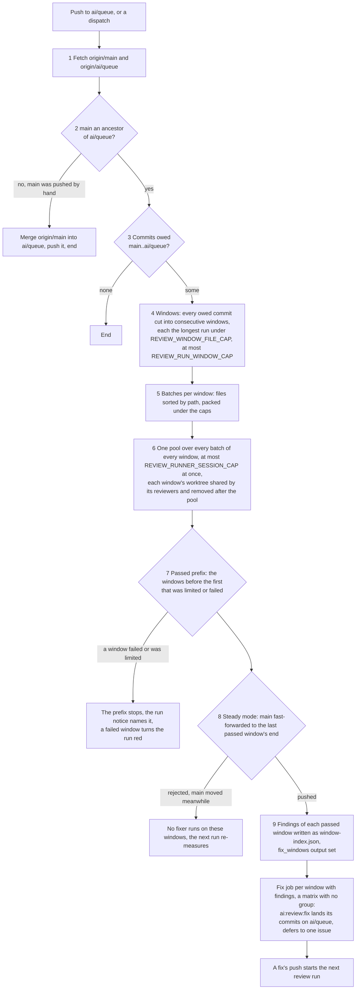

# Review

Working sessions push one permanent branch, `ai/queue`, which is the default branch, and nothing reaches `main` except through a review. The review is a single GitHub workflow, `.github/workflows/Review.yaml`, that runs on every push to `ai/queue`. It reads the commits `main` does not yet have, cuts all of them into windows of a bounded size, reads every batch of every window at once with headless haiku sessions, and then fast-forwards `main` through the longest prefix of windows that were read in full. A fixer job per window with findings fixes what the reviewers found. Nothing waits on a person, and no step is timed: a run's spend is bounded by how many files it reads.

## Why it replaced CodeRabbit

CodeRabbit's limits were time-based. The plan allowed a set number of reviews an hour, and a repository that sent more than a set number in a week was cut down to one an hour. Commits came in faster than that, and a backlog of hundreds of commits and thousands of files sat unreviewed.

The review collector existed to work around the bot. It cut windows to the bot's file cap and opened a stack of pull requests to `main`, with `develop` behind them. It rewrote `ai/queue` onto every window, kept an express lane for commits that claimed nothing needed review, carried a repair for a red `main`, and decided when to ask the bot again. That machinery was most of the code paid for one job, getting a review.

Without a bot, none of it is needed. There are no pull requests, so there is no `develop`, and nothing is rewritten: `main` is the reviewed prefix of `ai/queue`, and a review moves it forward.

## Why the run is parallel

The first live run measured where the time went. Setup, the checkout, the install and the cached package build took about 7.5 minutes. The review and its fixer over 84 commits, 297 files and 19 batches at a concurrency of 5 took about 5.5 minutes. The backlog it had to clear was about 830 commits. Reviewing one window at a time and then dispatching itself again made each commit wait for every window before it, so the design below plans every window at once, runs their batches together, and lets the fixes run beside the next review.

## How a run goes

Each push starts a run. Each step below is one of its steps; the diagram shows the order and the gates between them.

1. **Fetch.** The run reads `origin/main` and `origin/ai/queue`.
2. **Diverged main.** If `main` is not an ancestor of `ai/queue`, someone pushed `main` by hand. The run merges `origin/main` into `ai/queue`, pushes it, and ends, since that push starts the next run. A conflict fails the run, listing the conflicted paths.
3. **Commits owed.** The commits on `main..ai/queue`, first parents only, in order. None means the run ends.
4. **Windows.** Every owed commit is cut into consecutive windows. Each window is the longest run of commits whose changed files, taken together, stay within the file cap, and holds at least one commit, even when that commit alone is over the cap. A window's base is its first commit's parent and its end is its last commit. The run plans every window owed, up to the windows one run may hold. Windows past that cap wait for the next run.
5. **Batches.** Each window's changed files, after the excluded paths and binary files are dropped, are sorted by path so neighbours land together, then packed in order into batches under a file cap and a changed-line cap. A file over the line cap gets a batch to itself, and its diff in the prompt is cut at a line limit with a note telling the reviewer to read the file.
6. **Reviewers.** One pool holds every batch of every window, and runs at most a fixed number of sessions at once, which is what one runner's memory holds. Each window has one detached worktree at its end, made when its first batch starts and removed after the pool. Every reviewer of a window reads from that worktree, and a reviewer is read-only: it may read files, search them and run `git` to read history, and nothing else. It answers with a JSON object of findings. A batch that fails is retried once, and a batch that still fails marks its window failed.
7. **Passed prefix.** A window passes when every batch answered. It is limited when a batch hit the account's usage limit, and failed when any other batch errored. The passed windows are the ones before the first window that did not pass, since a window after a stopped one never reads its base as landed.
8. **Advance main.** In steady mode, the last passed window's end is pushed to `main` as a fast-forward, once, never forced. A push the remote refuses means `main` moved meanwhile: the passed windows may be stale, so no fixer runs on them and the next run re-measures. Range mode never moves `main`.
9. **Fixers.** Each passed window with findings gets its findings written as `window-<index>.json` and its index appended to the job output `fix_windows`. The review job uploads those files, and a matrix job per index runs one fixer over its window, in its own job, with no concurrency group, so the next review starts while the fixes run. A fixer runs at the tip of `ai/queue`, lands its commits by `git pull --rebase` and a push, retried on a rejected push, and defers what it cannot fix, and any fix whose commit did not land, to one issue per window.

Every session's commits are reviewed in a later run like any other commit, so a fix is never trusted on the fixer's word. A fixer's push starts that run.

### Range mode

A dispatch may name a `from` and a `to` commit. Steps 3 to 7 then run over the commits between them, and step 8 is skipped, because range mode never moves `main`. Its passed windows still go to fixers. A range run that stops early names, in its summary, the `from` to resume with. This is how the one-off backlog is reviewed, or any range re-reviewed.

### The usage limit

Every session draws on the same Claude account as a person's working session, so the account's limit can run out in the middle of a run. When a session reports it, that batch's window is limited: the windows after it do not pass, `main` moves only through the windows before it, and the run exits successfully with a notice naming where it stopped. The next push resumes steady state.

### The dry run

`pnpm -C scripts ai:review --dry-run`, with an optional `--from` and `--to`, prints every window this run plans, with its base and end, and its batches with their file and line counts. It runs no session and pushes nothing, so a plan's size can be checked before a run spends on it.

## Decisions

- **Limits are amounts, never time.** The window, the batch, the windows one run plans and the sessions one runner holds are each bounded by how much is read or how much a runner holds, so a run's cost is known before it starts and nothing depends on how many reviews happened in the last hour. A time limit is what CodeRabbit imposed and what the backlog outran.
- **Every window is planned per run, and one pool reads them.** Planning all windows up front lets every batch of the backlog run beside the others, and the fixes of a passed prefix run beside the next review, which a window-at-a-time dispatch could not do.
- **No pull requests, no `develop`, no express lane, no repair.** A pull request is a review slot the bot must spend, and a `develop` branch is a second place the reviewed prefix would have to be kept. Every commit is reviewed in its window, however small, so there is no lane that skips review, and a red `main` is fixed on `ai/queue` first, as the CI section below sets out.
- **`main` is the reviewed prefix of `ai/queue`.** Only the review's fast-forward moves `main`, through the windows that passed, so `main` is always an ancestor of `ai/queue`, and what `main` holds is exactly what a review has read.
- **`ai/queue` is the default branch.** GitHub runs a push-triggered workflow from the default branch's copy of its file, and `main` holds only what a review has passed, so a review workflow on `ai/queue` alone could never run. Renovate also reads its config from the default branch.
- **Renovate targets `ai/queue` and merges by pull request.** Its bumps enter through the queue like a session's commits, so they are reviewed like any other change instead of landing on `main` unread. A branch automerge is a fast-forward, which a base moving every few minutes starves, so Renovate's pull requests merge through GitHub's auto-merge once their required checks pass.
- **Reviewers are read-only, in a worktree at the window's end.** A reviewer reads the code exactly as it will be on `main`, cannot change it, and cannot reach GitHub. The session's answer is the only thing it hands back, parsed against a typed schema, and a malformed answer fails that one session.
- **One fixer per window with findings.** Within a window, one session fixes its findings in order, so the fixes stay in the order their findings were read. Different windows' fixers run in parallel, each landing its commits by pull and push; a commit that cannot land is deferred, not retried past its attempts.
- **Deferred findings go to one issue per window.** A finding the fixer cannot settle is a later session's, and it does not hold the queue. One issue per fixer lists them, so the run does not open a stream of issues, and the issue is labelled as work an agent can take.
- **The reviewers never touch GitHub.** The script does every push, issue and summary under its own token. The session gets nothing but its own Claude credential, so a finding's text, which came from code under review, cannot direct a push.

## Constants

Each limit is one named constant in the review's code, with its reason beside it. None of the values is written in prose, so a change is one edit in the file.

| Constant                    | What it bounds                                                                                                             |
| :-------------------------- | :------------------------------------------------------------------------------------------------------------------------- |
| `REVIEW_WINDOW_FILE_CAP`    | The files one window holds, so `main` advances in steps one review can read.                                               |
| `REVIEW_RUN_WINDOW_CAP`     | The windows one run plans. GitHub's matrix takes at most 256 jobs, and each window with findings is one of them.           |
| `REVIEW_BATCH_FILE_CAP`     | The files in one reviewer's batch. Kept small so the reviewer reads every file it is handed.                               |
| `REVIEW_BATCH_LINE_CAP`     | The changed lines in one reviewer's batch. Kept small so the reviewer reads every line it is handed.                       |
| `REVIEW_DIFF_LINE_LIMIT`    | Where one oversized file's diff is cut in the prompt. The reviewer is told to read the rest from the file.                 |
| `REVIEW_RUNNER_SESSION_CAP` | The `claude` sessions one runner holds at once across the whole pool. A starting value, to be measured against a real run. |
| `REVIEW_MODEL`              | The model every session runs.                                                                                              |
| `REVIEWER_TIMEOUT_MS`       | The wall clock of one reviewer, past which its process tree is killed.                                                     |
| `FIXER_TIMEOUT_MS`          | The wall clock of one fixer, past which its process tree is killed.                                                        |

The excluded paths are the generated output, snapshots, the lockfile, migrations, the changelog and binary files, the same set the bot's path filters used. The list lives beside the reason for each entry, and a path is dropped from every window and batch the same way.

## The session launcher

Every session goes through one function. It starts the Claude Code command line headless with the role's model and tool flags, sends the prompt on standard input, and kills the whole process tree at its wall clock. It removes every environment variable whose name looks like a credential, except the Claude token the session itself needs. Git and `gh` are authenticated in the parent only, through the credential helper, so a session can read the repository but cannot push or call the API on its own.

When Claude Code reports the account's usage limit, the launcher throws a distinct error, which is what the window's limited status catches. Any other failure is a plain error and counts as the batch's or the fixer's failed attempt.

## The workflow

`.github/workflows/Review.yaml` runs on a push to `ai/queue`, and on a dispatch that takes two optional inputs, `from` and `to`, which it passes to the script through the environment rather than the command line.

- The **review** job holds the concurrency group, one for steady state and another for range mode, with cancellation off. One run reviews and one waits behind it, so the next review starts as soon as this one ends, while its fixers are still working. A newer waiting run replaces an older one, which is harmless, since every run reviews everything owed at its start. The job has one timeout, which bounds the one pool of every batch; it checks out `ai/queue` with its full history and installs the workspace's packages from cache. It uploads each window's findings as an artifact, even when a window failed, so the passed windows' fixers still run.
- The **fix** job runs once per index in `fix_windows`, as a matrix of the same run, with no concurrency group, and a timeout that covers one fixer session. It checks out the tip of `ai/queue` with the full install, downloads the findings, and runs `ai:review:fix` for its window.

Both jobs run with a committer identity that is the repository's own automation account, and the workflow's token is read-only; the pushes use the collector's own token. The summary of each job records the windows and their status, or the window's findings and their dispositions.

## CI on the queue

A review does not gate on CI. A window's review completes and `main` moves, whatever CI says at that point. A red typecheck or lint on a session's push is that session's to fix, on `ai/queue`, before the next push. A red on `main` came from the queue, where its fix lands and then travels with the next window; `main` is never repaired in place.

## Key files

| File                                                  | Role                                                                                                        |
| :---------------------------------------------------- | :---------------------------------------------------------------------------------------------------------- |
| `.github/workflows/Review.yaml`                       | the workflow: its triggers, the review job, the fix matrix, and the groups, timeouts and outputs            |
| `scripts/src/review/index.ts`                         | the entry point, `pnpm -C scripts ai:review`, with `--from`, `--to`, `--dry-run` and `--findings-directory` |
| `scripts/src/reviewFix/index.ts`                      | the entry point, `pnpm -C scripts ai:review:fix`, the fixer over one window's findings file                 |
| `scripts/src/services/review/runReview.ts`            | the review job's half: planning, the pool, the passed prefix, `main` and the fix outputs                    |
| `scripts/src/services/review/runReviewFix.ts`         | the fix job's half: the fixer, its landing, its dispositions and its deferred issue                         |
| `scripts/src/services/review/readReviewWindows.ts`    | plans every window owed, each with its base, end, commits and batches                                       |
| `scripts/src/services/review/reviewWindows.ts`        | the one pool over every batch of every window, and each window's worktree                                   |
| `scripts/src/services/review/getPassedWindowCount.ts` | the passed prefix: the windows before the first that did not pass                                           |
| `scripts/src/models/review/ReviewFinding.ts`          | the typed finding a reviewer answers with: file, line, lane, summary and trigger                            |
| `scripts/src/models/review/ReviewDisposition.ts`      | the typed disposition a fixer answers with: finding index, outcome and reason                               |
| `scripts/src/models/review/ReviewWindowFindings.ts`   | the findings file a passed window hands its fixer, validated when the fixer reads it                        |
| `renovate.json`                                       | Renovate's pull requests, against the default branch `ai/queue`, auto-merged                                |
| `apps/infra/src/github/branchDefault.ts`              | `ai/queue` as the default branch, which the workflow runs from                                              |
| `.agents/skills/code-review/SKILL.md`                 | the review every reviewer runs, with its two lanes and its standing rules                                   |
| `.agents/skills/review-queue/SKILL.md`                | the session's side: committing and landing on `ai/queue`                                                    |
| `.agents/triage-labels.md`                            | the label the deferred-findings issue carries                                                               |

## Notes

- **A review reads commits, not pull requests.** There is no pull request to comment on, so a finding lives in the run's summary and, when deferred, in its issue.
- **A commit over the window cap is a window of its own.** A window holds at least one commit, so an oversized commit is reviewed whole, in batches, rather than held back.
