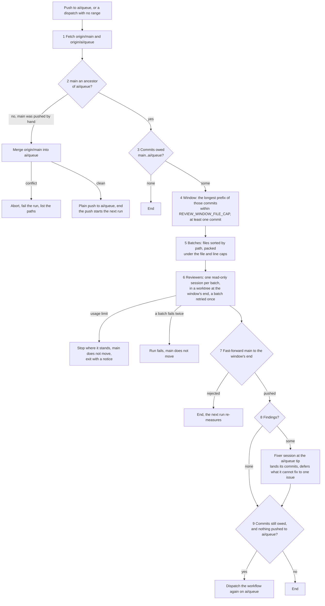

# Review

Working sessions push one permanent branch, `ai/queue`, which is the default branch, and nothing reaches `main` except through a review. The review is a single GitHub workflow. It reads the commits `main` does not yet have, cuts them into windows of a bounded size, reads each window in small batches with headless haiku sessions, and then fast-forwards `main` to the window's last commit. A second haiku session fixes what the reviewers found. Nothing waits on a person, and no step is timed: a run's spend is bounded by how many files it reads.

## Why it replaced CodeRabbit

CodeRabbit's limits were time-based. The plan allowed a set number of reviews an hour, and a repository that sent more than a set number in a week was cut down to one an hour. Commits came in faster than that, and a backlog of hundreds of commits and thousands of files sat unreviewed.

The review collector existed to work around the bot. It cut windows to the bot's file cap and opened a stack of pull requests to `main`, with `develop` behind them. It rewrote `ai/queue` onto every window, kept an express lane for commits that claimed nothing needed review, carried a repair for a red `main`, and decided when to ask the bot again. That machinery was most of the code paid for one job, getting a review.

Without a bot, none of it is needed. There are no pull requests, so there is no `develop`, and nothing is rewritten: `main` is the reviewed prefix of `ai/queue`, and a review moves it forward.

## How a run goes

The workflow runs `pnpm -C scripts ai:review`. Each step below is one of its nine steps; the diagram shows the order and the gates between them.

1. **Fetch.** The run reads `origin/main` and `origin/ai/queue`.
2. **Diverged main.** If `main` is not an ancestor of `ai/queue`, someone pushed `main` by hand. The run merges `origin/main` into `ai/queue`. A conflict aborts the merge and fails the run, listing the conflicted paths. A clean merge is pushed as a plain push, and the run ends, because that push starts the next run.
3. **Commits owed.** The commits on `main..ai/queue`, first parents only, in order. None means the run ends.
4. **The window.** The window is the longest prefix of those commits whose changed files, taken together, stay within the file cap. A window always holds at least one commit, even when that commit alone is over the cap. Its base is the first commit's parent and its end is the last commit in it.
5. **Batches.** The window's changed files, after the excluded paths and binary files are dropped, are sorted by path so neighbours land together, then packed in order into batches under a file cap and a changed-line cap. A file over the line cap gets a batch to itself, and its diff in the prompt is cut at a line limit with a note telling the reviewer to read the file.
6. **Reviewers.** One headless session per batch, at most a fixed number at once. Each runs in a detached worktree at the window's end, which needs no install. A reviewer is read-only: it may read files, search them and run `git` to read history, and nothing else. It answers with a JSON object of findings. A batch that fails is retried once, and a second failure fails the run without moving `main`.
7. **Advance main.** The window's end is pushed to `main` as a fast-forward, never forced. A push the remote refuses ends the run, and the next run measures again. This happens before the fixer, so a slow fix holds nothing back.
8. **Fixer.** Only when a reviewer reported something. One session runs at the tip of `ai/queue` with a full install, fixes what it can, and answers with a disposition for each finding. Its commits are landed by `git pull --rebase` and then a push, retried on a rejected push. Whatever it deferred, and every finding if the fixer itself failed, goes into one issue, labelled for an agent.
9. **Continuation.** If commits are still owed after the window's end and this run pushed nothing to `ai/queue`, the run dispatches itself again. A push to `ai/queue` already starts a run, so the dispatch is only for the case where nothing was pushed.

Every session's commits are reviewed in a later window like any other commit, so a fix is never trusted on the fixer's word.

### Range mode

A dispatch may name a `from` and a `to` commit. Steps 3 to 9 then run over the commits between them, and step 7 is skipped, because range mode never moves `main`. A range that owes commits after its window always dispatches its own continuation with `from` set to the window's end. Range runs have their own concurrency group, so a push-triggered run never cancels a range run's pending continuation. This is how the one-off backlog is reviewed, or any range re-reviewed.

### The usage limit

Every session draws on the same Claude account as a person's working session, so the account's limit can run out in the middle of a run. When a session reports it, the run stops where it stands. `main` does not move for an unfinished window, no continuation is dispatched, and the run exits successfully with a notice naming where it stopped (in range mode, the `from` to resume with). The next push resumes steady state.

### The dry run

`pnpm -C scripts ai:review --dry-run`, with an optional `--from` and `--to`, prints the window, its base and end, and its batches with their file and line counts. It runs no session and pushes nothing, so a window's size can be checked before a run spends on it.

## Decisions

- **Limits are amounts, never time.** The window, the batch and the reviewer count are each bounded by how much is read, so a run's cost is known before it starts and nothing depends on how many reviews happened in the last hour. A time limit is what CodeRabbit imposed and what the backlog outran.
- **No pull requests, no `develop`, no express lane, no repair.** A pull request is a review slot the bot must spend, and a `develop` branch is a second place the reviewed prefix would have to be kept. Every commit is reviewed in its window, however small, so there is no lane that skips review, and a red `main` is fixed on `ai/queue` first, as the CI section below sets out.
- **`main` is the reviewed prefix of `ai/queue`.** Only the review's fast-forward moves `main`, so `main` is always an ancestor of `ai/queue`, and what `main` holds is exactly what a review has read.
- **`ai/queue` is the default branch.** GitHub dispatches and schedules a workflow only from the default branch's copy of its file, and `main` holds only what a review has passed, so a review workflow on `ai/queue` alone could never be dispatched. Renovate also reads its config from the default branch.
- **Renovate targets `ai/queue` and merges by pull request.** Its bumps enter through the queue like a session's commits, so they are reviewed like any other change instead of landing on `main` unread. A branch automerge is a fast-forward, which a base moving every few minutes starves, so Renovate's pull requests merge through GitHub's auto-merge once their required checks pass.
- **Reviewers are read-only, in a worktree at the window's end.** A reviewer reads the code exactly as it will be on `main`, cannot change it, and cannot reach GitHub. The session's answer is the only thing it hands back, parsed against a typed schema, and a malformed answer fails that one session.
- **One fixer.** Fixes are made by a single session in order, so no two fixers race over the same files and the fixes stay in the order their findings were read.
- **Deferred findings go to one issue per run.** A finding the fixer cannot settle is a person's to see, but it does not hold the queue. One issue lists them, so the run does not open a stream of issues, and the issue is labelled as work an agent can take.
- **The reviewers never touch GitHub.** The script does every push, issue and summary under its own token. The session gets nothing but its own Claude credential, so a finding's text, which came from code under review, cannot direct a push.

## Constants

Each limit is one named constant in the review's code, with its reason beside it. None of the values is written in prose, so a change is one edit in the file.

| Constant                 | What it bounds                                                                                             |
| :----------------------- | :--------------------------------------------------------------------------------------------------------- |
| `REVIEW_WINDOW_FILE_CAP` | The files one run reviews before `main` advances. It bounds a run's spend and wall clock.                  |
| `REVIEW_BATCH_FILE_CAP`  | The files in one reviewer's batch. Kept small so the reviewer reads every file it is handed.               |
| `REVIEW_BATCH_LINE_CAP`  | The changed lines in one reviewer's batch. Kept small so the reviewer reads every line it is handed.       |
| `REVIEW_DIFF_LINE_LIMIT` | Where one oversized file's diff is cut in the prompt. The reviewer is told to read the rest from the file. |
| `REVIEW_CONCURRENCY`     | The reviewers running at once, within the account's rate.                                                  |
| `REVIEW_MODEL`           | The model every session runs.                                                                              |
| `REVIEWER_TIMEOUT_MS`    | The wall clock of one reviewer, past which its process tree is killed.                                     |
| `FIXER_TIMEOUT_MS`       | The wall clock of the fixer, past which its process tree is killed.                                        |

The excluded paths are the generated output, snapshots, the lockfile, migrations, the changelog and binary files, the same set the bot's path filters used. The list lives beside the reason for each entry, and a path is dropped from every window and batch the same way.

## The session launcher

Every session goes through one function. It starts the Claude Code command line headless with the role's model and tool flags, sends the prompt on standard input, and kills the whole process tree at its wall clock. It removes every environment variable whose name looks like a credential, except the Claude token the session itself needs. Git and `gh` are authenticated in the parent only, through the credential helper, so a session can read the repository but cannot push or call the API on its own.

When Claude Code reports the account's usage limit, the launcher throws a distinct error, which is what the run's usage-limit handling above catches. Any other failure is a plain error and counts as the batch's or the fixer's failed attempt.

## The workflow

`.github/workflows/Review.yaml`, named for its purpose, takes two optional inputs, `from` and `to`, and passes them to the script through the environment rather than the command line. It runs in one concurrency group for steady state and another for range mode, never cancels a run in progress, and has a timeout that covers a full window's reviewers and its fixer. It checks out `ai/queue` with its full history, installs the workspace's packages from cache, and runs with a committer identity that is the repository's own automation account. Its permissions allow it to dispatch its own continuation. Its summary records the window, the batches, each finding and its disposition.

The workflow starts only by dispatch until its first run is verified. The push trigger on `ai/queue`, which starts a run after each push, is added once it is.

## CI on the queue

A review does not gate on CI. A window's review completes and `main` moves, whatever CI says at that point. A red typecheck or lint on a session's push is that session's to fix, on `ai/queue`, before the next push. A red on `main` came from the queue, where its fix lands and then travels with the next window; `main` is never repaired in place.

## Key files

| File                                             | Role                                                                                |
| :----------------------------------------------- | :---------------------------------------------------------------------------------- |
| `.github/workflows/Review.yaml`                  | the workflow: its inputs, concurrency, timeout and the one script it runs           |
| `scripts/src/review/index.ts`                    | the entry point, `pnpm -C scripts ai:review`, with `--from`, `--to` and `--dry-run` |
| `scripts/src/models/review/ReviewFinding.ts`     | the typed finding a reviewer answers with: file, line, lane, summary and trigger    |
| `scripts/src/models/review/ReviewDisposition.ts` | the typed disposition a fixer answers with: finding index, outcome and reason       |
| `renovate.json`                                  | Renovate's pull requests, against the default branch `ai/queue`, auto-merged        |
| `apps/infra/src/github/branchDefault.ts`         | `ai/queue` as the default branch, which the workflow dispatches from                |
| `.agents/skills/code-review/SKILL.md`            | the review every reviewer runs, with its two lanes and its standing rules           |
| `.agents/skills/review-queue/SKILL.md`           | the session's side: committing and landing on `ai/queue`                            |
| `.agents/triage-labels.md`                       | the label the deferred-findings issue carries                                       |

## Notes

- **The workflow is dispatch-only until its first run is verified**, as stated above; this is the one part of the design not yet live.
- **A review reads commits, not pull requests.** There is no pull request to comment on, so a finding lives in the run's summary and, when deferred, in its issue.
- **A commit over the window cap is a window of its own.** A window holds at least one commit, so an oversized commit is reviewed whole, in batches, rather than held back.
