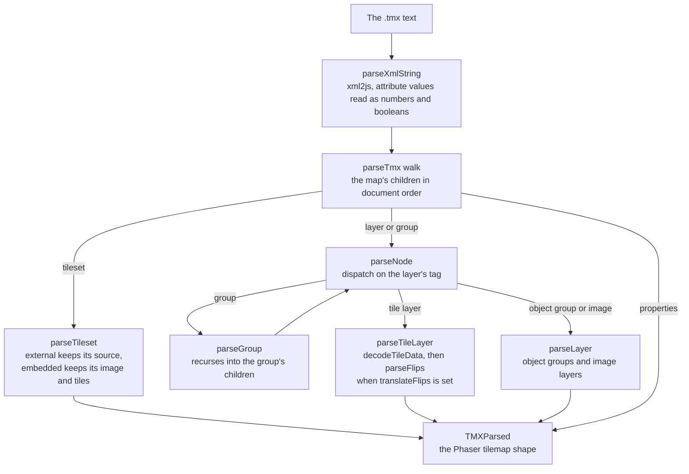

# parse-tmx

`packages/parse-tmx` (npm `parse-tmx`) reads a [Tiled Map Editor](http://www.mapeditor.org/) `.tmx` file into the tilemap shape Phaser's own JSON export produces, so a game loads a Tiled map without running Tiled. Its entry point is `parseTmx(xml, translateFlips)`, which resolves to a `TMXParsed` map; `parseTileset` and `parseXmlString` are exported beside it for a caller that reads one tileset or the raw XML tree.

It follows the upstream [tmx-map-parser](https://github.com/praghus/tmx-map-parser) pipeline, one function for each of the upstream's functions, and the upstream's dependency on xml2js is the reading layer under it. It is the reader the app's Tiled scripts and the [vue-phaserjs](/docs/vue-phaserjs) Tiled plugin use.

## How a map becomes a tilemap

`parseTmx` reads the file through [@esposter/xml2js](/docs/xml2js) into the `map` element's tree, then walks the map's children in the order the document gives them. Each child is dispatched on its tag name: a tileset becomes a parsed tileset, the map's properties its property list, and each layer or group goes through the node dispatch, where a group recurses into its own children and a tile layer's data is decoded.

- **The map's data.** A tile layer's data is one of Tiled's encodings: base64 with no compression, gzip or zlib, or a list of `<tile>` elements from the form Tiled deprecated and still writes into old maps. Each cell is a global tile id, and the high bits of an id are its flips; `translateFlips` turns those bits into the parsed tile's flip flags, and without it the id is kept as written.
- **Tilesets.** An embedded tileset keeps its attributes, its image's attributes and its tiles, each with its id, type and properties. An external tileset is a reference to another file, so its attributes are returned as read and the file itself is not opened.
- **Groups.** A group's layers are parsed in document order, with each layer's own tile count, so a group nested in a group is read the same way as one at the top.
- **The output's order.** Layers keep the order the document gives them, since a map's draw order is that order.

## Decisions

- **The reader is xml2js and nothing else.** Every element's attributes, text and child order come from `@esposter/xml2js` with the attribute processor that reads numbers and booleans; `parseXmlValue` is the one function here that reads a value. The model types under `src/models` name each node's shape rather than checking it, since the XML is the trust boundary and xml2js is what parses it.
- **A document with no root element is an error.** `parseXmlString` rejects a document xml2js resolves to null for, rather than handing the walk nothing to destructure.
- **The output is Phaser's shape.** The parsed map keeps the names Phaser's own tilemap export uses, so a game loading the parsed map reads it the way it reads Tiled's JSON.
- **The Tiled format is a spec that changes without us.** The reader follows the Tiled version the maps are written in; a new layer or encoding Tiled adds is a node the dispatch does not know, and it fails with an `InvalidOperationError` naming the tag, not with a silent skip.

## Upstream

Every issue of the upstream [tmx-map-parser](https://github.com/praghus/tmx-map-parser) repository, open and closed, read with its comments and given one verdict by the [dependency admission triage](/docs/architecture/dependency-admission). The repository has three issues, and its pull requests are dependency updates, which the catalog owns.

| Upstream                                                                                | Verdict            | Proof                                                                                                                                                      |
| --------------------------------------------------------------------------------------- | ------------------ | ---------------------------------------------------------------------------------------------------------------------------------------------------------- |
| [#1](https://github.com/praghus/tmx-map-parser/issues/1) — modify and save `.tmx` files | Out of scope       | Declined by the maintainer, who called the upstream "a rather simple reader"; writing a map is a different product, and this package stays a reader        |
| [#2](https://github.com/praghus/tmx-map-parser/issues/2) — handle groups                | In scope — feature | Built: a group's layers are parsed through `parseGroup`, and "parses a group's layers" in `parseNode.test.ts` proves it                                    |
| [#4](https://github.com/praghus/tmx-map-parser/issues/4) — can't resolve `xml2js`       | False positive     | The build leaves `@esposter/xml2js` external and declares it in `dependencies`, so the install provides it; the bundled `dist/index.js` imports it by name |

## Sources

- The upstream repository, [praghus/tmx-map-parser](https://github.com/praghus/tmx-map-parser), whose pipeline this package follows, and its 1.3.1 release.
- The [Tiled map format](https://doc.mapeditor.org/en/stable/reference/tmx-map-format/), the specification the reader's node shapes follow.
- Phaser's tilemap JSON export, the shape `parseTmx` produces.

## Key Files

| File                                                | Role                                                       |
| :-------------------------------------------------- | :--------------------------------------------------------- |
| `packages/parse-tmx/src/parseTmx.ts`                | The map walk and the `TMXParsed` it returns                |
| `packages/parse-tmx/src/services/parseXmlString.ts` | The xml2js read, rejecting a document with no root element |
| `packages/parse-tmx/src/services/parseNode.ts`      | The layer and group dispatch on the node's tag             |
| `packages/parse-tmx/src/services/parseTileset.ts`   | The embedded and external tileset shapes                   |
| `packages/parse-tmx/src/services/decodeTileData.ts` | The tile layer's encodings and compression                 |
| `packages/parse-tmx/src/services/parseFlips.ts`     | The flip bits of a global tile id                          |
| `packages/parse-tmx/src/models/tmx/node`            | The XML node shapes the dispatch reads                     |
| `packages/parse-tmx/src/models/tmx/parsed`          | The parsed Phaser tilemap shapes the walk returns          |
