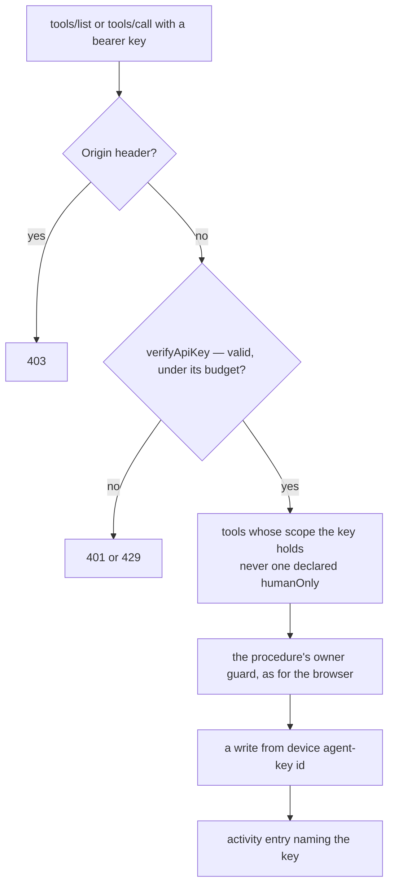

# Agent keys

Today an API key reaches every procedure that opts into the MCP endpoint, and the only ones that do are the TodoList's follow-ups. The [follow-ups page](/docs/resource/todolist-agent-follow-ups) promises that no key ticks, annotates or deletes a todo the owner wrote, and that promise holds only because no other tool exists. The content tools give a key everything its owner can edit, so this unit comes first: a key reaches only what it was made for, and the owner can see what each key did.

## Scopes

A procedure that opts in names its scope beside its description, `mcp: { description, scope }`, with `McpScope` holding `FollowUps` and `Resources`. The scope is one declaration at the procedure, like the description, so the bridge keeps no list of which tool belongs where.

A key carries its scopes as better-auth's own per-key `permissions`, `{ mcp: [...] }`. The plugin sets permissions only from the server, so creating a key moves from the plugin's client call in the settings card to a procedure on the user router that calls `auth.api.createApiKey` with the scopes the owner ticked. A key still never opens a session, so no key can create another.

The route hands the verified key's scopes to the bridge, which lists only the tools of those scopes. A tool outside them is not listed, and calling it by name is the unknown-tool protocol error it already is. The TodoList's Connect an agent dialog makes a follow-ups key, as it does today; the settings card offers both scopes.

Every key that exists was made for the follow-ups, the only tools there were, so a backfill gives each the `FollowUps` scope and nothing else, run as the `backfills` skill runs one.

## Read-only hints

MCP lets a tool declare that it changes nothing, `readOnlyHint`, which defaults to false, and a tool not marked read-only is treated as possibly destructive. The bridge sets the hint on every query's tool, read off the procedure's type, and leaves a mutation's at the defaults. A client can then allow every read without asking and keep its confirmation for writes, which is where Claude Code's own permission prompt belongs.

## The owner's alone

`Meta` gains `humanOnly`, the reason a procedure is never served to a key, and the bridge skips any procedure declaring it. The rule is reversibility: an agent may do whatever a revision, the recycle bin or an unpublish can undo, publishing and moving to the bin included, and what nothing can undo stays with the owner's own hand.

| Procedure                                                                                 | Why it stays the owner's                                                                                                                          |
| ----------------------------------------------------------------------------------------- | ------------------------------------------------------------------------------------------------------------------------------------------------- |
| `resource.purgeResource`                                                                  | the one delete nothing restores, already behind the type-the-name guard ([destructive confirmation](/docs/architecture/destructive-confirmation)) |
| `survey.deleteSurveyResponse`                                                             | deletes a respondent's answer from its table outright, data the owner holds on someone else's behalf                                              |
| `survey.createSurveyResponse`, `survey.updateSurveyResponse`, `survey.readSurveyResponse` | a respondent's procedures, not the owner's acts at all                                                                                            |

Creating and deleting keys is not on the list because no key can reach it: both run in a signed-in session, and a key opens none.

A test over the router holds the declaration: every procedure on a resource type's router that `createResourceProcedures` did not generate declares `mcp` or `humanOnly`. The type's router is found by its name, which is the type uncapitalized, and the factory's procedures by calling the factory for the type, so the test lists nothing by hand and a new type-specific procedure fails it until its author decides.

## Attribution

An agent writes as the key's owner from a device of its own, `agent-<key id>`, which `getAgentSessionPayload` already sets. The activity entry records that device, and saved-content entries coalesce per device rather than per user, so a run of an agent's saves and a stretch of the owner's typing stay separate lines. The activity log names the key by the name its owner gave it, so "what did the agent change" is answered where every other change is, and a restore from version history undoes an agent's run as it undoes anything else.

## Rate limits

Nothing new. A key spends the plugin's per-key budget, set to the standard limiter's, and every call also spends the owner's own standard budget in the procedure middleware, as any signed-in call does. A content patch carries many operations under one call, so an agent's bulk edit costs one request rather than one per cell.

## Key files

| File                                                               | Role after the change                                                         |
| ------------------------------------------------------------------ | ----------------------------------------------------------------------------- |
| `apps/web/server/models/trpc/Meta.ts`                              | `mcp` names its scope, and `humanOnly` names why a procedure is never served  |
| `apps/web/server/api/mcp.post.ts`                                  | hands the verified key's scopes to the bridge                                 |
| `apps/web/server/services/mcp/createMcpServer.ts`                  | lists only the tools of the key's scopes                                      |
| `apps/web/server/services/mcp/getMcpTools.ts`                      | marks a query's tool read-only and skips a human-only procedure               |
| `apps/web/server/services/mcp/getMcpTools.test.ts`                 | every non-factory procedure on a type's router declares `mcp` or `humanOnly`  |
| `apps/web/server/trpc/routers/user.ts`                             | creates a key with its scopes on the server                                   |
| `apps/web/app/components/User/ApiKeysCard/Index.vue`               | asks which scopes a new key holds, and lists each key's                       |
| `apps/web/app/components/Resource/TodoList/ConnectAgentButton.vue` | makes a follow-ups key                                                        |
| `apps/web/server/trpc/routers/todoList.ts`                         | the follow-up procedures name the follow-ups scope                            |
| `apps/web/server/trpc/routers/resource.ts`                         | `purgeResource` declares itself human-only                                    |
| `apps/web/server/trpc/routers/survey.ts`                           | response deletion and the respondent procedures declare themselves human-only |
| `apps/web/server/services/resource/writeResourceActivity.ts`       | records the writing device and coalesces per device                           |
| `packages/db-schema/src/models/resource/ResourceActivityEntity.ts` | the device column, which an Azure table takes with no migration               |
| `apps/web/app/components/Resource/ActivityLog.vue`                 | names the key on an agent's entries                                           |

## Sources

- [Better Auth — API key plugin](https://www.better-auth.com/docs/plugins/api-key) — per-key `permissions` as a record of resource to actions, set and updated only from the server, and checked by `verifyApiKey`.
- [Model Context Protocol — schema reference](https://modelcontextprotocol.io/specification/2025-06-18/schema) — `readOnlyHint`, default false, and `destructiveHint`, default true and meaningful only on a tool that is not read-only.
