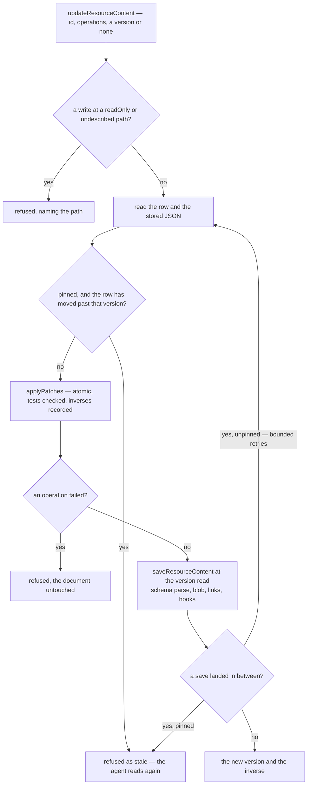

# Content tools

Built on the scopes API keys carry ([agent access](/docs/architecture/agent-access)), so the tools below reach only keys made for them. This is the core of [AI-native resources](/docs/proposals/architecture/ai-native-resources): an agent finds a resource, learns its type's shape, reads what it holds and edits it, through tools that read every type's declaration off the row they are handed.

## The tools

All four sit on the cross-type `resource` router and opt in under the `Resources` scope. The two that take an id are built on `getOwnerProcedure` with no type, the typeless owner guard `resource.readResource` already uses, so each acts only on the key owner's own resources.

| Procedure                            | Kind     | Input                                      | Answers                                                         |
| ------------------------------------ | -------- | ------------------------------------------ | --------------------------------------------------------------- |
| `resource.readResources`             | query    | the explorer's filters — name, types, tags | a page of the owner's resources, as the explorer lists them     |
| `resource.readResourceContentSchema` | query    | a type                                     | its capabilities and its content schema as JSON Schema          |
| `resource.readResourceContent`       | query    | an id, and optionally a pointer and a page | the JSON at the pointer, and the content version it was read at |
| `resource.updateResourceContent`     | mutation | an id, operations, optionally a version    | the new content version, and the operations that undo the edit  |

`resource.readResources` exists; the other three are new.

## Describing a type

One conversion turns a Zod schema into the JSON Schema an agent reads, and both the describe tool and the bridge's tool listing use it:

- **The input side.** Zod converts either side of a schema, and an agent is a writer, so the conversion takes the input: a normalised string is a string, a default is optional.
- **A Date is a `date-time` string.** Zod has no JSON Schema for a Date and throws by default, which is what more than half the content schemas do today. Its `unrepresentable` handler writes a Date as `{ type: "string", format: "date-time" }` — the form `JSON.stringify` stores, which `z.coerce.date()` reads back — and throws on anything else, so a Map, a Set or a BigInt in a content schema still fails.
- **Undescribed parts are marked.** `z.unknown()` and `z.any()` are stamped `x-opaque`, the key the router input test already stamps, so the agent sees where the schema stops describing.
- **Read-only fields say so.** Zod copies a schema's metadata into its JSON Schema, so a field given `.meta({ readOnly: true })` reaches the agent as JSON Schema's own `readOnly` keyword ([schema fidelity](/docs/proposals/architecture/ai-native-resources/schema-fidelity) sets it on the captured HTML of a Webpage and an Email).
- **Enums come through as `enum` lists** — a column's type, a node's type, a visual's — so the legal values arrive in the same answer as the shape.

The bridge uses the same conversion in place of its bare `z.toJSONSchema`, so a procedure whose input holds a Date can be served at all. `resource.readResources` is the first: its filter's `updatedAfter` and `updatedBefore` are `z.date()`, the default conversion throws on them, and the bridge hands tRPC the raw JSON arguments with no SuperJSON revival, so a Date would arrive as a string. They become `z.coerce.date()`, which the browser's revived Date passes too. Its input is also wrapped in `.prefault({})`, which the bridge test refuses as not an object, so the bridge and its test unwrap a default around an object.

## Reading

A read answers the stored JSON — what `readSerializedResourceContent` returns, through `JSON.parse` alone — rather than the content after the schema's parse. The save already ran the schema's transforms, so the stored JSON is exactly the document a patch addresses.

- **A pointer selects.** An RFC 6901 JSON Pointer picks a subtree, so an agent reads a Sheet's columns without its rows.
- **An array is paged.** An array at the pointer is answered a page at a time under `MAX_READ_LIMIT`, its length beside the page, so a large Sheet's rows reach the agent's context in pieces it chose.
- **A whole read past a named cap is refused**, answering instead with the size of each top-level member, so the agent narrows the read rather than receiving a truncated document.

## Editing

An edit is a list of RFC 6902 operations — add, remove, replace, move, copy and test — each addressed by a JSON Pointer. A patch is atomic: if any operation fails, a failed test included, none of them applies. Appending is the pointer's `-` index, so adding a row is `add /data/rows/-` with no index to know.

`applyPatches` (`apps/web/shared/services/jsonPatch/applyPatches.ts`), landed with the page builder, applies the operations to the stored JSON, sharing every untouched subtree and recording each operation's inverse as it goes. The [page builder](/docs/proposals/resource/page-builder/undo-as-patches) records its undo history with the same function, so the applier is written once for both of its consumers; both live in `apps/web`, so it sits in the app's `shared/` layer rather than `@esposter/shared`.

**Paths an agent may not write are refused first.** Every operation's path, and the `from` of a move or a copy, is resolved against the type's agent JSON Schema, and a write at or under a node marked `readOnly` or `x-opaque` is refused, naming the path. A `test` reads and is allowed anywhere. The refusal is read off the schema the agent was given, so the agent can know it in advance, and no type is special-cased.

**The result is parsed at the door.** The patched JSON goes to the `saveResourceContent` service, which parses it with the type's own schema, as it parses every caller's content. A patch that leaves the document invalid is refused with Zod's issues, each naming its path, and the save then does everything a save does: the blob and its hash, the [resource links](/docs/architecture/resource-links) projected from the content — so writing a link field is linking — the activity entry, the type's after-save hook such as a todo's due reminder, the revision interval, and the event every open editor of the resource listens on.

**Two modes of version.**

- **Pinned**, with the content version the agent read: the patch applies to that version, and a save landing in between makes it stale, refused by the door's own check, so the agent reads again. The tool's description recommends it.
- **Unpinned**, with no version: the patch applies to the latest content, its `test` operations the only guard, and a save landing between the server's read and its write is retried a bounded number of times — read again, reapplied — rather than written over. It suits a patch whose paths cannot shift, an append or an object key, and a patch that tests what it depends on, such as `test /data/rows/3/id` before replacing a cell in that row.

The read-change-save-retry loop is the follow-ups' own: `updateTodoListContent` generalized over the type, as `updateResourceContent(ctx, id, update)`. The follow-up procedures call it, and the TodoList's copy goes.

**An edit is bounded and reversible.** A patch holds at most a named `MAX_PATCH_OPERATIONS` operations within the request body limit. Its answer carries the inverse operations, so an agent undoes its own edit in one call, and the owner undoes it from version history. An operation's value is any JSON until the type's schema parses the result, so the router input test's list of opaque inputs gains this procedure.

[Delta content saves](/docs/resource/delta-content-saves) do not apply. They make a browser's whole-document save cheap on the wire, while a patch is already the size of the edit and the stored bytes are on the server.



## The test that holds every type

One test iterates `ResourceTypes`, with no list of its own. For each type it converts the content schema through the agent conversion, expects a root object, and compares the paths the conversion marks `x-opaque` or `readOnly` — written as JSON Pointers, `-` for an array's items and `*` for a record's values, such as a Flowchart's `/nodes/-/data/*` — with what the test records for that type. A new `z.unknown()` in any schema fails until it is described or written down, and each [schema fidelity](/docs/proposals/architecture/ai-native-resources/schema-fidelity) fix removes a line. `applyPatches` has its own tests: every operation, the atomic failure, and every edit followed by its inverse returning the original.

## Key files

| File                                                                  | Role after the change                                                      |
| --------------------------------------------------------------------- | -------------------------------------------------------------------------- |
| `apps/web/server/trpc/routers/resource.ts`                            | the describe, read and update tools, and `readResources` opted in          |
| `apps/web/server/services/mcp/getMcpTools.ts`                         | converts inputs through the agent conversion, a defaulted object unwrapped |
| `apps/web/server/services/mcp/getMcpTools.test.ts`                    | accepts a defaulted object input                                           |
| `apps/web/server/services/resource/readSerializedResourceContent.ts`  | the stored JSON a read selects from and a patch applies to                 |
| `apps/web/server/services/resource/saveResourceContent.ts`            | the one content door, unchanged                                            |
| `apps/web/server/services/resource/todoList/updateTodoListContent.ts` | deleted — the generic update service replaces it                           |
| `apps/web/server/services/resource/todoList/constants.ts`             | its attempt limit moves to the generic service                             |
| `apps/web/server/trpc/routers/todoList.ts`                            | the follow-ups call the generic update service                             |
| `apps/web/shared/models/db/resource/ResourceFilterInput.ts`           | its dates coerce, so the bridge's raw JSON parses                          |
| `apps/web/server/trpc/routers/index.test.ts`                          | names the update tool's opaque input                                       |
| `apps/web/shared/services/resource/ResourceDefinitionMap.ts`          | unchanged — the declaration every tool reads                               |

New code lands here:

```text
apps/web/shared/models/jsonPatch/JsonPatchOperation.ts       the six operations' schema, beside their landed interface
apps/web/server/services/mcp/getAgentJsonSchema.ts           the one conversion the bridge and the describe tool share
apps/web/server/services/mcp/getAgentJsonSchema.test.ts      every content schema converts, its undescribed paths recorded
apps/web/server/services/resource/updateResourceContent.ts   read, change, save at the version read, retry when unpinned
apps/web/server/services/resource/readContentAtPointer.ts    the value at a pointer, and an array's page
```

## Sources

- [RFC 6902 — JSON Patch](https://www.rfc-editor.org/rfc/rfc6902.html) (IETF) — the six operations, `test` succeeding only on an equal value, a failed operation failing the whole patch, and `-` appending to an array.
- [RFC 6901 — JSON Pointer](https://www.rfc-editor.org/rfc/rfc6901.html) (IETF) — the path every read and operation is addressed by.
- [Zod — JSON Schema](https://zod.dev/json-schema) — `z.toJSONSchema`'s input side, a Date among the unrepresentable types, the `unrepresentable` handler that substitutes a schema, and metadata copied into the output.
- [JSON Schema Validation 2020-12](https://json-schema.org/draft/2020-12/json-schema-validation) (section 9.4) — `readOnly`: a value the owning authority manages, whose modification it may reject.
