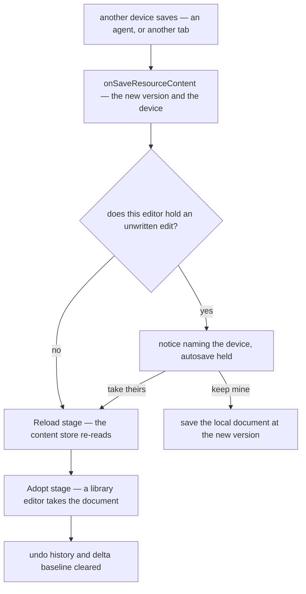

# Live edits

`ResourceSubscribablesMap` has one entry, the TodoList's, so every other type's open editor never hears that another device saved. Its next save carries the version it read, the door refuses it as stale, and the notice asks for a refresh, which reloads the page and drops whatever the person typed since their last save. A second tab meets that now and then. An agent editing a resource the owner has open would meet it on every write, so this unit makes adoption generic before the content tools put agents in front of it; it needs nothing from them and helps two tabs as much as an agent.

## One subscription for every type

`createResourceProcedures` already generates `onSaveResourceContent` for every type, filtered so a device never hears its own save. One generic subscription, run by the explorer (`Explorer/Index.vue`) for whichever resource is open, serves every type, so a type needs no entry anywhere, and the per-type subscribables go: `ResourceSubscribablesMap` and the TodoList's own `useTodoListSubscribables`.

The stream carries the new content version and the writing device rather than the content. The content is re-read through the reload stage a restore already runs, so a large Sheet arrives by the large-documents path rather than over the socket, and one path adopts whatever wrote the blob.

## Adopting

An open editor that holds no unwritten edit — no save pending, no autosave armed, content equal to what it last persisted — adopts the save. It stores the new version and runs `ResourceContentHookMap`'s two stages in order, as [third-party document adapters](/docs/architecture/third-party-document-adapters) describe for a restore: `Reload`, where each content store re-reads through `createContentData`, then `Adopt`, where a library holding its own copy — Tiptap, SurveyJS, GrapesJS — takes the new document.

Two things describe a document that is gone, and clear. An editor's undo history clears, as a restore clears it: the Sheet's command history today, the page builder's patch history once it ships. The [delta content saves](/docs/resource/delta-content-saves) baseline clears too, since it names bytes the server no longer holds, so one large save crosses whole before deltas resume.

The TodoList saves each edit as it happens, so it rarely holds an unwritten one, and it re-reads on another device's save in place of taking the streamed list.

## Meeting an unsaved edit

An editor holding an unwritten edit overwrites nothing in either direction. The notice comes the moment the other save lands, naming the device — an agent by its key's name from the owner's key list — with two answers:

- **Take theirs** adopts as above and drops the local edit.
- **Keep mine** re-saves the local document through the existing save mutation at the newer version, replacing the other write, which stays in version history.

Until it is answered, the store's stale latch holds autosave, as it does after a refused save today. What changes is the timing and the choice: the latch is raised when the other save lands rather than at the person's next save, and a reload that drops their edit is no longer the only way out. After Keep mine, an agent's next pinned patch is stale and it reads again; an unpinned one reapplies over the owner's document under its tests.

## Key files

| File                                                                     | Role after the change                                                             |
| ------------------------------------------------------------------------ | --------------------------------------------------------------------------------- |
| `apps/web/app/components/Resource/Explorer/Index.vue`                    | runs the open resource's save subscription, whatever its type                     |
| `apps/web/app/services/resource/ResourceSubscribablesMap.ts`             | deleted                                                                           |
| `apps/web/app/composables/resource/todoList/useTodoListSubscribables.ts` | deleted                                                                           |
| `apps/web/app/store/resource/todoList/index.ts`                          | its own adoption of a streamed list goes                                          |
| `apps/web/app/store/resource/index.ts`                                   | adopts or asks from its unwritten-edit state, and owns the notice and its answers |
| `apps/web/app/services/resource/createContentData.ts`                    | unchanged — its reload stage is the adoption                                      |
| `apps/web/app/services/resource/ResourceContentHookMap.ts`               | unchanged — the two stages a restore runs                                         |
| `apps/web/app/store/resource/sheet/history/index.ts`                     | clears on adoption                                                                |
| `apps/web/server/trpc/procedure/resource/createResourceProcedures.ts`    | the save stream carries the version and the device rather than the content        |
