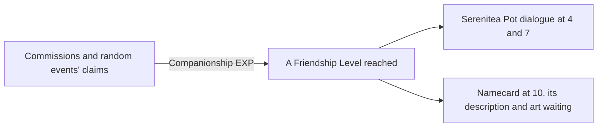

# Companionship

The Friendship Level, the EXP that raises it and the namecard a level 10 holds are built, as the [companionship](/docs/genshin/companionship) page sets out. This proposal keeps what is still unopened and the sources still waiting on their own pages.

## Decisions

- **The namecard's description and art wait.** The name is read from the name records the stat tables already share. The description is published to the hosted game data with the rest of the namecard's words when it is built. Its art is the game's texture, which is never served, so the extracted art is a reference only, and no extraction gates the view.
- **Each source states its own.** Commissions give their share by Adventure Rank, the day's bonus its own, and random events theirs up to ten a day, as the wiki lists them. Each source's page gives its amounts; none is set here.
- **The Serenitea Pot dialogue opens at 4 and 7.** Levels 4 and 7 open a dialogue when the character is a companion in the Serenitea Pot, with the [Serenitea Pot](/docs/proposals/genshin/serenitea-pot)'s companions, whose talk it is. A line that also waits on a quest waits on both. The lines are the game's own by text id ([game text](/docs/genshin/game-text)), which `FettersExcelConfigData` does not name a pot condition for, so they are looked up in `DialogExcelConfigData` and `NpcExcelConfigData` once that exists.

## How it works

## Scope and order

**This adds, in order:**

1. **The Serenitea Pot dialogue at 4 and 7**, once the pot's companions are invited.
2. **The commissions and random events' EXP.** The commissions' claim returns its Companionship EXP item, and routing it to the [friendship grant](/docs/genshin/companionship) is the claim caller's, built in the [commissions](/docs/proposals/genshin/commissions) proposal's routing step. Random events have no page yet.

## Data and measures

- **Provisional:** each claim kind's Companionship EXP, until the References sought clips show what a claim pays out.
- **Settled:** the first claim amounts are provisional at the low end of each wiki range, measured by the References sought clips.

## Key files

| File                                                                     | Role after the change                        |
| :----------------------------------------------------------------------- | :------------------------------------------- |
| `packages/genshin-world/src/components/Character/Screen/Index.vue`       | The Profile tab, opening what a level opens  |
| `packages/genshin-world/src/services/friendship/gainCompanionshipExp.ts` | The grant the claims route their EXP through |

## Sources

- [Friendship Level](https://genshin-impact.fandom.com/wiki/Friendship_Level), Genshin Impact Wiki: what each level from 1 to 10 opens, stories and voice-overs also waiting on quests, and no EXP past 10.
- [Companionship EXP](https://genshin-impact.fandom.com/wiki/Companionship_EXP), Genshin Impact Wiki: the commissions' and random events' amounts, which their pages take.
- [AnimeGameData](https://github.com/DimbreathBot/AnimeGameData), the community's per-patch dump: the dialogue and NPC tables the Serenitea Pot lines are looked up in.
