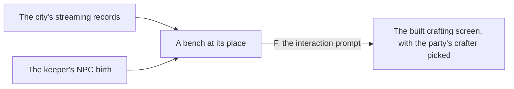

# Crafting

The as-built [crafting](/docs/genshin/crafting) page holds the recipes, their rules, the instructions that open them, the characters' crafting talents, the bench's screen and the save's crafting slice. What is left is the bench's place in the world, which spends from the [inventory](/docs/genshin/inventory)'s bag and wallet and takes Condensed Resin's resin from the [Original Resin](/docs/genshin/original-resin) wallet.

## Decisions

- **The bench is where the game puts one.** Each crafting bench stands where the city's streaming records place it, or where the [spawned places](/docs/proposals/genshin/spawned-places) fit it if they do not, and is used through the [interaction](/docs/genshin/interaction) prompts. The official map marks no crafting bench, so the spawned places cannot place one; the streaming records must, which the scene's extraction reads and which is not read yet.
- **The bench's keeper is an NPC the dump places.** The NPC who keeps the bench reads their place from the hosted `sceneNpcBorn/scene3` dataset, published from the dump's NPC births; the bench's own place is still the scene groups'.
- **Left to other pages.** The [crafting page](/docs/genshin/crafting) lists what it leaves out. The essential oils and the Xiao Lantern are quest items for the [quests](/docs/proposals/genshin/quests) page to settle.

## How it works

## Scope and order

**Still to build, in order:**

1. **The bench's place.** Waits on the other machine's scene group export, since the official map marks no bench and the wiki places Mondstadt's in the Market District. Its prompt then goes through the interaction page. The screen's learned recipes and crafted counts are already the world's, held in `useWorldSave`, so the bench binds them with its `craftedCountMap` model and its `progress` prop.
2. **The keeper's NPC**, placed beside the bench from the hosted dataset once the bench stands.

## Data and measures

- **Not measured.** Crafting takes no time in the game and has no timed state, so no compute-queue item is owed.

## Key files

| File                                                              | Role after the change                                |
| :---------------------------------------------------------------- | :--------------------------------------------------- |
| `scripts/src/services/genshinAssets/world/readWorldPlacements.ts` | Reads the bench's streaming placements for Mondstadt |

## Sources

- [Crafting](https://genshin-impact.fandom.com/wiki/Crafting), Genshin Impact Wiki: where the bench stands in Mondstadt's Market District.
- [AnimeGameData](https://github.com/DimbreathBot/AnimeGameData), the community's per-patch dump: the NPC births, `sceneNpcBorn/scene3`, the keeper's place is read from.
