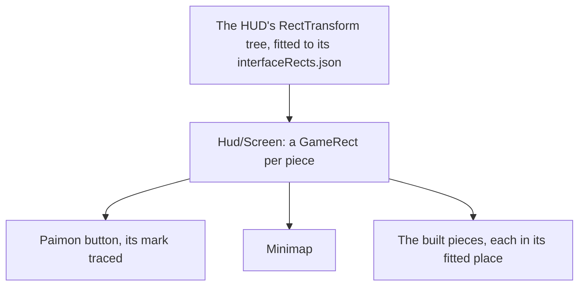

# HUD

The [HUD](/docs/genshin/hud) is built with its stamina meter, its quest tracker, the deployed team's portraits, the member on the field's health and its skill and burst buttons, beside the Paimon button, the [minimap](/docs/genshin/minimap) and the [touch controls](/docs/genshin/touch-controls). Each piece but the quest tracker stands in its fitted rect of the game's own tree, the tracker having no rect there and staying at its provisional place, and each size and colour of those is provisional until its look below is measured. This page keeps what is still unbuilt. It builds on [interface layout](/docs/genshin/interface-layout), which places every screen by the game's own rect tree.

## Decisions

- **Laid out by the game's own tree.** Each piece with a place in the HUD's RectTransform tree sits in that place's `GameRect`, as the login's interface does; the quest tracker has none, so it stays provisionally placed. Built: the HUD's block has its entry in `DerivedAssetComponentMap`, `genshin:assets interface` exports it and `fitHud` publishes its rects. Each piece rides in its game parent, so the screen holds on any window shape.
- **Measured like the login.** Each piece's size and colour come from a recording of the English PC client's world at 1080 high (showing the Paimon button, the minimap turning as the camera turns, the party down the right through a switch, the stamina meter draining to empty and refilling, a quest navigated on its tracker, and a fight with the HP bar falling, the skill on its cooldown and the burst filling, used and cooling), published ones searched first, named in `ParityReferenceMap`. The screen is compared over that recording's own frame with the scene behind it, then shot bare and approved in the visual suite, with its fixture and reference beside it.
- **The HUD's block is the in-level page's block.** The asset index holds no GameObject, so the block is found by an indexed asset beside the page, as the login's is. The page's GameObject, `InLevelMainPage`, is in `00/04803507.blk`, and its clips (`Ani_InLevelMainPage_FadeIn`, `_FadeOut` in `00/03931010.blk`, `_VirtualDial_Show` and `_Hide` in `00/13058112.blk`) are named for it, as `LoginMainPage`'s are the login's. The anchor is `TeamBtn_MP`, the party button's Animator, which only `00/04803507.blk` holds among the game's blocks, where `GrpMainPage` is in four. Its root is `InLevelMainPage`: its tree holds `GrpMiniMap`, `BtnPlayerProfile`, `SPBar`, `TeamBtnContainer` and `GrpActionBtn`, the pieces [HUD](/docs/genshin/hud) lists.
- **Paimon's mark is traced.** Built: the Paimon button draws the face traced from the game's own frame (`hud-world-pickup`, the 90 pixel box at 100, 10) as a path of our own, as every glyph is ([interface library](/docs/genshin/interface-library)). Its ink is the whole head as the trace splits it, with the tracer's default share, so its place and fill are provisional until measured.

## How it works



## Scope and order

**Today:** the HUD's block is exported and fitted, and every piece but the quest tracker stands in its fitted rect of the game's tree ([as-built page](/docs/genshin/hud)), the stamina meter on the screen beside the character; the touch layout's buttons, the keys' skill and burst buttons with their caps (on `hud-world-keys`) and the meter's arc are measured, and the rest of the looks are still provisional: the party's portraits, the member's health and the keys' uncharged burst, which no PC frame shows. The quest tracker has no rect in the HUD's tree and stays at its provisional place until one is found.

**This adds, in order:**

1. **The looks.** Each piece's look is replaced with the game's, read off the copied captures and `hud-world-pickup`. Paimon's mark is built (traced from the same frame, as the Decisions say). `world-hud-hidden.mkv` re-measures the composite later; it gates nothing. The party, health and skill buttons are built first, each measured with `genshin:parity compare hud-world-pickup` before and after, and the stamina meter with `hud-stamina-climb`; the quest tracker's altitude line ("Higher 1540m") comes last, since it waits on the navigated objective's height, which no region data carries until a height is extracted and published by the Mac.

The looks, as built so far (`hud-world-pickup`, head 3ee1c42c1f: mean 10.34%, shape 0.220, tone 9.50%, FLIP 0.4321): the party's rows are built, each name right of its HP bar and left of its portrait, with no slot number (mean 10.34%, shape 0.237, FLIP 0.4319). The health bar was tried with the level before the bar and the numbers over it, and was reverted: its mean rose to 10.35%.

Re-run on 2026-10-11 with the fit's dry run (`genshin:assets fit hud --dry-run` reads `hud/interfaceRects` unchanged, so no publish is owed for the rects): the baseline reads mean 10.06%, shape 0.340, tone 9.21%, FLIP 0.4285, as the Mac's numbers above. The reference's third row in the party list reads Tabibito, the name the recording's player chose for the Traveler, as no English text map entry reads it. Built: the save holds the chosen name ([save data](/docs/genshin/save-data)), the Traveler's row shows it in place of the text map's "Traveler" while it is set, and the fixture sets it to Tabibito (mean 10.06%, shape 0.341, tone 9.20%, FLIP 0.4285, the name too small a part of the frame to move a figure). The frame's three rows stay as it shows them.

Burst fill: the reference's burst disc at 24% energy fills in Anemo's colour, not gold. No pixel of the disc reads gold, and its fill is #309d6b over green grass at 70 seconds and #47bcea over blue water at 80, which one bright tone (#50ffe1) laid at a third over each backdrop gives. Charged, the PC part of the same recording fills the whole disc in the element's colour, Cryo's #80c0dc ringed in #abf6ff at 20 seconds (darker over dark rock at 4) and Geo's #dd9c1a ringed in #fec325 at 60. Built: the burst fills in its element's bright tone at a third and, charged, takes its element's charged tone, ringed in the bright one (`ElementBurstColorsMap`), the other elements' tones estimated from the game's hue for each (mean 10.04%, shape 0.341, tone 9.20%, FLIP 0.4281). The departure from the gold decided for it waits on the roadmap's Manual verification.

`hud-world-pickup` turned out to be the mobile client: the recording says so as it reaches the frame, and its three discs are the touch layout's sprint, attack and jump. So the touch layout is built ([HUD](/docs/genshin/hud)): the attack, aim, jump and sprint buttons beside the skill and burst, each disc placed from `GrpActionBtn`'s corner, its glyph traced from the game's icon, and the fixture draws it with Venti, the bow's wielder the frame shows, on the field. Baselines re-taken on 2026-10-10 read the same on the Mac as on the PC: mean 10.34%, shape 0.237, tone 9.50%, FLIP 0.4319. Built: mean 10.06%, shape 0.341, tone 9.20%, FLIP 0.4285 on the Mac.

The stamina meter is measured on `hud-stamina-climb`, the PC client's meter part drained on a public climb (the capture `yt-hRR2yoP3uY0-world-stamina.mp4`): an arc of radius 104.5 round the pivot, 54 degrees long and 7 wide, a yellow fill over a dark red track, flashing under an eighth. The meter had stood inside its tree rect at the screen's middle, offset off the screen by the pivot; it now stands on the screen. Before, mean 3.25%, shape 0.018, tone 3.68%, FLIP 0.1764 (the meter off the region); built, mean 1.97%, shape 0.724, tone 2.17%, FLIP 0.1411, both on the Mac, the reference new with this pass.

Skill and burst icons: Venti's two, the frame's, are traced from the wiki's talent icons onto their discs at the size and tones `hud-world-pickup` shows, the burst's dimmed to 0.14 while uncharged (mean 9.95%, shape 0.374, tone 9.10%, FLIP 0.4266).

Keys' layout: the same recording's PC part is a reference of its own, `hud-world-keys` at 20 seconds, Chongyun on the field with his burst charged, scored over the skill and burst and their caps. The skill and burst are placed, sized and toned as it shows them, Chongyun's icons traced, his burst's Cryo tones read off that frame and the halo softened to half, and each has its key's cap below it (mean 16.07% to 4.23%, shape 0.000 to 0.927, tone 14.62% to 3.30%, FLIP 0.4505 to 0.2456; `hud-world-pickup` and `hud-stamina-climb` unchanged). The burst uncharged in the keys' layout is drawn as the touch layout's, since no PC frame shows it, and asked on the roadmap's Manual verification.

Meter's flash and fades, from the same climbing clip as `hud-stamina-climb`: the meter fades in over about 100 ms (it appears at 1.9 seconds) and out, evenly, over about 200 ms (7.7 seconds), so the fade-out went from 300 ms eased to 200 ms linear. No frame shows it under an eighth before the pool runs out at 33 seconds; from there the fill refills red and the track pulses red, #a8362a at its height (33.27 and 33.93 seconds) with a glow toward the character, back to its dark red between (33.6), so the flash under an eighth became that pulse, the share it starts under asked on the roadmap's Manual verification. `hud-stamina-climb` holds at mean 1.97%, shape 0.724, tone 2.17%, FLIP 0.1411, its frame not low. The section ticks are measured on the same clip, a line about 2 wide at each 100 of its pool of about 214, darker across the fill and paler across the track, and wait on a pool past 100, which nothing raises yet.

Left of the looks: every other character's skill and burst icons, each pair some 13 KB of paths, so the roster's wants hosted data rather than committed source; the meter's section ticks, waiting on a pool past 100; and the tracker's altitude line, waiting on a published region height.

## What this does not propose

- **The pieces of features the world lacks**: the chat and the top right's shortcuts.
- **The agent console's bar.** The console is hidden from the game until it is rebuilt in the game's style, which is its own page's.

## Key files

| File                                                              | Role after the change                 |
| :---------------------------------------------------------------- | :------------------------------------ |
| `packages/genshin-world/src/components/Hud/Screen/Index.vue`      | Draws each piece with the game's look |
| `scripts/src/services/genshinParity/shared/ParityReferenceMap.ts` | Gains the HUD's recordings            |

New files:

```text
packages/genshin-world/src/components/Hud/Screen/Index.reference.ts
```

## Sources

- [Paimon Menu](https://genshin-impact.fandom.com/wiki/Paimon_Menu), Genshin Impact Wiki, for the top-left Paimon button, which opens the menu as Escape does.
