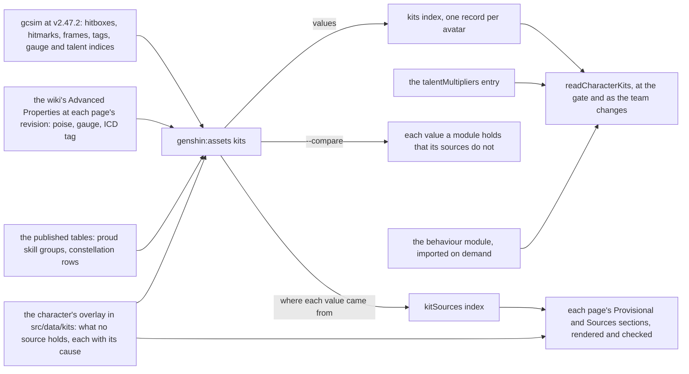
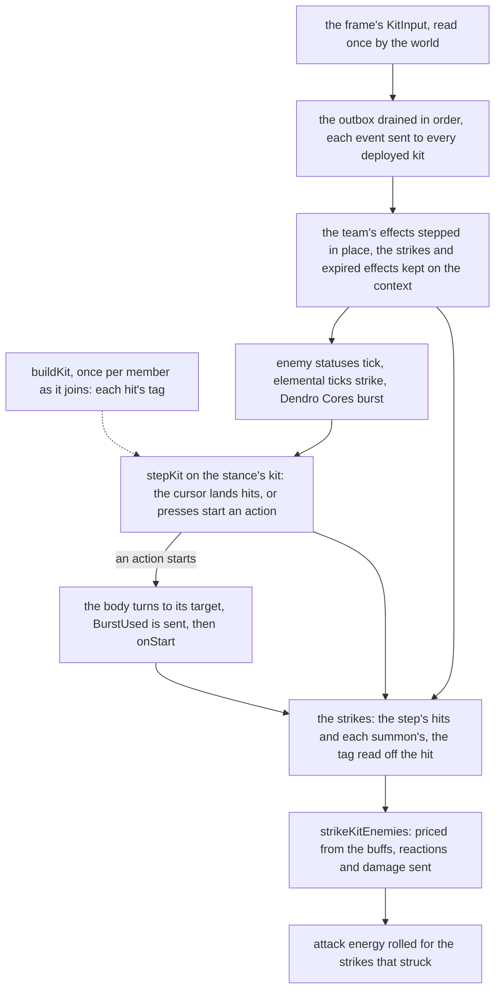

# Kit framework

Every playable character's kit is one module under `services/kit/characters`: about a hundred modules, a little under three hundred lines each, on a framework of about three thousand lines ([character kits](/docs/genshin/kits)). A module mixes two things. The first is the values a source already holds: frames, hitmarks, cancels, areas, tags, gauges, poise and talent indices, each copied by hand with a comment citing where it was read. The second is what the character alone does. The values are most of every module. So the duplicate-code finder's kit-against-kit pairs, some sixty, are nearly all the same data shapes written again: plunges, normal-attack strings, measured areas, charged attacks and one-hit skills. Every module also ships in the package's entry, a third of it, though a party holds four. And the frame that steps them allocates and searches where it could read.

This page splits a kit into two parts:

- a **record**, generated from its sources and published as hosted data;
- a **behaviour module**, written only where the character is unique, over a small set of primitives that each absorb one family of the duplicated code.

The frame reads what the build resolved once, and a module loads only when its character joins the party.

## Decisions

### Data and behaviour

- **A kit is a record and a behaviour module.**
  - The record holds every value:
    - each action's cancel frame and targeting;
    - each hit's hitmark, area, attack tag, internal cooldown tag, element, gauge, poise and bluntness;
    - each hit's talent parameter and the attribute its damage scales with;
    - the skill's and burst's cooldowns, energy cost, charges and hold thresholds, and the charged attack's stamina;
    - a stance's own actions;
    - the named hits a behaviour casts: a summon's ticks, an explosion, a coordinated attack;
    - a resource's maximum.
  - The behaviour module holds what no value can: what an action's start sets going, what a passive or constellation answers, and how a field ticks.
  - `buildKit(record, multipliers, behaviour)` joins the two once per member into the `Kit` that the step, the strike and the HUD already read. No reader of a kit changes; each hit carries its `attackTag`.
- **The record is generated wherever a source holds the value, and each source is read where it is exact.**
  - **gcsim** gives frames, hitmarks, areas, tags, element and gauge.
  - **The game's tables** give multipliers, cooldowns, energy, stamina and durations, already published as `talentMultipliers`. Where a constellation row's `paramList` holds a constellation's value, it comes from there too.
  - **The wiki's Advanced Properties template** gives poise, which gcsim has for only about one hit in ten. It also cross-checks each hit's gauge and ICD tag.
  - `pnpm -C scripts genshin:assets kits` reads all three and publishes one record per avatar into a `kits` index. The talent multipliers stay their own index, read alongside it.
- **A hit's talent parameter is read, never mapped by hand.** gcsim's generated talent file names the game's parameter index beside each multiplier (`1-Hit DMG: {0}`), and its `config.yml` names the multiplier each hit deals. So the builder joins a hit to its proud skill group and index exactly. This replaces two hand-kept things in every kit: the comments listing each group's indices, and the group-id constants.
- **What no source holds goes in an authored overlay, never a literal in a module.**
  - Each character has one overlay file in `src/data/kits`, checked by a Zod schema. It holds every value the builder cannot read, each with its cause from `KitProvisionalCause` and the recording that will replace it. It also holds the choice made wherever two sources disagree.
  - The index's shared provisional causes are builder rules applied by cause, so a kit's overlay names only what is its own. Those causes are: a plunge gcsim has no file for, a box priced as the circle to its corner, a hit centred on the target, and an unmeasured hold.
  - The overlay is a committed input to the builder; the bundle never imports it.
- **gcsim is read at v2.47.2, its last MIT release, and only there.**
  - The [Genshin proposal](/docs/proposals/genshin) settles gcsim's data up to v2.47.2; every later tag is under gcsim's own licence. Today's kits cite v2.47.2 and an unpinned `main` side by side, so some of their values were read past the licence line.
  - The builder reads that one tag and records it in every value's provenance. `--compare` lists each module value the tag disagrees with, the ones read off `main` among them, so the record holds only what the tag says.
  - A character the tag predates is built from the tables, the wiki and its overlay alone.
- **The record holds only what a reader reads.** gcsim's ICD groups, hitlag and strike types other than blunt stay in the source until a rule reads them.
- **Behaviour is TypeScript over the primitives.** The record holds values, never expressions or conditions. A constellation's gate, a passive's condition and an event's answer are functions in the character's module, typed and tested like any other code.

### The kit's shape

```ts
// Published as the `kits` index, one record per avatar id. Frames are gcsim's, at 60 a second, turned into seconds once
// By buildKit
interface KitRecord {
  burst: KitActionRecord;
  burstCooldownSeconds: KitParameter;
  // Absent where the burst draws on no Energy, as Mavuika's
  burstEnergyCost?: KitParameter;
  burstVariant?: KitActionRecord;
  chargedAttack: KitActionRecord;
  chargedAttackStamina: KitParameter;
  moonsignBenediction?: KitMoonsignBenedictionRecord; // { lunarReactionTypes }
  normalAttacks: KitActionRecord[];
  plungeCollision: KitHitRecord;
  plunges: Record<KitPlunge, KitActionRecord>;
  skill: KitActionRecord;
  skillChain?: KitSkillChainRecord;
  skillCharges?: KitParameter;
  skillCooldownSeconds: KitParameter;
  skillHolds: KitHoldRecord[]; // { action, cooldownSeconds, minimumHeldSeconds, variant? }
  skillMaximumHeldSeconds?: KitParameter;
  // What a behaviour reads by name, each under its module's name for it: an action, an area, a frame
  // Count, a hit or its fields, a table's parameter, and a stance's own actions where they differ from the kit's
  actions?: Record<string, KitActionRecord | KitActionRecord[]>;
  areas?: Record<string, AttackArea | AttackArea[]>;
  frames?: Record<string, number | number[]>;
  hitFields?: Record<string, Partial<KitHitRecord>>;
  hits?: Record<string, KitHitRecord | KitHitRecord[]>;
  parameters?: Record<string, KitParameter | KitParameter[]>;
  stances?: Record<
    string,
    Partial<Pick<KitRecord, "burst" | "chargedAttack" | "chargedAttackStamina" | "normalAttacks" | "skill">>
  >;
}
interface KitActionRecord {
  animationFrames: number;
  hits: KitHitRecord[];
  isAimed?: true;
  staminaPerSecond?: KitParameter;
  targeting: KitTargeting;
}
interface KitHitRecord {
  area: AttackArea;
  attackTag?: AttackTag;
  bubble?: KitBubbleRecord; // { explosion, omen, secondsRemaining }
  convertedArea?: AttackArea;
  convertedPoiseDamage?: number;
  damageBonus?: KitParameter;
  element?: Element;
  gauge?: number;
  healParty?: KitPartyHealRecord;
  hitmarkFrames: number;
  internalCooldownTag?: InternalCooldownTag;
  isBlunt?: true;
  lunarReactionType?: LunarReactionType;
  multiplier: KitParameter;
  poiseDamage: number;
  scalingAttribute?: Attribute;
  stackedHit?: KitStackedHitRecord; // { multipliers, poiseDamages }
}
// A table's parameter by its group and index, or a number where no table holds it
type KitParameter = number | { index: number; proudSkillGroupId: number };

// What a character alone does, each call given the world's one context and the kit's own combatant. Its module returns
// It from its record's reader, which reads each named value once as the kit is built
interface KitBehaviour {
  burst?: KitActionBehaviour; // { onStart?: (context, target?) => void, hits?: KitHitBehaviour[] }
  burstVariant?: KitVariantBehaviour; // { checkIsActive, onStart?, hits? }
  chargedAttack?: KitActionBehaviour;
  moonsignBenediction?: { getBaseDamageBonus };
  normalAttacks?: KitActionBehaviour[];
  plungeCollision?: KitHitBehaviour; // enemyStatus, onStrike, a party heal's chance, a bubble's omen, a stack's status
  plunges?: Partial<Record<KitPlunge, KitActionBehaviour>>;
  skill?: KitActionBehaviour;
  skillChain?: KitActionBehaviour[];
  skillHolds?: KitHoldBehaviour[]; // { onStart?, hits?, variant? }
  onKitEvent?: (event: KitEvent, context: KitContext, combatant: Combatant) => void;
  // Beside it the passives, each top-level: getPassiveBonuses, getStrikeDamageBonus, onSprint and two multipliers
}
```

A behaviour joins its record's slots by place, an action's hits in the record's order, and the reader throws on a name its record does not hold, so a typo in a name fails that kit's suite.

### The primitives

Each primitive absorbs one family of the finder's kit pairs, or one shape a hand count of the modules shows repeated:

| Primitive                                           | Family it absorbs                                                                                                      | Today                                                                                                                              |
| :-------------------------------------------------- | :--------------------------------------------------------------------------------------------------------------------- | :--------------------------------------------------------------------------------------------------------------------------------- |
| `KitRecord` and `buildKit`                          | Plunges, normal-attack strings, measured areas, one-hit skills and bursts, charged attacks: most of the finder's pairs | A local plunge builder in about a third of the kits, a frame divided by 60 over a thousand times, a few hundred group-id constants |
| `castKitSummon`                                     | Summon ticks, coordinated attacks, hits queued past an action's end                                                    | Over a hundred casts, each a summon and an effect add, often spread with an id or a tag                                            |
| `createPeriodicKitHits`, until step 7's records     | A hit every interval from a first frame: Oz, Guoba, Pyronado, the steles                                               | Dozens of `Array.from` builders                                                                                                    |
| `castKitField`                                      | Fields                                                                                                                 | Dozens of nine-field literals                                                                                                      |
| `scheduleKitTask`                                   | gcsim's `QueueCharTask`                                                                                                | Over a dozen one-tick fields with an infinite interval that linger a tenth of a second past their tick                             |
| `castKitShield`, `castKitTaunt`                     | Shields and taunts, over the one absorb order already shared                                                           | About a dozen shield literals                                                                                                      |
| `changeKitMemberHealth` (exists), `healKitTeam`     | Heals                                                                                                                  | A couple of dozen direct heals, half of them outside the Healing Bonus                                                             |
| `buffKitMember`, `buffKitTeam`                      | Party buffs                                                                                                            | Dozens of buff literals and a dozen loops over the deployed team                                                                   |
| `infuseKitMember`                                   | Infusions                                                                                                              | Over a dozen                                                                                                                       |
| `enterKitStance`, with `endsOnSwap`                 | Stance construction, and the swap handler that ends it                                                                 | About a dozen stances, most ended by a hand-written swap handler                                                                   |
| `addKitStatus`, `findKitStatus`, `startKitCooldown` | Status lookups and cooldown checks                                                                                     | Dozens of status literals, a few local finders, dozens of check-then-add gates                                                     |
| `gainKitResource`, `spendKitResource`               | Counters with a cap                                                                                                    | Never-ending statuses whose stacks are the count, in a fifth of the kits                                                           |
| `KitContext` and its outbox                         | The partial contexts and the ad-hoc event queues                                                                       | Five context shapes and two queues                                                                                                 |

- **A status has one meaning.** Today a status serves as a cooldown, a mark or a counter. The three are split:
  - a gate on a repeat is `startKitCooldown`, which starts the status and returns false while one is already running, in one call;
  - a timed mark, stacked or not, stays a status, read by `findKitStatus` beside `checkHasKitStatus`;
  - a count that outlives any timer and has a cap is a resource.
- **A resource is a capped amount on a character.** `KitResource` holds one character's amount of one resource and its maximum from the record. It persists across swaps, as statuses do today. Raiden's Resolve, Furina's Fanfare, Arlecchino's Bond of Life, Mavuika's Fighting Spirit and each Natlan character's Nightsoul points are each a resource.
- **Nightsoul is a resource, a stance and two events, as gcsim's one template models it.** gcsim keeps Nightsoul in one shared state (`internal/template/nightsoul`): points up to a per-character maximum, and a Blessing status with an optional exit timer. Here:
  - the points are a resource;
  - the Nightsoul Blessing is a stance, timed or not, whose hits carry gcsim's attack tags (Kinich's Scalespiker Cannon among them);
  - `ResourceChanged` carries every gain and spend, which Mavuika's Fighting Spirit counts across the party;
  - a party rule sends `NightsoulBurst` to the team when a hit gcsim tags `AttackTagNightsoul` sets it off. Ororon, Chasca, Kinich and Citlali answer it.

  Each piece lands with the first kit that needs it, as the framework's shared effects always have.

- **One context for every call.**
  - Before it, each kind of call (the step, a start, a field tick, an event) got a partial context of its own. A field tick cannot draw at random, an action's start cannot see the enemies, and adding one field breaks every test that builds a context by hand.
  - Landed as `KitContext`, which the [kits page](/docs/genshin/kits) describes with what it holds.
  - Every behaviour call takes the context: `onStart(context, target)`, `onTick(context, tickIndex)`, and a strike's `onStrike(context, strike)`. A call made for the character on the field reads it as `context.activeCombatant`, so only an event, which reaches every deployed member, is given the kit's own combatant as well: `onKitEvent(event, context, combatant)`. No call builds an object.
  - The field member's controls are passed beside it (`ActiveKitControls`).
  - One test builder, `createKitTestContext`, makes the context for every suite.
- **One outbox for what happens between steps.**
  - Events raised inside the active step are sent as they happen, as today.
  - Events raised outside it each had an ad-hoc queue, drained at different points of the step. A taunt's damage becomes the `outbox` on the context, drained in queue order at the start of the next step, after a swap and ahead of the effects running down, so a strike that spends a taunt's health is still heard before the taunt ends.
  - A member's HP change stays on the party's own record, sent last in the step as before, since every heal and every strike already records it there and moving it would move no digest's cause but its timing.

### The per-frame path

What `stepActiveKit` and its callees do today:

- **A frame where nothing lands still makes about two dozen objects:**
  - the body, the emit closure, and a context for each callee;
  - the taunt-damage and expired-effect lists;
  - two filtered copies of the effect list, one for what expired and one for what stays, made whether anything expired or not;
  - the landed hits' slice and the attack-tag list;
  - a Set and three arrays to find a normal attack's first hit;
  - three arrays to join the strikes, the struck list, and the emptied HP-change list.
- **It walks the team's effects about ten times:**
  - once for taunt damage;
  - four times in `stepKitEffects`, plus its two filters;
  - once for Crystallize shards and once for a stance;
  - once or twice for an infusion.
- **A landed hit is searched for, not read:**
  - `getKitAttackTag` walks the effects and then every hit of the kit with `includes`, making two arrays;
  - `infuseKitHits` builds a Set of every infusable hit of the kit, and `readOreHits` a Set of every attack hit, on every frame a hit lands.
- **A summon filters and maps its whole hit list every frame, landing or not:** two arrays per summon per frame. Oz and a Stone Stele each hold a few dozen hits.
- **A stance makes a new merged kit and a new combatant every frame it holds** (`getStancedKit`).
- **Every event builds five objects:** the context for `emitKitEvent`, and a copy of it spread for each deployed member.
- **A strike's pricing filters the buffs every strike,** and when any buff applies it copies the whole attribute map (`getBuffedCombatant`).

What it does after:

- **What the build can resolve is resolved once.**
  - Each hit gets its `attackTag`: its action's kind, unless gcsim's `AttackInfo` for that hit names another, including a stance's.
  - That removes `getKitAttackTag` and the stance's hand-written `attackTags`. No action needs a slot: the step already tells its actions apart by which of the kit's lists holds them.
  - An infusion and the ores follow the list a hit sits in, not its kind of attack, so the same build gives each hit its action's kind beside it (`actionAttackTag`), and the infusable and melee Sets, built from the kit on the field each frame a hit lands, go. Read off the hit, the hits of an attack that outlives its stance stay infusable and melee, which gcsim's infusion, applied by the attack's tag as it lands, agrees with.
  - A stance's combatant is built once, when the stance starts, its kit with the stance's actions in place.
- **A cursor lands the hits.** An action and a summon each keep the index of their next hit. A step compares one hitmark rather than the whole list, and a summon with nothing to land does nothing.
- **The effects are stepped by index, in today's order, and compacted in place.**
  - The order is unchanged: seconds down, then fields, then summons, taunts, bubbles and shields. That is three walks of the list, with no array made.
  - The walk notes nothing on the way. The field member's stance and infusion, the live shield Enduring Rock reads and the buffs a strike is priced by are each read where today's step reads them, after the ticks and events that change them, and each read is one scan of a few dozen effects that makes nothing. Noted in the walk, they would be read before those writes. `getBuffedCombatant` still copies the attributes for a strike a buff applies to, a copy made only on a frame that lands it.
  - The rule that a write replaces the list stays. Each walk runs over the list as it stood when the walk started, so an effect a field's tick adds is stepped only by the walks after that tick, as today. The third walk, where no kit code runs, compacts that list in place, dropping the effects that ran out into the context's expired list.
- **A frame where nothing lands allocates nothing.** The body, the outbox, and the strike and expired lists belong to the context and are emptied by setting their length to zero. A frame that lands hits allocates only its strikes, an infused hit's copy and a buffed striker's attributes.
  - The other searches a landed hit made go with them: a hit's infusion and its ore read the kind of action it sits in off the hit (`actionAttackTag`), a normal attack's first hit is looked for only on a frame that lands one, and an enemy's status ticks join the outbox rather than a list of their own.
- **No typed arrays.** A kit holds at most a few dozen hits and the team a few dozen effects, and scanning that many costs no more than the objects a typed array would replace. They wait until the bench shows a hot loop.
- **`stepActiveKit.bench.ts` proves it.**
  - **The workload:** one minute of the fixed step for a party of four (Raiden, Xiangling, Noelle and the Traveler, the proof party).
  - **The input:** scripted, at a fixed seed: the string, a charged attack, each skill, each burst once charged, and a swap every few seconds.
  - **Two scales:** idle (no enemies, no effects) and in combat (enemies standing in reach, the party's effects up). Each is one `bench.compare` with `BENCHMARK_RUN_OPTIONS` and a small iteration count.
  - **The fixture:** the world state is rebuilt inside the callback; the records and multipliers are read once, at module scope, from the mirror.
  - **When it runs:** it lands first, on today's path, and is re-run on the same machine once the tree has moved. The diff of its committed `.bench.md` is the before against after.
  - Its input script is the same fixture the replay guard drives.

### Provenance and the docs

- **Every value names how it is known.**
  - The builder publishes a `kitSources` index beside `kits`, as the stats run publishes `talentLabels` beside `talentMultipliers`. So the record the browser reads carries no provenance.
  - For each value read, `kitSources` gives its source and where in it: gcsim's file and line at the tag, the wiki page at its revision, or the table's group and index.
  - Each overlay value carries its own cause, or the source it was chosen from.
  - A value with no provenance fails the build.
  - The `/ 60` and the "Measured: gcsim" comment above each constant leave the modules along with the values.
- **The character pages render from the record, and a test checks them.**
  - Each character page keeps its prose: its decisions and what is not built. It no longer copies values.
  - Its Provisional and Sources sections are rendered from `kitSources` and the overlay by `genshin:assets kits --docs`. A test renders them again and fails on any difference, as the kit map's test does for the generated map.
  - The index's list of shared provisional causes is rendered from `KitProvisionalCause` the same way.
- **A tool's test takes its oracle from the source.** The builder's tests assert cases worked by hand from gcsim's files and the wiki's template (Xiangling's strings from `xiangling/attack.go` and Dough-Fu's Advanced Properties). They never assert the builder's own earlier output.

### Loading

- **A kit loads when its character joins.**
  - `readCharacterKits(gameDataBaseUrl, characterIds)` reads each member's multipliers entry, its `kits` record and its behaviour module together, then builds its kit once (`readCharacterKit`).
  - It runs where `readTalentMultipliers` was awaited, with the same retry: at the world's gate for the starting team, and as the team changes. The load budget's `talent-multipliers` step became `character-kits`.
  - Step 8 landed its loading half, the module and the multipliers read together and the kit built from them; step 7 added the `kits` record and `buildKit` to it.
  - The generated `CharacterIdCreateKitBehaviourMap` is a loader map of `import()` calls, still generated at build from each module's declared id, written as the literal the module declares, since importing the constant would load the module. A map elsewhere keyed by a kit's id writes the literal too (`CharacterIdSkillGlyphsMap`).
  - A character with no module still falls back to the Traveler's kit.
- **The barrel leaves the kit modules out.**
  - The source barrel lists every module and the entry re-exports it, so a dynamic import alone would load nothing lazily.
  - `generateExports` gains an option naming the directories a package loads on demand, and leaves them out of its barrel. genshin-world passes it from its own `build:prepare` hook, which replaces the base's rather than joining it, so the tsdown factories carry no such option.
  - Rolldown splits each `import()` into its own chunk: the build emits one a kit module, 106 of them from about 7 KB to 20 KB.
- **The entry has a ceiling.**
  - The loader map's commit lands genshin-world's `index.js` size snapshot at or under 1,350,000 bytes, down from about 2 MB. The kit modules, about a third of the entry's code, leave it; the loader map and the primitives come in. The snapshot holds the figure after that.
  - A record is a hosted read of a few kilobytes, fetched alongside the multipliers; the builder's dry run reports its size.

## Measured

**gcsim's regularity**, counted over every character folder of v2.47.2, the tag the builder reads. A tag is fixed, so these counts do not move:

| What a kit needs                         | Where gcsim holds it                                                                 | Regular in                                                                                  |
| :--------------------------------------- | :----------------------------------------------------------------------------------- | :------------------------------------------------------------------------------------------ |
| Each hit's area                          | `config.yml`'s `abilities` hitboxes: shape, centre, offset, radius or box, fan angle | 110 of 110 characters, 1,645 hitboxes                                                       |
| Each multiplier's talent parameter       | `zz_<name>.dm.go`, the game's own index `{n}` beside each multiplier                 | 110 of 110, 1,607 multipliers                                                               |
| Which multiplier each hit deals          | `config.yml`'s `talents`                                                             | 110 of 110                                                                                  |
| Normal attack hitmarks and cancels       | the `attackHitmarks` literal, and `InitNormalCancelSlice(hitmark, frames)`           | 107 and 110 of 110                                                                          |
| Charged attack                           | a hitmark constant, and `InitAbilSlice(frames)`                                      | 77 of 77                                                                                    |
| Plunges                                  | hitmark constants as small integer sums (`44 + 3`), and `InitAbilSlice`              | 53 of 53; the other characters have no plunge file                                          |
| Skill and burst                          | a hitmark constant, and `InitAbilSlice`                                              | hitmarks in 90 and 85 of 110, frames in 110 of 110; the rest are scheduled tasks            |
| Attack tag, ICD tag, element, durability | each `AttackInfo` literal                                                            | 848, 845, 831 and 828 of 856                                                                |
| Poise                                    | `PoiseDMG`                                                                           | 87 of 856, so poise is read from the wiki                                                   |
| Max HP or DEF scaling                    | `FlatDmg`                                                                            | 41 of 111 on the same line; the rest go through a local variable, so they go in the overlay |
| Nightsoul                                | one shared template, and `AttackTagNightsoul` in a hit's `AdditionalTags`            | the Natlan characters, as Kinich's `skill.go` shows                                         |

**The wiki** carries its `{{Advanced Properties}}` template on several hundred talent pages, including all but a handful of the Normal Attack pages. Each hit gets a title, gauge, ICD tag and type, and poise. Its values match the poise the kits copied by hand: Xiangling's Dough-Fu agrees hit for hit.

**The kits.** About a fifth of the modules' lines is behaviour: the callbacks and the helpers they call. About half is hit and action fields, frame and area constants, value builders, and the comments citing each value. The rest is imports and blank lines. That bears out the other machine's estimate that about two thirds could be generated, and puts it nearer three quarters once the scaffolding that goes with the values is counted.

| Kit         | Today (lines) | Of it behaviour | After (estimate)        |
| :---------- | :------------ | :-------------- | :---------------------- |
| Kinich      | ~180          | none yet        | ~10, until its Blessing |
| Neuvillette | ~200          | none            | ~10                     |
| Amber       | ~220          | ~40             | ~35                     |
| Noelle      | ~300          | ~40             | ~35                     |
| Nilou       | ~330          | ~80             | ~65                     |
| Xiangling   | ~400          | ~80             | ~65                     |
| Bennett     | ~420          | ~65             | ~50                     |
| Zhongli     | ~420          | ~100            | ~80                     |
| Fischl      | ~430          | ~115            | ~95                     |
| Raiden      | ~560          | ~225            | ~170                    |
| Furina      | ~715          | ~340            | ~280                    |

In total:

- the modules go from about twenty-nine thousand lines to about six or seven thousand, about 65 a kit;
- the framework stays about three thousand lines in the package, as the reach helpers and the attack-tag search leave and the primitives and `buildKit` come in;
- the builder adds about a thousand lines in `scripts`;
- the overlays are expected at a few hundred lines of JSON, with most kits needing none. The compare report gives the real count.

**The bundle.** genshin-world's entry is about 2 MB. The kit modules' code is about a third of it (comments are stripped in the build). The framework under them is about 60 KB.

## Data flow



## Per-frame flow



## Scope and order

**Every kit moves at once, in a series of whole-tree refactors.** There is no compatibility path and no phase that converts one kit at a time: nothing is kept to spare old code the cost of moving ([no compatibility debt](/docs/architecture/no-compatibility-debt)). Each commit moves every kit, every caller and every suite to the new form together, scripted where the move is mechanical and finished by hand, and deletes the old form in the same commit, so `ai/queue` never holds two kit shapes side by side. Every replay digest stays byte-equal at every refactor: a digest that moves means the commit is wrong, not the snapshot, unless the commit means to change behaviour and says which digests move and why. A step that finds the record lacking a value stops and extends the builder first, in a commit of its own that publishes only the keys it changes (`genshin:assets kits --only <character>`), rather than half-landing.

1. **The builder.** Landed.
   - `genshin:assets kits` is a citty command with three readers: gcsim at v2.47.2 (the YAML hitboxes, a constant evaluator for the action files' literals and integer sums, the `AttackInfo` fields and the talent file's indices), the wiki through the MediaWiki API at each page's revision, and the published tables through the lock.
   - It holds the join, the overlay's schema and `KitProvisionalCause`, and `--compare` seeds each overlay with every module value a source lacks or disagrees with, classifying a shared provisional constant by its cause, a disagreement as `DiffersFromSource` and the rest as `Unclassified`.
   - `kits` and `kitSources` are published for every built character, each record reproducing its module's values, and the builder's tests take their oracles from gcsim's and the wiki's own text.
   - The record was completed ahead of step 7, so that it holds every value a module reads. A module is read for its record rather than given one: its text is analysed for the values its behaviours read, and it is built under a probe twice, once from its multipliers and once from encoded ones. What its slots do not hold, named bags hold. The Traveler has a record, read from her composite gcsim folder at Lumine's gender. Holds and presses are read from gcsim's names, and an arrow's box on its target by rule. The gap against the committed overlays went from 5,013 values in 85 kits to none in 107.
   - Corrections to the shape above, as built. `burstEnergyCost` is optional, since Mavuika's burst draws on none. `cancelFrames` is `animationFrames`, since a kit's action ends where its animation does, not where it may be cancelled. A hit holds no `name`: a behaviour reads a hit by its key in a bag, and a slot's hits by their place. `isNightsoul` is not recorded, as no kit's hit carries it. The `hits` and `stances` the shape had are two of the bags, and a stance records just the actions it plays in place of its kit's.
   - What is not a value is not recorded. A behaviour's own numbers, its status ids, an omen's id and its functions stay in its module. A talent read whose group or index the behaviour picks has no one value to record, so step 7 records its candidates as a list for the behaviour to pick from.
   - gcsim names its skill and burst hitboxes by no convention, and a burst's variant or a hold's is no constant of its own, so variants, Kazuha's and Razor's frames as arrays, Lynette's hold end and Zhongli's press hitmark are not read from gcsim. Their values stand in the overlays, as Bennett's hold frames, which gcsim does not give, and Kirara's and Sayu's holds, which gcsim models as two levels against the modules' eleven.
2. **The guard and the bench.** Landed.
   - A replay test drives each kit alone, and the proof party together, through the scripted minute at a fixed seed, and snapshots each strike log's count and its multipliers by attack tag, bugs included.
   - The bench lands beside it, on today's path.
3. **`KitContext` and its outbox replace the partial contexts.** Landed.
   - `KitStepContext`, `KitEventContext`, `KitFieldTick`, `KitStrikeContext` and `ActiveKitStepContext` go, with `createKitStepContext` and `createKitEventContext`; every hook takes the world's one context, and every suite builds it with `createKitTestContext`.
   - The taunt's own damage queue goes into the outbox, which the step drains after a swap is sent.
4. **The attack tag set at build.** Landed.
   - A stance's kit is built once as the stance starts (`enterKitStance`), and `getStancedKit` goes.
   - Each hit's attack tag is set as its kit or its stance's kit is built (`tagKitHits`), unless the hit names its own, and `getKitAttackTag` and `KitStance.attackTags` go.
   - The tag is the one step whose digests move, in a commit of its own that means to: tagging at build closes the stance edge the [kits page](/docs/genshin/kits) names, which the read at landing left untagged. Eight kits' digests move between tags (Tartaglia, Hu Tao, Yoimiya, Raiden, Nilou, Skirk, Flins and Durin), and no strike count or total does.
   - No action carries a slot, for the reasons under the per-frame path.
5. **The cursors.** Landed. An action (`KitState.nextHitIndex`) and a summon (`KitSummon.nextHitIndex`) each keep the index of their next hit, and `queueKitHits` queues the hits from it on. A fix landed ahead of it, in a commit of its own: a summon's hit at its cast never landed, since its first step read hits after nought, and eight kits' digests move by the field ticks that now strike (Collei, Columbina, Dori, Faruzan, Lynette, Ororon, Rosaria and Shenhe).
6. **The effects stepped in place.** Landed. In today's order and compacted in place, the body, the outbox and the expired and strike lists held on the context and emptied by their length, and a stance holding its built combatant. A fix landed ahead of it, in a commit of its own: an infusion and the ores read the kind of action a hit sits in, tagged at build, so an attack that outlives its stance keeps its kind for both; no digest moves.
   - The bench's minute, idle and in combat, ran in 45.52 and 53.86 ms before step 3 and 33.54 and 39.74 ms after this step, on the same machine; its committed figures move at step 9.

**Between 6 and 7, the primitives.** Each pair lands as a whole-tree commit of its own, only where it absorbs a repetition the tree still holds, and the finder's count is read before and after it.

- `castKitSummon` and `createPeriodicKitHits`. Landed. A summon is cast in one call, its id, its kind and its seconds named beside its hits rather than spread over a summon, and 23 `Array.from` builders are one call each, the hitmark's frames still summed before they are divided, so no hitmark moves by a bit. The finder held at 73: what they absorb sits under its window.
- `castKitField` and `scheduleKitTask`. Landed. A field is cast in one call that copies its centre and leaves its radius unbounded unless named, and every one-tick field that lingered a tenth past its tick, `createDelayedKitField` among them, is a task with no centre of its own; the finder fell from 73 to 71. Behind them, each cast returns what it cast, and the 23 fields and summons a kit made and then added, or spread to name the enemy a summon strikes, are casts too; the finder held at 70.
- `buffKitMember` and `buffKitTeam`. Landed. Every one of the 41 buff literals is a call that names its member apart from the buff, and the seven loops that gave every member of the deployed team the same buff are one call each; the two that leave their caster out and Sucrose's, which picks members by element, keep their loops. The finder held at 71.
- Every heal through `changeKitMemberHealth`. Landed as a fix: the direct heals and the hit heals read the Healing Bonuses and name their healer, as gcsim's do, and a party heal reaches the deployed team. `healKitTeam` was left out: after the move a team heal is a two-line loop in two places, which a primitive would not shorten.
- `addKitStatus` and `startKitCooldown`. Landed. The 68 status literals are a call each, and 23 check-then-add gates are one call that starts the cooldown and returns whether it ran; two local finders went to `findKitStatus`, and in a commit behind it the last five inline ones. Two gates stay by hand: Qiqi's A Glimpse into Arcanum checks before its roll and starts after it, and Chevreuse's Overcharged Ball is a mark, not a cooldown. Navia's two, which read whether the status has run out rather than whether it is there, followed in a fix that has every gate read it so, as gcsim's `StatusIsActive` does; no digest moves. The finder held at 71.
- `infuseKitMember` was left out: an infusion literal names only its kind beyond what each kit must say, so a call would shorten each by a line and absorb nothing. `castKitShield` landed after step 9's leftovers: every shield, the thirteen kits' and the Crystallize shard's, is cast through it, so none writes its kind or adds itself, and Zhongli's Jade Shield and the helpers that built a shield to add it read the one it returns. `castKitTaunt` landed with step 7, where Amber's Baron Bunny and Ganyu's Ice Lotus were the finder's last kit-against-kit pair: the call copies the taunt's body as a summon's does, and Itto's Ushi takes it too.
- `enterKitStance` with `isEndedOnSwap`, the name the boolean convention gives `endsOnSwap`. Landed. The seven stances a hand-written swap handler ended take the option, and the step ends the leaving character's stance before the team's kits hear of the swap; Skirk's and Yoimiya's handlers went, and the other five keep only what else gcsim's exit deletes. The finder went from 71 to 70. A buff and an infusion took the option behind it, and Hu Tao's swap handler went; Itto's Royal Descent, which gcsim's exit deletes and no kit here ended, took it in a fix of its own, and no digest moved.
- Four stances gcsim's exit deletes ended on no swap here: Hu Tao's Paramita Papilio, Kokomi's Ceremonial Garment, Kaveh's Painted Dome and Flins's Manifest Flame. Landed as a fix behind the option, with Hu Tao's swap ending the Paramita's infusion and ATK; no digest moves, as the replay swaps only the proof party.
- `gainKitResource` and `spendKitResource`, with `countKitResource` to read one. Landed. Raiden's Resolve, Itto's Superlative Superstrength, Eula's Lightfall Sword stacks, thirty statuses of their own ids until then, and Aloy's coils are each a capped gain and a spend, and three local counters went. `KitResource` was left out: a resource is held as a status that never runs out, so the walk and the one list of effects take it as they are, and a kind of its own waits on the Nightsoul points, the first resource a rule outside its kit reads. Ayato's Namisen and Alhaitham's Mirrors stay statuses held until a swap, as gcsim sets each outright as well as adding to it. No digest moves; only the effect lists in two replays change, Eula's holding one resource for the Sword's stacks and Aloy's dropping her coils as Rushing Ice spends them, where it kept them at nought. The finder held at 70.

7. **`buildKit` and `readCharacterKits`, each module reading its record.** Landed. The frames, areas and talent indices leave the modules, and the reach helpers (`createBoxReach`, `createCircleReach`, `createFanReach`, `createTargetedHitArea`) go as builder rules. The kits index's framework sections are rewritten for the record.
   - Each module is `create<Name>KitBehaviour`, which `buildKit` joins to the kit its record's slots build, and `readCharacterKit` reads a member's record, multipliers and behaviour together; the Traveler's behaviour adds nothing to her record. The modules fell from 29,438 lines to 9,706, and the finder over the kit tree from 70 to none: the last two, Amber's and Ganyu's taunt literal and a filter Yae Miko's skill and burst both wrote, went to `castKitTaunt` and a finder of her standing totems.
   - Corrected against the sketch: a behaviour joins an action's hits by place, in its record's order, rather than by name; the passives stay top-level beside the actions; and the reader throws on a name its record does not hold, on one it holds in the other shape, and on a bubble, a party heal or a stacked hit left without the id or chance only a behaviour gives.
   - Each value a behaviour reads outside the slots is in a bag under what it is in the game. The names step 1's reader took from where a module read them (`elementalSkillOnStart`, `onKitEventSecondsRemaining2`) were renamed, the entries no behaviour reads were pruned, and seventeen kits gained the hits, stances and parameters their modules had built by hand, Raiden's Musou Isshin, Alhaitham's projections and Flins's and Skirk's stances among them, each published under `--only` with every digest byte-equal.
   - A value a kit picks as it plays (a shield's level, the seals spent, a Salon member) is a list in its record, so no module names a talent's group, and a reader of a talent's parameter by its group was left out.
   - `createPeriodicKitHits` went: each list of hits it built is in its kit's record, hit by hit, and Oz's, whose count its seconds set, is built from them.
   - The reach helpers are the gcsim reader's: `toGcsimArea` and the plunges' candidates price a hitbox with them, and the world package names none.
   - The scripts read no module: the reference record is the published one, a publish builds every published kit and fails on any that differs unless `--only` names it, and `--compare` reseeds the overlays against the published record. A kit's first publish is built since step 9's leftovers: a publish reads every published kit and each one `--only` names, a named kit with no published record among them, and `--compare` reports one and seeds nothing for it.
   - Lane F's one shape for `isEndedOnSwap` rode with it: a buff, an infusion and a stance each take `KitSwapEndable`, and after step 9's leftovers a summon too, by the character that cast it, so Klee's sparks end on a swap and Sparkly Explosion goes off from her kit hearing it. Zhongli's RES cut, which stands on his shield, and Razor's, Xiao's and Ningguang's swap fields, which also gate what their effects do within the swap's own step, stay their kits' own.
   - What stays in a module is what its character alone does, with its source: status, field and summon ids, passive and constellation gates and numbers, offsets, and the durations and field radii a table gives otherwise or not at all. None counts frames itself: Beidou's Bane of Evil, Durin's Dragons and Yae Miko's totems and Thunderbolts are lists and frames in their records, and Furina's Singer and Kinich's lasers, which reckon in whole frames, read their frames (`readFrames`) and turn the count into seconds through `toKitSeconds`.
8. **The loader map on `lazyDirectories`.** Landed, over its ceiling. `CharacterIdCreateKitMap` is a map of `import()` calls, the barrel leaves the kit modules out, and `readCharacterKits` reads a member's module and multipliers together, at the gate and as the team changes.
   - The entry fell from 2,153,111 bytes to 1,386,245, 36,245 over the ceiling: the modules took about 767 KB with them, a little less than the ceiling assumed, and the loader map came in at about 9 KB.
   - What holds the rest up is none of the kits': the hand-traced glyph path maps (about 312 KB over sixteen files, `ElementMarkPathMap` alone 98,658 bytes), the components (about 345 KB) and the framework (about 61 KB). The ceiling stands.
9. **The guard and the bench's entry for today's path deleted,** once nothing moves anymore, with the bench re-run on the same machine for the before against after. The zero test turns on.
   - The zero test is on: the workspace suite holds genshin-world at no clone, and the ledger's two rows are swept. The split test is on: `kitModules.test.ts` reads each module's source and fails on one that divides by 60 or by `KIT_FRAMES_PER_SECOND`, names `proudSkillGroupId` or calls `getTalentMultiplier`.
   - The bench's one task is the fixed step, today's path's entry gone. The Mac ran this sitting on battery in Low Power Mode, slower throughout than the committed before's mains power, so the before was re-run from the bench's first commit beside the after: 69.63 ms to 53.29 idle and 84.35 to 68.69 in combat, at forty rounds.

**Per kit, after the tree has moved.** What no whole-tree commit can do is a sweep: classifying each overlay's `Unclassified` entries from its module's own comments, and rendering each page's Provisional and Sources sections. The kit-records ledger is opened for it, in the `sweeps` skill's shape, only if such work remains.

**After: the sources win.** Each overlay entry marked `DiffersFromSource` is settled one value per commit: its suite is updated to the source's value, with the source cited. An `Unclassified` or provisional entry stays on the References sought list until a source answers it.

### Keeping both machines building

- **The tree moves under one claim.** A whole-tree refactor runs under the `genshin--kit-framework` claim, and no kit is claimed on its own. The other machine edits a kit in the shape `ai/queue` holds when it starts, and the refactor that lands after it carries the edit across, as any whole-tree change carries a concurrent edit.
- **Nothing lands in an old shape,** because each refactor deletes its old form as it lands. A new kit or hook is written in the shape `ai/queue` holds. Its replay digest moves only in a commit that means to change its behaviour.
- **A refactor publishes nothing.**
  - The builder's publish holds every record with the same values as today's modules.
  - A test holds the committed overlay's values to the published record's, so a value changed without a publish fails.
  - A value that moves is a fix, in its own commit with a publish of its own key (`genshin:assets kits --only <character>`).
- **The hooks pass's landed work is kept:**
  - hits queued past an action's end still land at gcsim's hitmark on the world's clock, priced by the caster, and each now carries its own attack tag;
  - the burst-used, particle-collected, normal-attack-landed and damage-taken events;
  - the party on every call, now on the context;
  - the Berserker pricing hook, as a passive;
  - the summon and reaction hit tags, the taunt-damaged event with its optional explosion, the one `findAbsorbedElement`, and the seeded random source, now on the context;
  - each module's `<NAME>_CHARACTER_ID` export, from which the loader map is still generated.

### What the zero test asserts

- **The finder finds no clone in the kit tree.** `pnpm ai:sweep:duplicate-code` over `packages/genshin-world/src/services/kit` reports nothing at its thresholds of five lines and fifty tokens. The workspace suite's zero test holds it there, and the ledger's two genshin-world rows are marked swept.
- **The split holds.** A test over the kit modules finds no module that divides by 60, names a proud skill group or calls `getTalentMultiplier`. Every frame, area and talent index lives in the record, so a value written back into a module fails.

## What this does not propose

- **A scripting language for kits,** or expressions and conditions in the record. Behaviour is TypeScript; the record is values.
- **An ECS or a struct-of-arrays store** for the team's effects. There are a few dozen at most, and stepping them in place is the whole gain. It is reopened only if the in-combat bench shows the effects dominating the step.
- **Typed arrays** for hits, effects or the attribute map. The counts are small, and the attribute map as an array would change combat's pricing everywhere. It is reopened only if pricing dominates the bench.
- **Parsing Go or running gcsim.** A handful of literal forms, a constant evaluator and a YAML read cover the values. gcsim's scheduled tasks are behaviour, written into each character's module against the primitives.
- **Reading gcsim past v2.47.2.** Every later tag is under gcsim's own licence, so a newer character's values come from the tables, the wiki and its overlay.
- **Translating gcsim's behaviour code.** It runs on gcsim's own queue and hitlag. What a character does is written here, against the primitives.
- **A handler per event kind, or object pools for strikes.** One `onKitEvent` stays. Once calls pass the context and the combatant, an event allocates nothing beyond itself.
- **Committed generated TypeScript for each kit.** A dataset the browser reads is hosted, never committed or bundled (the `genshin-data` skill).
- **An integer frame clock.** Hits land on seconds as today. Switching to frames would change which step a hit on a boundary lands in, a change of its own that the replay would show.
- **Hitlag, ICD groups and strike types other than blunt.** They are in gcsim's source and stay out of the record until a rule reads them.

## Key files

| File                                                                | Role                                                                                                        |
| :------------------------------------------------------------------ | :---------------------------------------------------------------------------------------------------------- |
| `packages/genshin-world/src/services/kit/stepActiveKit.ts`          | The frame: the outbox, the effects, the step and the strikes, reading what the build resolved               |
| `packages/genshin-world/src/services/kit/stepKit.ts`                | An action's cursor and the presses                                                                          |
| `packages/genshin-world/src/services/kit/effects/stepKitEffects.ts` | The effects stepped by index in today's order and compacted in place                                        |
| `packages/genshin-world/src/models/kit/Kit.ts`                      | The built kit its readers keep, each hit carrying its attack tag                                            |
| `packages/genshin-world/src/services/kit/readCharacterKit.ts`       | A joining member's module, record and multipliers read together, and its kit built once                     |
| `packages/genshin-world/src/services/kit/buildKit.ts`               | The slot kit its record builds, joined to its behaviour, its frames, areas and talent indices resolved once |
| `packages/genshin-world/scripts/kit/generateCharacterKitMap.ts`     | Writes the loader map of `import()` calls from each module's declared id                                    |
| `packages/configuration/src/generateExports.ts`                     | The barrel's option for directories a package loads on demand                                               |
| `packages/genshin-world/src/composables/useWorldCombat.ts`          | Builds the world's one `KitContext`, and awaits `readCharacterKits` as the team changes                     |
| `packages/genshin-world/src/components/World/Screen/Index.vue`      | The gate whose `character-kits` step reads the starting team's kits                                         |
| `packages/genshin-world/src/index.test.ts`                          | The entry's size snapshot, held at or under its ceiling                                                     |
| `scripts/src/services/genshinAssets/stats/writeTalentTables.ts`     | The precedent for one index entry per avatar, and for values published apart from their labels              |
| `scripts/src/services/sweeps/duplicateCode/constants.ts`            | The finder whose zero holds the kit tree                                                                    |
| `apps/web/content/docs/genshin/kits/index.md`                       | The framework's page, its provisional causes rendered from `KitProvisionalCause`                            |

## Sources

- [gcsim](https://github.com/genshinsim/gcsim) (MIT up to v2.47.2), tag [v2.47.2](https://github.com/genshinsim/gcsim/tree/v2.47.2/internal/characters). Each character's `config.yml` hitboxes and talents, its action files' hitmark and frame literals and `AttackInfo` records, and its generated `zz_<name>.dm.go` talent indices. The shared Nightsoul state is in [`internal/template/nightsoul`](https://github.com/genshinsim/gcsim/tree/v2.47.2/internal/template/nightsoul).
- [Template:Advanced Properties](https://genshin-impact.fandom.com/wiki/Template:Advanced_Properties), Genshin Impact Wiki, read through the wiki's [MediaWiki API](https://genshin-impact.fandom.com/api.php) (`action=parse`, `prop=wikitext`): each hit's gauge, ICD tag and type, and poise. [Dough-Fu](https://genshin-impact.fandom.com/wiki/Dough-Fu) is the hand-worked case.
- [AnimeGameData](https://github.com/DimbreathBot/AnimeGameData), the community's per-patch dump: `ProudSkillExcelConfigData`, whose multipliers are already published, and `AvatarTalentExcelConfigData`, whose constellation rows carry a `paramList`.
