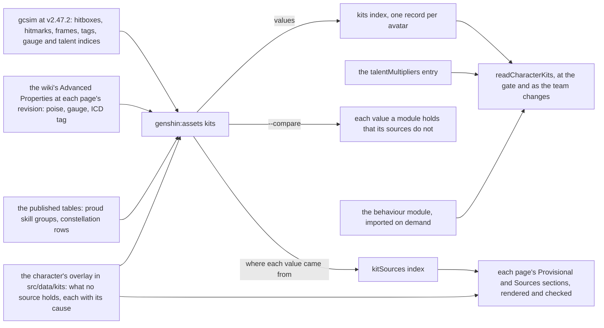
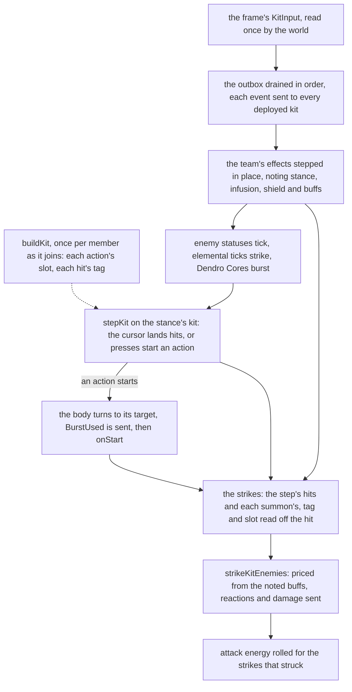

# Kit framework

Every playable character's kit is one module under `services/kit/characters`: about a hundred modules, a little under three hundred lines each, on a framework of about three thousand lines ([character kits](/docs/genshin/kits)). A module mixes two things. The first is the values a source already holds: frames, hitmarks, cancels, areas, tags, gauges, poise and talent indices, each copied by hand with a comment citing where it was read. The second is what the character alone does. The values are most of every module. So the duplicate-code finder's kit-against-kit pairs, some sixty, are nearly all the same data shapes written again: plunges, normal-attack strings, measured areas, charged attacks and one-hit skills. Every module also ships in the package's entry, a third of it, though a party holds four. And the frame that steps them allocates and searches where it could read.

This page splits a kit into two parts:

- a **record**, generated from its sources and published as hosted data;
- a **behaviour module**, written only where the character is unique, over a small set of primitives that each absorb one family of the duplicated code.

The frame reads what the build resolved once, and a module loads only when its character joins the party.

## Decisions

### Data and behaviour

- **A kit is a record and a behaviour module.**
  - The record holds every value:
    - each action's cancel frame and targeting;
    - each hit's hitmark, area, attack tag, internal cooldown tag, element, gauge, poise and bluntness;
    - each hit's talent parameter and the attribute its damage scales with;
    - the skill's and burst's cooldowns, energy cost, charges and hold thresholds, and the charged attack's stamina;
    - a stance's own actions;
    - the named hits a behaviour casts: a summon's ticks, an explosion, a coordinated attack;
    - a resource's maximum.
  - The behaviour module holds what no value can: what an action's start sets going, what a passive or constellation answers, and how a field ticks.
  - `buildKit(record, multipliers, behaviour)` joins the two once per member into the `Kit` that the step, the strike and the HUD already read. No reader of a kit changes; each action gains a `slot` and each hit an `attackTag`.
- **The record is generated wherever a source holds the value, and each source is read where it is exact.**
  - **gcsim** gives frames, hitmarks, areas, tags, element and gauge.
  - **The game's tables** give multipliers, cooldowns, energy, stamina and durations, already published as `talentMultipliers`. Where a constellation row's `paramList` holds a constellation's value, it comes from there too.
  - **The wiki's Advanced Properties template** gives poise, which gcsim has for only about one hit in ten. It also cross-checks each hit's gauge and ICD tag.
  - `pnpm -C scripts genshin:assets kits` reads all three and publishes one record per avatar into a `kits` index. The talent multipliers stay their own index, read alongside it.
- **A hit's talent parameter is read, never mapped by hand.** gcsim's generated talent file names the game's parameter index beside each multiplier (`1-Hit DMG: {0}`), and its `config.yml` names the multiplier each hit deals. So the builder joins a hit to its proud skill group and index exactly. This replaces two hand-kept things in every kit: the comments listing each group's indices, and the group-id constants.
- **What no source holds goes in an authored overlay, never a literal in a module.**
  - Each character has one overlay file in `src/data/kits`, checked by a Zod schema. It holds every value the builder cannot read, each with its cause from `KitProvisionalCause` and the recording that will replace it. It also holds the choice made wherever two sources disagree.
  - The index's shared provisional causes are builder rules applied by cause, so a kit's overlay names only what is its own. Those causes are: a plunge gcsim has no file for, a box priced as the circle to its corner, a hit centred on the target, and an unmeasured hold.
  - The overlay is a committed input to the builder; the bundle never imports it.
- **gcsim is read at v2.47.2, its last MIT release, and only there.**
  - The [Genshin proposal](/docs/proposals/genshin) settles gcsim's data up to v2.47.2; every later tag is under gcsim's own licence. Today's kits cite v2.47.2 and an unpinned `main` side by side, so some of their values were read past the licence line.
  - The builder reads that one tag and records it in every value's provenance. `--compare` lists each module value the tag disagrees with, the ones read off `main` among them, so the record holds only what the tag says.
  - A character the tag predates is built from the tables, the wiki and its overlay alone.
- **The record holds only what a reader reads.** gcsim's ICD groups, hitlag and strike types other than blunt stay in the source until a rule reads them.
- **Behaviour is TypeScript over the primitives.** The record holds values, never expressions or conditions. A constellation's gate, a passive's condition and an event's answer are functions in the character's module, typed and tested like any other code.

### The kit's shape

```ts
// Published as the `kits` index, one record per avatar id. Frames are gcsim's, at 60 a second, turned into seconds once
// By buildKit
interface KitRecord {
  burst: KitActionRecord;
  burstCooldownSeconds: KitParameter;
  burstEnergyCost: KitParameter;
  chargedAttack: KitActionRecord;
  chargedAttackStamina: KitParameter;
  // The hits a behaviour casts by name, gcsim's hitbox names: a summon's ticks, an explosion, a coordinated attack
  hits: Record<string, KitHitRecord>;
  normalAttacks: KitActionRecord[];
  plunges: Record<KitPlunge, KitActionRecord>;
  resourceMaximum?: KitParameter;
  skill: KitActionRecord;
  skillCooldownSeconds: KitParameter;
  skillHolds: KitHoldRecord[];
  // A stance's own actions, each hit carrying the attack tag gcsim gives it
  stances: Record<string, Pick<KitRecord, "burst" | "chargedAttack" | "normalAttacks" | "skill">>;
}
interface KitActionRecord {
  cancelFrames: number;
  hits: KitHitRecord[];
  targeting: KitTargeting;
}
interface KitHitRecord {
  area: AttackArea;
  attackTag?: AttackTag;
  element?: Element;
  gauge?: number;
  hitmarkFrames: number;
  internalCooldownTag?: InternalCooldownTag;
  isBlunt?: true;
  isNightsoul?: true;
  multiplier: KitParameter;
  name: string;
  poiseDamage: number;
  scalingAttribute?: Attribute;
}
// A table's parameter by its group and index, or a number where no table holds it
type KitParameter = number | { index: number; proudSkillGroupId: number };

// What a character alone does, each call given the world's one context and the kit's own combatant
interface KitBehaviour {
  burst?: KitActionBehaviour; // { onStart?: (context, combatant, target?) => void }
  hits?: Record<string, KitHitBehaviour>; // by the record's hit name: enemyStatus, onStrike, partyHeal
  normalAttacks?: KitActionBehaviour[];
  onKitEvent?: (event: KitEvent, context: KitContext, combatant: Combatant) => void;
  passives?: KitPassives; // bonuses, a strike's bonus, cooldown and stamina multipliers, onSprint
  skill?: KitActionBehaviour;
  skillHolds?: KitActionBehaviour[];
}
```

`buildKit` throws if a behaviour names a hit its record does not hold, so a typo in a hit name fails that kit's suite.

### The primitives

Each primitive absorbs one family of the finder's kit pairs, or one shape a hand count of the modules shows repeated:

| Primitive                                           | Family it absorbs                                                                                                      | Today                                                                                                                              |
| :-------------------------------------------------- | :--------------------------------------------------------------------------------------------------------------------- | :--------------------------------------------------------------------------------------------------------------------------------- |
| `KitRecord` and `buildKit`                          | Plunges, normal-attack strings, measured areas, one-hit skills and bursts, charged attacks: most of the finder's pairs | A local plunge builder in about a third of the kits, a frame divided by 60 over a thousand times, a few hundred group-id constants |
| `castKitSummon`                                     | Summon ticks, coordinated attacks, hits queued past an action's end                                                    | Over a hundred casts, each a summon and an effect add, often spread with an id or a tag                                            |
| `createPeriodicKitHits`                             | A hit every interval from a first frame: Oz, Guoba, Pyronado, the steles                                               | Dozens of `Array.from` builders                                                                                                    |
| `castKitField`                                      | Fields                                                                                                                 | Dozens of nine-field literals                                                                                                      |
| `scheduleKitTask`                                   | gcsim's `QueueCharTask`                                                                                                | Over a dozen one-tick fields with an infinite interval that linger a tenth of a second past their tick                             |
| `castKitShield`, `castKitTaunt`                     | Shields and taunts, over the one absorb order already shared                                                           | About a dozen shield literals                                                                                                      |
| `changeKitMemberHealth` (exists), `healKitTeam`     | Heals                                                                                                                  | A couple of dozen direct heals, half of them outside the Healing Bonus                                                             |
| `buffKitMember`, `buffKitTeam`                      | Party buffs                                                                                                            | Dozens of buff literals and a dozen loops over the deployed team                                                                   |
| `infuseKitMember`                                   | Infusions                                                                                                              | Over a dozen                                                                                                                       |
| `enterKitStance`, with `endsOnSwap`                 | Stance construction, and the swap handler that ends it                                                                 | About a dozen stances, most ended by a hand-written swap handler                                                                   |
| `addKitStatus`, `findKitStatus`, `startKitCooldown` | Status lookups and cooldown checks                                                                                     | Dozens of status literals, a few local finders, dozens of check-then-add gates                                                     |
| `gainKitResource`, `spendKitResource`               | Counters with a cap                                                                                                    | Never-ending statuses whose stacks are the count, in a fifth of the kits                                                           |
| `KitContext` and its outbox                         | The partial contexts and the ad-hoc event queues                                                                       | Five context shapes and two queues                                                                                                 |

- **A status has one meaning.** Today a status serves as a cooldown, a mark or a counter. The three are split:
  - a gate on a repeat is `startKitCooldown`, which starts the status and returns false while one is already running, in one call;
  - a timed mark, stacked or not, stays a status, read by `findKitStatus` beside `checkHasKitStatus`;
  - a count that outlives any timer and has a cap is a resource.
- **A resource is a capped amount on a character.** `KitResource` holds one character's amount of one resource and its maximum from the record. It persists across swaps, as statuses do today. Raiden's Resolve, Furina's Fanfare, Arlecchino's Bond of Life, Mavuika's Fighting Spirit and each Natlan character's Nightsoul points are each a resource.
- **Nightsoul is a resource, a stance and two events, as gcsim's one template models it.** gcsim keeps Nightsoul in one shared state (`internal/template/nightsoul`): points up to a per-character maximum, and a Blessing status with an optional exit timer. Here:
  - the points are a resource;
  - the Nightsoul Blessing is a stance, timed or not, whose hits carry gcsim's attack tags (Kinich's Scalespiker Cannon among them);
  - `ResourceChanged` carries every gain and spend, which Mavuika's Fighting Spirit counts across the party;
  - a party rule sends `NightsoulBurst` to the team when a hit gcsim tags `AttackTagNightsoul` sets it off. Ororon, Chasca, Kinich and Citlali answer it.

  Each piece lands with the first kit that needs it, as the framework's shared effects always have.

- **One context for every call.**
  - Today a kit's step, an action's start, a field's tick and an event each get a different partial context. A field tick cannot draw at random, an action's start cannot see the enemies, and adding one field breaks every test that builds a context by hand.
  - `KitContext` is the world's combat state, built once by `useWorldCombat` and written in place each step. It holds the party, every built combatant by id, the enemies with their tables, the team's effects, the seeded random source, the outbox, and the field member's body and combatant.
  - Every behaviour call takes the context and its own character's combatant: `onStart(context, combatant, target)`, `onKitEvent(event, context, combatant)`, `onTick(context, combatant, tickIndex)`. No call builds an object.
  - One test builder, `createKitTestContext`, makes the context for every suite.
- **One outbox for what happens between steps.**
  - Events raised inside the active step are sent as they happen, as today.
  - Events raised outside it each have an ad-hoc queue today, drained at different points of the step: a member's HP change and a taunt's damage. They become one `outbox` on the context.
  - The outbox is drained in queue order at the start of the next step, ahead of the effects running down. So a strike that spends a taunt's health is still heard before the taunt ends.
  - The one timing this moves is an HP change from an enemy's strike between steps: it is now heard at the start of the next step rather than its end, one frame earlier. Phase 1 makes that change in a commit of its own.

### The per-frame path

What `stepActiveKit` and its callees do today:

- **A frame where nothing lands still makes about two dozen objects:**
  - the body, the emit closure, and a context for each callee;
  - the taunt-damage and expired-effect lists;
  - two filtered copies of the effect list, one for what expired and one for what stays, made whether anything expired or not;
  - the landed hits' slice and the attack-tag list;
  - a Set and three arrays to find a normal attack's first hit;
  - three arrays to join the strikes, the struck list, and the emptied HP-change list.
- **It walks the team's effects about ten times:**
  - once for taunt damage;
  - four times in `stepKitEffects`, plus its two filters;
  - once for Crystallize shards and once for a stance;
  - once or twice for an infusion.
- **A landed hit is searched for, not read:**
  - `getKitAttackTag` walks the effects and then every hit of the kit with `includes`, making two arrays;
  - `infuseKitHits` builds a Set of every infusable hit of the kit, and `readOreHits` a Set of every attack hit, on every frame a hit lands.
- **A summon filters and maps its whole hit list every frame, landing or not:** two arrays per summon per frame. Oz and a Stone Stele each hold a few dozen hits.
- **A stance makes a new merged kit and a new combatant every frame it holds** (`getStancedKit`).
- **Every event builds five objects:** the context for `emitKitEvent`, and a copy of it spread for each deployed member.
- **A strike's pricing filters the buffs every strike,** and when any buff applies it copies the whole attribute map (`getBuffedCombatant`).

What it does after:

- **What the build can resolve is resolved once.**
  - `buildKit` gives each action its `slot` (`KitActionSlot`: normal attack, charged attack, plunge, skill, burst).
  - Each hit gets its `attackTag`, read from gcsim's `AttackInfo` for that hit, including a stance's and a summon's.
  - That removes `getKitAttackTag`, the skill-or-burst search, the infusable and melee Sets, and the stance's hand-written `attackTags`.
  - A stance's kit is built once, when the stance starts.
- **A cursor lands the hits.** An action and a summon each keep the index of their next hit. A step compares one hitmark rather than the whole list, and a summon with nothing to land does nothing.
- **The effects are stepped by index, in today's order, and compacted in place.**
  - The order is unchanged: seconds down, then fields, then summons, taunts, bubbles and shields. That is three walks of the list, with no array made.
  - On the way, the walk notes the field member's stance and infusion, the live shield Enduring Rock reads, and each member's buffs for pricing.
  - The rule that a write replaces the list goes. A walk runs to the length it started with, an effect added during it is appended and stepped as it is today, and an ended effect has its seconds zeroed, as kits already end effects.
- **A frame where nothing lands allocates nothing.** The body, the outbox, and the strike and expired lists belong to the context and are emptied by setting their length to zero. A frame that lands hits allocates only its strikes.
- **No typed arrays.** A kit holds at most a few dozen hits and the team a few dozen effects, and scanning that many costs no more than the objects a typed array would replace. They wait until the bench shows a hot loop.
- **`stepActiveKit.bench.ts` proves it.**
  - **The workload:** one minute of the fixed step for a party of four (Raiden, Xiangling, Noelle and the Traveler, the proof kits).
  - **The input:** scripted, at a fixed seed: the string, a charged attack, each skill, each burst once charged, and a swap every few seconds.
  - **Two scales:** idle (no enemies, no effects) and in combat (enemies standing in reach, the party's effects up). Each is one `bench.compare` with `BENCHMARK_RUN_OPTIONS` and a small iteration count.
  - **The fixture:** the world state is rebuilt inside the callback; the records and multipliers are read once, at module scope, from the mirror.
  - **When it runs:** it lands first, on today's path, and is re-run on the same machine after phase 1 and after phase 3. The diff of its committed `.bench.md` is the before against after.
  - Its input script is the same fixture the replay guard drives.

### Provenance and the docs

- **Every value names how it is known.**
  - The builder publishes a `kitSources` index beside `kits`, as the stats run publishes `talentLabels` beside `talentMultipliers`. So the record the browser reads carries no provenance.
  - For each value read, `kitSources` gives its source and where in it: gcsim's file and line at the tag, the wiki page at its revision, or the table's group and index.
  - Each overlay value carries its own cause, or the source it was chosen from.
  - A value with no provenance fails the build.
  - The `/ 60` and the "Measured: gcsim" comment above each constant leave the modules along with the values.
- **The character pages render from the record, and a test checks them.**
  - Each character page keeps its prose: its decisions and what is not built. It no longer copies values.
  - Its Provisional and Sources sections are rendered from `kitSources` and the overlay by `genshin:assets kits --docs`. A test renders them again and fails on any difference, as the kit map's test does for the generated map.
  - The index's list of shared provisional causes is rendered from `KitProvisionalCause` the same way.
- **A tool's test takes its oracle from the source.** The builder's tests assert cases worked by hand from gcsim's files and the wiki's template (Xiangling's strings from `xiangling/attack.go` and Dough-Fu's Advanced Properties). They never assert the builder's own earlier output.

### Loading

- **A kit loads when its character joins.**
  - `readCharacterKits(gameDataBaseUrl, characterIds)` reads each member's multipliers entry, its `kits` record and its behaviour module together, then builds its kit once.
  - It runs where `readTalentMultipliers` is awaited today, with the same retry: at the world's gate for the starting team, and as the team changes. The load budget's `talent-multipliers` step becomes `character-kits`.
  - The generated `CharacterIdCreateKitMap` becomes a loader map of `import()` calls, still generated at build from each module's declared id.
  - A character with no module still falls back to the Traveler's kit.
- **The barrel leaves the kit modules out.**
  - The source barrel lists every module and the entry re-exports it, so a dynamic import alone would load nothing lazily.
  - `generateExports` gains an option naming the directories a package loads on demand, and leaves them out of its barrel.
  - Rolldown should then split each `import()` into its own chunk. genshin-world has no dynamic-import chunk yet (its only extra chunk is shared between two entries), so phase 1 confirms the split in the `dist` listing.
- **The entry has a ceiling.**
  - Phase 1 lands genshin-world's `index.js` size snapshot at or under 1,350,000 bytes, down from about 2 MB. The kit modules, about a third of the entry's code, leave it; the loader map and the primitives come in. The snapshot holds the figure after that.
  - A record is a hosted read of a few kilobytes, fetched alongside the multipliers; the builder's dry run reports its size.

## Measured

**gcsim's regularity**, counted over every character folder of v2.47.2, the tag the builder reads. A tag is fixed, so these counts do not move:

| What a kit needs                         | Where gcsim holds it                                                                 | Regular in                                                                                  |
| :--------------------------------------- | :----------------------------------------------------------------------------------- | :------------------------------------------------------------------------------------------ |
| Each hit's area                          | `config.yml`'s `abilities` hitboxes: shape, centre, offset, radius or box, fan angle | 110 of 110 characters, 1,645 hitboxes                                                       |
| Each multiplier's talent parameter       | `zz_<name>.dm.go`, the game's own index `{n}` beside each multiplier                 | 110 of 110, 1,607 multipliers                                                               |
| Which multiplier each hit deals          | `config.yml`'s `talents`                                                             | 110 of 110                                                                                  |
| Normal attack hitmarks and cancels       | the `attackHitmarks` literal, and `InitNormalCancelSlice(hitmark, frames)`           | 107 and 110 of 110                                                                          |
| Charged attack                           | a hitmark constant, and `InitAbilSlice(frames)`                                      | 77 of 77                                                                                    |
| Plunges                                  | hitmark constants as small integer sums (`44 + 3`), and `InitAbilSlice`              | 53 of 53; the other characters have no plunge file                                          |
| Skill and burst                          | a hitmark constant, and `InitAbilSlice`                                              | hitmarks in 90 and 85 of 110, frames in 110 of 110; the rest are scheduled tasks            |
| Attack tag, ICD tag, element, durability | each `AttackInfo` literal                                                            | 848, 845, 831 and 828 of 856                                                                |
| Poise                                    | `PoiseDMG`                                                                           | 87 of 856, so poise is read from the wiki                                                   |
| Max HP or DEF scaling                    | `FlatDmg`                                                                            | 41 of 111 on the same line; the rest go through a local variable, so they go in the overlay |
| Nightsoul                                | one shared template, and `AttackTagNightsoul` in a hit's `AdditionalTags`            | the Natlan characters, as Kinich's `skill.go` shows                                         |

**The wiki** carries its `{{Advanced Properties}}` template on several hundred talent pages, including all but a handful of the Normal Attack pages. Each hit gets a title, gauge, ICD tag and type, and poise. Its values match the poise the kits copied by hand: Xiangling's Dough-Fu agrees hit for hit.

**The kits.** About a fifth of the modules' lines is behaviour: the callbacks and the helpers they call. About half is hit and action fields, frame and area constants, value builders, and the comments citing each value. The rest is imports and blank lines. That bears out the other machine's estimate that about two thirds could be generated, and puts it nearer three quarters once the scaffolding that goes with the values is counted.

| Kit         | Today (lines) | Of it behaviour | After (estimate)        |
| :---------- | :------------ | :-------------- | :---------------------- |
| Kinich      | ~180          | none yet        | ~10, until its Blessing |
| Neuvillette | ~200          | none            | ~10                     |
| Amber       | ~220          | ~40             | ~35                     |
| Noelle      | ~300          | ~40             | ~35                     |
| Nilou       | ~330          | ~80             | ~65                     |
| Xiangling   | ~400          | ~80             | ~65                     |
| Bennett     | ~420          | ~65             | ~50                     |
| Zhongli     | ~420          | ~100            | ~80                     |
| Fischl      | ~430          | ~115            | ~95                     |
| Raiden      | ~560          | ~225            | ~170                    |
| Furina      | ~715          | ~340            | ~280                    |

In total:

- the modules go from about twenty-nine thousand lines to about six or seven thousand, about 65 a kit;
- the framework stays about three thousand lines in the package, as the reach helpers and the attack-tag search leave and the primitives and `buildKit` come in;
- the builder adds about a thousand lines in `scripts`;
- the overlays are expected at a few hundred lines of JSON, with most kits needing none. The compare report gives the real count in phase 1.

**The bundle.** genshin-world's entry is about 2 MB. The kit modules' code is about a third of it (comments are stripped in the build). The framework under them is about 60 KB.

## Data flow



## Per-frame flow



## Scope and order

**Phase 1: the record and the primitives, proven on three kits.** Each step lands green.

1. **The builder.**
   - `genshin:assets kits` is a citty command with three readers:
     - a gcsim reader at v2.47.2: the YAML hitboxes, a constant evaluator for the action files' literals and integer sums, the `AttackInfo` fields, and the talent file's indices;
     - a wiki reader through the MediaWiki API that records each page's revision;
     - the published tables, read through the lock.
   - It also holds the join, the overlay's schema, and `KitProvisionalCause`.
   - `--compare` builds every module as it stands. It seeds each overlay with the module's value wherever a source lacks the value or disagrees with it, and classifies what it can:
     - a value equal to a shared provisional constant takes that cause;
     - a value a source disagrees with is `DiffersFromSource`;
     - the rest are `Unclassified`.
   - One publish of `kits` and `kitSources` for every built character, so each record reproduces its module's values exactly.
   - Its tests take their oracles from gcsim's and the wiki's own text.
2. **The guard and the bench.**
   - A replay test drives each kit alone, and the bench's party together, through the scripted minute at a fixed seed.
   - It snapshots a digest of each strike log, with the count of strikes and the sum of multipliers by attack tag, so a failure shows where behaviour moved.
   - It records today's behaviour, bugs included, which is why phase 3 deletes it rather than keeping it as an oracle.
   - The bench lands beside it, on today's path.
3. **The framework, alongside today's.**
   - It adds `KitContext` and its outbox, the cursors, the slot and attack tag set at build, the effects stepped in place, `buildKit`, `readCharacterKits`, the loader map with the barrel option, and the primitives the proof kits need.
   - A module still in today's shape runs through a compatibility path that builds today's partial contexts for it, so every replay digest stays as it was.
   - The finder learns to end a clone where the import block ends, which removes the false positives among the kit pairs.
4. **The proof kits,** each in its own commit with its digest unchanged:
   - **Xiangling:** summons, a following summon, scheduled tasks, a team buff;
   - **Noelle:** a shield, a converting infusion, a party heal on a hit, an explosion as the shield ends;
   - **Raiden:** a stance with gcsim's own attack tags, events, cooldown statuses, and Resolve as a resource;
   - **the Traveler's** framework-owned kit.

   The bench is re-run for the before against after, and the size snapshot lands at or under its ceiling.

**Phase 2: every other kit, in parallel.**

- One commit per kit, behaviour-preserving:
  - its module becomes its behaviour;
  - its suite's scaffolding moves to `createKitTestContext`, with no expected value changed;
  - its overlay's `Unclassified` entries are classified from the module's own comments;
  - its page's sections are rendered.
- Its suite and its replay digest guard the commit.
- A primitive not yet built lands with the first kit that needs it:
  - a taunt with Amber or Itto;
  - a bubble with Mona;
  - `ResourceChanged` with Mavuika;
  - `NightsoulBurst` with the first Natlan kit that answers it;
  - Bond of Life's draw on heals with Arlecchino.

**Phase 3: the old shapes deleted.**

- These go:
  - the compatibility path and today's partial contexts (`KitStepContext`, `KitEventContext`, `KitFieldTick`, `KitStrikeContext`, `ActiveKitStepContext`);
  - `getKitAttackTag`, `getStancedKit` and `KitStance.attackTags`;
  - the reach helpers (`createBoxReach`, `createCircleReach`, `createFanReach`, `createTargetedHitArea`), which are now builder rules;
  - `createKitStepContext` and `createKitEventContext`;
  - the replay guard, and the bench's entry for today's path.
- The kits index's framework sections are rewritten for the record.
- The zero test turns on.

**After: the sources win.** Each overlay entry marked `DiffersFromSource` is settled one value per commit: its suite is updated to the source's value, with the source cited. An `Unclassified` or provisional entry stays on the References sought list until a source answers it.

### Keeping both machines building

- **The migration is a sweep with a ledger.** the kit-records ledger has one row per kit, ticked by each commit's `Ledger:` trailer. A machine claims its rows through the fleet before converting them, and neither machine edits a kit the other has claimed.
- **From phase 1's framework commit, a new kit is written in the new shape**, as the index's template shows. A kit not yet converted still takes edits in today's shape, a passive or a hook, and its conversion carries them over. Its replay digest moves only in a commit that means to change its behaviour.
- **A conversion publishes nothing.**
  - Phase 1 publishes every record once, with the same values as today's modules.
  - A conversion edits only its overlay's classifications, which the page check reads from the repo.
  - A test holds the committed overlay's values to the published record's, so a value changed without a publish fails.
  - A value that moves is a fix, in its own commit with a publish of its own key (`genshin:assets kits --only <character>`).
- **The hooks pass's landed work is kept:**
  - hits queued past an action's end still land at gcsim's hitmark on the world's clock, priced by the caster, and each now carries its own attack tag;
  - the burst-used, particle-collected, normal-attack-landed and damage-taken events;
  - the party on every call, now on the context;
  - the Berserker pricing hook, as a passive;
  - the summon and reaction hit tags, the taunt-damaged event with its optional explosion, the one `findAbsorbedElement`, and the seeded random source, now on the context;
  - each module's `<NAME>_CHARACTER_ID` export, from which the loader map is still generated.

### What the zero test asserts

- **The finder finds no clone in the kit tree.** `pnpm ai:sweep:duplicate-code` over `packages/genshin-world/src/services/kit` reports nothing at its thresholds of five lines and fifty tokens. The workspace suite's zero test holds it there, and the ledger's two genshin-world rows are marked swept.
- **The split holds.** A test over the kit modules finds no module that divides by 60, names a proud skill group or calls `getTalentMultiplier`. Every frame, area and talent index lives in the record, so a value written back into a module fails.

## What this does not propose

- **A scripting language for kits,** or expressions and conditions in the record. Behaviour is TypeScript; the record is values.
- **An ECS or a struct-of-arrays store** for the team's effects. There are a few dozen at most, and stepping them in place is the whole gain. It is reopened only if the in-combat bench shows the effects dominating the step.
- **Typed arrays** for hits, effects or the attribute map. The counts are small, and the attribute map as an array would change combat's pricing everywhere. It is reopened only if pricing dominates the bench.
- **Parsing Go or running gcsim.** A handful of literal forms, a constant evaluator and a YAML read cover the values. gcsim's scheduled tasks are behaviour, written into each character's module against the primitives.
- **Reading gcsim past v2.47.2.** Every later tag is under gcsim's own licence, so a newer character's values come from the tables, the wiki and its overlay.
- **Translating gcsim's behaviour code.** It runs on gcsim's own queue and hitlag. What a character does is written here, against the primitives.
- **A handler per event kind, or object pools for strikes.** One `onKitEvent` stays. Once calls pass the context and the combatant, an event allocates nothing beyond itself.
- **Committed generated TypeScript for each kit.** A dataset the browser reads is hosted, never committed or bundled (the `genshin-data` skill).
- **An integer frame clock.** Hits land on seconds as today. Switching to frames would change which step a hit on a boundary lands in, a change of its own that the replay would show.
- **Hitlag, ICD groups and strike types other than blunt.** They are in gcsim's source and stay out of the record until a rule reads them.

## Key files

| File                                                                | Role                                                                                           |
| :------------------------------------------------------------------ | :--------------------------------------------------------------------------------------------- |
| `packages/genshin-world/src/services/kit/stepActiveKit.ts`          | The frame: the outbox, the effects, the step and the strikes, reading what the build resolved  |
| `packages/genshin-world/src/services/kit/stepKit.ts`                | An action's cursor and the presses, reading each action's slot                                 |
| `packages/genshin-world/src/services/kit/effects/stepKitEffects.ts` | The effects stepped by index in today's order and compacted in place                           |
| `packages/genshin-world/src/services/kit/getKitAttackTag.ts`        | Deleted: a hit's tag is set when its kit is built                                              |
| `packages/genshin-world/src/models/kit/Kit.ts`                      | The built kit its readers keep, gaining each action's slot and each hit's attack tag           |
| `packages/genshin-world/src/models/kit/KitStepContext.ts`           | One of the five partial contexts `KitContext` replaces                                         |
| `packages/genshin-world/src/services/kit/createCharacterKit.ts`     | Replaced by `buildKit` and `readCharacterKits`                                                 |
| `packages/genshin-world/scripts/kit/generateCharacterKitMap.ts`     | Writes the loader map of `import()` calls from each module's declared id                       |
| `packages/configuration/src/generateExports.ts`                     | The barrel's option for directories a package loads on demand                                  |
| `packages/genshin-world/src/composables/useWorldCombat.ts`          | Builds the world's one `KitContext`, and awaits `readCharacterKits` as the team changes        |
| `packages/genshin-world/src/components/World/Screen/Index.vue`      | The gate whose `talent-multipliers` step becomes `character-kits`                              |
| `packages/genshin-world/src/index.test.ts`                          | The entry's size snapshot, held at or under its ceiling                                        |
| `scripts/src/services/genshinAssets/stats/writeTalentTables.ts`     | The precedent for one index entry per avatar, and for values published apart from their labels |
| `scripts/src/services/sweeps/duplicateCode/constants.ts`            | The finder whose zero holds the kit tree                                                       |
| `apps/web/content/docs/genshin/kits/index.md`                       | The framework's page, its provisional causes rendered from `KitProvisionalCause`               |

## Sources

- [gcsim](https://github.com/genshinsim/gcsim) (MIT up to v2.47.2), tag [v2.47.2](https://github.com/genshinsim/gcsim/tree/v2.47.2/internal/characters). Each character's `config.yml` hitboxes and talents, its action files' hitmark and frame literals and `AttackInfo` records, and its generated `zz_<name>.dm.go` talent indices. The shared Nightsoul state is in [`internal/template/nightsoul`](https://github.com/genshinsim/gcsim/tree/v2.47.2/internal/template/nightsoul).
- [Template:Advanced Properties](https://genshin-impact.fandom.com/wiki/Template:Advanced_Properties), Genshin Impact Wiki, read through the wiki's [MediaWiki API](https://genshin-impact.fandom.com/api.php) (`action=parse`, `prop=wikitext`): each hit's gauge, ICD tag and type, and poise. [Dough-Fu](https://genshin-impact.fandom.com/wiki/Dough-Fu) is the hand-worked case.
- [AnimeGameData](https://github.com/DimbreathBot/AnimeGameData), the community's per-patch dump: `ProudSkillExcelConfigData`, whose multipliers are already published, and `AvatarTalentExcelConfigData`, whose constellation rows carry a `paramList`.
