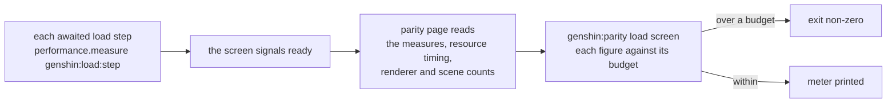

# Load budget

Miliastra Wonderland meters a stage's load as its author builds it: every placed object takes its share of a fixed budget, and the meter says how much is left. The recreation has the same need with nothing to show it. A screen's loading time grows with every dataset, region and warm-up added to its gate. Nothing says which step took the time, how many objects and fetches the world holds when it shows, or whether a change made either worse. The scene bench (`genshin:parity bench`) times the frames after a screen is drawn; this page is its counterpart for everything before the first frame.

## Decisions

- **A load step is a browser performance measure, not a framework of our own.** Each awaited step of a screen's loading is wrapped in `performance.mark` and `performance.measure` under the name `genshin:load:<step>`: the opening's reads, the world gate's reads, the region data, the terrain's first tiles, the scene's compile. The browser already keeps these. DevTools' Performance panel draws them on its Timings track, so the steps can be seen by eye on any page, and the parity page reads the same entries with `performance.getEntriesByType`. Nothing else records them.
- **Fetches are read from resource timing.** `performance.getEntriesByType("resource")` already lists every request with its transferred bytes, so the game data fetched before ready is counted from it, by its path under the game data base, with no counter of our own.
- **The renderer's and the scene's counts are the scene bench's, taken at ready.** The geometries, textures and programs the renderer holds, and the scene's visible objects by kind, are read the way `benchScene` reads them, once, at the moment the screen signals ready.
- **A budget is a committed record per screen, and the command fails over it.** `scripts/src/services/genshinParity/load/ScreenLoadBudgetMap.ts` maps a screen to its budget for each figure: milliseconds to ready, requests, game data bytes, visible objects, geometries, textures and programs. `pnpm -C scripts genshin:parity load <screen>` loads the screen cold, waits for its ready, and prints each figure against its budget as a meter, with the share used. It exits non-zero when any figure is over. A budget is first written at the screen's measured figure plus a tenth, so it holds what is there and catches a regression. Trimming lowers it in the same commit that trims, never the reverse.
- **Time is reported but measured on the machine that runs it.** The counts are the same on every machine; milliseconds are not. So the time budget is checked only on the machine its record names, and elsewhere the time is printed beside it without failing.
- **No in-game overlay.** DevTools' Timings track shows the steps on any page, and the command shows the meter. A panel drawn into the game would be a second view of the same entries, kept in step with them by hand.

## How it works

## Scope and order

1. **Measure. Built**, see [Load budget](/docs/genshin/load-budget): each awaited load step is measured as `genshin:load:<step>` by `measureLoadStep`, and `genshin:parity load <screen>` prints each figure against its budget in `scripts/src/services/genshinParity/load/ScreenLoadBudgetMap.ts`, written for the opening, the login and the Windrise world.
2. **Trim, one step at a time, each measured before and after with `load`:**
   - Read only the region ground in the first view at the gate, and the rest after the world shows. Today `readWindriseData` reads all seven region grounds and the base ground.
   - Leave the far terrain rings out of `ready`, so the first frame waits on the near tiles only. **Built**, as the finest level only (`checkIsFirstFrameSettled`). [The as-built load budget](/docs/genshin/load-budget) gives what it measured.
   - **Next, measured:** the terrain measure is about 19.5 s, of which about 17 s passes before a worker runs its ground load. Each worker imports the `genshin-engine` barrel, which on the parity page's dev server is a waterfall of unbundled modules, and the first eight tile requests all wait behind it, arriving near 20 s. A tile's compile costs 0.6 ms (186 tiles, 119 ms in all), so a compile once per material is not the cost and is not built. The start is the next trim: a worker that imports only the terrain functions, or this measure read on a production build, decides it.
   - Compile the first view's materials before ready, and the rest after.
   - Read each name-text and stat table when its first reader needs it, rather than all of them at the world gate.
3. **Hold.** Each trim lowers its screen's budget in the same commit, so the meter only tightens.

## Key files

| File                                                               | Role                                                       |
| :----------------------------------------------------------------- | :--------------------------------------------------------- |
| `packages/genshin-world/parity/benchScene.ts`                      | The scene bench whose counts the load bench takes at ready |
| `scripts/src/services/genshinParity/commands/benchCommand.ts`      | The frame bench's command, which `load` stands beside      |
| `packages/genshin-world/src/components/World/Screen/Index.vue`     | The world's gate of reads before it shows                  |
| `packages/genshin-world/src/services/windrise/readWindriseData.ts` | The region grounds read at the gate                        |
| `packages/genshin-world/src/components/World/Terrain/Index.vue`    | The tiles whose arrival the world's ready waits on         |

## Sources

- [Performance: mark() and measure()](https://developer.mozilla.org/en-US/docs/Web/API/Performance/measure), MDN: named measures the browser keeps and DevTools draws on its Timings track.
- [PerformanceResourceTiming](https://developer.mozilla.org/en-US/docs/Web/API/PerformanceResourceTiming), MDN: every fetch's transfer size, read without a counter of our own.
