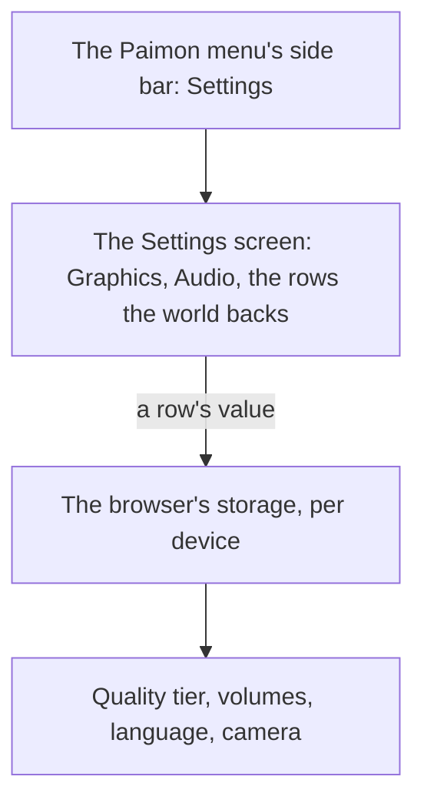

# Menu Settings screen

The [Paimon menu](/docs/proposals/genshin/menu-paimon) opens a Settings screen from its side bar. Its Graphics tab's header, tab and quality row are built, and the world does not yet open the screen. This proposal draws its body. It builds on the [screens](/docs/genshin/screens) shell, on the [renderer's quality tiers](/docs/genshin/rendering-style), on [game text](/docs/genshin/game-text) for the language row, and on the [follow camera](/docs/genshin/follow-camera), whose sensitivities and default distance this screen's Controls tab would show.

## Decisions

- **Settings shows only the rows the world has.** Each row the world backs is laid out with the game's name, range and default. Graphics Quality is the renderer's quality tier. Volume, Music Volume and SFX Volume run from 1 to 10 over the music's player and the sound effects. Game Language offers the fifteen languages of [game text](/docs/genshin/game-text). The camera sensitivities and default distance belong to the follow camera. Settings are kept in the browser, as the game keeps its settings per device. A row the world does not back is left out, never drawn disabled.

## How it works



## Scope and order

1. **Settings' body**: the Graphics Quality row's choices and the store its value is kept in, the Audio tab, and the rows' colours over the blurred world the page has no copy of.
2. **The Controls tab's defaults**, once the interface export holds the Settings screen itself: [follow camera](/docs/proposals/genshin/follow-camera) owns the values.
3. **The check.** `menu-settings.mkv` re-measures the Graphics rows and the Audio tab when it lands, its frame scored with `pnpm -C scripts genshin:parity compare settings-graphics-rows` over the whole frame, with the blurred world counted as the one thing the page cannot draw. The clip waits in the roadmap's Manual verification.

## Key files

| File                                                             | Role after the change                                                  |
| :--------------------------------------------------------------- | :--------------------------------------------------------------------- |
| `packages/genshin-world/src/components/Menu/Settings/Index.vue`  | The Graphics tab's header and quality row, not yet opened by the world |
| `packages/genshin-engine/src/renderer/QualityTierSettingsMap.ts` | The tiers the Graphics Quality row chooses between                     |
| `packages/genshin-text/src/models/GameTextKey.ts`                | Gains every label of Settings                                          |

New files:

```text
packages/genshin-world/src/components/Menu/Settings/Index.fixture.ts
```

## Sources

- [Settings](https://genshin-impact.fandom.com/wiki/Settings), Genshin Impact Wiki: the graphics quality, the volumes from 1 to 10, the fifteen game languages and the camera's rows, and settings kept per device.
