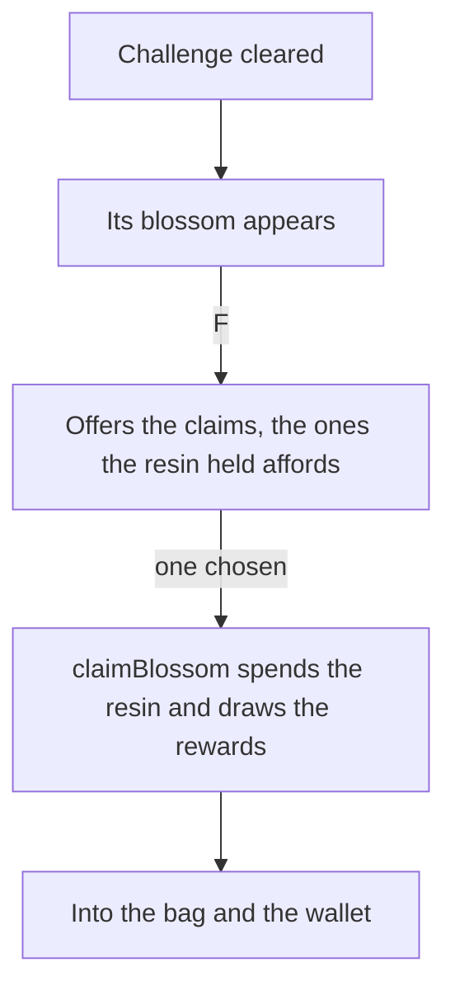

# Original Resin

The [original resin](/docs/genshin/original-resin) page holds the resin's count, its regeneration and refills, a claim's price, its rewards and Condensed Resin. What is left is the claim's offer on F, which each challenge's blossom needs once a challenge places one. Each challenge's own page spawns the blossom, and the claim spends the resin for it.

## Decisions

- **A cleared challenge leaves its blossom, and F offers its claim.** A [ley line outcrop](/docs/proposals/genshin/ley-line-outcrops)'s Ley Line Blossom, a [domain](/docs/proposals/genshin/domains)'s Petrified Tree or a [boss](/docs/proposals/genshin/bosses)'s Trounce Blossom. A challenge cleared but not claimed gives nothing. The offers and their prices are the [original resin](/docs/genshin/original-resin) page's.
- **Fragile Resin is used from the bag.** Its use restores 60 Original Resin, the refill rule the [as-built page](/docs/genshin/original-resin) already has, and it waits on the [inventory](/docs/proposals/genshin/inventory)'s using of an item.

## How it works

## Scope and order

**This still adds:** the claim's offer on F, its one step left. It waits on the ley line outcrops' blossom, which the world does not place yet.

1. **The claim's offer on F**, with the first blossom a challenge places ([ley line outcrops](/docs/proposals/genshin/ley-line-outcrops) or [bosses](/docs/proposals/genshin/bosses)): its prompt row through `computeInteractionPrompts`, its offers from `computeBlossomClaimOffers` shown to choose from, Condensed Resin's among them at a ley line or a domain, and `claimBlossom` on the one chosen.

## Key files

| File                                                                           | Role after the change                         |
| :----------------------------------------------------------------------------- | :-------------------------------------------- |
| `packages/genshin-world/src/services/interaction/computeInteractionPrompts.ts` | Lists a blossom in reach as a claim           |
| `packages/genshin-world/src/services/enemy/computeEnemyDrops.ts`               | Its bands, which a claim's rolled drops share |

## Sources

- [Original Resin](https://genshin-impact.fandom.com/wiki/Original_Resin), Genshin Impact Wiki: claims at ley line outcrops, domains and bosses and their prices.
- [Condensed Resin](https://genshin-impact.fandom.com/wiki/Condensed_Resin), Genshin Impact Wiki: three rewards at once, and never at a boss.
- [Normal Bosses](https://genshin-impact.fandom.com/wiki/Normal_Bosses) and [Weekly Bosses](https://genshin-impact.fandom.com/wiki/Weekly_Bosses), Genshin Impact Wiki: the Trounce Blossom, 40 resin, and 30 for the first three weekly claims.

## Reference

- `map-top-bar.mkv` — the map on M opened from standing still in the open world, its top bar in view with the Original Resin counter, 10 seconds at most; the counter's place and type are measured from it. On the wiki and YouTube, none found (searched 2026-10-11).
