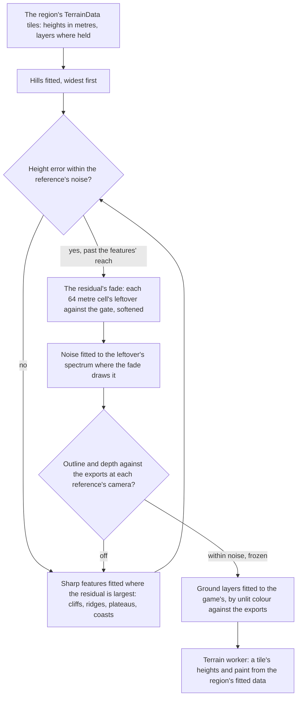

# Terrain shapes

This page builds on the [terrain](/docs/genshin/terrain), whose quadtree, workers and floating origin already stream the ground, and is the ground's part of the [scene derivation](/docs/genshin/scene-derivation): its heights answer the layout and shape passes, its paint the surface pass. Today Windrise's heights are several thousand Gaussian hills fitted to the game's terrain tiles round the oak's foot, under a metre of error there and a few metres at the valley's edge, and nothing past the kilometre it is fitted over. The continent is one connected land on the game's own tiles, so every region's ground is fitted the same way, and the fit grows only where its error says hills are not enough.

## Decisions

- **The ground is fitted, never drawn.** Each 1024-metre tile's TerrainData holds its heights in metres on the game's own coordinates ([game data formats](/docs/genshin/game-data-formats)), so a region's ground is a fit to those tiles: `fitRegionGround` already fits each region's hills, and features and the residual are what this proposal adds. The game's coordinates are the world's, so no transform from a map's pixels is needed. What ships is the fit's parameters, the region's data, never the heights themselves.
- **The least representation that holds, in order.** Hills come first, as Windrise's are. Where their error stands above the gate, the fit adds the sharp features hills smear: cliff bands with a step height, ridge lines with a profile, plateau outlines and coastlines, each found where the residual is largest and fitted to it, blended in by its signed distance with its own falloff. What is left below the features' reach is filled by noise whose amplitude and scale are fitted to the residual's own spectrum, judged by its statistics as anything random is, never by its heights point for point.
- **Gated by the shape pass's measure.** A tile's fit is done when its height error over the tile, and its outline and depth against the exports drawn by the witness at each reference's camera, stand within the reference's noise; the fit prints both, and a test freezes the fitted parameters' error once the gate holds.
- **The ground's layers are fitted to the game's own.** A region's layers lie where a field fitted from its terrain's base maps puts them, each painting its class's mean colour ([ground paint](/docs/genshin/ground-paint)), and a rule of the slope, the height or a path's distance goes over the field only once a measure shows the field needs it. The surface pass judges both by the Ground's unlit colour against the exports'.
- **What a heightfield cannot hold is a placed object.** Overhangs, arches, stone pillars, sea stacks, caves and the floating rocks of Liyue and Inazuma are objects the game places, so they stand where their StreamGen records set them in the region's layout pass and are rebuilt in object passes, never forced into the heights.
- **The same heights serve collision.** The worker keeps each tile's heights for the `collision` module's height query, which [exploring](/docs/proposals/genshin/exploring) adds, so the camera and later the character stand on the surface that is drawn.
- **The fit's data follows reach.** A region's fitted parameters load with its region data, so the ground's data grows with what is in reach, never with the continent.
- **The first slice's calls.** Plateaus come first, placed greedily: each round takes the disc, of 96, 48 or 24 metres' radius on a centre every half radius, whose mean residual takes the most squared error off, its falloff a quarter of its radius; a disc counts only where every sample is fitted ground, and the fit stops at 16 plateaus or when the next takes under 1% of what is left. The residual's noise takes the scale among 8 to 256 metres whose own correlation length is nearest the residual's, and the amplitude that makes its root-mean-square over the same grid the residual's, with three octaves and a fixed seed.
- **The residual is faded out where the ground above it holds, and the fade is fitted.** Noise matched by its statistics adds its own error wherever it is drawn, so the fit draws it only where the hills and features miss: on nodes 64 metres apart covering the tiles the fit reads, each weighs smoothstep from the gate to twice the gate of the root-mean-square left after the hills and features in the cell round it, then the weights are averaged once over each node's three by three so the fade's edges are soft, and kept to two decimals. The gate is the hills' bar, 0.62 metres (`GROUND_RESIDUAL_GATE_METRES`), and a cell with no sample weighs one. The residual is drawn only where it reaches, as every layer is: none past the fade's grid, where nothing was fitted; none within the radius the hills' bar is read over, its fade's clearing ramping it in across the next fade cell; none on a place the world stands something on, each landmark and capital a region file sets inside the fitted extent cleared the same way across its footprint; and none under a feature, the composed height taking it times one less the features' blend. A capital's footprint is its city, the farthest corner of its city area's placements from its place, since the capital's whole architecture stands on that ground; another building's is the half diagonal its kit's width and depth give, and any other place's the bar's radius; the fit prints each with its source. The places are clearings on the fade, held at none point by point, rather than weights stamped into its grid: nodes 64 metres apart cannot hold a footprint smaller than a cell at none between them. The noise's amplitude and scale are fitted to the leftover weighted by that fade, so they match the ground the noise is drawn on rather than the whole extent. A ground's bar is read on the composed ground, hills, features and faded residual together: its RMS within 60 metres of the centre, and the landmark gate [scene derivation](/docs/genshin/scene-derivation) states. Past the bar's radius the residual is judged by its statistics, the fit printing its change over each octave's scale beside the faded leftover's for the record.
- **Ridges are placed as the cliffs are.** After the cliffs ([scene derivation](/docs/genshin/scene-derivation), "Each region's ground"), each round tries the same segments at the same headings through `getRidgeBlend`, a ridge's width a quarter of its length and its height the mean residual within that width of its segment where every sample is fitted ground, under the same limits.

## How it works



## Scope

**Today:** the terrain's tiles are generated from a region's height function and painted by its layers' rules, in vertex colours ([ground paint](/docs/genshin/ground-paint)). Windrise's is Gaussian hills fitted to the game's own terrain tiles, its layers its fitted field's, each painted its class's colour. The layers the composition sums (hills, cliff, ridge and plateau features, and the residual's noise with its fade) are built as [terrain shape height](/docs/genshin/terrain-shape-height); the fit now places each region's plateaus and cliffs and its residual's fade and noise, and Windrise's ground carries three cliffs and its residual.

**This adds:**

1. **Ridges and coastlines**: ridges as the Decisions set out, in `fitTerrainRidges.ts` after the cliffs through `placeTerrainFeatures`, then coastlines where the residual after both is largest, and the gate each region is held to once its features are run. The plateaus, the cliffs, the residual's noise and the fit for any set of tiles are built in `fitRegionGround`.
2. **The ground layers fitted**: the weights the game's tiles hold read by the inventory and written in place of the rules', each layer's colours fitted to the game's, and the paths read from its path layer.
3. **The heights kept for collision**, when exploring's camera asks for them.
4. **Each area's outline** in the [world map](/docs/genshin/world-map)'s catalogue, read from the game's own area data where the inventory finds it and otherwise drawn round the tiles its placements stand on, in place of Galesong Hill's provisional one.

## Key files

| File                                                               | Role after the change                                                          |
| :----------------------------------------------------------------- | :----------------------------------------------------------------------------- |
| `scripts/src/services/genshinAssets/fit/fitRegionGround.ts`        | Each region's hills, plateaus, cliffs and residual, built; ridges still to fit |
| `scripts/src/services/genshinAssets/fit/placeTerrainFeatures.ts`   | The greedy placement each kind of feature's fit shares, the ridges' too        |
| `scripts/src/services/genshinAssets/fit/fitTerrainCliffs.ts`       | The cliffs' segments and headings, which the ridges' follow                    |
| `scripts/src/services/genshinAssets/fit/fitTerrainResidual.ts`     | The residual's noise, its scale and amplitude matched to its statistics        |
| `scripts/src/services/genshinAssets/fit/fitTerrainResidualFade.ts` | The residual's fade, each cell's leftover against the gate, softened           |
| `scripts/src/services/genshinAssets/fit/fitGaussianHills.ts`       | The first rung of the fit, its error deciding whether features follow          |
| `packages/genshin-engine/src/terrain/computeTerrainTile.ts`        | The tile generator, which samples the fitted features and noise                |
| `packages/genshin-world/src/workers/terrainTile.worker.ts`         | The worker, which reads a region's fitted data in place of its code            |
| `packages/genshin-world/src/models/windrise/WindriseBaseGround.ts` | The base ground's schema, which takes each kind of feature the fits draw       |

New files:

```text
scripts/src/services/genshinAssets/fit/fitTerrainRidges.ts
packages/genshin-engine/src/terrain/   ← the features' and the residual noise's generators
```

## Sources

- [Making maps with noise functions](https://www.redblobgames.com/maps/terrain-from-noise/), Red Blob Games: noise octaves summed into height, used here only for the residual below the fitted features, its octaves' amplitudes fitted to that residual.
