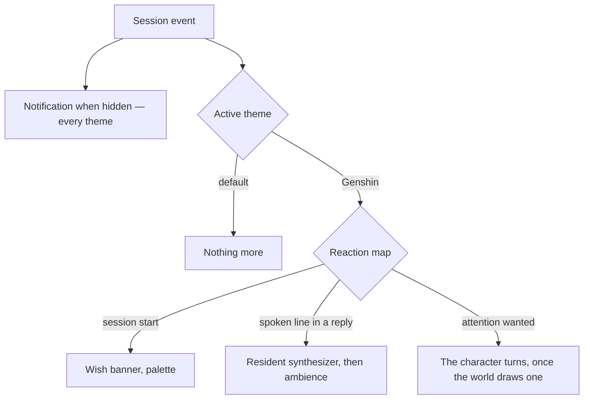

# Themes

The [agent console](/docs/infra/claude-interface/agent-console) already has a theme registry. It holds the default and the Genshin theme, and the parts a theme sets are its avatar, which the Genshin theme reads off the persona plugin's line in the session-start context, and its reactions, which add to the console's own hidden-tab notification ([as built](/docs/infra/claude-interface/agent-console)). This proposal is the rest of what a theme may set, and the rest of the Genshin theme.

## What a theme may add

| Part      | What it is                                                                                                                                               | Default theme |
| :-------- | :------------------------------------------------------------------------------------------------------------------------------------------------------- | :------------ |
| Palette   | the tokens inside the console's theme scope for its panels                                                                                               | dusk          |
| Scene     | what the theme adds to the world, receiving the session's events                                                                                         | nothing       |
| Reactions | a map from session event to what the theme does — a pose, a sound, a notification tone — on top of the console's own notification when the tab is hidden | none          |
| Voice     | how the agent's spoken lines are heard                                                                                                                   | none          |

A theme never removes a part of the [console overlay](/docs/infra/claude-interface/agent-console/console-overlay) that [terminal parity](/docs/infra/claude-interface/agent-console/terminal-parity) needs. It may only dress the world and furnish it, which is what keeps a theme cheap to write and impossible to make a downgrade. Each part is added to `AgentConsoleTheme` with the first theme that sets it, never ahead of one.

## The Genshin theme

Built from what the [persona plugin](/docs/infra/claude-interface/persona-plugin) already produces:

- **Palette** from the character's element.
- **Voice** from the plugin's resident synthesizer, which the theme calls on the loopback with each spoken line it finds in a reply. The terminal's message-display hook has no display to fire on in the console. The theme is the console's one producer of spoken lines: the synthesizer, the [element ambience](/docs/proposals/infra/agent-console/element-ambience) and [spatial chat](/docs/proposals/infra/agent-console/spatial-chat) all take the lines it finds, so no line is synthesized twice.
- **Scene and reactions** from the sub-specs: the [wish banner](/docs/proposals/infra/agent-console/wish-banner), the [element ambience](/docs/proposals/infra/agent-console/element-ambience) and, as an option, [spatial chat](/docs/proposals/infra/agent-console/spatial-chat).



## Scope and order

1. **The palette**, the first part a theme sets past its reactions. It is read off the character's element, and two seams stand between it and the console today, so the first build settles them before a line of the palette is written:
   - **The element is not in the session context.** The persona's context carries the card's name on its last line (`Character: <name>`, from `getSessionStartOutput`), and the element only in the headline's prose, which no theme may parse. The first build adds `Element: <element>` as a line of its own under the name line, read by the Genshin theme the way the avatar is.
   - **The console's scope takes one style and one mode.** `UiThemeScope` lets each scope pick a `UiStyle` (`uiStyle`), but it provides only `getUiTheme(style, mode)`, the theme of that style. The palette does not become a style: the scope takes the style's theme as it does now and a palette of token overrides beside it, set as the tokens' own CSS custom properties on the scope's root, so an element recolours the accents inside the console and nothing outside it, and no feature names a design style.
2. **The voice**, from the resident synthesizer, once the palette has shipped and the console has a line source.
3. **The scene and reactions**: the wish banner, then the element ambience, then spatial chat as an option. Each one is built as its own sub-spec.

The element colours are the palette's source, and they live in one place. They move out of `packages/genshin-persona/src/services/ElementColorMap.ts` into [genshin-text](/docs/genshin/game-text), keyed by element: the colour is how the game's interface paints the element's name, which `genshin-text` already owns through `splitGameTextColors`, and the package depends only on `@esposter/shared`, is published, and is already a dependency of the web app. genshin-persona cannot take a workspace dependency, so it takes the map from npm through its own `package-lock`. There is one copy and no duplicate, and the nameplate's colour fallback reads it from there.

The palette is not built yet, so nothing in the console changes and the Genshin theme keeps the avatar alone. The console itself is unmounted while `/genshin` is the game alone, so the palette's look has no place to be judged until that changes; the user's eyes check it then.

## Key files

| File                                                                | Role after the change                                          |
| :------------------------------------------------------------------ | :------------------------------------------------------------- |
| `apps/web/app/services/agentConsole/themes/AgentConsoleThemeMap.ts` | The registry the Genshin theme is added to                     |
| `apps/web/app/models/agentConsole/AgentConsoleTheme.ts`             | The theme interface, grown by the parts the Genshin theme sets |
| `packages/genshin-persona/scripts/speak.ts`                         | The resident synthesizer the Genshin theme speaks through      |

```text
apps/web/app/components/AgentConsole/Theme/Genshin/
packages/genshin-text/src/services/ElementColorMap.ts   ← the element colours, keyed by element
```

## Notes

- Each session keeps the look of the theme whose plugin began it, as the avatar already does, so the Genshin theme on one session and the default on a parallel one is the ordinary state, not an edge case. Each part added here reads the session's theme the same way.
- A second persona set — another game, another cast — is another theme reading another plugin's hook line, and nothing in the console changes for it.
