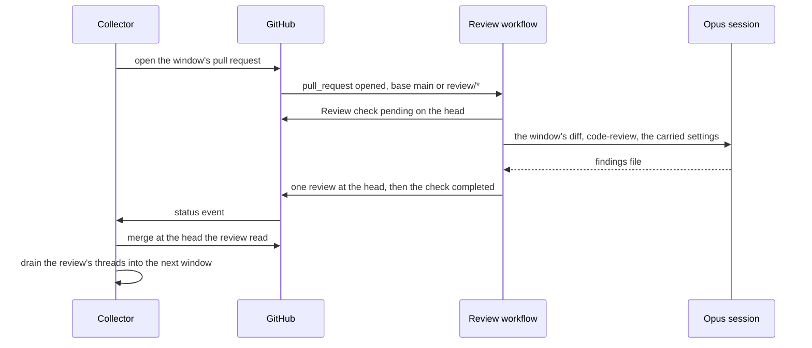

# Review Session

The [review collector](/docs/infra/review-collector) gates every window on CodeRabbit's review, and most of what the collector has grown beyond cutting, merging and draining windows exists to cope with the bot rather than to review code: a rolling hourly allowance that rate-limits the window next to merge, skips for the plan's file limit or its usage credits, check-status sentences the gate has to recognise by elimination, marked asks with their own cap and wait, and re-cuts of a window the bot never read. This proposal puts our own reviewer exactly where the bot sits — a GitHub Actions workflow that fires when a window's pull request opens, runs one headless Claude Code session over the window's diff, posts the findings as a pull request review and reports a check on the head. The collector keeps reading a check and draining review threads; only what the check can say gets smaller.

## Scope

**Today:** a window's pull request opening is CodeRabbit's cue. The gate (`getGateDecision.ts`) reads the bot's check on the window's head as running, complete, rate limited, skipped or missing; a rate limit sleeps out the deadline the bot stated and then asks again (`settleRateLimit.ts`, `settleReviewAsk.ts`); a window still unreviewed past its asks is re-cut (`recutWindowStack.ts`). Window size is bounded by the plan's file cap (`REVIEW_FILE_CAP`), so an oversized commit is held or reshaped. Once the check completes, the window merges and its findings — review threads the bot authored, read by `getOpenFindings.ts` — are drained into the next window by a haiku session.

**This adds:**

1. **A `Review` workflow on the bot's trigger.** It runs on `pull_request` `opened` and `reopened` against `main` and `review/**` — the bases `.coderabbit.yaml` reviews today — and skips renovate's pull requests, as the bot's `ignore_usernames` does. It has no `synchronize` trigger, which is what `auto_incremental_review: false` asks of the bot: a window's branch is never pushed to, so the head its one review reads stays fixed. A concurrency group per pull request keeps a reopen from running two reviews of one head.
2. **The settings carried over as they are.** The repository's half of CodeRabbit's configuration moves without rewording: each `path_instructions` entry becomes an instruction the session applies to the files its glob matches, and `path_filters` become the files the review skips. What the bot does on top — its own prompts, context building, bundled linters and models — is not published, so nothing claims to copy it; the review itself is the repository's `code-review` skill, its two lanes and its trigger rule, which is the written standard every review in the repo already follows.
3. **The session runs on opus, in the job.** The workflow checks out the window's head and launches Claude Code headless through the same launcher the collector's roles use (`runSession`), with the prompt naming the window's base and head. The session writes its findings to a typed file (path, line, body, an optional suggestion block) and never touches GitHub: the job posts them as one review under its own token, so the untrusted-input rule `runSession` applies holds, and an empty review is posted when nothing was found.
4. **A check the gate already knows how to read.** The job reports a `Review` check on the head — pending while the session runs, completed once the review is posted, failed when the session could not finish. The gate reads it in place of the bot's: complete merges, pending waits, and missing or failed past its wait re-runs the workflow by dispatch. There is no allowance, no stated deadline and no skip, so the rate-limit branch, the marked asks, their cap and the re-cut on a skip are deleted. A session the account's limit refuses fails the check with the instant the limit lifts in its description, and the gate wakes then, the window staying open.
5. **The drain reads the new reviewer.** `getOpenFindings` keys on the workflow's login and the suggestion format the session writes; everything after it — `Answers` trailers, deferral, the reply on each finding — is unchanged.
6. **The file cap becomes ours.** With no plan behind it, `REVIEW_FILE_CAP` is the window size one review session reads inside a short context, chosen once from the shadow run below and owned by the constant rather than a plan map.
7. **A shadow run before the switch.** For a stretch of windows the workflow runs beside the bot on the same heads, posting its findings as a comment that reaches no drain, while the gate still reads CodeRabbit. The cut-over — the gate reading the `Review` check, `.coderabbit.yaml` deleted, the bot uninstalled — is one change, made once the session's findings hold up against the bot's on those windows.



### What it deletes

The bot's vocabulary leaves the collector: the rate-limited, skipped, incremental-declined branches of the gate; `settleRateLimit.ts`, `settleReviewAsk.ts` and the re-cut a skip triggers (the re-cut a fold conflict triggers stays); the plan maps behind `REVIEW_FILE_CAP` and `REVIEWS_PER_HOUR`; the deadline sleep in the [retrigger](/docs/infra/review-collector/runner/retrigger); and the `coderabbit` skill, whose conventions for answering findings move to the drain's prompt. The [branch namespaces](/docs/infra/branch-namespaces) page loses its reason for keeping pull requests off `main`, which was the bot's hourly slot.

### The model

The review session runs on **opus**, the one headless role that does. Every collector role runs on `haiku` because its judgement is settled before it starts — a conflict to resolve, a finding to answer, CI's own verdict to fix. A review's verdict is the judgement itself, and the `llm-delegation` skill's split already places a review's verdict with opus. A weaker reviewer costs twice: the bugs it misses reach `main`, and every nitpick it raises spends a haiku drain answering it. So `SessionModel` gains the `opus` alias and the `llm-delegation` skill's table names the review session as the one headless opus role.

## Key files

| File                                                                              | Role after the change                                                                |
| :-------------------------------------------------------------------------------- | :----------------------------------------------------------------------------------- |
| `.coderabbit.yaml`                                                                | deleted at the cut-over; its instructions and filters carried into the review prompt |
| `scripts/src/models/coderabbit/collect/SessionModel.ts`                           | gains the `opus` alias                                                               |
| `scripts/src/services/coderabbit/collect/runSession.ts`                           | the launcher the workflow's session goes through                                     |
| `scripts/src/services/coderabbit/collect/getGateDecision.ts`                      | reads the `Review` check: complete, pending, or missing or failed                    |
| `scripts/src/services/coderabbit/collect/walkWindowStack.ts`                      | dispatches the workflow where it asked the bot                                       |
| `scripts/src/services/coderabbit/collect/settleRateLimit.ts`                      | deleted                                                                              |
| `scripts/src/services/coderabbit/collect/settleReviewAsk.ts`                      | deleted                                                                              |
| `scripts/src/services/coderabbit/collect/recutWindowStack.ts`                     | keeps only the re-cut a fold conflict needs                                          |
| `scripts/src/services/coderabbit/collect/getOpenFindings.ts`                      | keys on the workflow's login and the session's suggestion format                     |
| `scripts/src/services/coderabbit/collect/portWindow.ts`                           | sizes windows by our own cap                                                         |
| `scripts/src/services/coderabbit/shared/constants.ts`                             | `REVIEW_FILE_CAP` as our chosen size; the plan constants removed                     |
| `.agents/skills/code-review/SKILL.md`                                             | the review the session runs, unchanged in its lanes                                  |
| `.agents/skills/coderabbit/SKILL.md`                                              | deleted; answering findings moves to the drain's prompt                              |
| `apps/web/content/docs/infra/review-collector/collection-cycle/gate-and-merge.md` | the gate rewritten around the `Review` check                                         |
| `apps/web/content/docs/infra/review-collector/runner/retrigger.md`                | loses the deadline sleep                                                             |
| `apps/web/content/docs/infra/branch-namespaces.md`                                | loses the hourly-slot reason                                                         |

New files:

```text
.github/workflows/Review.yaml          pull_request opened/reopened on main and review/**, renovate skipped, one run per pull request
scripts/src/review/index.ts            pnpm ai:review — check pending, session launched, review posted, check completed
scripts/src/services/review/
  getReviewPrompt.ts                   the window's base and head, the code-review skill, the carried settings
  postReview.ts                        the findings file posted as one pull request review at the head
scripts/src/models/review/
  ReviewFinding.ts                     path, line, body and suggestion, with its schema
```

## Notes

- **It spends the account's own limit.** The workflow authenticates with the same Claude account as every working session (`CLAUDE_CODE_OAUTH_TOKEN`), so each window's review is opus usage drawn from the window the user works in, where CodeRabbit's was free of it. The trade is one review per window against the bot's slots and the stalls they caused; a review the limit refuses waits for the reset like any session.
- **A workflow, not a collector step.** Run inside the collector, an opus review would hold the collector's job for its whole length and spend its cycle budget; as its own workflow it sits where the bot sits, the gate stays a check reader, and the shadow run needs no collector change at all.
- **The collector's folders keep their names.** `scripts/src/services/coderabbit` names the subsystem's history, not its reviewer; renaming the tree is a sweep of its own, out of this proposal's scope.
