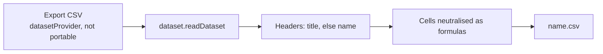

# Dataset CSV Export

A survey owner who wants a file of the answers to open in a spreadsheet or send on finds it in the resource's overflow menu as **Export CSV**. The file is one more reader of the same dataset a Dashboard binding reads ([datasets](/docs/architecture/dataset)), so it is built once for every dataset provider rather than once per type.

## Two exports, two capabilities

A resource has two kinds of thing to take out, and each has its own seam:

| What leaves         | Capability          | The command                                    | Who has it                            |
| :------------------ | :------------------ | :--------------------------------------------- | :------------------------------------ |
| The resource itself | **Portable**        | Import and Export, one entry per format        | Sheet, Email and the TodoList's print |
| The data it serves  | **DatasetProvider** | **Export CSV**, one command for every provider | Survey and Program                    |

Portable moves a resource's _content_, a survey's model rather than its answers, so responses are never a Portable format. A Sheet is both, and its Portable CSV export already writes its rows with the column choice and filters the export dialog offers, so a dataset provider that is also Portable keeps its own export and gets no second command.

## What it does

- **One command.** The resource page's overflow menu shows **Export CSV** for every type that declares `datasetProvider` and not `portable`, read off `ResourceDefinitionMap` by `checkHasCapability`. Nothing is added per type.
- **One read.** The command runs `dataset.readDataset` for the open resource and writes its columns and rows. A dataset over the row cap exports what was read and says so in an alert, rather than implying the file is complete ([dataset row-cap warning](/docs/resource/dataset-row-cap-warning)). The file is named after the resource.
- **Columns read the way a person reads them.** `DatasetColumn` carries an optional `title`, the header a file prints in place of the column's `name`. The survey dataset sets it to each question's title, so the file reads "How did you hear about us?" rather than `question3`.
- **Survey columns lead with context.** A survey dataset's first column is its submission time, and in an Identified survey the respondent follows it. A checkbox question's answers join into one cell separated by `; `. These columns are available to a Dashboard binding as well.
- **Every cell is neutralised as a formula.** A dataset may hold text typed by anonymous respondents on a public page, opened by the owner in a spreadsheet, so the command treats all of it as untrusted. A cell starting with `=`, `+`, `-`, `@`, a tab or a line break is quoted with a tab placed before that first character, the one mitigation OWASP reports surviving an Excel save and reopen. `escapeUntrustedCsvCell` is a sibling of `escapeCsvCell` rather than a change to it, since the Sheet's own export must round-trip the owner's formulas-as-text unchanged.

## Survey response columns

- **Submitted**: the response's last save. A response is saved as it is submitted, so this is its submission time unless the respondent edits it afterwards.
- **Respondent**: present only when the survey is Identified ([survey response modes](/docs/resource/survey-response-modes)). It is the participant's `publicId`, the same non-secret identifier the Program's status dataset publishes, never the recipient's key value and never the token. A response with no participant, such as an anonymous-era row, reads as empty. A program whose participant read reached the row cap may have left a respondent out, and the column is then flagged as possibly under-reporting.

The two reserved names, `submittedAt` and `respondent`, are not reserved in the survey model, since a question may be named either. A question that takes one keeps its own column, and the reserved column takes a trailing `_` (`submittedAt_`, `respondent_`) that no question has, so the question's column name and its answers are never changed.

## What is deliberately not in it

- **No live-synced spreadsheet** (Google Forms' linked Sheet). A Sheet can import the dataset today; a live link is [realtime dataset refresh](/docs/resource/deferred/realtime-dataset-refresh).
- **No other file formats.** A dataset is rows and columns, and CSV opens everywhere.

## Key files

| File                                                                             | Role                                                                    |
| -------------------------------------------------------------------------------- | ----------------------------------------------------------------------- |
| `apps/web/app/components/Resource/Blade/Header.vue`                              | the Export CSV command for a dataset provider with no Portable export   |
| `apps/web/app/services/dataset/exportDatasetCsv.ts`                              | reads the dataset, warns on a capped read, downloads the file           |
| `apps/web/app/services/dataset/createDatasetCsv.ts`                              | the header and cell rows, through `escapeUntrustedCsvCell`              |
| `apps/web/shared/models/dataset/DatasetColumn.ts`                                | the optional `title` a file prints as its header                        |
| `apps/web/server/services/dataset/surveyResponses/readSurveyResponsesDataset.ts` | adds the submission time and, when Identified, the respondent           |
| `apps/web/server/services/dataset/surveyResponses/readSurveyRespondents.ts`      | the token to `publicId` map for an Identified survey                    |
| `apps/web/server/services/survey/readBoundProgramIds.ts`                         | the programs that issue a survey's tokens, shared with token resolution |
